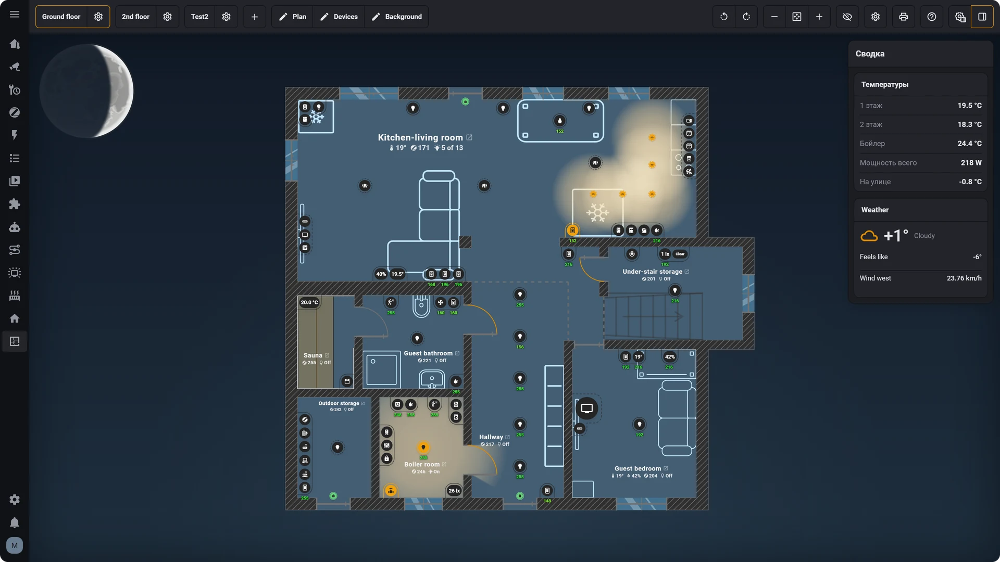
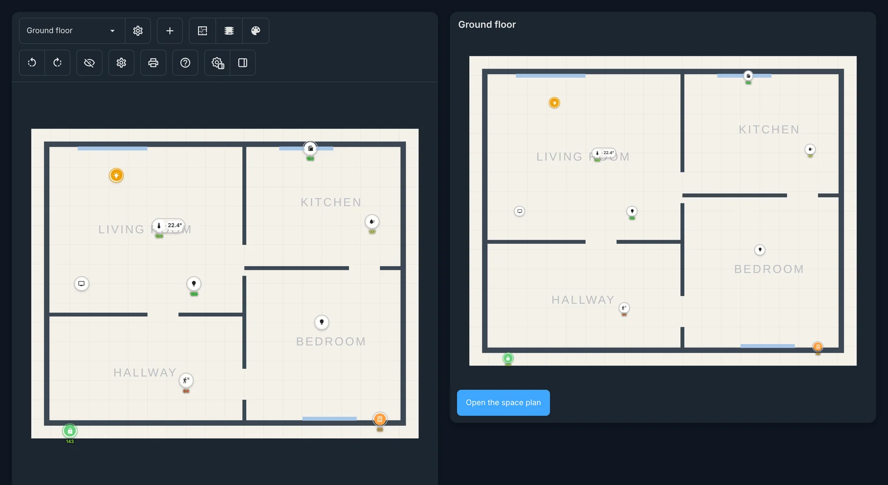
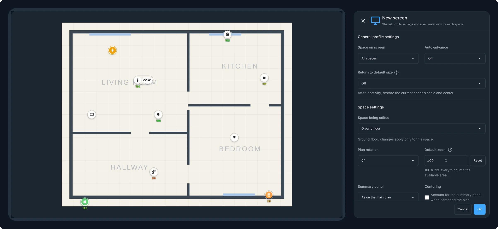
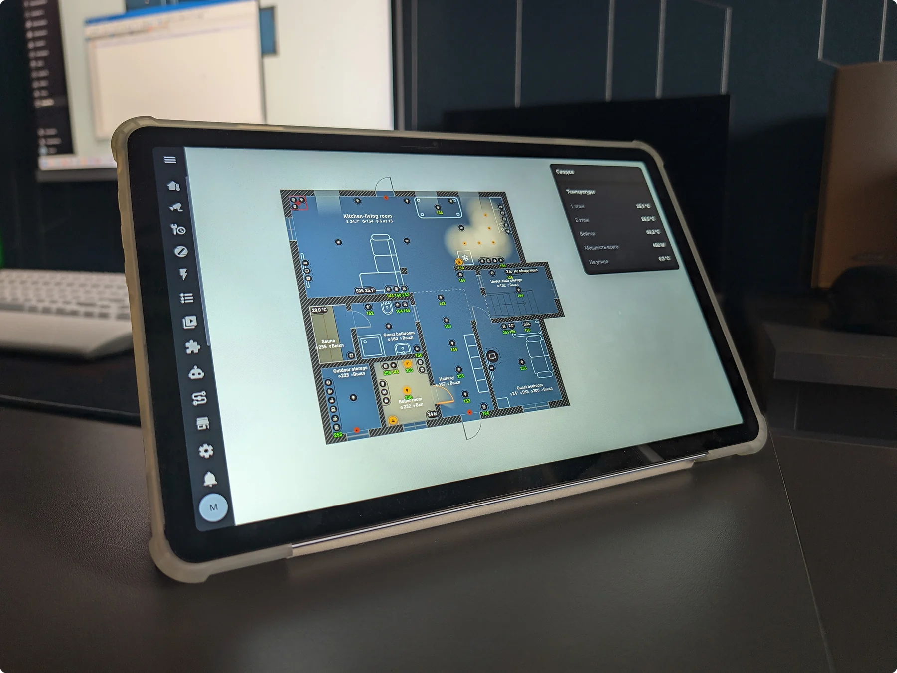
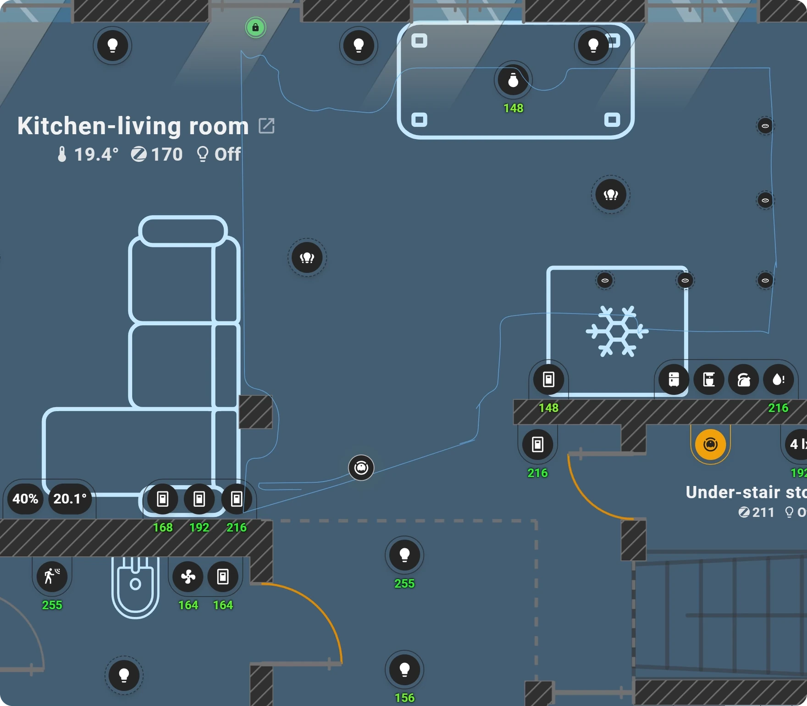
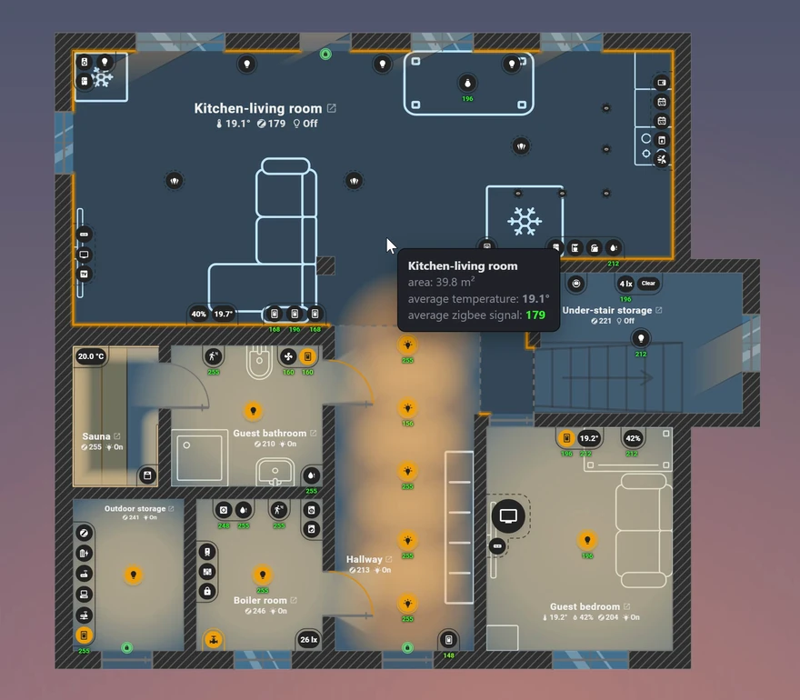
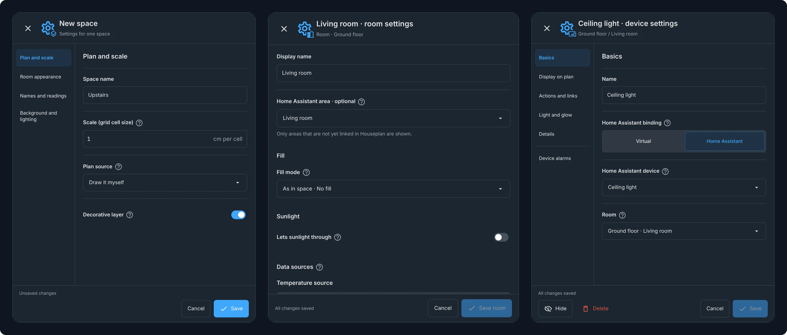

# 🏠 House Plan — a live home map for Home Assistant

  
  
  

<!-- docs-section: overview -->

## Your whole home at a glance

House Plan shows your home on a floor plan, exactly as it is right now. Which
lights are on, which door is open, which room is getting chilly, where the robot
vacuum has wandered off to and which sensor has gone quiet — you see it all at
once, without lists or tabs.

Getting started is simple: upload a picture of your plan or draw the rooms right
in the browser, link them to Home Assistant areas, and the devices take their
places in the right rooms on their own. All that is left is to nudge the icons
to where things really are.

[▶ Watch the video on YouTube](https://www.youtube.com/watch?v=DAG92u8xZKY)

Everything is set up with the mouse — no YAML, no Inkscape, no external editors.
The plan lives on your Home Assistant server, so it is the same on your
computer, tablet and phone.

<!-- docs-section: usage -->

## Three ways to use the plan

House Plan is not a single card but a whole app inside Home Assistant. You can
use it in several ways: pick whichever suits you, or combine them.

### A page of its own

After installation, a **House Plan** item appears in the Home Assistant sidebar.
This is the main screen: the plan fills the page, floors and editors sit along
the top, and a summary of the home is at the side — temperatures, weather and
any other readings you choose. You don't need to build a dashboard for it.

### Dashboard cards

If you want the plan inside your own dashboard, next to charts and buttons, add
a card. There are two:

- **the full card** — the same live plan with everything it can do: tap
  devices, switch floors and open the editors;
- **the static card** — a compact picture of one floor. It shows states,
  temperatures and alerts, but the only thing you can press is the button that
  opens the full plan. Handy as a thumbnail on an overview dashboard.

### Kiosk: a wall tablet, a phone, a TV

For screens that simply hang there and show the home, there is kiosk mode:
nothing but the plan, full screen, with no menus or editors. Swipe between
floors or let them change on a timer; tapping devices works as usual.

Each screen can be tuned separately: rotate the plan, set the zoom, enlarge
icons and labels for a TV, show or hide the summary, pick one floor or all of
them. The settings are saved as a screen profile — all that is left is to open
its link on the device.

> Drawing and setting up the plan is easier on a computer: the editors are built
> for a mouse and keyboard. You can view the plan and control devices on a
> touchscreen. For 3D view, the browser on your tablet, phone or other screen
> must support **WebGL 2**. If WebGL 2 is unavailable, House Plan shows the 2D
> plan. More in [touch support](docs/TOUCH-SUPPORT.md).

<!-- docs-section: features -->

## What House Plan can do

- **Shows your home live.** Lights, plugs, climate, appliances, sensors — the
  state of every device is right there on the plan, with the numbers that
  matter, such as temperature, humidity or battery level, next to the icon.
  Lights and other simple devices switch with a single tap.
- **Doors, windows, gates, blinds and locks.** They are drawn into the walls and
  mirror what is really happening: open, closed, locked.
- **You see straight away where something is wrong.** A leak, smoke, an open
  window, a device that has dropped offline, a weak Zigbee signal, a flat
  battery. You can set your own thresholds for any device — for example, a
  warning when the boiler room gets too hot.
- **Rooms with climate.** Each room shows its temperature, humidity and lights.
  A room can be tinted by temperature, light or signal quality, so you can tell
  at a glance where it is cold.
- **Light that behaves like light.** Lamps that are on light up the room, light
  passes through doorways and stops at walls, and LED strips are drawn as
  strips. The plan brightens during the day, sunbeams fall through the windows,
  and the moon comes out at night.
- **Flat or with depth.** One switch gives the plan volume: walls, doors and
  windows rise up, and device icons lift off the floor.
- **Robot vacuums.** See where the robot is now, where its dock is and the path
  it has already covered. Past cleaning runs can be viewed too.
- **Several floors and the yard.** Each floor has its own tab, and you can move
  from floor to floor right from the stairs on the plan. The yard, a garage or
  a sauna are plans of their own, just the same.
- **Everything is drawn and set up in the browser.** One editor is for walls,
  rooms, doors and windows; another for devices and how they look; a third for
  furniture, labels and lines. A plan you already have in Sweet Home 3D, Easy
  Floorplan or a picture-elements card can be brought over, and your own can be
  saved as PDF or SVG.

The plan is shared by the whole household: changes show up on every screen
straight away, and by default only administrators can edit it. The interface is
available in English, Russian, German and French.

  
  

<!-- docs-section: installation -->

## Installation

House Plan is a Home Assistant integration, not just a card. So there are three
steps, and the last one matters most.

1. **Install.** Open **Settings → Marketplace**, find **House Plan** and select
   **Install**. On Home Assistant 2026.10 and older, do the same in HACS.
2. **Restart Home Assistant** if it asks you to.
3. **Add the integration.** Open **Settings → Devices & services → Add
   integration** and choose **House Plan**.

  

> [!IMPORTANT]
> Don't skip step three. Until the integration is added, Home Assistant has
> neither the House Plan page nor the cards — there is no point looking for them
> in the dashboard card picker.

After that, a **House Plan** item appears in the sidebar — open it and create
your first plan. If it is not there, hard-refresh the page: `Ctrl+F5`, or
`Cmd+Shift+R` on a Mac.

The rest is optional:

- **A dashboard card.** In the dashboard editor, add the
  `custom:houseplan-card` card (full) or `custom:houseplan-space-card`
  (static).
- **Kiosk.** Open `/houseplan/kiosk` on the screen you want. Each device can
  have its own address with parameters: choose a floor, rotate the plan,
  enlarge the icons, turn on automatic floor switching. For example,
  `/houseplan/kiosk/2?hprotate=90&hpicons=150` shows the second floor rotated
  by 90° with icons one and a half times larger.

Home Assistant 2024.6 or newer is required. Manual installation, card options
and what to do if the card does not show up are covered in the guide, section
[Installation and access](docs/USER-GUIDE.md#installation-and-access).

<!-- docs-section: first-run -->

## Your first working room

1. Open **House Plan** in the sidebar and create your first space — a floor, an
   apartment or the yard. You can upload a picture of the plan or start from a
   blank sheet.
2. In the plan editor, outline a room with walls. As soon as the outline closes,
   House Plan asks you to name the room.
3. Name the room and choose its Home Assistant area — the devices from that
   area appear on the plan straight away.
4. In the device editor, move the icons to where they belong.
5. Go back to the view. The plan is already live: tap a lamp and the light
   comes on.

Furniture, labels and decoration can wait until you feel like it.

Every tool and special case is described in the
[full user guide](docs/USER-GUIDE.md).

## Detailed documentation

- [Full user guide](docs/USER-GUIDE.md)
- [Navigation, zoom and input](docs/USER-GUIDE.md#navigation-zoom-and-input)
- [Plan editor tools](docs/USER-GUIDE.md#plan-tools-at-a-glance)
- [Stairs and floor links](docs/USER-GUIDE.md#stairs)
- [Furniture, labels and decoration](docs/USER-GUIDE.md#background-editor)
- [Robot vacuums](docs/USER-GUIDE.md#robot-vacuums)
- [Presence radars](docs/USER-GUIDE.md#presence-radars)
- [PDF and SVG export](docs/USER-GUIDE.md#download-a-file-for-printing-pdf-or-svg)
- [Touch support](docs/TOUCH-SUPPORT.md)
- [Contributing and development](CONTRIBUTING.md) · [Development process](PROCESS.md)

<!-- docs-section: support -->

## Support and feedback

- Questions, ideas and plan examples: [Telegram @ha_houseplan](https://t.me/ha_houseplan).
- Bugs and proposals: [GitHub Issues](https://github.com/Matysh/houseplan-card/issues).
- Before reporting a bug, update House Plan, restart Home Assistant and
  hard-refresh the page (`Ctrl+F5`). If something is wrong with the plan itself,
  also try the **Optimize plans** button in General settings.
- The easiest way to report a bug is from House Plan itself: the **Help &
  feedback** button in the header. If the problem is in the plan, turn on
  **Attach extended diagnostics** there. Names and Home Assistant IDs are
  excluded, but exact room geometry and home dimensions remain. Inspect the
  preview before sending; see [diagnostic contents](docs/USER-GUIDE.md#help--feedback).

License: [MIT](LICENSE).
