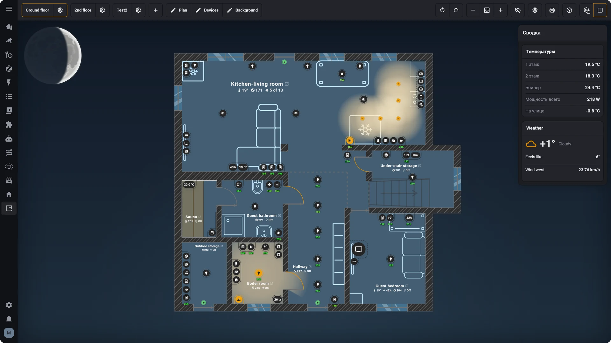
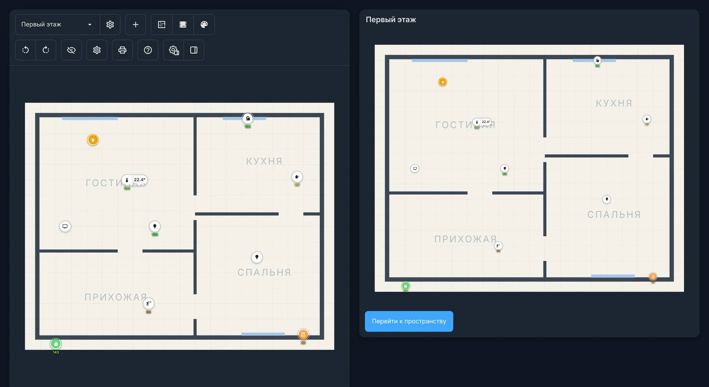
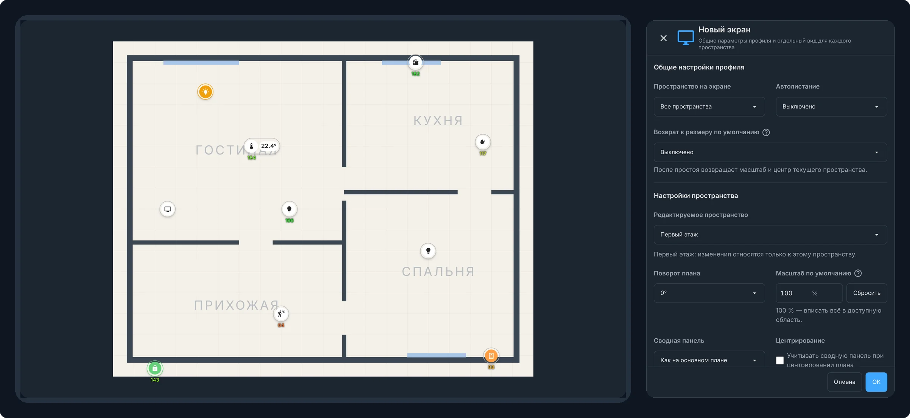
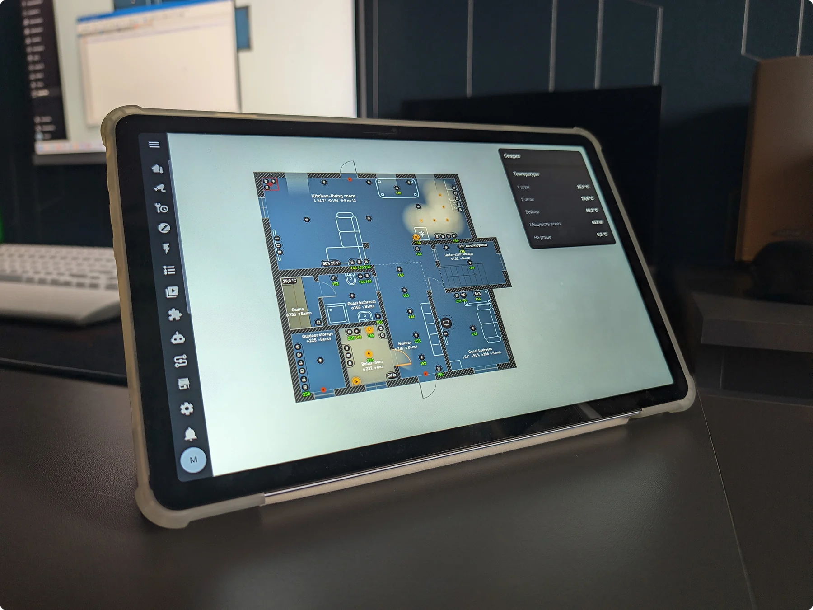
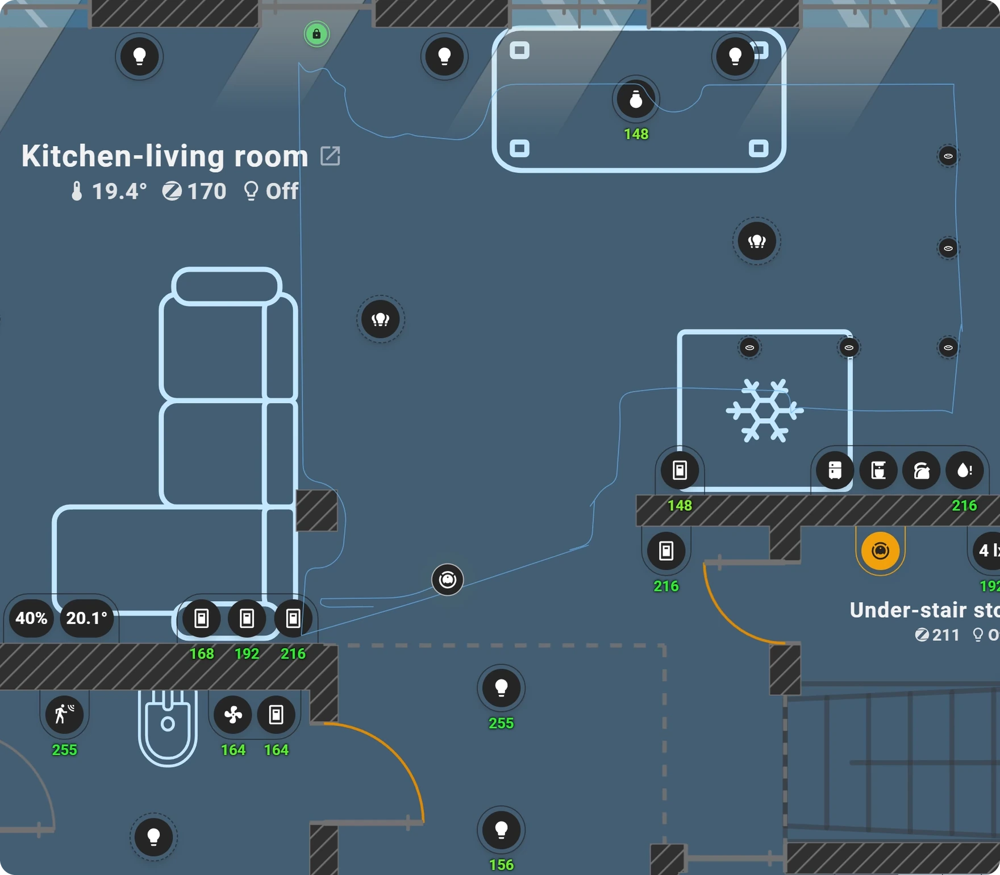
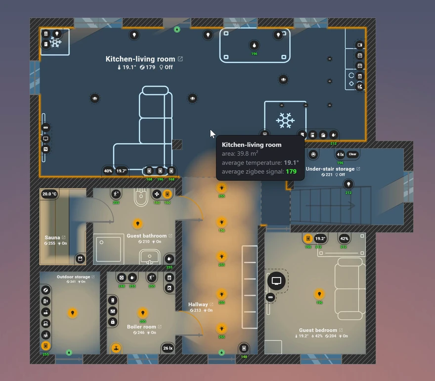
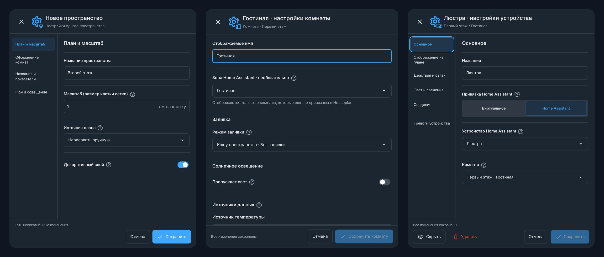

# 🏠 House Plan — живой план дома для Home Assistant

  
  
  

<!-- docs-section: overview -->

## Дом целиком — одним взглядом

House Plan показывает ваш дом на плане — таким, какой он прямо сейчас. Где горит
свет, какая дверь открыта, в какой комнате прохладно, куда уехал робот-пылесос и
какой датчик давно не выходил на связь — всё видно сразу, без списков и вкладок.

Начать просто: загрузите картинку с планом или нарисуйте комнаты прямо в
браузере, свяжите их с зонами Home Assistant — и устройства сами встанут по
своим комнатам. Останется подвинуть значки туда, где они висят на самом деле.

[▶ Смотреть видео на YouTube](https://www.youtube.com/watch?v=DAG92u8xZKY)

Всё настраивается мышкой — без YAML, Inkscape и сторонних редакторов. План
хранится на сервере Home Assistant, поэтому на компьютере, планшете и телефоне
он один и тот же.

<!-- docs-section: usage -->

## Три способа пользоваться планом

House Plan — не одна карточка, а целое приложение внутри Home Assistant.
Пользоваться им можно по-разному: выберите, что удобнее, или совмещайте.

### Отдельная страница

После установки в боковом меню Home Assistant появляется пункт **House Plan**.
Это основной экран: план занимает всю страницу, сверху — этажи и редакторы,
сбоку — сводка по дому: температуры, погода и другие показатели, которые вы
выберете. Никаких дашбордов для этого создавать не нужно.

### Карточки для дашбордов

Если план нужен внутри вашего дашборда, рядом с графиками и кнопками, добавьте
карточку. Их две:

- **полная** — тот же живой план со всеми возможностями: можно нажимать на
  устройства, переключать этажи и открывать редакторы;
- **статичная** — компактная схема одного этажа. Она показывает состояния,
  температуру и тревоги, но нажимается в ней только кнопка перехода к полному
  плану. Удобна как миниатюра на общем дашборде.

### Киоск: планшет на стене, телефон, телевизор

Для экранов, которые просто висят и показывают дом, есть режим киоска: только
план во весь экран, без меню и редакторов. Этажи листаются свайпом или сами по
таймеру, а нажатия на устройства работают как обычно.

Каждый экран настраивается под себя: можно повернуть план, задать масштаб,
укрупнить значки и подписи для телевизора, показать или убрать сводку, выбрать
один этаж или все. Настройки сохраняются как профиль экрана — остаётся открыть
на устройстве его ссылку.

> Рисовать и настраивать план удобнее на компьютере: редакторы рассчитаны на
> мышь и клавиатуру. Просматривать план и управлять устройствами можно с
> сенсорного экрана. Для 3D-вида браузер на планшете, телефоне или другом экране
> должен поддерживать **WebGL 2**. Если WebGL 2 недоступен, House Plan показывает
> план в 2D. Подробнее в разделе [поддержки сенсорных экранов](docs/TOUCH-SUPPORT.md).

<!-- docs-section: features -->

## Что умеет House Plan

- **Показывает дом вживую.** Свет, розетки, климат, техника, датчики —
  состояние каждого устройства видно прямо на плане, а нужные цифры вроде
  температуры, влажности или заряда батареи стоят рядом со значком. Свет и
  другие простые устройства включаются одним нажатием.
- **Двери, окна, ворота, шторы и замки.** Они нарисованы в стенах и повторяют
  то, что происходит на самом деле: открыто, закрыто, заперто.
- **Сразу видно, где что-то не так.** Протечка, дым, открытое окно, пропавшее
  со связи устройство, слабый сигнал Zigbee, севшая батарейка. Для любого
  устройства можно задать свои пороги — например, предупредить, если в котельной
  стало слишком жарко.
- **Комнаты с климатом.** У каждой комнаты видны температура, влажность и
  свет. Саму комнату можно подкрасить по температуре, по свету или по качеству
  связи — и сразу понять, где холодно.
- **Свет как в жизни.** Включённые лампы освещают комнату, свет проходит в
  дверные проёмы и не проходит сквозь стены, светодиодные ленты рисуются
  лентами. Днём план светлеет, из окон тянутся солнечные лучи, ночью появляется
  луна.
- **Плоский план или объёмный.** Один переключатель добавляет плану объём:
  стены, двери и окна вырастают вверх, а значки устройств приподнимаются над
  полом.
- **Роботы-пылесосы.** Видно, где робот сейчас, где его база и какой путь он
  уже прошёл. Прошлые уборки тоже можно посмотреть.
- **Несколько этажей и участок.** У каждого этажа своя вкладка, а с этажа на
  этаж можно перейти прямо по лестнице на плане. Участок, гараж или баня —
  такие же отдельные планы.
- **Всё рисуется и настраивается в браузере.** В одном редакторе — стены,
  комнаты, двери и окна; в другом — устройства и то, как они выглядят; в
  третьем — мебель, подписи и линии. Готовый план из Sweet Home 3D, Easy
  Floorplan или карточки picture-elements можно перенести, а свой — сохранить в
  PDF или SVG.

План один на всю семью: изменения сразу видны на всех экранах, а редактировать
его по умолчанию могут только администраторы. Интерфейс переведён на русский,
английский, немецкий и французский.

  
  

<!-- docs-section: installation -->

## Установка

House Plan — это интеграция Home Assistant, а не просто карточка. Поэтому шагов
три, и последний — самый важный.

1. **Установите.** Откройте **Настройки → Marketplace**, найдите **House Plan**
   и нажмите «Установить». На Home Assistant 2026.10 и старше то же самое
   делается в HACS.
2. **Перезапустите Home Assistant**, если он об этом попросит.
3. **Добавьте интеграцию.** Откройте **Настройки → Устройства и службы →
   Добавить интеграцию** и выберите **House Plan**.

  

> [!IMPORTANT]
> Не пропускайте третий шаг. Пока интеграция не добавлена, в Home Assistant нет
> ни страницы House Plan, ни карточек — искать их в списке карточек дашборда
> бесполезно.

После этого в боковом меню появится пункт **House Plan** — открывайте его и
создавайте первый план. Если пункта нет, обновите страницу со сбросом кэша:
`Ctrl+F5`, на Mac — `Cmd+Shift+R`.

Остальное — по желанию:

- **Карточка на дашборд.** В редакторе дашборда добавьте карточку
  `custom:houseplan-card` (полная) или `custom:houseplan-space-card`
  (статичная).
- **Киоск.** Откройте на нужном экране адрес `/houseplan/kiosk`. Для каждого
  устройства можно собрать свой адрес с параметрами: выбрать этаж, повернуть
  план, укрупнить значки, включить автолистание. Например,
  `/houseplan/kiosk/2?hprotate=90&hpicons=150` покажет второй этаж, повёрнутый
  на 90°, со значками в полтора раза крупнее.

Нужен Home Assistant 2024.6 или новее. Ручная установка, настройки карточек и
ответы на «карточка не появилась» — в руководстве, раздел
[«Установка и доступ»](docs/USER-GUIDE.ru.md#установка-и-доступ).

<!-- docs-section: first-run -->

## Первая рабочая комната

1. Откройте **House Plan** в боковом меню и создайте первое пространство —
   этаж, квартиру или участок. Можно загрузить картинку с планом, можно начать
   с чистого листа.
2. В редакторе плана обведите комнату стенами. Как только контур замкнётся,
   House Plan предложит дать комнате имя.
3. Назовите комнату и выберите её зону Home Assistant — устройства этой зоны
   сразу появятся на плане.
4. В редакторе устройств расставьте значки по местам.
5. Вернитесь в просмотр. План уже живой: нажмите на лампу — и свет включится.

Мебель, подписи и оформление можно добавить позже, когда появится настроение.

Все инструменты и особые случаи описаны в
[полном руководстве](docs/USER-GUIDE.ru.md).

## Где искать подробности

- [Полное руководство пользователя](docs/USER-GUIDE.ru.md)
- [Навигация, масштаб и жесты](docs/USER-GUIDE.ru.md#навигация-масштаб-и-жесты)
- [Инструменты редактора плана](docs/USER-GUIDE.ru.md#инструменты-плана-в-короткой-таблице)
- [Лестницы и переходы между этажами](docs/USER-GUIDE.ru.md#stairs)
- [Мебель, подписи и оформление](docs/USER-GUIDE.ru.md#background-editor)
- [Роботы-пылесосы](docs/USER-GUIDE.ru.md#роботы-пылесосы)
- [Радары присутствия](docs/USER-GUIDE.ru.md#радары-присутствия)
- [Экспорт в PDF и SVG](docs/USER-GUIDE.ru.md#скачать-файл-для-печати-pdf-или-svg)
- [Поддержка сенсорных экранов](docs/TOUCH-SUPPORT.md)
- [Участие в разработке](CONTRIBUTING.md) · [Процесс разработки](PROCESS.md)

<!-- docs-section: support -->

## Помощь и обратная связь

- Вопросы, идеи и примеры планов — в [Telegram @ha_houseplan](https://t.me/ha_houseplan).
- Ошибки и предложения — в [GitHub Issues](https://github.com/Matysh/houseplan-card/issues).
- Прежде чем писать об ошибке, обновите House Plan, перезапустите Home
  Assistant и обновите страницу со сбросом кэша (`Ctrl+F5`). Если что-то не так
  с самим планом, попробуйте ещё кнопку **«Оптимизировать планы»** в общих
  настройках.
- Сообщать об ошибке удобнее всего прямо из House Plan: кнопка **«Помощь и
  обратная связь»** в шапке. Если дело в плане, включите там же **«Прикрепить
  расширенную диагностику»**. Имена и ID Home Assistant исключаются, но точная
  геометрия и размеры дома сохраняются. Перед отправкой посмотрите предпросмотр;
  подробнее — [состав диагностики](docs/USER-GUIDE.ru.md#помощь-и-обратная-связь).

Лицензия: [MIT](LICENSE).
