# House Plan — user guide

&emsp;&emsp;With House Plan, your Home Assistant home becomes a shared live map. Draw rooms, place your devices and use the plan from a computer, phone or wall screen. Open **House Plan** in the Home Assistant sidebar, or add an optional dashboard card if that is more convenient: it shows the same data.

&emsp;&emsp;**House Plan 1.85.x development line.** This guide is based on [dev 45faf4e](https://github.com/Matysh/houseplan-card/tree/45faf4e7c16d5feb2e0f30727784d69a52429960). Your installed stable may not contain every described feature yet. This is a source snapshot, not an announcement of a new release. [Русская версия](USER-GUIDE.ru.md).

[Project overview and quick installation](../README.md).

&emsp;&emsp;The screenshots below show this version with a fictional plan. This guide uses the English interface; the [Russian guide](USER-GUIDE.ru.md) uses Russian. Your Home Assistant theme, window width and data may change the layout and appearance. [Capture details](images/guide-2026-11/README.md).

&emsp;&emsp;You can view the plan and control your home from a phone, tablet or touch screen. For drawing and editing, use a computer with a mouse and keyboard: touch editors work where possible, but full support is not guaranteed. Plans stay in HA. Diagnostics are sent through Help only when you choose to send them.

## Contents

1. [Getting started](#start)
2. [Create and organize plans](#create)
3. [Main screen and common editor controls](#main)
4. [General settings](#general)

   - [Sections and scope](#where-each-general-section-applies), [dialogs and unsaved changes](#how-settings-dialogs-work).

5. [Space settings](#space)
6. [Plan editor: rooms and walls](#plan)

   - [Create a room](#create-a-room), [nodes](#moving-wall-nodes), [Merge](#merge), [Split](#split), [Resize](#resize), [dimensions](#dimensions-on-both-sides-of-a-wall), [thickness](#wall-thickness).

7. [Openings: doors, windows and gates](#openings)

   - [Leaves and shades](#independent-leaves-shades-and-sliding-openings-1024), [settings](#opening-settings), [locks](#lock), [light in thick walls](#thick-walls).

8. [Room settings](#room)
9. [Device editor and catalog](#devices)

   - [Catalog and placement](#device-editor), [copy](#copying-in-the-device-editor), [Undo/Redo](#undoing-device-copies-and-deletions).

10. [Device settings, actions and visual states](#device-settings)

    - [Fields](#marker-basics), [actions](#actions), [display modes](#five-display-modes), [battery](#battery-charge), [Zigbee signal](#zigbee-signal-visibility).

11. [Background editor](#background-editor)
12. [Summary panel](#summary)
13. [External screens, profiles and dashboard cards](#screens)

    - [Screen profiles](#screen-profiles), [interactive card](#adding-a-card), [static card](#static-space-card).

14. [Kiosk](#kiosk)
15. [Appearance, room fills, light, Sun and Moon](#appearance)
16. [Special devices and Zigbee diagnostics](#special)
17. [Printing and plan maintenance](#maintenance)
18. [Storage, collaboration, backups and recovery](#backup)
19. [Limitations and troubleshooting](#troubleshooting)
20. [Help and safe operation](#help)

### Find your starting point

- **First plan:** [installation and quick start](#start) → [spaces and import](#create) → [walls and rooms](#plan).
- **An option or an unexpected appearance:** [General](#general), [Space](#space), [Room](#room) or [Device settings](#device-settings). A setting’s scope matters more than the floor currently open.
- **Precise geometry:** [Resize](#resize), [wall dimensions](#dimensions-on-both-sides-of-a-wall), [nodes](#moving-wall-nodes) and [openings](#openings).
- **A wall tablet/TV:** [screen profiles](#screens) and [kiosk](#kiosk).
- **Something went wrong:** [diagnostics](#troubleshooting), [backup/recovery](#backup) and [Help](#help).

<a id="start"></a>

## 1. Getting started

&emsp;&emsp;Start with one room: install House Plan, get to know the main terms and check your editing permissions. Once that room works, you can refine the details.

<a id="1-data-model-and-terms"></a>

<a id="2-installation-and-access"></a>

<a id="4-quick-start"></a>

<!-- docs-section: model -->

<!-- docs-section: installation -->

<!-- docs-section: first-run -->

### The everyday workflow

&emsp;&emsp;Draw architecture in **Plan**, arrange live markers in **Devices**, add furniture and annotations in **Background**, then return to **View**. These are three editors of one plan, not separate files. Leaving an editor is not a substitute for saving an open settings dialog; accepted canvas operations normally save as you finish them.

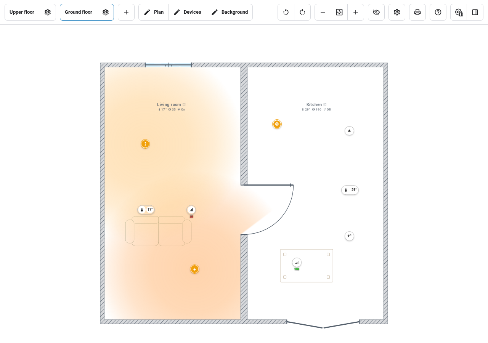

*Main screen: spaces, editors and live devices.*

&emsp;&emsp;There is no universal “global → space → room → device” override chain. A room fill inherits its space, a device Glow radius can inherit General, and a screen profile controls only its display. Each corresponding section below explains its own precedence. A background, backdrop image and room fill are different things.

### Data model and terms

&emsp;&emsp;These are scopes of data, not one universal override hierarchy. Follow the specific field’s inheritance rule in General, Space, Room or Device settings.

| Level | Meaning | Stored data |
|---|---|---|
| Panel/card | Primary sidebar page or one optional dashboard instance | Last/initial space; dashboard cards may additionally set language, icon size, value/LQI display, kiosk and cycle |
| Global settings | Defaults for all spaces | Fill palette, background, Glow radius, north, sun, room-hover information, 2.5D view and icon rules |
| Space | Floor, yard, garage or building | Plan image, scale, rooms, walls, openings, decor and display settings |
| Room | A closed outline | Name, optional HA area, temperature/humidity source and local fill |
| Wall | A room-contour or independent segment | Stable identity and thickness from 0 to 100 cm; zero-thickness appearance is selected per space |
| Opening | Door, window, open passage or gate on a room wall or completed independent wall | Size, orientation where applicable, contact and optional lock |
| Marker | A device shown on the plan | HA binding, room, action, presentation, light role and attachments |
| Decor | Background-layer item | Line, shape, text, furniture or plan-image transform |

&emsp;&emsp;Current architecture uses a shared wall graph; room contours refer to its boundaries. Independent walls can remain outside a room. A wall chain creates no floor until a bounded face is accepted as a room.

### Installation and access

#### Requirements

| Component | Requirement |
|---|---|
| Home Assistant | 2024.6.0 or newer |
| Installation | Any installation that supports custom integrations |
| Browser | Web Components, SVG and Pointer Events |
| Editing permission | Administrators by default |

<a id="hacs"></a>

#### Marketplace / HACS

1. On Home Assistant 2026.11 or newer, open **Settings → Marketplace**, find
   **House Plan** and install it. On 2026.10 and older, use HACS. House Plan is
   in the default catalog; no custom repository is needed. See
   [Home Assistant's Marketplace documentation](https://www.home-assistant.io/integrations/marketplace/).
2. Restart Home Assistant if requested.
3. Open **Settings → Devices & services → Add integration → House Plan**.
4. Keep “administrators only” enabled unless other users must edit the plan.

&emsp;&emsp;Do not skip adding the integration: installing its files alone does not register the House Plan sidebar page or cards.

&emsp;&emsp;The integration registers both the sidebar panel and its Lovelace resource automatically. After installation or an update, complete any requested Home Assistant restart, then fully reload the page: `Ctrl+F5` on Windows/Linux or `Cmd+Shift+R` on macOS.

##### Storage mode (Home Assistant default)

&emsp;&emsp;No YAML is normally needed. If automatic registration did not make the card available, open **Settings → Dashboards → menu ⋮ → Resources → Add resource**, enter `/houseplan_files/houseplan-card.js`, and select **JavaScript module**.

##### YAML resources mode (Home Assistant 2026.2+)

&emsp;&emsp;To manage resources in `configuration.yaml` independently of the dashboard mode, use:

```yaml
lovelace:
  resource_mode: yaml
  resources:
    - url: /houseplan_files/houseplan-card.js
      type: module
```

##### Legacy Home Assistant 2024.6–2026.1

&emsp;&emsp;Only for a full-YAML dashboard that is already managed in YAML, use:

```yaml
lovelace:
  mode: yaml
  resources:
    - url: /houseplan_files/houseplan-card.js
      type: module
```

&emsp;&emsp;`mode: yaml` changes the dashboard itself to YAML mode. Do not switch a storage dashboard to legacy YAML just for House Plan; use the Storage mode instructions above instead. Do not use `/custom_components/houseplan/frontend/houseplan-card.js`; it is an on-disk path, not the JavaScript URL served by Home Assistant.

#### Manual installation

&emsp;&emsp;Copy the release folder to `config/custom_components/houseplan`, restart Home Assistant, and add the integration. If the card is still unavailable, follow the Storage or YAML resource instructions above for your Home Assistant version and resource mode. Always copy the complete integration folder: the stable resource URL remains one file, but that entry loads internal content-hashed modules.

&emsp;&emsp;A lone `houseplan-card.js` is not a supported install.

&emsp;&emsp;The ordinary View does not download editor code. The first opening of Plan, Device or Background may therefore take a brief moment. If that internal module cannot be loaded after one retry, the plan stays in View; no half-open editor is kept. After a network failure the card invites you to check the connection and press again — the next press starts a fresh download.

&emsp;&emsp;Only when the tab holds code from another build does the advice ask for a page refresh instead. A fully stale proxy-cached `houseplan-card.js` no longer leaves an empty card after an update: it shows a panel asking to reload the page.

&emsp;&emsp;If tips/live updates, the summary panel or Zigbee links cannot load, a persistent notice names the unavailable feature while the base plan and safe actions remain usable. **Try again** makes one same-build attempt. The notice disappears on success; otherwise only **Reload page** remains. A summary you hid is not reported as broken and its saved preference is retained.

&emsp;&emsp;Ordinary cards never reload automatically. A terminal kiosk failure may use the existing one-per-build/session safe reload, never during dialogs, gestures or pending writes. Manual recovery keeps the editor's normal discard-draft decision.

#### Removal and reinstallation

&emsp;&emsp;Removing the House Plan entry in **Settings → Devices & services** and then the HACS package does not erase plans. Data remains in the HA config directory: `.storage/houseplan.config`, `.storage/houseplan.layout`, `.storage/houseplan.virtual_lights`, `.storage/houseplan.trails` and `houseplan/plans/`, `houseplan/files/`, `houseplan/assets/`.

&emsp;&emsp;When adding the integration again, the wizard shows the space count, file count and last-modified date, then offers:

1. **Restore previous plans** — reuse existing data with normal migrations.
   This is the first option. An unreadable or newer configuration gets a warning;
   restoration does not repair it.
2. **Start fresh** — move the complete old set to
   `houseplan/archive/<UTC-timestamp>-<unique-id>/` and open an empty plan.

&emsp;&emsp;Both choices lead to the existing administrators-only checkbox. Archival starts only when that final form is confirmed. Closing the wizard before confirmation changes nothing. With no data, or only an archive, there is no extra question. If the previous data has no spaces (devices alone do not count), there is no question either: once the final form is confirmed, the old set is archived as with **Start fresh**.

&emsp;&emsp;The menu appears only when spaces exist, the data cannot be read, or an interrupted plan save is pending. Archives are excluded from file quotas and never cleaned automatically; each fresh start creates a separate archive. Only the administrator can remove it manually.

&emsp;&emsp;For manual recovery, first back up HA and **stop HA**. Preserve the current new set separately, then restore **one selected set**: move `archive/<...>/storage/houseplan.*` to `.storage/` and that archive's `plans/`, `files/`, `assets/` directories to `houseplan/`. Do not mix old and new sets or overwrite the only copy. Start HA; if its integration entry was removed, add it and choose restoration.

&emsp;&emsp;There is no in-app archive recovery button.

&emsp;&emsp;An archival error creates no entry and rolls back completed moves. A power loss or failing media during rollback can leave some files in the archive: preserve both sets and consult the archive path in the HA log for manual recovery. Nothing is automatically deleted.

#### Permissions

&emsp;&emsp;Every signed-in user can view the plan. Home Assistant permissions still govern device service calls. With the default integration option, only administrators can edit configuration or upload files. If that option is disabled, ordinary household users may edit, but members of Home Assistant's `system-read-only` group never become writers.

&emsp;&emsp;Plan optimization and its undo use the same Houseplan write permission, including ordinary writers when admin-only is off. These actions are unavailable in kiosk mode.

&emsp;&emsp;The **House Plan** sidebar item is visible to every signed-in user. A user who cannot edit gets the complete View experience without editor controls. On an empty installation that user sees a read-only explanation, not an Add space button or an automatically opened setup dialog.

&emsp;&emsp;The device information card offers **Edit** only to a plan writer outside kiosk. Without that permission, device state, controls, **Open in HA** (the ordinary entity more-info dialog) and **Close** remain available, and the **New** flag is not acknowledged. The room-name Area link is visible only to HA administrators outside kiosk.

&emsp;&emsp;In Plan its icon remains part of the draggable label for every plan writer, including non-admin writers, and never navigates. In View the Area action is a separate button: Tab selects it and Enter or Space opens the HA area without fitting the room. Device settings opened in View retain an unsaved draft across a short card remount; renderer loading can be closed, and a failed load offers an explicit retry.

&emsp;&emsp;On screens without hover the View Area shortcut is clipped and non-interactive until keyboard focus, preventing its invisible target from covering stairs or blocking pan. Keyboard focus restores the native 44px button; mouse-capable desktop presentation is unchanged (#1128).

### Quick start

&emsp;&emsp;For your first room, work through these steps:

1. Add a space with **+**, or import Home Assistant floors.
2. Upload SVG/PNG/JPG/WebP, reuse an uploaded plan, or choose no image.
3. Set the real size of a grid cell. It controls wall, opening, furniture and
   area measurements.
4. In Plan choose **Walls**, draw the boundary, then click its first point to
   close the first room face.
5. Name the room and bind it to an HA area, or use **No area**.
6. Add wall thickness and openings if needed.
7. In Device, position auto-discovered markers and choose their actions.
8. In Background, align the plan image and add labels, lines or furniture.
9. Return to View and confirm live values and actions.

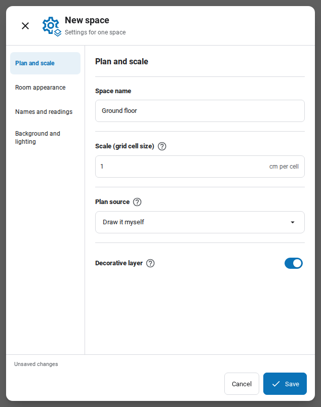

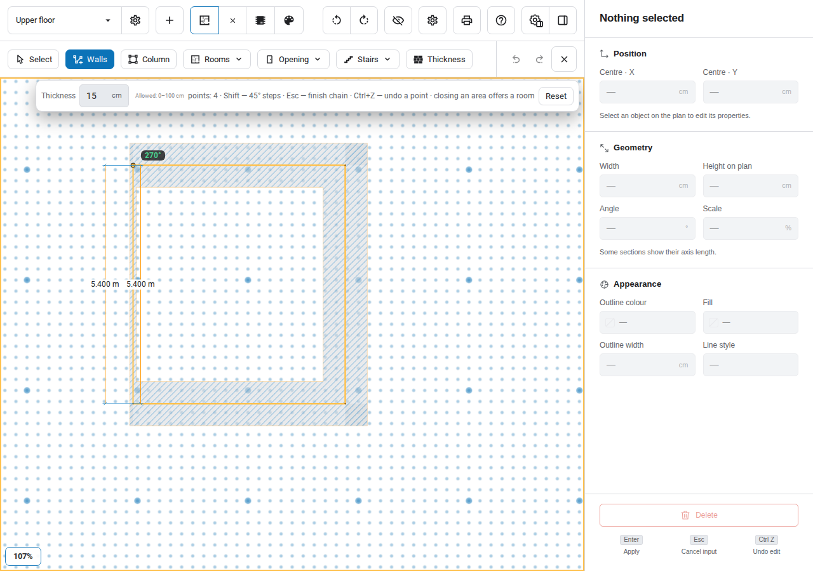

&emsp;&emsp;Create the plan on a computer. Once it is ready, a phone, tablet or wall panel supports everyday viewing and home control.

<a id="create"></a>

## 2. Create and organize plans

&emsp;&emsp;A space can be a floor, a yard or a separate drawing. Here you can choose how to start, arrange the tabs, copy a space or import a template. Restoring the whole installation is a separate operation.

<a id="7-spaces"></a>

<!-- docs-section: spaces -->

### Copy a space without duplicating its devices

&emsp;&emsp;In Space settings choose **Copy**, enter a name and optionally enable **Copy furniture** and **Copy decor**. Both boxes start off each time. Furniture is one option; lines, shapes, text and images are the other. Architecture, columns, openings, scale and display settings are copied; rooms and device placements are not. Room boundaries become independent walls ready for a new room layout.

&emsp;&emsp;The source is unchanged. Copy preserves saved geometry without requiring Optimize or imposing new opening clearances. Cancel creates nothing.

&emsp;&emsp;For an independent floor template from a file, use [space import](#backup). Restoring a full backup instead replaces the installation’s shared plan.

### Start with an existing plan

&emsp;&emsp;The empty screen and the HA floor selection dialog link to the [plan converter](https://houseplan.tech/convert/). It supports Sweet Home 3D (.sh3d) and Easy Floorplan (YAML / JSON). The link opens a new tab and preserves your selected floors. This information is also available without editing rights or the storage integration. It returns when the last space is deleted; creating or restoring a space removes the empty-screen hint.

&emsp;&emsp;A space may represent a floor, garden, garage or separate structure. It stores its image, grid scale, geometry, Background layer and display overrides.

&emsp;&emsp;A new space always opens Plan and scale with Draw it myself selected. In image mode, Already uploaded becomes available when stored images exist. Subsequent choices remain in the open draft.

### Plan source

| Choice | Use it when | Behaviour |
|---|---|---|
| Image | You already have a drawing or photo | SVG, PNG, JPG or WebP; proportions are preserved and Background can move, scale or rotate it later |
| Previously uploaded file | A plan is reused or already stored on the server | Pick it from the server list; a file used by a space cannot be deleted |
| No image | You will draw directly in House Plan | The paper follows room contours; borders and names start enabled |
| Import HA floors | Home Assistant already has a floor registry | A wizard creates spaces in order and lets you skip any floor |

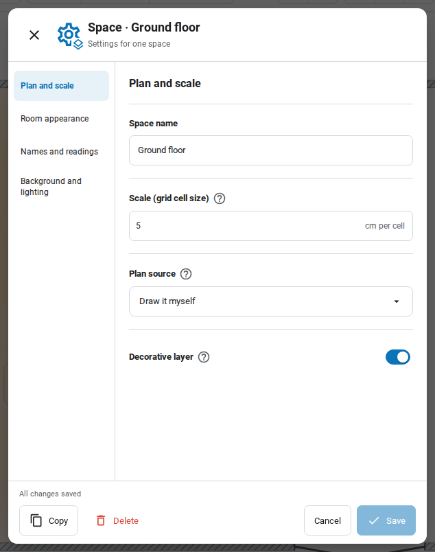

*The plan source and scale belong to the selected space.*

&emsp;&emsp;Very large rasters (roughly 32 megapixels and up) are recognised from the file header before heavy work starts. A dialog shows exact resolution and memory figures and offers a safe reduced copy. The original and the current plan stay untouched in every outcome. Browsers cannot display a side wider than 16384 px; reduce such an image on a desktop first.

&emsp;&emsp;SVG is never rasterised.

&emsp;&emsp;An image-backed new space starts with borders and names off. **No image** starts with both on. Once either choice is edited, switching source no longer resets it. Every floor-import step receives its own clean defaults. Detaching an image never deletes the server file; deletion always requires an explicit action.

### Tab order

&emsp;&emsp;Space tabs follow the order in which the spaces were created, and that order can be changed when the header has enough room for tabs: in any editor mode grab a tab with the mouse and drag it to a new position. The new order is saved immediately and applies everywhere — the tabs, the kiosk swipe between floors and the carousel arrows.

&emsp;&emsp;While dragging, a thin divider shows the exact insertion side; release outside the tab strip to keep the existing order.

&emsp;&emsp;Dragging works **with a mouse and in the editors only**. In ordinary View and on touch screens a tab still does one thing: it switches the space. There it is the primary way to navigate, and a gesture must not compete with a plain tap. Order is changed on a computer, like the rest of the plan work.

&emsp;&emsp;If a card anywhere pins its floor **by number** (`floor: 0`), remember that the number means a position: after a reorder such a card shows a different floor. The card warns about this once. Pin the floor by space id instead of a number to avoid it entirely.

### Importing a plan from Sweet Home 3D

&emsp;&emsp;If the home is already drawn in [Sweet Home 3D](https://www.sweethome3d.com/), there is no need to draw it again: the converter at [houseplan.tech/convert](https://houseplan.tech/en/convert/) turns a `.sh3d` file into import documents — one per level. From there it is the ordinary space import under **Global settings → Backup and transfer**.

&emsp;&emsp;This is an **optional shortcut**, not a setup step: the normal paths — a background image or drawing from scratch — stay unchanged. The conversion runs in your browser; the file is never uploaded.

&emsp;&emsp;Carried over: levels, rooms with their names, walls with thickness, doors and windows. Not carried over: furniture, materials, textures, lights, cameras — and the binding of rooms to Home Assistant areas together with device placement, because the file has neither; both are done in the editor. Curved walls are straightened, walls thicker than 100 cm are clamped to the limit, and independent walls and wall-only floors are retained too.

&emsp;&emsp;The page lists every limitation before download. Output uses the current data model and requires House Plan 1.81.0 or newer.

### Importing from Easy Floorplan

&emsp;&emsp;On the same page choose **Easy Floorplan** and paste the YAML of one `custom:easy-floorplan-card` from the HA editor, or choose its YAML/JSON file. Do not paste the entire Lovelace dashboard. Each floor downloads separately and uses the ordinary space import, without replacing your existing plan.

&emsp;&emsp;Besides rooms, walls and openings, compatible entity/Area bindings, device positions/settings, values, furniture, static/live text, backdrop references and light settings are retained. This is not a pixel-identical copy of the original card: unsupported symbols, actions and styles are reported before download. Unknown furniture keeps a footprint and a label.

&emsp;&emsp;Scale is estimated automatically from ordinary doors, known furniture, or a 1 cm/unit fallback. Calibrate it in space settings after import if necessary; all floors use one coefficient. Images are **references only**, without bytes: on another HA copy them or replace the backdrop. Check entity IDs and Areas too: the converter does not create them in Home Assistant.

&emsp;&emsp;Signed URLs, unknown query parameters and fragments after `#` are omitted with a loss report. Use an ordinary image link without an access key, or replace the backdrop after importing.

### Importing from a picture-elements card

&emsp;&emsp;The third source on the same page is the standard Home Assistant `picture-elements` card: paste the YAML of one card from the card editor (“Show code editor”), or choose its YAML/JSON file. Not the whole dashboard and not a stack: the converter reads exactly one `type: picture-elements`.

&emsp;&emsp;The card has no geometry, so what transfers is the backdrop (a reference, as for Easy Floorplan) and the elements at their positions: `state-icon` and `icon` with an entity become devices, `state-badge` a device with its value badge, `state-label` live text with prefix and suffix; `title` becomes the device name. Entityless `icon` and `service-button` become virtual markers.

&emsp;&emsp;More-info / none and own-entity Toggle are retained; lock/alarm remain inert. One exact `automation.trigger`, `script.turn_on` or `scene.turn_on` target without other parameters becomes Run; plain `script.<name>` runs that same script. Confirmation applies to Toggle/Run, with custom text/exemptions reported as loss. For info/none the stored flag is inactive and this is reported too.

&emsp;&emsp;Other actions fall back to information for bound devices or none for virtual markers, with a report code. Legacy `service-button` reads `service`/`service_data`, not `tap_action`. Rooms, walls, Area bindings and the scale do not exist in the source: trace the rooms and set the scale in the editor afterwards — the devices stay where they are.

&emsp;&emsp;picture-elements positions are percentages of the image, so the page needs the image proportions: choose the image file (only its width and height are read, the file goes nowhere) or type the size in pixels. Without it the conversion does not start. Not transferred, each named in the report: `conditional` layers, `image` elements and state-dependent image swapping (use glow for lights), custom cards, CSS other than `left`/`top` percentages and literal text colour/px size, hold and double-tap actions, numeric positions without `%`, pixels or positions outside the image.

&emsp;&emsp;Separate static `image` is skipped too; the card backdrop is handled separately. The report counts transferred, partial and skipped elements and gives each loss a stable code, source index and available ID. Fractional positions survive import without grid snapping. YAML and image files stay local; stale image completion cannot replace newer input.

### Importing IFC from Archicad or Revit

&emsp;&emsp;Choose **IFC — Archicad / Revit** in the [converter](https://houseplan.tech/convert/), select a local IFC2x3/IFC4 `.ifc`, then select storeys. The standalone HTML also works from disk without a network connection. The engine runs in a separate Worker; **Cancel processing** or a new file discards the old job.

&emsp;&emsp;Review the preview and expandable loss list before downloading. A partial result uses **Download with the listed omissions**; the report identifies each object by name and GUID/STEP id. **Show on plan** highlights known geometry. Import each storey through **Global settings → Backup and transfer**, then link HA areas/devices yourself. Walls, rooms and openings remain editable. Room contours use common wall axes, so their calculated area may differ from the IFC interior area.

&emsp;&emsp;The profile supports straight constant-thickness walls, simple room contours and wall-hosted doors/windows. Curves, room holes, arbitrary body-only reconstruction and roof windows are reported as omissions. If rooms are absent, walls can still be transferred. Door opening direction must be checked manually. IFCZIP/IFCXML, IFC4X3 and native project files are not supported. KOMPAS requires a separately prepared export and remains unconfirmed. [Export settings, tested profiles and limitations](../scripts/sh3d-convert/IFC.md).

<a id="main"></a>

## 3. Main screen and common editor controls

&emsp;&emsp;View gives you a live map of your home; the editors let you change its objects. This section covers navigation and the controls shared by all three editors.

<a id="5-interface-modes"></a>

<a id="6-navigation-zoom-and-input"></a>

<!-- docs-section: modes -->

<!-- docs-section: input -->

### View and editors

&emsp;&emsp;View is the state with no editor open. Close the active editor to return to it. Escape first cancels the current dialog, popover, drag, selection or tool; press it again after the editor is neutral to return to View.

| Mode | Devices | Geometry | Background/openings |
|---|---|---|---|
| View | Live and actionable | Read-only; room hover shows summary | Visible according to space settings |
| Plan | Dimmed and inert; pointer goes to plan tools | Rooms, walls, columns and openings editable | Openings always visible |
| Device | Draggable; wide click selects Properties, narrow click opens settings | Read-only background | Read-only background |
| Background | Dimmed and inert | Dimmed | Background objects editable |
| Kiosk | Actionable as in View | Read-only | Read-only; no editors |
| Static card | Live states, values and alarms as in View (`live_states`), no tooltips or more-info | Render only | Render only; not interactive |

&emsp;&emsp;Dialog choices share the same fields and menus, including the device icon picker. Search for an icon or enter a custom value in Search. On narrow or short screens, Home Assistant opens its native bottom sheet. Escape closes the open list first and returns focus to the field; the surrounding settings stay open. Long entity names and IDs wrap inside source lists.

<a id="consistent-editor-actions"></a>

### Choosing a colour

&emsp;&emsp;The Hue, Saturation and Brightness thumbs show the same selected colour. Saturation runs from gray to saturated; Brightness runs from black to bright. Use the colour field or HEX as well; opacity stays separate. Save changes with the settings dialog's Save action.

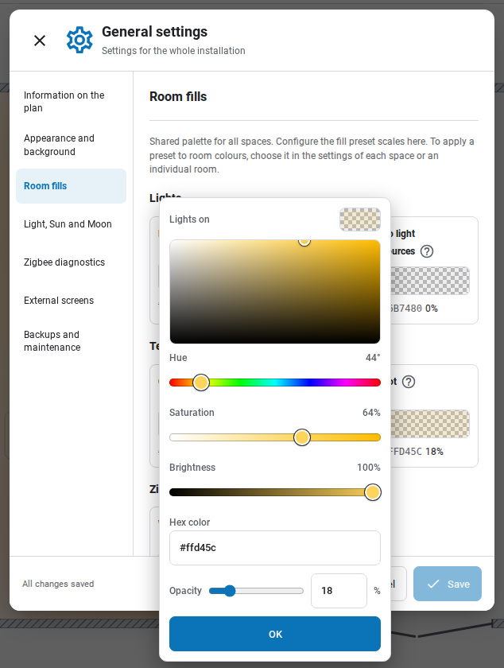

*All three thumbs show the selected colour; opacity is adjusted separately.*

&emsp;&emsp;Decor Properties also accepts a HEX value (3 or 6 digits, with or without #) and a percentage beside the sample. A valid pair previews immediately; Enter or leaving the whole compound field applies one change, Escape cancels it. Incomplete input is not saved. Here 100% means opaque; a field explicitly named transparency uses the inverse scale (0% means opaque).

### Dialogs and tools

&emsp;&emsp;Help, Devices, Icon rules and Print share the settings appearance, with one scrolling body and accessible header/footer actions. Accepted closing animates; reduced motion disables it. A failed Save or Continue editing keeps the live form and draft. Focus returns to the opener without a flashing ring; the next Tab restores ordinary keyboard focus styling.

&emsp;&emsp;The Background trash tool is **Delete**. Another tool activates with one press after Shapes, Furniture or Image; pressing the canvas only dismisses a palette. Confirmation, cancellation and Undo/Redo are unchanged. The global palette defines preset scales; apply a preset to rooms in the space or room settings.

### Zoom when switching editors

&emsp;&emsp;Opening/closing an editor keeps the current zoom and centre. The Properties column reduces the available area, not the saved size of objects. The editor’s working camera becomes that floor’s View camera on exit; **Fit all** explicitly fits the complete plan again. Wall/line thickness uses the shared unit field: new input allows three characters including a decimal separator, while an existing longer saved value is not truncated.

&emsp;&emsp;Units follow HA.

### Editor properties panel

&emsp;&emsp;At a card width of 1024 px or more, Plan, Devices and Background show a persistent **Properties** column. Click an object to edit its position, dimensions and appearance. Grey fields are unavailable; locked fields are computed. Contour endpoints move only through node dragging. Opening width keeps its centre; its gap measures to the nearest opening edge from the physical corner/end marked on the plan, not from a guessed centreline endpoint.

&emsp;&emsp;The full-height right column keeps every section expanded and fits its content. The shared A/B endpoint explanation lives beside Position. Windows offer the room/outside direction; doors keep their hinge choice. Selection retains frames and handles without extra object captions. Wall A/B, room names and your text remain visible.

&emsp;&emsp;**Rooms** contains Merge, Split, Resize and Delete. Background's **Shapes** menu contains Line, Rectangle and Ellipse. Undo and Redo are icon buttons immediately before Close in every editor. Hover or keyboard focus opens delayed help; `Esc` dismisses it. Background dims stairs together with the walls.

&emsp;&emsp;`Enter` or leaving a field applies one change; `Esc` cancels the draft. Invalid input or a failed save keeps the selection and explains the problem. Text uses `Enter` for a newline and `Ctrl/Cmd+Enter` to apply; **Insert HA variable** inserts an entity state or attribute at the captured caret. Images have a local aspect ratio lock.

&emsp;&emsp;Main plan image opacity is saved independently and survives resetting its transform.

&emsp;&emsp;Double-click and the existing **Properties** / **Open device settings** buttons still open full dialogs; the panel is inert while a dialog is open. Narrow cards retain the previous UI, including single-click device settings. Resizing does not save a draft: it waits for the panel to return; opening a narrow full dialog discards that local draft.

&emsp;&emsp;View and kiosk never show the panel. Device Undo/Redo also covers panel icon scale/angle without rewinding unrelated marker settings.

&emsp;&emsp;The editor grid continues across the whole working canvas; View does not show it. Each editor has a stable primary toolbar. Tool parameters and selected-object actions appear in a context tray over the top of the canvas. On a narrow screen the tray scrolls horizontally instead of shrinking the plan.

&emsp;&emsp;Where an editor offers a color sample, one click opens the House Plan color picker. Hue, saturation, brightness, an exact HEX value and opacity (when the setting supports it) are available together; there is no second browser color dialog. The Hue track shows the full colour spectrum at a glance, with a contrasting ring keeping its slider visible.

&emsp;&emsp;Changes remain a draft until the settings dialog that contains it is saved.

&emsp;&emsp;This is the same control everywhere: decor and custom fills, the global light/temperature/LQI/Glow/wall palettes, global and per-space backgrounds, room colour, marker Glow and the device activity ripple. Settings that already have opacity show it in the picker; colour-only settings do not acquire one. **Default** and **Inherited** background actions remain beside the colour sample and do not save the displayed fallback unless a colour is changed.

### Shared panel and card header

&emsp;&emsp;The main /houseplan page has a single header, without an extra title bar or empty strip. Its 44 px HA-menu button appears when the HA sidebar is hidden or narrow; native HA kiosk and an external provider’s hasSidebar:true suppress it. House Plan kiosk hides the whole header; Back or the ordinary /houseplan URL exits.

&emsp;&emsp;The header adapts to the available space, the names and the language. There is no single width that makes it switch to a phone layout. Editor labels become icons, the three Zoom buttons can hide, and space tabs become a dropdown before controls wrap. Controls remain directly available in two rows; before a third row is needed, they become an **Actions** menu.

&emsp;&emsp;In the main panel multiple spaces keep their selector above the menu; one space uses its name. A pinned dashboard card has no redundant space selector. The menu opens below the header across the plan, scrolls internally when needed and does not change the selected floor or camera. Zoom gestures remain available. Compact editors keep Close, Undo and Redo at the right.

&emsp;&emsp;Expanding restores the ordinary layout.

&emsp;&emsp;Lovelace keeps its configured/default card title, truncating long text with the full title in a tooltip; it never adds another HA-menu button. Space settings/Add obey editing permissions and pinned-floor rules. Rotation, space selection and editor Close retain 44 px targets. The Properties column has its separate 1024 px card-width threshold.

### Navigation, zoom and input

&emsp;&emsp;The two rotate buttons beside the zoom controls turn the plan by 90° in either direction, in View and the editors. The choice belongs to this browser and this space; it survives reload and takes priority over the card's optional `rotation` (`0`, `90`, `180`, `270`, clockwise). Without usable browser storage it still works until reload.

&emsp;&emsp;A kiosk has no header controls and uses only its card value. The same setting is available in both Lovelace card editors; invalid values show an editor error and are treated as zero when resolving the card default.

&emsp;&emsp;Geometry, furniture, decor text, sunlight and custom icon angles follow the plan. Ordinary device icons, room readings and editor measurements remain screen-facing; a right value badge stays on the right. Pan, pinch, wheel and arrow-key nudges keep their screen directions. **Fit all** includes the turned bounds. The Static card and PDF use the effective orientation.

&emsp;&emsp;Rotation never changes saved coordinates or other browsers' choices.

&emsp;&emsp;The canvas is effectively infinite: objects may be drawn outside the original plan square. **Fit all** frames the actual content. The View and kiosk touch gestures below are supported; editor touch is best effort, so use a desktop for precise drawing, Resize, keyboard modifiers and double-click properties.

| Scenario | Mouse | Touch View | Touch editors | Keyboard |
|---|---|---|---|---|
| Zoom and pan | Wheel; drag empty space; `−`/`+`; double-click background/room to Fit all | Pinch; drag; double-tap background/room to Fit all | Available but precision is not guaranteed; no Fit-all double-tap | — |
| Room | One clean click fits the room after the 350 ms double-click window | One clean tap fits the room after the 350 ms double-tap window | — | Immediate `Enter`/`Space` on a visible room label |
| Change space | Click a tab | Tap; in kiosk at 1:1, swipe inward from the 48 px edge that has a neighbour | Tap a tab | — |
| Device | Click/double-click per mode | Tap; safe actions equal desktop | Drag/properties are best effort | `Esc` closes the top surface |
| Walls drawing or precise drag | Full contract | Not applicable | Best effort; use desktop for Resize and exact nodes | `Shift` changes magnet/angle; `Esc` finishes a Walls chain or cancels the current precise drag |
| Editor history | Undo/Redo controls | Not applicable | Controls may work; no gesture guarantee | `Ctrl/Cmd+Z`, `Ctrl/Cmd+Shift+Z`, `Ctrl+Y` |
| Kiosk sizing | — | Hold empty space for 3 seconds | — | — |

&emsp;&emsp;Important details:

- wheel, `−`/`+`, **Fit all**, the return arrow and a plan-surface
  double-click/tap in View or kiosk use a short smooth camera transition;
  rapid wheel events update one destination instead of building a queue;
- pinch and pan remain directly under the fingers; reduced motion makes every
  commanded zoom immediate, and panning works at every zoom;
- fitting a room uses its visible floor and walls, but not markers, labels,
  Glow, sun rays, backdrop or decor. Manual pan/zoom and **Fit all** release the
  fitted-room hold on the next resize;
- each space keeps its own local View viewport. Editor pan/zoom is a working
  view and does not replace it;
- a hint appears when objects lie far away from the main plan;
- a kiosk space swipe starts only in the inner 48 CSS px of an edge with a
  neighbouring space, points inward and stays strongly horizontal. Elsewhere,
  at an unavailable edge and above 1:1 the gesture pans. Any manual kiosk
  operation pauses auto-cycle for 60 seconds;
- `Shift` keeps positional grid snapping. For room walls it locks the current
  segment to the nearest 45° direction; in Background it creates a square or
  circle, allows independent axes for ordinary decor, unlocks furniture
  proportions and snaps furniture rotation to 45°. On the compass it enables
  a 15° step.

#### Cancel and undo

| Context | `Esc` | `Ctrl+Z` / `Cmd+Z` | `Ctrl+Shift+Z` / `Ctrl+Y` |
|---|---|---|---|
| Active **Walls** chain | Finishes accepted segments as independent walls and keeps the tool active | Removes the last accepted point and segment | — |
| Unfinished Split | Removes the last point or leaves the tool | Removes the unfinished point first | — |
| Any other Plan tool | Cancels the current gesture or selection | Undoes the last named geometry command | Redoes it |
| Background | Cancels unfinished drawing or restores the state from before the active move/resize/rotate | Undoes the last named decor/backdrop command | Redoes it |
| Text field | Closes the top dialog | Browser text undo | Browser text redo |

&emsp;&emsp;Plan and Background share one 50-command geometry history. Both toolbars have **Undo** and **Redo**, whose tooltip names the next command. The history lasts for the current card session and resets safely when a newer external plan revision arrives.

&emsp;&emsp;When an operation cannot be undone or redone, the history is not erased and one press never applies the next operation. If this card is pinned to a different space, the operation stays in the history: open a card with access to that space or remove the fixed-floor setting and try again. A temporary failure shows “This operation is not available right now.

&emsp;&emsp;Try again.”. An operation that can no longer be restored (its space no longer exists, its saved state or geometry cannot be safely restored) is removed from history alone, with its reason; the other steps keep their order. In an active **Walls** chain a temporary refusal keeps the points; after its step is removed the chain ends without changing saved walls and the tool stays selected.

&emsp;&emsp;In every dialog, `Tab` and `Shift+Tab` stay inside the open surface; `Esc` closes the top one and focus returns to the control that opened it, including through nested dialogs.

<a id="general"></a>

## 4. General settings

&emsp;&emsp;Open the gear in the main header outside kiosk. General settings apply to the whole installation, not just the floor you have open. Some fields let you choose a local value; their descriptions explain when it takes priority.

### Where each General section applies

&emsp;&emsp;The wide dialog has section navigation on the left; a narrow dialog uses a selector at the top. Changing section keeps the same unsaved draft. Save applies ordinary settings; Cancel/close uses the discard confirmation. Explicit maintenance and data-loading buttons retain their own confirmations and save boundaries.

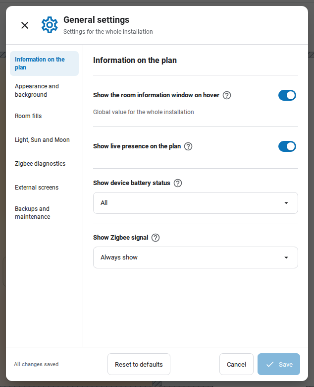

*General settings: choose a section on the left and adjust its options on the right.*

| Section | Purpose and dependencies |
|---|---|
| Information on the plan | Room hover information, live radar visibility, battery and Zigbee indicators. Hiding a reading does not delete its source or disable its device. Space battery/LQI choices and marker hide options can override these defaults; see [device indicators](#battery-charge). |
| Appearance and background | 2.5D View, centering with Summary and the shared background. Editors stay flat. A space can use its own background. A backdrop image and room fill are unaffected; see [appearance](#appearance). |
| Room fills | Shared on/off/no-light, temperature and LQI colour palettes with opacity. These are colour scales, not the choice of fill mode; choose that in [Space](#space) or [Room](#room). Wall-body and caption colours belong to the space. |
| Light, Sun and Moon | Default light colour/intensity and Glow radius, north, sunlight switch and ray origin, Moon visibility. The device may override Glow; the space may override north/rays. The Moon uses HA location and the clock, not a mirrored plan drawing. |
| Zigbee diagnostics | Provider topics, explicit cached-data reads/scans and snapshot explanations. Signal numbers work independently; turning links on does not itself start a scan. See [Zigbee links](#zigbee-links). |
| External screens | Create/edit named display profiles and copy their URL. Ordinary Save applies the outer draft; see [screen profiles](#screens). |
| Backups and maintenance | Import/export, available server Undo, Optimize and the external converter link. These are explicit operations, not ordinary appearance controls; see [backups](#backup) and [maintenance](#maintenance). |

&emsp;&emsp;For example, changing a temperature palette changes the colours used wherever temperature fill is selected; it does not turn every room into a temperature map. Changing the General Glow radius affects inheriting sources, not a device with its own radius. An explicit zero-opacity colour stays a colour, not “inherit”.

&emsp;&emsp;The room highlight remains available in View and kiosk. To keep that highlight but hide the floating room summary, turn off **General settings → Show the room information window on hover**. The option is on by default and does not affect device tooltips.

### Contextual setting help

&emsp;&emsp;A circled question mark beside a complex setting opens a short explanation without changing the value. It works with mouse, keyboard and tap, closes on `Escape` before the settings dialog and does not add another scrollbar. Help is available for space scale, global and local background, north, room fill, global and per-marker Glow radius, zero-thickness wall style, light-source role and links, binding, icon, marker display and size.

&emsp;&emsp;The header eye has its own **Show hidden devices** explanation. The zero-thickness help also states that dashed lines pass Glow and sunlight, while solid lines block them.

### How settings dialogs work

&emsp;&emsp;The four dialogs — **Space**, **General settings**, **Room settings** and **Device on the plan** — use one responsive form and one scrolling body. General, Space and Device have section navigation; Room is a compact continuous form. Settings are grouped into cards; a card or field may carry a `?` help action.

| Element | Appearance | Behaviour |
|---|---|---|
| Switch row | Icon, title, caption and switch on the right | The whole row toggles one setting |
| Segment | A short set of choices in one frame | Works like a radio group, including arrow keys and screen readers |
| Colour plate/tile | Colour, HEX and opacity where supported | Opens the House Plan picker; the number edits opacity directly |
| Field with a unit | Number plus `cm`, `°C`, `m`, `%` or `°` | Empty means inheritance only where the help explicitly says so |
| Slider with a number | Slider, editable value and optional reset | Drag the slider or type an exact value |
| Picker button | Dropdown-styled button | Expands search and results inside the card, not over it |
| Chips | Selected items with remove buttons | Used for linked lights and attachments |
| State message | Tinted row with an icon | Explains a current problem or a consequence of Save; it is never hidden under `?` |

&emsp;&emsp;**Save** is enabled only after a change; no footer sentence duplicates that state. Closing with an unsaved draft through the close button, **Cancel** or a click outside first asks whether to discard it. **Continue** keeps the draft and reopens the form with input focus restored; **Discard** closes it. Invalid required values are explained under the field, and **Review N fields** moves to the first problem.

&emsp;&emsp;Empty room temperature bounds are the deliberate exception: each inherits its space value. If Home Assistant recreates the card without a full page reload, an open dialog, its draft and its original comparison point are restored for a short window; a full reload does not restore drafts.

&emsp;&emsp;New-device and new-room forms, including queued room names and Split, use the same protection. Merely opening a new form is not a change. A refused edit to an existing room keeps the form and input available for retry. If a new face cannot be accepted, its creation form closes and the accepted walls stay; fix the reported cause, select the free face again and retry.

&emsp;&emsp;Closing a form never saves it automatically.

<a id="space"></a>

## 5. Space settings

&emsp;&emsp;Press the gear beside a space name. Here you can choose its plan source and physical scale, style its rooms, and set the readings, background and lighting for that space.

### Choose the setting by the result you want

- **The whole plan has the wrong physical dimensions:** correct **Plan and scale**;
  do not compensate by resizing each device or changing browser zoom.
- **All room names/readings are too large:** use **Names and readings**. The room’s
  own name/readings percentages multiply the matching space sizes.
- **One room should look different:** use [Room settings](#room), not another space palette.
- **Only this tablet should have larger icons:** use a [screen profile](#screens)
  or local kiosk sizing, not shared object geometry.

&emsp;&emsp;The decorative layer and architectural borders are display switches. Hiding their drawing does not remove saved objects or make hidden walls transparent to lighting. Dashed versus solid zero-thickness walls is the separate light rule.

### Space settings

&emsp;&emsp;The four room-appearance colours belong only to this space; wall fill is no longer in General Settings. Room Settings → **Name color** offers **As in the space / Custom color**, affecting both name and readings. Returning to inherit removes only this caption override, not room fill or font sizes. Alpha zero is an explicit colour, not inheritance.

&emsp;&emsp;Existing plans retain their colours and opacity before the first save; a space colour change keeps room overrides.

| Card | Setting | Result |
|---|---|---|
| Plan and scale | Name, physical cell size, source | Draw manually or choose an image; a new space starts at 1 cm or 1 in per cell according to HA units. Changing source does not delete uploaded files |
| Plan and scale | Decorative layer | Hides decor in View; Background still shows it for editing |
| Room appearance | Show room borders, including doors and windows | Controls outlines and opening symbols together; sensors, physical bodies and light calculations remain |
| Room appearance | Zero-thickness walls | Dashed passes artificial light and sunlight; Solid blocks them even if its outline is hidden |
| Room appearance | Wall color / Name color | Independent wall lines/outlines/hatching and entire room captions (names and readings), each with opacity |
| Room appearance | Custom room fill / Wall fill color | Custom room colour is used in Custom mode. Wall-body colour below hatching immediately follows it and is available in every fill mode; Zigbee, Lights and Temperature remain unchanged |
| Names and readings | Room names, temperature, humidity, CO₂, signal and light | Readings appear only with a usable source; turning names off keeps the selected metrics. CO₂ is not added to the static card |
| Names and readings | Name size / readings size | Independent 50–300% sliders with exact values and a live sample; room multipliers apply to the corresponding size |
| Names and readings | Device battery / Zigbee signal | Inherit General or use a space value; device hide options can suppress an indicator further |
| Background and lighting | Background | Inherit the read-only General mode/colour, or choose this space’s Static / Follow the sun value |
| Background and lighting | North and rays | General source or a local choice; use the compass/field/slider for local north |

&emsp;&emsp;The scale is the real size of one grid cell. A finer cell adds snap points per metre but does not change the finished appearance: physically equal rooms, walls, openings, labels and markers look the same at 1 and 5 cm per cell. Existing spaces keep their value; a legacy space without `cell_cm` keeps the 5 cm compatibility fallback and is not silently migrated.

&emsp;&emsp;Room cards are positioned and scaled on the plan. View renders only enabled metrics. Plan temporarily shows a caption for positioning even when names are off; returning to View hides it without losing its position. The former space Glow switch is absent. An old saved Off remains effective until the space is normally saved; that save enables Glow.

&emsp;&emsp;A device can still use **Never**.

&emsp;&emsp;For **Copy**, use the [copy workflow](#copy-a-space-without-duplicating-its-devices). The suggested name is the first free numbered copy; duplicate names are allowed. The accepted copy opens in Plan with Walls selected, without first optimizing the original plan.

&emsp;&emsp;Deleting a space is blocked while any active device — hidden ones included — still points to the space, one of its rooms or a saved position on it, provided another space remains. **Delete** then scrolls the dialog to the warning and moves focus to it, every time it is pressed. Either move or delete those devices first — then the confirmed delete removes the space-owned layout — or press **Delete space with devices** in the warning.

&emsp;&emsp;One confirmation names the space and the number of devices (and, when there are any, how many of them are hidden); after it the space and those devices are deleted in a single write. Each device goes exactly as with **Delete** in its own dialog: it leaves the plan, its position and robot trail are removed, and its binding appears in **Devices → Available again**.

&emsp;&emsp;Nothing changes in Home Assistant. Until the next plan or layout edit, **General settings → Undo space deletion** restores the space, devices and their saved positions. Device attachments are retained during that interval, then removed if no remaining device uses them; the previous recorded robot cleanup trail is not restored. Cancel in the confirmation writes nothing.

&emsp;&emsp;After another edit, restore the original plan from a [backup](#20-storage-multiple-cards-and-backups). If the plan changed after the confirmation, nothing is deleted and the warning shows the current number.

&emsp;&emsp;The sole remaining space can still be deleted after confirmation: affected devices keep their bindings, icons, actions and settings but become unplaced. Its plan image and their attachments are not deleted automatically.

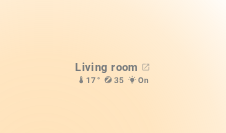

<a id="plan"></a>

## 6. Plan editor: rooms and walls

&emsp;&emsp;Use Plan to draw rooms and walls. Start with Walls, close the boundary and create a room. For precise changes, use Select and the node menu; furniture and devices have their own editors.

<a id="8-rooms-and-walls"></a>

<!-- docs-section: plan-tools -->

### Choose the right way to change geometry

&emsp;&emsp;Select a wall to see its two-side dimensions without dragging. Drag a node for an authored corner change, or choose **Rooms → Resize** to move a room wall parallel to itself. Resize needs an exactly horizontal/vertical moving side and perpendicular adjacent sides: it is not a general polygon scale tool. The reason on a dimmed handle explains an unavailable operation; see [Resize](#resize).

&emsp;&emsp;For an angled room, move its nodes or redraw/split the affected geometry. A plan pinned to another space can temporarily refuse a history command; remove that display restriction before retrying. Do not expect Optimize to convert an intentional diagonal into a rectangle. Openings and shared walls retain their own physical safety limits.

### Create a room

&emsp;&emsp;Select **Walls** and draw one continuous chain. Every completed segment is saved immediately as an ordinary independent wall. Changing tool, editor, floor or leaving the card finishes the session-local chain: compatible straight sections become one wall and a proven duplicate over room masonry is absorbed immediately. Undo/Redo remains segment-by-segment but restores consistent geometry, so a normal current-version chain leaves no work for **Optimize plans**.

&emsp;&emsp;Reloading preserves the accepted walls but cannot finish the interrupted session. When the latest segment creates bounded endpoint/T/X faces, House Plan offers them from smallest to largest. Save creates that room and consumes exactly coincident chain walls, Keep as walls rejects only that candidate, and Cancel leaves all accepted walls in place with no partial rooms.

&emsp;&emsp;If the walls were completed earlier, choose **Select** and click inside the smallest free closed area to open the same room dialog. In **Walls**, a click always draws or continues a wall chain; no Shift bypass is needed. An opening does not break the structural wall axis, and a zero-thickness axis remains part of the closure graph.

&emsp;&emsp;Drawing a wall across an existing room can offer its smaller face: the larger retains the old name, Area and settings. An arbitrary partial overlap is refused; a fully nested island room is supported. If creation is refused, the form closes but accepted walls remain. Fix the cause, choose Select and click the free face to reopen it.

&emsp;&emsp;Existing valid wall coordinates outside the grid are retained when creating a room from their closed contour; running Optimize first is unnecessary. Explicit alignment in Optimize keeps its preview/confirmation flow and must preserve each opening's wall carrier. A refused operation leaves the stored plan unchanged.

&emsp;&emsp;While drawing an open chain, `Esc` finishes all accepted segments as ordinary independent walls and keeps **Walls** selected; the next click starts a new chain. `Ctrl/Cmd+Z` instead removes the last accepted point and segment. Pan, pinch and `pointercancel` neither finish the chain nor add geometry.

&emsp;&emsp;If finishing fails, **Keep editing** leaves the chain available for retry. **Leave without finishing** releases only the drawing session, preserves saved walls and performs the requested tool/editor/floor change. A failed Escape or Reset leaves into **Select**; successful Escape still keeps **Walls** selected. Leaving never bypasses the geometry check or adds an Undo command.

&emsp;&emsp;A rejected floor deep link also restores the URL to the actual floor. Navigating away from Houseplan or reloading the page keeps the existing reset behaviour.

&emsp;&emsp;Existing segment endpoints and lines appear above walls while drawing. An endpoint grows when the next click will join it. A point on a line shows where the click will create a valid T-junction without splitting the existing wall. The active thick wall also shows its centre axis, exact endpoint, length and angle. Only an actually 45°-multiple vector is green.

&emsp;&emsp;Hold `Shift` to lock the segment to the nearest such direction: a compatible endpoint or exact ray/wall intersection is accepted and an incompatible snap target is ignored. If several different endpoints look like one at the current zoom, no wall is added; the conflict is highlighted and asks you to zoom in.

&emsp;&emsp;When explicitly creating a room, one unambiguous contour gap up to 2 cm may be repaired exactly to an endpoint or solid wall axis. A red dashed preview shows the repair. It is saved in the same Undo command as the room; Cancel and **Keep as walls** repair nothing. Larger, ambiguous or multiply matching gaps must be joined manually.

&emsp;&emsp;A segment which is visually horizontal or vertical within `0.25°` is stored as an exact axis: House Plan moves only the free endpoint, and preview already shows the final result. A real diagonal remains unchanged. Older invisible one-grid-step slopes are offered separately by **Optimize plans**, with the number of walls and maximum movement shown before confirmation.

&emsp;&emsp;The end of a horizontal or vertical segment snaps to the line through the end of an already drawn parallel wall that is itself exactly horizontal or vertical, including a zero-thickness wall and an accepted segment of the current chain. The magnet acts when the pointer is closer than 8 screen pixels to that line on either side: the end lands exactly on the parallel wall end's coordinate, even off the grid, and the segment stays on its axis.

&emsp;&emsp;Zooming in narrows the zone in centimetres, which is how you place a point next to the line; There is no keyboard shortcut to turn this magnet off. The preview and length label show the snapped endpoint. Click to place it there. An endpoint or axis of an existing wall and the contour closure win over the magnet; a slanted segment, including `Shift` at 45°, has no magnet, while 0° and 90° do.

&emsp;&emsp;If **Room settings** covers an element you need, drag anywhere on its capsule. It stays inside that room and remembers the temporary position until you leave the Plan editor; zooming, panning or visiting another floor does not reset it. This position lasts only for the current editing session: it changes neither saved settings nor Undo history.

&emsp;&emsp;A plain click or tap without a drag still opens Room settings. A wall-resize preview does not discard the position when cancelled; after a confirmed room shape change it is retained only while it remains inside the room.

### Wall junction limits

&emsp;&emsp;To keep the plan physically meaningful, House Plan refuses a write that would create an impossible junction. These are absolute physical limits and do not scale with `cell_cm`:

| Rule | Threshold |
|---|---|
| Angle between neighbouring walls at one node | at least 15° |
| Walls meeting at one node | at most 6 |
| Complete wall length | at least 20 cm and never below its own thickness |
| Distance from a non-incident node to another node or foreign wall | at least 5 cm |
| Room interior after subtracting masonry | at least 25 cm² |

&emsp;&emsp;Length is measured along the complete wall, not one contour atom: a short filler that compensates a thickness step is legal when the wall as a whole is long enough. A T-junction is not rejected by the distance rule. If the check itself fails, House Plan saves nothing and shows a message that it could not check the junction. It does not save an unchecked change.

&emsp;&emsp;Checks run only when geometry is written. Existing plans, migrations, imports and backup restores are not re-judged, and an edit that does not touch the old problem still passes. Drawing and **Thickness** leave a refused value unapplied and name the rule; Resize stops at the last valid position and explains once per gesture what the next step would break.

### Plan tools

&emsp;&emsp;Ordinary entry selects **Select** for an existing architectural plan and **Walls** for an empty one. A backdrop, decor, devices or LED strips alone do not make an architectural plan nonempty. Creating/copying a space still opens Walls directly. The node context menu is available from every Plan tool; a right click does not add a wall.

&emsp;&emsp;If old geometry cannot safely provide handles, Plan remains accessible without inventing nodes or repairing data on entry.

#### Moving walls and openings with arrow keys

&emsp;&emsp;In **Select**, arrow keys move the selected free independent wall by one current grid cell. Both endpoints and hosted openings move together. A wall connected to another wall or room stays fixed; the command keeps junctions and neighbours intact.

&emsp;&emsp;A selected opening moves one cell along its existing wall. Left/Right work on a horizontal or mostly horizontal host; Up/Down work on a mostly vertical host. At 45°, Left/Right work and the other pair does nothing. Right/Down point right and down regardless of endpoint order. An opening stays fixed if the complete step would cross an end or another opening.

&emsp;&emsp;`Shift` does not accelerate a step. Zoom and magnets do not change the cell distance or original grid offset. Each accepted press is a separate Undo step. Inputs, Properties, dialogs, menus and unfinished gestures keep their own keys.

#### Moving wall nodes

&emsp;&emsp;In **Select**, hover a wall endpoint, room corner or supported junction: the cursor becomes a grab hand. Drag the node: affected old walls disappear and the proposed node, walls and openings are translucent. Magnets follow original wall axes and exact horizontal/vertical positions. When a wall connected to the node is exactly horizontal or vertical in its new position, the node snaps along it to the line through the end of another parallel wall (also exactly on an axis, zero thickness included) within 8 screen pixels; walls the node itself moves are ignored.

&emsp;&emsp;Magnets combine: a wall can straighten and end flush with its neighbour at once, even off the grid. When an original node magnet pulls the same coordinate, the nearer one wins and a tie keeps the node magnet. Release to save. **Esc before release** cancels the entire gesture; **Ctrl+Z during dragging** also only cancels the gesture, not the previous edit.

&emsp;&emsp;After saving, normal Undo and Redo work.

&emsp;&emsp;A T slides along its carrier and aligns only along it. At a simple X, first move along one of the two walls: it stays straight and the transverse wall bends at the new node while retaining its far ends. Complex passing junctions are not movable yet. Openings retain width and distance from the fixed end; an opening that no longer fits or unsafe geometry refuses the entire move on release.

&emsp;&emsp;Zoom in to separate ambiguous nearby nodes. Node movement is mouse-first in the Plan editor, absent in View and kiosk. An older backend shows an integration-update hint instead of saving an unsupported edit.

#### Merging wall nodes

&emsp;&emsp;In **Select**, drag a node onto another node: the magnet attracts it and the stationary target is highlighted. Release to merge. A wall directly connecting the pair is removed in the same command. An opening on that wall, a destroyed room or unsafe geometry cancels the entire gesture with an explanation. Successful persistence creates one Undo/Redo step.

&emsp;&emsp;A click never merges nodes; **Esc** cancels the drag. This requires an updated Home Assistant integration.

#### Attaching a dangling end to a wall

&emsp;&emsp;In Select, drag a free end towards the middle of another wall/partition. Within 12 screen pixels the receiving wall and joining point highlight. Release creates one shared T node and splits that wall into two spans. An existing target node uses Merge instead. Corners, completed branches, ambiguous targets, opening conflicts and unsafe geometry are refused in full.

&emsp;&emsp;Escape cancels; an accepted attachment is one Undo/Redo step and requires an integration that supports the command.

#### Deleting a wall node

&emsp;&emsp;In the Plan editor with any selected tool, right-click an intermediate node and choose **Delete node**. Its two neighbouring sections become one straight wall between their unchanged outer endpoints. A safe corner is supported too: the room boundary follows the new straight span. A shared wall counts once regardless of how many rooms own it.

&emsp;&emsp;The command is disabled at an endpoint, T/X junction, incompatible sections or an unsafe result; the menu explains why. Openings keep their position, size and settings. If they cannot remain on the new wall, the entire deletion is refused. Devices, decor and other floors are neither removed nor moved.

&emsp;&emsp;A right-click alone does not move the node. **Esc** or an outside click closes the menu. Deletion is one common history step: Undo restores both sections and the node; Redo repeats the replacement. A server refusal keeps the command in history. Finish editing a Properties field before the action. View and kiosk have no command; an older integration shows an update hint.

&emsp;&emsp;The menu is mouse-first.

#### Plan tools at a glance

| Tool | Result | Room area | Light and shadow | Main limit |
|---|---|---|---|---|
| Walls | Continuous wall chain; offers rooms when it closes faces and finishes open chains as independent walls | Only a confirmed room has area | Positive thickness blocks light; zero thickness follows the space's dashed/solid policy | Partial room overlap is rejected; there is no separate Partition or Boundary drawing tool |
| Column | Square or circular support | Does not change area | Blocks light inside its shape | One shape/size/rotation; not a wall or room |
| Opening | Door, window or gate | Does not change area | Door/gate passage follows state; window may cast sun | Must fit completely on a suitable wall segment |
| Stairs | Straight flight or one-turn spiral with automatic 30 cm treads and an ascent arrow | Subtracts only its footprint overlap from clean area | No effect on Glow, sun or walls | Lives on this floor only; a valid optional target makes it a View link |

&emsp;&emsp;Other operations edit existing geometry:

| Operation | Result |
|---|---|
| Merge | Joins adjacent rooms; a dialog chooses the surviving identity, name and area |
| Split | Cuts a room from one wall to another; the larger part keeps the original room |
| Resize | Moves one eligible horizontal/vertical wall without changing room topology. The common dimension layer reports changing physical intervals on both sides of both rooms' side walls; each room retains its area beside the moving wall |
| Thickness | Changes one span or every wall of a room, including zero-thickness walls |
| Delete room | Deletes the room after choosing whether its exclusive physical walls remain; shared walls always remain |

&emsp;&emsp;Right-click a room's empty floor area for **Room settings…**, **Resize**, **Split…**, **Merge with adjacent room…**, and **Delete room…**. Resize and Split start with that room selected; Merge waits for a neighbour with a shared wall. Clicking a node, wall, opening or staircase keeps that object's own interaction. **Esc** or an outside click closes the menu without changing the plan.

&emsp;&emsp;While the **Thickness** dialog is open, its wall stays highlighted independently of the pointer or an unapplied field value. The band follows the physical wall when navigating the plan, not the dragged dialog. Closing the dialog or changing tool/floor removes the session-only selection.

<a id="stairs"></a>

&emsp;&emsp;Choose **Stairs → Straight** or **Stairs → Spiral**, then draw on the plan like a decor shape: press, drag and release. The drag direction is the direction of ascent, the drawn extents are the size, and a plain click still places the default size. The selected stair shows a frame above the walls with corner, side and rotation handles; the cursor over a handle shows which way it moves.

&emsp;&emsp;A handle resizes about the opposite side without turning or mirroring the stair and snaps the dragged side flush to a parallel wall; dragging the body snaps the nearest side to a wall (turning the stair by at most 5°) or flush to another stair; `Shift` snaps rotation to 45°. **Optimize plans** preserves the exact continuous transform.

&emsp;&emsp;Double click opens size (30 cm to 100 m, saved exactly as shown), direction, angle, line/fill colour and opacity, and target-floor properties. A new stair copies the main decor colour and has no visible fill. Straight **Up/Down** changes the 100%/80% taper but not the arrow direction; rotate the whole stair to turn the arrow. Treads and spiral sectors divide the full run evenly at the closest possible step to 30 cm.

&emsp;&emsp;In View, hovering a stair with a valid target shows "Go to floor …", and a clean activation switches to that target and restores its saved view; gesture tails, broken links and fixed-floor cards do nothing. The target floor is never changed automatically. After stair navigation in View or kiosk, every stair leading back pulses twice in the theme accent over two seconds; reduced motion shows a static highlight.

&emsp;&emsp;There is no extra camera movement, and pan and pinch remain available. Missing or off-screen return stairs produce no extra indicator. In 2.5D the symbol is flat on the floor. See [Stairs](STAIRS.md).

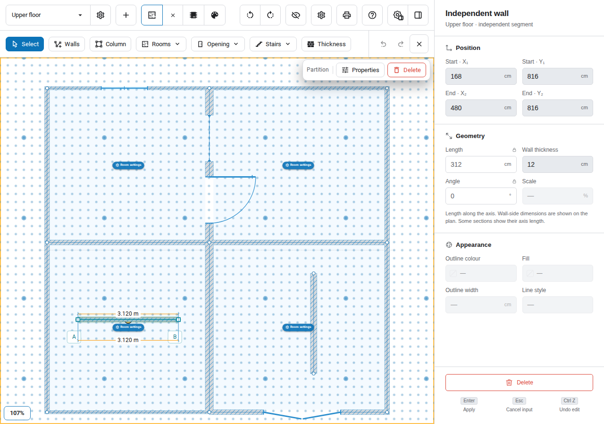

&emsp;&emsp;Dragging a partition in **Select** moves its doors and windows in the live preview as well. There is only one visible copy of each opening; their width, flips and settings stay unchanged. Release saves one Undo step. Press **Esc** or Undo while holding to cancel without saving.

### Merge

- Rooms must share a boundary.
- Choose which room keeps its identity, name and HA area.
- The other room's name, HA area and area-discovered devices are not silently
  copied. Assign the area elsewhere if those devices should reappear.
- Nested or geometrically incompatible candidates may be refused.

&emsp;&emsp;Deleting a room also clears that exact room from direct device assignments and vacuum segment maps, including maps owned by a vacuum on another floor. Merging rooms redirects the same references to the surviving room. The change is part of the room command: Undo and Redo restore or reapply geometry and references together without changing unrelated marker settings.

&emsp;&emsp;When deleting a room, choose whether its exclusive physical walls remain. Keeping walls converts positive-thickness pieces into independent walls and reattaches their openings; zero-thickness pieces remain independent `0 cm` walls. Removing walls deletes only openings hosted by exclusive room masonry. Shared walls, coincident independent walls and their openings remain.

&emsp;&emsp;Thickness records are normalised by their new physical role, never across an outer/shared transition or between different room pairs.

### Split

- The first and last points must lie on the selected room boundary.
- Intermediate points stay inside the room and may not cross the contour or
  the cut itself.
- The larger result keeps the original room and its devices; the room dialog
  opens for the smaller result.
- A cut may start or end at an existing corner. Even when the new shared wall
  is thicker than the facade, it joins the facade from the inside and does not
  change the outer shape.

### Resize

&emsp;&emsp;Resize changes one room, or exactly two rooms when their shared wall coincides endpoint-to-endpoint. It can pass an existing side-run T/X meeting in one drag when the same material and ownership remain valid; derived nodes split/join without extra saves or Undo steps. It still stops at a real corner, opening, foreign room or a physical/ownership conflict; no more than two rooms can change.

&emsp;&emsp;It also stops where extending or shortening an adjacent wall would turn shared material into outer material (or the reverse), so one saved thickness never silently serves both roles. If neither direction has even one safe grid step, the handle explains that only part of a shared wall cannot be moved. Resize also preserves every unrelated wall exactly: changing the length of a neighbouring wall cannot shift a thickness boundary to an invented off-grid point.

&emsp;&emsp;An ambiguous candidate is rejected instead of damaging another wall. Partial shared walls, diagonal walls and walls overlapped by an independent partition/column keep a dimmed handle with an explanatory tooltip and cannot start a drag. The former corner scale frame was removed. An ordinary opening on the moving wall follows it once; a side-wall opening stops the moving masonry at its physical jamb.

&emsp;&emsp;Release creates one Undo step, while Esc or an interrupted pointer writes nothing.

&emsp;&emsp;The moving wall has no redundant length badge. An outer wall shows one clean area; a shared wall shows two on opposite sides with short leaders. In a narrow room a label may extend outside the room rather than overlap the other area or the Room settings button. Both affected rooms' changing side-wall dimensions are displayed simultaneously, without the old axis highlights.

| Scenario | Result |
|---|---|
| Outer wall | Only the selected room changes |
| Endpoint-to-endpoint shared wall | Exactly two rooms change |
| Irregular room | Movement is allowed only until the first corner that would change the wall extent |
| Opening on the moving wall | Follows the wall once |
| Side-run T/X meeting | Can be passed in one drag when material and ownership remain valid; derived nodes split/join without intermediate saves or Undo steps |
| Opening on a side wall | Masonry stops at the nearest jamb, including half its thickness |
| Side material would switch between shared and outer | Movement stops at the exact role boundary; if neither direction has a safe step, the handle explains that only part of a shared wall cannot move |
| Partial/diagonal shared wall, third room, overlapping partition or column | Handle remains visible but dimmed and explains why movement is unavailable |
| Room becomes too small | Stops at the last position preserving the 30 cm minimum without deleting a vertex |

### Dimensions on both sides of a wall

&emsp;&emsp;Drawing walls, moving nodes and Resize share thin drafting dimensions for changing intervals. Click a wall with Select to inspect both sides without dragging. Values measure physical faces, not necessarily the distance between nodes. A junction may split one side into a chain while the opposite side remains continuous. Door and window cuts do not split the wall into pier lengths.

&emsp;&emsp;Witnesses start at the measured supports, perpendicular to the wall; the parallel rail uses Home Assistant's accent colour. Metric lengths have three decimal places; imperial formatting follows HA. Font and stroke sizes stay constant while zooming. In dense scenes, stable numbered markers refer to a complete temporary list with its own scrolling.

&emsp;&emsp;The Properties Length remains read-only and axis-based. Zero-thickness walls use a proved clear boundary interval or an explicitly explained axis fallback. An unprovable axis shows “Dimension unavailable”, never a fabricated zero. The layer writes nothing, adds no history and hides during whole-wall body drags. No numeric input is introduced; editors remain desktop-first and best-effort on touch.

### Wall thickness

&emsp;&emsp;Select the value with the mouse to replace it. Drag the dialog by its background, label or unit to move it aside; it stays inside the stage and holds its screen position while you pan or zoom the plan. Closing it forgets that position. Wheel over the dialog changes neither the plan nor the value. Precise editing is intended for a desktop mouse; moving the dialog on touch is best effort.

| Property | Behaviour |
|---|---|
| Value | 0–100 cm for room and independent walls; empty/non-numeric input is rejected |
| Geometry | Grows by half the value on both sides of the axis; a shared boundary is one physical wall |
| Clean area | Measured to the inner wall faces |
| Hatching | 9.6 cm physical pitch, independent of grid scale and zoom |
| Junctions | Exact shared nodes form one bounded mitre/bevel; a T-junction does not split the through wall |
| Equal adjacent pieces | Normalised only when thickness, direction and physical role match |

&emsp;&emsp;Wall thickness is stored in real units, and one room may use different values on different spans. Open branches and T-junctions are allowed. At a saved T/X-junction the complete physical width stays solid through the node: the bounded bevel removes only an excessive corner and never creates a white triangle, painted cap, invented shadow or light barrier.

&emsp;&emsp;A short arm stops at its saved endpoint; the removed bevel remains connected to the surrounding room/background instead of becoming a tiny enclosed hole. This is a rendering correction, so a valid plan may remain unchanged after **Optimize plans**.

&emsp;&emsp;Legacy near-axis walls are different: Optimize can explicitly straighten them, counts a shared wall once and leaves unsafe candidates unchanged. Cancel writes nothing; Apply is one server-side Undo step. Independent walls and columns can be dragged on the grid and edited by double-click. An independent wall accepts 0–100 cm. A column is square or circular, 1–150 cm; a square rotates and a circle uses the size as its diameter.

&emsp;&emsp;They subtract from clean area and block Glow/sun, but Resize does not move them. Outside rooms they create no floor.

### Zero-thickness walls

&emsp;&emsp;A wall thickness of **0 cm** is a real wall-axis record without a masonry body: it does not create hatch, wall area, an opening tunnel or a valid opening host. It is drawn and edited with the same Walls and Thickness tools as every other wall. In Space settings choose whether all zero-thickness walls are **Dashed** or **Solid**. Dashed zero walls let Glow and sun through; solid zero walls are zero-area light barriers.

&emsp;&emsp;Missing settings use Dashed. Changing the style affects every `0 cm` wall in that space; there is no separate Boundary tool or separate virtual-wall type.

&emsp;&emsp;An opening cannot be placed on a zero wall, and changing an occupied span to `0 cm` is rejected without a partial save. When room borders are hidden, the line is hidden in View/kiosk but its light semantics stay active; every editor still shows the axis.

<a id="openings"></a>

## 7. Openings: doors, windows and gates

&emsp;&emsp;An opening cuts a hole in a wall with positive thickness. Its drawing, sensor state and light transmission are connected, but mean different things. Changing the drawing never sends a command to a real door or blind.

<a id="9-doors-windows-gates-and-locks"></a>

### Find the right setting

&emsp;&emsp;Use **Opening** in Plan for placement, then select the opening for dimensions and position or double-click for all properties. A window’s leaf/shade settings are nested drafts: **Done** returns to the window, **Save** writes the result. The contact need not also have a separate marker on the plan.

&emsp;&emsp;The common dimension renderer shows both jamb offsets on the available wall faces during placement, movement and selection. Values describe the accepted snapped preview, not the raw pointer. See [wall dimensions](#dimensions-on-both-sides-of-a-wall).

### Independent leaves, shades and sliding openings (#1024)

&emsp;&emsp;Window settings offer 1–4 equal leaves and one common opening side. Open a row to choose its sensor, manual position and left/right/top hinges. The preview follows plan orientation and highlights the selected leaf. In 2.5D, top opening is depicted as a tilted leaf with its lower edge fixed, up to 30°. This is a visual convention, not a measured angle; saved sensors and the Flat symbol stay unchanged.

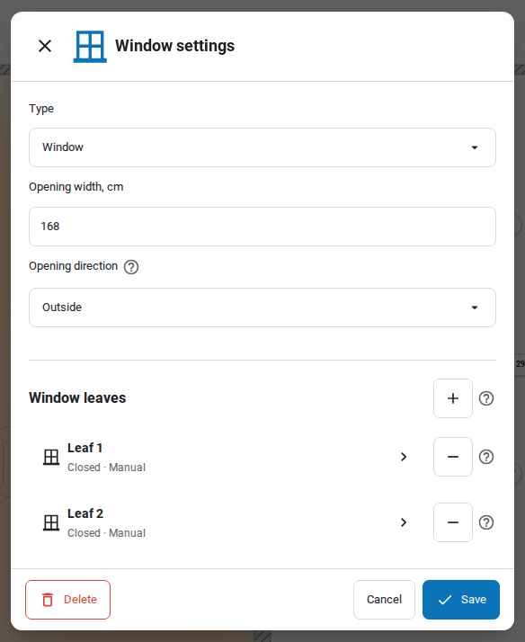

*Window settings: width, opening direction and individual leaves.*

&emsp;&emsp;A bound sensor takes precedence and disables manual position. An unavailable window sensor keeps a neutral closed pose with a separate `?`, never a saved manual fallback. Without a sensor, a window defaults to closed and a door/gate to open. Remove the binding to choose manually.

&emsp;&emsp;Each leaf can have curtains, blinds or shutters with its own source and manual position. Confirmed closed shades block only their share of light; open, partly open and unknown shades allow it. A sun, crossed-out sun or `?` indicates the state. Shades have no physical panels. Glass-leaf position changes only the symbol, not light transmission.

&emsp;&emsp;Use **Position in the opening** in the swing-door properties to choose where the leaf sits in the wall. Flat and 2.5D place it at the face it opens towards by default. Choose either face or the centre to keep the leaf there when the opening direction changes. For a sliding door, the sidebar’s **Placement side** shows which face the panel uses.

&emsp;&emsp;Doors and gates offer swing or one full-width sliding panel with an axis-local direction. These settings never send commands. Sensor-driven guides use the HA accent; manual guides use the symbol colour. Merely opening or saving an old window does not materialize independent-leaf settings.

&emsp;&emsp;Nested **Done** changes only the draft; outer **Save** writes it. Cancel, close and Escape discard the current nested draft. Space Copy clears all leaf/shade bindings, including disabled shades, but keeps manual positions. Backup transfer preserves bindings. Update both the card and integration and reload before editing.

&emsp;&emsp;An opening belongs to one room-wall segment or one completed independent Walls segment. Door and open passage default to 90 cm, window to 120 cm and gate to 300 cm; the UI accepts 20–600 cm in 5 cm steps. **Opening** first opens a compact Window / Door / Open passage / Gate menu. Hover a physical wall: door, window and gate show the exact translucent symbol and opening side, while a passage shows the future wall-coloured cut and two orange boundary marks.

&emsp;&emsp;Click opens properties and **Save** creates it. The selected type remains armed for a series; `Esc`, another tool/editor or another space ends the series.

&emsp;&emsp;The placement preview also draws a thin dimension line from each jamb to the physical inner end of the wall. On a wall shared by two rooms, four values are shown — two along each room's inner face — because their usable boundaries can differ. On a finished independent wall, each value stops at the nearest physical face of a connected wall; where no such face exists, it keeps the distance to the independent wall's own endpoint.

&emsp;&emsp;Placement, dragging and selection use the same thin drafting dimensions as wall edits, not separate badge implementations. A dimension is omitted rather than fabricated when its physical reference cannot be proved.

&emsp;&emsp;On a finished independent wall, a new or directly edited opening must leave a jamb at each endpoint equal to at least half that wall's real thickness. The same limit applies to placement, drag, rebind and length edits. Existing near-end openings remain visible and are not moved until their geometry is edited.

&emsp;&emsp;Clicking the body of a thick wall works without a prior hover: the editor finds its axis and opens the same dialog. A zero wall cannot host an opening. An exact independent wall over room masonry is an explicit host and cuts the one combined body; an ambiguous junction is never guessed. Deleting a host wall asks about all attached openings and removes them in the same Undo step only after confirmation.

&emsp;&emsp;A legacy opening whose host disappeared is marked for rebind in Plan and omitted from View and light transport.

&emsp;&emsp;A swing gate behaves like a door in data and light, but uses two half leaves without a large arc; a sliding gate uses one full-width panel. It may have a contact and lock. An open passage has no leaf, sensor, lock, inversion or swing: it is simply an always-open cut through masonry. Changing a door/gate into a passage warns that Save removes its contact and lock; Cancel preserves the original.

### Opening settings

| Setting | Where it applies |
|---|---|
| Width and position | Every opening; positive host thickness and physical jamb limits still apply. |
| Contact / inversion / manual position | Doors and gates, and individual window leaves. A valid bound sensor takes priority over manual position. |
| Mechanism and direction | Door/gate swing or sliding panel; windows use their common side and each leaf’s hinges. No irrelevant mirror command is needed. |
| Shades | Per window leaf: optional source and manual setting, independent from its glass leaf. |
| Lock | Door/gate only; an open passage has neither contact nor lock. |

&emsp;&emsp;Contacts come from suitable `binary_sensor` entities and door covers. The contact animates the leaf; inversion handles integrations with opposite logic. Contacts and locks are exact opening bindings: removing a separate marker for the same entity does not clear them. A live YAML entity without a registry row also works while HA supplies its exact state; a disabled, missing or unavailable entity does not.

&emsp;&emsp;Search by friendly name or `entity_id`; **— none —** stays first and clears the binding.

### Behaviour by mode

| Mode | Activation | Drag |
|---|---|---|
| View | The opening body is inert; only its lock badge opens the opening card | No |
| Plan editor | Opens properties | Along the host wall, snapping to its centre or grid step |
| Other editors | Inert | No |

### Glass-door light transmission

&emsp;&emsp;For a door, **Passes light** is available in its settings and Properties, Off by default. It allows artificial light through a closed internal glass door. An exterior glass door can admit sunlight with the ordinary window tunnel and shadow rules; an internal door does not relay solar rays into the next room. This does not require marking the room as sunlight-transparent, change its sensor/symbol/lock, or send a command.

&emsp;&emsp;Gates, windows and passages do not get this door-only switch. Turn it off to restore opaque-door behaviour.

### Lock

&emsp;&emsp;The opening card uses the exact lock/contact friendly names from Home Assistant, with distinct names beside their states. Another client's accepted deletion or rebinding updates or closes the card and cancels its old unlock confirmation.

- `locked` uses a closed lock on green; `unlocked`/`open` uses an open lock on red;
- an unknown state uses neutral unknown styling;
- the badge opens the opening card; a plan tap never toggles a lock;
- locking needs no extra confirmation; unlocking uses the common House Plan
  confirmation with the lock name and **Cancel** as the safe initial action;
- marker actions never toggle `lock.*` or disarm `alarm_control_panel.*`.

### Thick walls

&emsp;&emsp;Artificial lamp and LED light passes through an internal window between two rooms even when its contact reports closed glass. Jambs, walls, columns and the light radius still limit the beam. No extra setting is needed. Exterior windows and the exterior portion of a mixed aperture remain opaque. View, 2.5D and supported Static Glow use the same rule.

&emsp;&emsp;At a closed opaque door, artificial light fills the source-side tunnel up to the drawn leaf and stops there. Swing and sliding doors use the same rule in room walls and partitions, from either side. An exterior closed door lights only its bounded pocket, never the outdoors. Partial opening and **Passes light** retain their existing behavior.

&emsp;&emsp;The opening cuts the full masonry depth and keeps visible jambs. Door, window and gate symbols stay centred on the wall; **Opens the other way** mirrors only the leaf direction, not the symbol position. Internal light passes through a door, gate or passage along the tunnel and is clipped by its reveals. A sun ray starts at the inner or outer window-tunnel corners according to General settings (inner is the default).

&emsp;&emsp;Solar access comes from exterior windows or windows exposed by an exterior-connected chain of rooms marked **Lets sunlight through**; an isolated interior window or independent-wall window has no sun ray.

&emsp;&emsp;Openings may slide along joined corners. Double-click in Plan opens properties. The static card shows doors, windows and gates on room walls and independent partitions with the same symbol, opening direction and physical cut as the full plan. An open passage has a cut without a leaf. The current room fill continues through the tunnel.

&emsp;&emsp;The borders switch hides both architecture and opening symbols.

<a id="room"></a>

## 8. Room settings

&emsp;&emsp;Open Room settings in Plan to choose an HA area, reading sources and this room’s own settings. To move its caption, return to the plan: that is a separate action.

&emsp;&emsp;The **Delete room…** button at the bottom of an existing room's settings opens the same choice to keep its walls or remove them with the room. Unsaved edits first trigger the usual discard question; declining keeps the form and its entered values.

### What belongs to the room

| Field | Effect, inheritance and recovery |
|---|---|
| Name and Home Assistant area | The display name is independent from the Area name. The Area drives automatic placement and room aggregates; only currently unbound Areas and this room’s existing selection are offered. No Area is also valid. |
| Fill | **As the space** follows its current mode. A local mode wins only for this room. Leaving local Custom color clears that room colour; use inheritance to return to the space. |
| Temperature From / To | Each blank bound inherits independently. **As the space** clears both overrides; it does not change the measurement source. |
| Lets sunlight through | Excludes this room from receiving window rays and may expose neighbouring interior windows to sunlight when an exterior-connected transparent-room chain exists. It does not change artificial light or walls; see [Sun behaviour](#behaviour). |
| Temperature / humidity / CO₂ sources | Room average or a specific readable sensor/device, including one outside the Area. A missing explicit source stays selected and hides the reading rather than silently using the average. |
| Name color | Inherit the space or use a local colour/opacity for the whole caption, including readings. Returning to inherit clears only the caption override, not the room fill. |
| Name and readings sizes | Two separate 50–300% multipliers on the space’s corresponding sizes. The sample is synthetic, not live telemetry. |

&emsp;&emsp;Enable the actual metric tiles in [Space settings](#space); choosing a source alone does not force a hidden tile on. For example, select the bedroom sensor here, then enable temperature for that space. A manually assigned physical device follows its plan room for automatic averages; a physical radio source is counted once even if several of its entities are represented.

&emsp;&emsp;Room Save writes the form. A creation dialog can save a valid unchanged initial draft; an existing room needs a change. Closing never silently saves. Position the caption in Plan if it covers an object; that is distinct from changing its name, source or appearance.

### CO₂

&emsp;&emsp;Room **CO₂** is an optional fifth value tile in Space settings, after humidity, off by default. It works in the main plan and kiosk (Flat and 2.5D), not the static card. Room Sources offers an average or a selected sensor/device, including one outside the room's HA Area. Only carbon-dioxide sensors (`device_class: carbon_dioxide`) measured in `ppm` qualify.

&emsp;&emsp;Each physical device is counted once per room; plan placement overrides their HA Area. An unavailable explicit source hides the reading rather than falling back to the average. Tooltips use the same value independently of the tile; previews follow unsaved choices. Fill colours, thresholds and device actions are unchanged.

### HA area binding

&emsp;&emsp;One HA area may be bound to one room. It drives automatic device placement, room LQI, light and climate averages. A real temperature or humidity sensor manually assigned to another House Plan room follows that placement instead of its registry area. This also works in a room without an HA area. An explicitly selected room measurement source still has priority over the automatic average.

### Room fields and readings

&emsp;&emsp;The room dialog is one continuous form: name and optional HA Area, **Fill**, **Sunlight**, **Sensor sources** and **Room caption**. The Area explanation is beside its field; other help belongs to the corresponding card/setting.

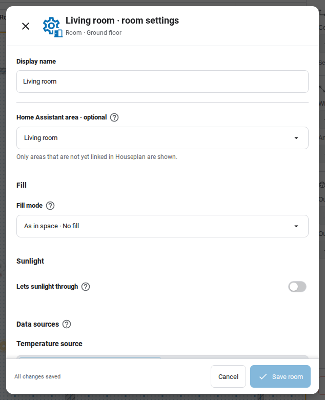

*Room settings contain the HA area, fill and reading sources.*

&emsp;&emsp;**Fill** has one list: **As the space** with its effective mode, or a local None / Custom color / Zigbee signal / Lights / Temperature mode. Custom reveals the colour/opacity control. When the temperature fill is in effect (own or inherited), two °C comfort-bound fields appear with a Cold / Comfort / Hot legend and an **As the space** link.

&emsp;&emsp;Choose whether to use the room average or a specific sensor. The choices work like ordinary radio buttons, including arrow keys and screen readers. For a specific sensor, press the button below to search and choose it inside the form. Name and label sizes are two sliders with an editable number and a named synthetic sample underneath.

&emsp;&emsp;They multiply the corresponding space sizes. For an existing room, change a field before saving. A new room can be saved with a valid initial draft. If you close a form with unsaved changes, House Plan asks what to do.

<a id="devices"></a>

## 9. Device editor and catalog

&emsp;&emsp;Use Devices to arrange the markers on your plan. To choose a data source, tap action or appearance, open the device settings covered in the next section.

<a id="10-devices"></a>

<!-- docs-section: devices -->

### Position versus configuration

&emsp;&emsp;On wide cards a click selects the marker in Properties; drag moves its saved centre. Double-click or **Open device settings** opens the complete form. On narrow cards the existing single-click settings path remains. Moving a marker changes layout, while explicitly choosing a room in its settings changes its room assignment. Changing the HA Area is a third, HA-owned operation.

&emsp;&emsp;Use the header eye to reveal hidden service devices temporarily. This is not a new saved layer, and it does not reactivate a device disabled in HA.

&emsp;&emsp;A device's editor context menu offers settings, copying, Hide or Show on plan, and Delete. Revealed user-hidden devices have a grey dot. The eye in the main toolbar controls local hidden-device display; the Devices dialog has no duplicate switch.

### Device editor

&emsp;&emsp;Arrow keys move the selected marker one current grid cell from its visible position, preserving its grid offset; `Shift` does not accelerate the step. Only the selected member of a contact group moves; the other visible anchors stay fixed. An invalid complete step does nothing. Each accepted press has its own **Undo/Redo** step. Focused inputs, dialogs and controls keep their native arrow action.

&emsp;&emsp;This does not edit drawn LED geometry.

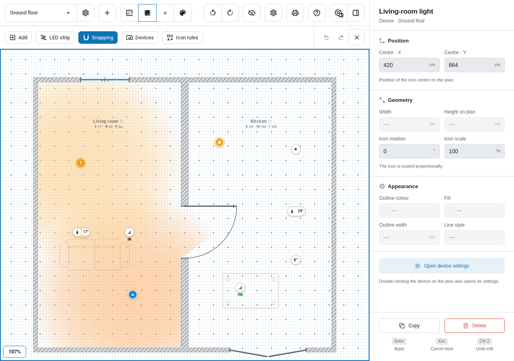

*Select a device on the plan to see its Properties on the right.*

- **Magnets** (#866, #1003) start enabled for this session. A marker snaps to
  a visible wall face, both faces of a corner, or an exact neighbour pitch.
  Hold **Alt** to bypass these magnets; equal spacing is independent. Flat
  groups reflow when a value or size changes and may separate safely if they
  cannot fit. All-virtual contours are dashed, mixed groups solid; wall-owned
  boundary strokes are omitted. Actions and dragging remain individual.
  Turning magnets off does not dissolve contacts. 2.5D keeps individual tiles.

- drag a marker to save its server-side position. One completed drag creates
  one position-history step; a cancelled, unchanged or failed drag creates
  none;
- guides refer only to other visible, movable icons on this floor, not hidden
  devices or icons replaced by LED strips. Leaving the page/editor/floor while
  dragging cancels that unfinished move and restores the icon; the next drag
  works immediately. A move already released for saving is not cancelled;
- **equal spacing** (#873): once two markers stand in one horizontal or
  vertical row, a dragged marker snaps to the point one step past either end
  of that row when the pointer is within 6 px of it, and lets go beyond 10 px —
  the same at every zoom. Two identical thin dimension lines show the
  reference gap (the far one of the row) and the new one with their length;
  when the length does not fit, both labels hide. The fourth and further
  markers repeat the same step. A row is markers on one horizontal or vertical
  with one step and no other marker within two steps past its ends; hidden,
  disabled and LED-strip markers do not count. The point is always a grid
  node, so a row of markers between nodes gives no snap — **Optimize plans**
  puts them on nodes. The drop is an ordinary position save with one history
  step, Undo restores the previous point without snapping, and no other marker
  moves. View and kiosk have no snapping;
- persistent Undo/Redo buttons affect marker positions, LED commands and panel
  icon scale/rotation (not unrelated marker settings). The same
  session-local history is available through `Ctrl/Cmd+Z`,
  `Ctrl/Cmd+Shift+Z` and `Ctrl+Y`, keeps up to 50 completed moves, and is not
  restored after reopening the card;
- click it to edit name, binding, room, tap action and presentation;
- **Add** opens the new-device dialog directly, without going through the
  device catalog;
- **Devices** opens one searchable device catalog. Its **On plan**,
  **Available**, **Hidden** and **Available again** tabs explain where every
  exact HA binding is and offer the next valid action;
- **Hide selected** / **Show selected** (#618): the **On plan** and **Hidden**
  tabs have a checkbox on every row and **Select all (N)** above the list. N
  counts every eligible row of the tab after search and **New only**,
  including rows behind **Show more**. With a selection the panel shows
  “Selected: K”, the action button with the count and **Clear selection**. The
  whole batch is saved in one write and confirmed by a “Hidden: K” / “Shown: K”
  toast. There is no confirmation prompt — the same tab reverses it. Rows that
  are disabled or missing in HA, or unverified, may be selected for deletion
  but disable Hide/Show for the entire mixed selection. Selection resets on
  space/tab/search/entity-visibility/**New only** changes, survives opening a device from the catalog, and is
  cleared after a successful save; a failed save changes nothing and keeps it;
- **Discovery filters** (#44) live on the **Available** tab: a switch that
  groups room lights into one marker (on by default) and the list of excluded
  integrations with search and a "Restore recommended" reset. Changes show
  appear/disappear counters before anything is written; Save stores the
  settings once. Filters only affect automatic candidates — a device you
  placed explicitly never disappears because of them, and an excluded
  candidate names its integration in the catalog;
- **Add device** is the renamed **Add virtual device** button: it opens the
  same new-marker form without saving automatically. Enable **Show
  entities** in **Available** to place an individual entity;
- The direct header eye **Show hidden devices**, including in a narrow
  header, temporarily reveals hidden markers; the catalog has no duplicate switch. Active hidden devices appear normally
  in every mode, with ordinary effects, lights and controls. This browser
  remembers the choice per user/card without changing the saved Hidden flag
  or switching real lamps. HA-disabled devices remain editor-only service ghosts;
- **Icon rules** edits the first-match regular-expression list.

&emsp;&emsp;The catalog also includes virtual devices, identified individually by marker ID. They support Find, settings, Hide/Show and Delete without invented HA statuses or an Available-again entry after deletion.

&emsp;&emsp;**Space** filters every tab together with search, without switching the plan. A new catalog starts at **All spaces**; **No space** includes unassigned or ambiguous candidates rather than guessing a floor from the current tab. Placed devices use their actual plan space. Tab counters reflect the space filter but not search; Select all includes matching rows behind Show more.

&emsp;&emsp;**Delete selected (N)** on On plan/Hidden asks once for the exact named set. It removes settings, positions, attachments and saved robot paths; LED shapes stay unbound. HA devices/entities and opening contact/lock links are not deleted. One config write commits the batch. In the active Devices editor it is one structural Undo step; outside that editor no new device history is created, so keep a backup.

&emsp;&emsp;A stale confirmation requires checking the list again.

&emsp;&emsp;An automatically discovered marker is already **On plan** even before it has saved marker settings. The **New** badge is independent and remains until the marker settings are opened. **Find on plan** centres and briefly selects the marker without changing config or acknowledging that badge. Hide and Show are reversible; Delete leaves an exact binding tombstone and moves an active HA binding to **Available again**.

&emsp;&emsp;A disabled or missing binding keeps its saved category and receives a separate Home Assistant status instead of silently moving to another tab.

### How markers appear automatically

&emsp;&emsp;House Plan reads Home Assistant device, entity and area registries. A device in a bound HA area receives an automatic marker. Service-only records, bridges and other non-spatial records are filtered; a light group may replace its members. Newly discovered devices get a red dot until first opened in Device. Devices automatically placed when you save a newly created room bound to an HA area are the exception: a successful room save acknowledges them immediately.

&emsp;&emsp;This also applies to splitting a room or creating several rooms from walls. Existing red dots are kept. Devices arriving in HA later still get a red dot.

&emsp;&emsp;When the Area of a direct HA device or a separately placed entity changes, House Plan moves its automatic marker to the room bound to the new Area. A previous manual drag is layout, not a room override: it is discarded, the ordinary room grid chooses the new position and the red attention dot appears. Selecting a room explicitly in the marker settings overrides HA Area placement.

&emsp;&emsp;Ambiguous or unbound Areas never make House Plan guess a destination.

&emsp;&emsp;Service and non-spatial integrations such as HACS, system records, bridges, scenes and some aggregates are filtered when the list is first materialised. Room light members may be replaced by one group marker. Newly discovered devices receive a red attention dot until their marker settings are first opened, except for the intentional room-creation placement described above.

&emsp;&emsp;The compact marker size is stored directly in its base geometry, so its saved point remains the centre and the action target does not shrink. In Value mode the inner number capsule has true semicircular ends and even inset inside the outer shell.

### Copying in the device editor

&emsp;&emsp;In **Devices**, right-click an ordinary marker or LED strip and choose **Copy device** to create an independent virtual marker nearby. Real HA devices, including automatically placed ones without saved overrides, can be copied too. Appearance, description, files and incoming/outgoing light links are retained; the original's own HA binding and live equipment state are not.

&emsp;&emsp;The base HA icon is pinned; the light's own HA colour/brightness become manual values. The copy uses the Always light role when needed for its source or incoming links. Normal virtual-light rules still apply: a new unlinked manual lamp starts on.

&emsp;&emsp;Names fill the first free number from 2: copying “Lamp 4” can produce “Lamp 2”; another numeric suffix is never appended. The copy keeps the same floor and room assignment but may be placed outside the room outline when space is tight. Neither the original nor its neighbours move. An LED is copied as an **ordinary icon**; its existing strip remains with the original.

&emsp;&emsp;Attachments are independent, as are later edits. A changed plan or failed save asks you to refresh before retrying; damaged links are never silently discarded. Copying itself sends no equipment commands. Escape or an outside click closes the menu. No new touch copying gesture is introduced. Copy and Delete now join the device editor's history.

### Undoing device copies and deletions

&emsp;&emsp;The **Undo** and **Redo** buttons beside Close, plus `Ctrl/Cmd+Z`, `Ctrl/Cmd+Shift+Z` and `Ctrl+Y`, use one ordered 50-step history for Copy, Delete, movement, icon size/angle, appearance and LED changes. After Copy, Move and Delete, three Undo actions restore the deleted copy, restore its previous position and remove the copy itself, in that order.

&emsp;&emsp;Redo restores the same copy. These shortcuts still edit text when a text field has focus.

&emsp;&emsp;Copy, Delete and their Undo/Redo complete after the server confirms the save. Until then the toolbar shows **Copying device…**, **Deleting devices…**, **Undoing: …** or **Redoing: …**; repeated or conflicting actions are disabled. A lost reply is resolved before another operation, preventing a duplicate copy. A refusal does not advance to another history step.

&emsp;&emsp;Movement, size, angle and LED edits keep their immediate preview and roll it back if saving fails.

&emsp;&emsp;Delete from device settings, Properties and the Devices catalogue while the device editor is active uses the same history. Batch Delete is one atomic step for the whole selection. Undo restores the marker's settings and position, related links, room assignment, LED bindings and attachments without changing the strip's shape. It never creates or deletes an actual HA device or entity.

&emsp;&emsp;Robot settings return, but its cleanup path comes from current data rather than an old history step.

&emsp;&emsp;Independent changes from another client are retained. If the device or related data changed and restoration is unsafe, House Plan explains the refusal and removes only the unusable step; other steps keep their order. History belongs to the current card, user and connection, is not included in backups and does not survive a page reload.

&emsp;&emsp;A structural step can become unavailable after 24 hours without activity. Attachments stay available while their command can be undone; releasing history never deletes files referenced by the current plan or another applicable command. With an older integration, ordinary Copy and Delete remain available, but their new Undo support is unavailable.

<a id="device-settings"></a>

## 10. Device settings, actions and visual states

&emsp;&emsp;Open a marker’s settings from its context menu, the catalog or the editor. You are changing how the device appears on the plan; its entry in the Home Assistant registry stays as it is.

<a id="11-tap-actions"></a>

<a id="12-device-visual-states"></a>

<!-- docs-section: visual-states -->

### A practical settings example

&emsp;&emsp;To show a washer’s running state but open its HA control dialog, choose the running entity under **Display on plan → Icon state source**, then choose the HA more-info action and its target under **Actions and links**. Neither setting changes the value source, battery, LQI or light role. Read the resolved target and preview before Save; a pretty icon is not proof of a valid command target.

&emsp;&emsp;For a virtual lamp controlled by a real switch, follow [the linked-lamp example](#a-dumb-lamp-with-a-smart-switch). For a robot/radar/strip, use [special devices](#special) as well as these common settings.

### Choose the Home Assistant dialog for a device

&emsp;&emsp;In device settings, open Actions and links and select HA more-info dialog. The Open in Home Assistant field below it offers Auto (the main functional entity, such as the thermostat) and this device’s own entities, with search inside the list. The same selection applies to Open in HA in the device card. Right-click opens the five-command menu; its HA more-info command uses the same target and Settings is its first row.

&emsp;&emsp;Icon activity, displayed values and control targets remain independent. A deleted or disabled explicit target produces a warning instead of silently opening another entity.

### Why a device reports an alarm

&emsp;&emsp;The existing device info card lists all active alarm sources at the top: their names, reasons and Home Assistant states. Source details show the entity id, raw state and device class. Open source in Home Assistant opens that exact entity; it does not reset the alarm or change a device. Ordinary users and kiosk users can read these details with keyboard or touch.

&emsp;&emsp;Device settings show the same actual reasons in the display preview.

&emsp;&emsp;Verified Home Connect Local machine-care and filter-cleaning reminders appear as maintenance, with a passive yellow wrench to the left of the marker. They do not trigger red alarm pulsing while an appliance is off. Actual faults retain red priority; the card lists both groups when they coexist. Static display modes keep their neutral face while the card still explains current causes.

### Bindings

| Binding | Use |
|---|---|
| HA device | Uses its related entities and resolves a primary function |
| HA entity | Exact entity binding after enabling “Show entities” |
| Virtual device | Label/icon/description only, with no live active state |

&emsp;&emsp;The same binding cannot be used by two markers.

&emsp;&emsp;When an exact HA entity belongs to a device, placing that entity gives its channel to the entity marker. The automatic parent marker, if needed, contains only the remaining active, HA-visible and unplaced entities; it disappears when that residual is empty. HA-hidden siblings alone do not keep an automatic parent on the plan. To show both the exact entity and the complete device, place `entity:X` and `device:D` explicitly — two explicit markers are treated as an intentional configuration.

&emsp;&emsp;Deleting an entity marker returns the entity to automatic parent discovery; its binding tombstone does not remove registry data from the live HA device.

&emsp;&emsp;After deleting a complete HA device, you can restore only one of its entities: open **Devices → Available**, enable **Show entities**, and select that entity. House Plan returns the selected marker with a fresh position while the complete device and its other entities remain deleted. The complete device stays available in **Available again** if you later decide to restore it explicitly as well.

### Marker basics

&emsp;&emsp;Every device has the same five sections: **Basics**, **Display on plan**, **Actions and links**, **Light and glow** and **Details**. A vacuum or an automatically recognized radar has an additional section below a divider. LED strips have no empty extra tab: choose their representation in **Display on plan** and edit the strip shape with the existing plan tool.

&emsp;&emsp;A section selector replaces the side menu on narrow screens. All four settings dialogs follow the current Home Assistant theme, including theme changes while open.

&emsp;&emsp;**Basics** contains the name, Home Assistant binding, room and any applicable climate-source options under **Room metrics**. Binding is a **Virtual / Home Assistant** segment. The picker starts closed and opens only on request; Escape closes the expanded list, returns focus to its button and retains the form draft. The picker searches devices and, with **Show entities**, individual entities.

&emsp;&emsp;You can see its selected binding in one row; search help belongs to the picker, while the binding-mode hint explains what the two modes mean. A required missing binding disables Save and shows the reason below the field.

&emsp;&emsp;**Display on plan** contains the existing searchable MDI picker, LED representation, icon/value and badge sources, adjacent battery/Zigbee hide switches, size, rotation and the actual device preview. Clearing the picker restores the automatic icon. The preview uses the same presentation as the plan at a standard size: size changes apply to the saved plan marker, while rotation updates the preview icon and leaves values and badges upright.

&emsp;&emsp;Saved missing sources remain visible as missing rather than being silently replaced.

&emsp;&emsp;**Actions and links** contains tap actions, their exact target/result, optional confirmation and **Controls other light sources**. Linked sources appear as chips with their device names. **Ask for confirmation** appears only for toggle or run actions. **Light and glow** contains the source role, leading entity, glow mode, colour, brightness and radius.

&emsp;&emsp;Auto reports its resolved result; Never dims the glow controls and explains why. **Details** contains model, manufacturer/product link, description and attachments. Each attached file has its own remove action; removing a chip is part of the draft.

&emsp;&emsp;The footer keeps **Hide / Delete** on the left and **Cancel / Save** on the right. Hide is a draft change; Delete confirms before removing the marker, not the Home Assistant device. Switching sections preserves the draft. Save status shows unsaved changes; a failed save keeps the form and draft for a retry. Vacuum live-source/path controls, map/calibration workflows and radar setup keep their existing separate confirmation and save boundaries.

| Field | Purpose |
|---|---|
| Name | Plan label and House Plan card title |
| Binding | Virtual device or an HA picker with search and **Show entities**; Save stays disabled until a required binding is chosen |
| Room | Automatic HA area or an explicit room, including one with no HA area |
| Tap action | House Plan card, HA more-info, Device settings, Toggle, Run or **Do nothing**, with the exact target/result shown below |
| Controls other light sources | **Actions and links**: named chips for other placed `light.*`/`switch.*` markers or forced sources; the marker's own entities are not listed |
| Is a light source | **Auto / Always / Never**; Auto shows its resolved result, Always may choose a leading entity, Never disables only the marker's own source |
| Glow colour and brightness | From source, fixed colour, or fixed colour and brightness; manual brightness is 1–100% |
| Glow radius | Shows the current General value until overridden; leaving that displayed value untouched does not save a local override. Empty or non-positive input uses the General radius; valid stored range is 0.1–100 m |
| Icon and display | Automatic or manual `mdi:*`; icon/state/activity, value/state, static icon or value/static icon |
| Icon size and rotation | ×0.5–×3 and a 5° angle step; the preview stays at standard size and rotates only the icon |
| Include the device temperature in the room | **Basics → Room metrics**: includes climate `current_temperature` in the marker and its room average |
| Model, link, description and instructions | Informational card data and multiple PDF/PNG/JPG/WebP/TXT attachments |

&emsp;&emsp;The footer keeps **Hide** and **Delete** on the left and **Cancel**/**Save** on the right. Hide preserves configuration and may preserve aggregate room data; Delete removes the marker and its layout after confirmation.

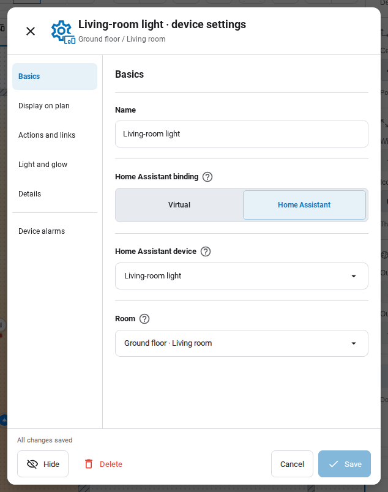

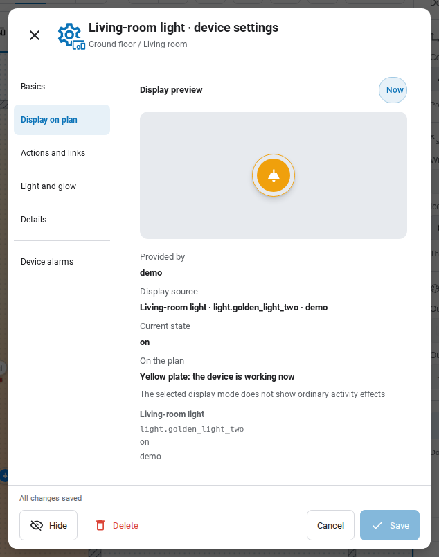

### A “dumb” lamp with a smart switch

1. Add a virtual marker at the lamp's real position.
2. Set **Is a light source → Always**. With no HA entity it becomes a passive
   source; choose its colour, brightness and radius manually.
3. Open the smart-switch marker and add that lamp under **Controls other light
   sources**.

&emsp;&emsp;The switch now reports aggregate work, while the floor pool, room fill and statistics belong to the lamp and its room. Several switches use OR. A `marker:*` value is only an internal plan link and is never sent to HA as an entity ID. Tapping the linked virtual lamp with **Toggle state** toggles the union of its real incoming controllers; tapping a switch controls only that switch's own group.

&emsp;&emsp;Live HA state remains authoritative, so physical switches, automations and other dashboards update both markers and all lighting effects.

&emsp;&emsp;Without incoming controllers, the same virtual **Always + Toggle** combination uses the manual state: a new lamp starts on, the state is shared by full and static cards and survives reloads and HA restarts. Saved outgoing controls are retained but do not call services in that unlinked mode. Adding/removing the last incoming link does not erase the previous manual state.

&emsp;&emsp;Hide preserves it; deleting the marker clears it. It is not an HA helper and is not included in plan import/export.

&emsp;&emsp;Delete and Hide are different. Delete removes the marker from LQI, climate, light, Glow, room cards, actions, live text and other markers' external controls; its binding moves to **Available again**. An exact opening contact or lock remains a separate binding. Re-adding creates a new position and restores saved references without duplicating the opening binding.

&emsp;&emsp;The position leaves the plan; Devices editor history retains it and attachments while Undo remains available. Deletion outside that editor context has no new recovery history. The server-side vacuum trail is discarded and starts afresh after restoration.

### Hidden devices

&emsp;&emsp;A hidden marker with the eye Off:

- is absent from View and all editors;
- has no state colour, value, temperature, humidity, LQI, Glow or light-source
  contribution;
- may still contribute LQI and climate data to the explicitly assigned room.

&emsp;&emsp;The header eye **Show hidden devices** temporarily reveals active hidden devices as ordinary devices in View and every editor. The Hidden catalog category does not change, and has no duplicate display switch. This browser remembers the choice separately for each HA user and card. Toggling never changes saved visibility, controls real devices or moves the camera; the next **Fit all** includes revealed devices.

&emsp;&emsp;Kiosk adds no new button, and the independent static space card does not inherit the choice. Disabled, removed or unverified bindings never become ordinary active devices.

&emsp;&emsp;Use **Devices → On plan**, row checkboxes or **Select all (N)** and **Hide selected** for a batch; reverse it under **Hidden → Show selected**. Disabled, missing or unverified bindings can be selected for Delete but disable Hide/Show for the entire selection. Selection resets on space/tab/search/entity-visibility/**New only** changes, survives opening one device, clears after a successful save and remains after a failed one.

### Disabled in Home Assistant

&emsp;&emsp;When a device, exact entity or every entity of a device has `disabled_by`, its binding is temporarily excluded from markers, LQI, climate, light, Glow, live text, openings, actions and vacuum position/trail. Configuration, layout, attachments and server history are retained. The catalog keeps the marker on its current catalog tab with **Disabled in Home Assistant** status; **Show hidden on plan** reveals a gray service ghost.

&emsp;&emsp;You may inspect it, edit description, remove it from the plan or open HA settings, but Show is unavailable until HA enables it. The same ID then returns with its old settings and position, including the user's separate Hidden choice.

&emsp;&emsp;If the current account cannot read the complete HA registry, House Plan does not infer disabled state from a missing row. Proven live bindings continue to work; unverified ones safely stay out of the plan until registry access returns.

### Tap actions

#### Marker gestures

&emsp;&emsp;In ordinary View, right-click a device to choose Device settings, HA more-info, Device card, Hide (or Show on plan for a hidden device shown through the eye), or Delete. Read-only users retain informational commands; writer commands are disabled with a reason. Kiosk keeps its existing refusal and touch hold keeps opening the device card.

&emsp;&emsp;Delete removes the plan representation only after the existing confirmation. The menu uses the common UI Kit and leaves the current mode, floor and camera unchanged.

| Gesture | View | Device editor |
|---|---|---|
| Short click/tap | Configured action | Select in Properties on wide cards (≥1024 px); open marker settings on narrow cards |
| Hold 600 ms | House Plan device card | No device control |
| Right click | Five-command device menu; read-only keeps information commands, kiosk keeps its permission hint | Settings, Copy, Hide/Show and Delete menu |

&emsp;&emsp;If you cancel a press,, a release beside the marker or window focus loss neither opens a card later nor switches the device. After returning from the background, the next fresh tap or Enter works immediately; an old gesture tail does nothing. An already open device card remains open when the window loses focus.

&emsp;&emsp;When a short activation actually sends a device command, the marker gently shrinks by 5% and returns over 0.2 s. Merely opening information, an editor or a confirmation does not trigger feedback; with confirmation it starts only after approval and dispatch. Reduced motion replaces the scale with a brief steady accent.

#### Actions

| Action | Behaviour | Safety |
|---|---|---|
| Device card | House Plan card with entities, model, description, links and files | No state change |
| HA more-info | Native dialog for the exact primary entity | No state change |
| Device settings | Existing House Plan settings for this device, without leaving View | Requires House Plan edit permission outside kiosk; no tap confirmation or device command |
| Toggle state | Toggles the exact binding, supported device function or configured light-source group | Locks, alarm panels and protective garage/door/gate targets receive no command; other supported targets can ask for confirmation |
| Run | Runs an automation, script or scene | Explicit target; confirmation is optional |
| Do nothing | Short click/tap, Enter and Space are ignored | No dialog, command, confirmation, toast or press feedback |

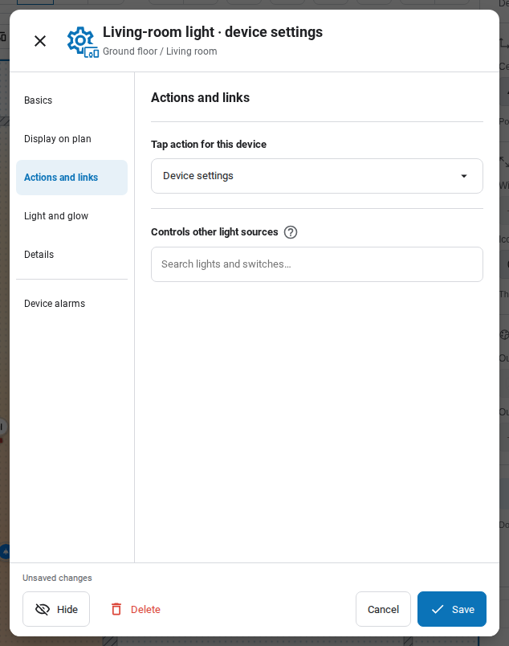

*The tap action is configured separately from the device appearance.*

&emsp;&emsp;When confirmation is enabled for **Toggle state**, the dialog shows the current state and the exact expected result (`On`, `Off`, `Open`, `Closed` or `Stopped`). A group shows the active/total count and lists unavailable targets separately; the result describes only the targets that will receive the command. The text is a snapshot, but Confirm re-resolves the live state and direction.

&emsp;&emsp;If the target set changed while the dialog was open, House Plan cancels the action and asks you to try again.

&emsp;&emsp;A light defaults to Toggle; other devices default to the House Plan card. An unsupported Toggle stays selectable but clearly shows that it will send no command and is never changed into another action behind the user's back. **Do nothing** is an explicit saved choice, not the default: it keeps the marker's normal appearance, hover, long-press House Plan card and the independent right-click device menu while disabling only short activation.

&emsp;&emsp;Right click opens the device menu regardless of the saved tap action; Settings is its first command.

&emsp;&emsp;When **Device settings** is the saved tap action, a short tap, Enter or Space opens it. View keeps the same plan and space; closing the dialog returns there. Users without House Plan edit permission and everyone in kiosk see a permission hint; no settings, information card or HA more-info opens. HA admin status alone does not replace House Plan edit permission.

&emsp;&emsp;The explicit **HA more-info** action and long-press device card remain available as before. Settings on touch remain best effort.

&emsp;&emsp;If every explicitly configured `controls` target is unavailable, missing or disabled in HA, a short tap sends no service call and the standard local House Plan message names the target and explains that no action was performed. A partially available group still operates only its available subset, so it does not show the misleading no-action message.

&emsp;&emsp;When a device-bound marker has two or more own `light.*`/`switch.*` entities, **Entity to toggle** appears below Toggle. It selects the exact own channel and updates the target hint before Save. **Automatic** keeps the previous binding / functional-role rules. If a saved entity is missing, its selection stays in the settings. A warning explains that House Plan is temporarily using the fallback; returning the same entity restores the choice.

&emsp;&emsp;This setting is independent from **Leading light entity**. With an explicit external controls group, an explicitly selected own entity joins the group; without a selection existing groups remain external-only.

&emsp;&emsp;Toggle remains selectable for every marker, including virtual ones. A marker with no suitable target clearly explains that tapping will send no command; House Plan does not silently replace it with a card. An exact entity binding never substitutes a sibling relay. With several controlled sources, any active source makes the next action turn all off; if all are off, it turns all on.

&emsp;&emsp;Only available targets receive the command, and the hint names every skipped target. The controller's own availability remains independent from that aggregate work state.

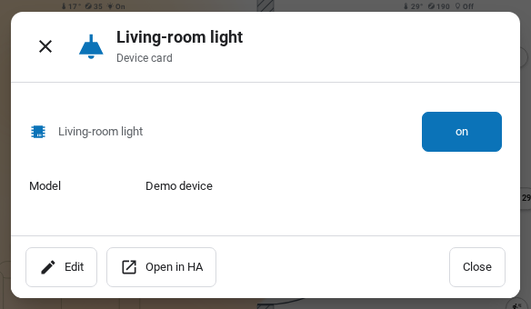

### Device visual states

#### Icon state source

&emsp;&emsp;In device settings, open **Display on plan → Icon state source**, immediately after Display method. Auto keeps the existing logic. Choose an entity of the same physical device, for example the washer's running sensor instead of power. Search by name or entity_id inside the expanded list; no extra search field appears in the closed form.

&emsp;&emsp;Escape closes the list, not the settings dialog. In **Active when**, choose **Automatically** or **Set manually**. The question-mark help explains automatic type, class and state semantics. Manual mode accepts one exact HA state such as `running` or `washing`, not a formula or threshold.

&emsp;&emsp;The device image uses the full preview width, with integration, source, current state and activity explanations underneath. Missing data means unknown activity, without silently selecting another source. Actions, readings, battery/Zigbee, Glow and room lighting are unchanged. Safety alarms retain priority; door/lock/cover faces keep their automatic special state.

&emsp;&emsp;Virtual devices have no own HA entities. Choose Auto and save to restore the previous behaviour.

#### Indication layers

&emsp;&emsp;Presentation uses one shared outer shell around three independent layers: stable core, icon or value, and optional activity pulse. Visual priority is **alarm → keyboard focus → selected → hover → semantic state → neutral**.

&emsp;&emsp;Confirmed unavailable devices fade the whole ordinary marker to 35%; the inner icon/value/badge does not receive a second fade. Off devices keep their ordinary opaque icon and circle. Tooltips name Off or Unavailable after the name/model. Unavailable devices retain no visual hover and no pulse, but their ordinary activation may still open information or settings.

&emsp;&emsp;A media player in `off` keeps the ordinary icon paint. Hover starts only from a real hover-capable mouse. Finger or pen input clears tooltip/highlight immediately; later mouse movement restores desktop hover.

#### Background and stable status

| State | Meaning | Examples |
|---|---|---|
| Red alarm | Critical condition, even with live states disabled | Smoke, gas, CO, leak, tamper/problem/safety, triggered alarm |
| Yellow | Device is doing its main job | Light/switch/fan on, active climate, vacuum cleaning, known appliance work |
| Red lock | Lock is unsecured | Unlocked/open lock |
| Green lock | Lock is secured | Locked lock |
| Orange | Physically open | Door/window contact, opening valve |
| Faded whole marker | Confirmed own offline | Every active own entity explicitly unavailable; ordinary marker, circle and contents fade once to 35% |
| Ordinary icon, Off in tooltip | Own Power Off | Explicit own power domain or composite Power=off; circle and badges keep ordinary paint |
| Neutral | No alarm, work or open condition | Off, closed, idle, standby, docked |

&emsp;&emsp;For a controller with `controls`, target work and controller availability are independent. The controlled lights still decide whether the marker is yellow, but only the controller's own active entities decide whether it fades. A live battery, Zigbee LQI or update entity therefore keeps a wireless switch neutral and opaque when all of its lamps are unavailable.

&emsp;&emsp;If an active physical HA device exposes no entities at all, House Plan also keeps its controller opaque: missing telemetry alone is not evidence that the device is offline, so its controlled target makes it yellow when working and neutral otherwise. If the device does expose own entities but has no real own reading, a working target does not create yellow paint or a pulse.

&emsp;&emsp;Only every own row explicitly reporting `unavailable` fades the whole ordinary marker; a mixture with missing/unknown is not confirmed offline. A virtual controller has no physical offline evidence. Off/idle/standby/ paused remain real available samples, including media players. Explicit own Power Off dims only the inner MDI icon.

&emsp;&emsp;Own unavailable dims the ordinary frame, contact ink, LQI and battery together; its separate 2.5D shadow retains ordinary paint. An LED strip keeps its ordinary inactive shape and fades only badge text when a badge is present. This remains true when the same target was separately removed from the plan: the removed marker is not restored, but it cannot make the controller look offline or make its editor preview disagree with the plan.

&emsp;&emsp;For a composite appliance with a dedicated Power switch, Power=`on` alone remains neutral. If Home Assistant also exposes a dedicated work-state entity such as Status/Run state/Job state, active values (`start`, `running`, `washing`, `rinse`, and similar work states) make the marker yellow; idle, paused and terminal values remove it.

&emsp;&emsp;Power=`off` still dims only the icon; confirmed own unavailable dims the ordinary marker even if the work-state value is stale. Mode, Program, Stage and remaining time are not treated as independent proof of work, and an ordinary lone relay keeps its existing yellow-on behaviour.

#### Activity

&emsp;&emsp;Ordinary activity appears only for **Icon + state and activity** while live states are enabled; a critical alarm remains a separate signal in every dynamic mode.

| Activity | Duration | Sources |
|---|---|---|
| Short event, three waves | about 3.3 s | motion/vibration/sound trigger, contact opening, button/event change, manual Run, terminal transition without a travelling state |
| Persistent presence | while active | occupancy/presence binary sensor |
| Persistent transition | while moving | cover opening/closing, lock locking/unlocking, valve opening/closing, moving sensor, vacuum returning |
| Persistent work | while working | lights, switches, fans, humidifiers, climate work, vacuum cleaning, scripts and known appliance work states |

&emsp;&emsp;Activity may be a finite three-wave event, persistent presence, a travelling transition, or persistent work. Continuous motion uses a 3.6 s cycle (green presence, amber work, blue neutral transition), a short event lasts 3.3 s, and the two-wave red alarm cycles in 2.4 s. Explicit saved pulse color/size remains authoritative; the package size default is 1.5 diameters. `prefers-reduced-motion` replaces ordinary motion with a compact colored indicator while the static red alarm remains clear.

#### Five Display modes

| Choice | Icon | Status background | Activity | Value |
|---|---:|---:|---:|---:|
| Icon + state | Yes | Yes | Alarm only | Optional compact °/% and LQI |
| Icon + state and activity | Yes | Yes | Yes | Optional compact °/% and LQI |
| Value + state | Automatic fallback when no unambiguous value; a virtual marker keeps an icon fallback | Yes | Alarm only | Automatic or explicitly selected state, attribute, LQI or linked-light state |
| Always-static icon | Yes | Theme-neutral | No | No |
| Value + static icon | Same value/fallback rules as Value + state | Theme-neutral | No | Same source as Value + state |

&emsp;&emsp;The five display choices are icon + state; icon + state + activity; value + state; always-static icon; and value + static icon. **Value + static icon** combines the two: the marker content follows the same rules as **value + state** — the same Value source, the same numbers and localized states, the same icon fallback with its reason — while the colour behaves like **always-static icon**.

&emsp;&emsp;State, alarm, unavailability, live RGB colour and activity never change the marker; there is no pulse at all, the compact °/% and LQI readings stay hidden, and the separate value badge is suppressed the same way (the setting is kept), because the value is already inside the marker. A vacuum in this mode draws no live puck, trail or route warning, and its saved history is not deleted.

&emsp;&emsp;For **value + state**, the Device editor also offers **Value source**. Keep **Automatic (as before)** for the legacy choice, or select one of those same readings—for example, cover position—to replace the icon with `42 %` rather than `Open`. A temporarily unavailable saved source stays selected and shows `—` until it recovers; it is not silently replaced.

&emsp;&emsp;Changing this source never changes what a click or tap does. Text and adjacent values are sections of the same shell. They shrink to a readable floor and then expand the shell; they are never ellipsized. The complete visible value capsule is one hover and action target: clicking or tapping its value section runs exactly the same configured action and safety checks as the icon core.

#### Value badge beside a device

&emsp;&emsp;The editor may add an independent badge, select a state, useful attribute, average LQI or linked-light state, and place it on the right, bottom, left or top. A missing saved source stays selected and shows `—`. It may accompany a normal icon or Value + state. Bottom placement puts system LQI on a second row; when the badge itself is LQI, the duplicate row is hidden.

&emsp;&emsp;Old markers keep their automatic °/% badge; explicitly turning the badge off suppresses that legacy heuristic. The badge does not depend on the general temperature option, which now affects only room averaging.

&emsp;&emsp;The whole outer capsule is one hover and activation target. Always-static icon and Value + static icon temporarily hide the badge without deleting its setup. The preview uses the unsaved form and live HA state, and may run a local short or persistent pulse sample without touching HA, the saved config or the marker on the plan.

&emsp;&emsp;The separate battery indicator remains visible in both static display modes and with live states disabled. This does not restore LQI, pulses or other suppressed diagnostics.

#### Zigbee signal visibility

&emsp;&emsp;House Plan reads each device's own LQI directly from Zigbee2MQTT or ZHA; enabling diagnostic entities is not required. This works independently of Zigbee links, including for household users and authenticated read-only kiosks. For a custom Zigbee2MQTT base topic, enter it in the existing General settings Zigbee topics field; it is available with links off and no scan is needed.

&emsp;&emsp;ZHA reads already cached values every 30 seconds without contacting the radio.

&emsp;&emsp;After a House Plan/HA restart, a first value may need the device's next message when no retained/cached value exists. Available Home Assistant diagnostics are the fallback. A disconnected direct source may retain its last known number, with an explanation in the tooltip; reading it does not mean it was measured now. A real LQI of zero is shown as zero.

&emsp;&emsp;Values remain in memory only and are excluded from backups and exports.

&emsp;&emsp;**General settings → Display → Show Zigbee signal**, immediately below battery status, offers **Always show** (default), **Low only** and **Do not show** for system signal numbers. Low only keeps **LQI ≤ 50**, including 50 and zero; missing data is not zero. This is a weak-link indicator, not a confirmed fault, and the colour scale stays unchanged.

&emsp;&emsp;In **Space settings → Appearance → Visible layers**, choose **Use general settings** or any of those three modes. The inherited choice shows the current shared value; saving another field does not turn inheritance into an override.

&emsp;&emsp;Existing Off choices stay Off. Historical On choices inherit the new shared setting. YAML `show_signal: false` remains a card exception; true or omission inherits. An explicit space mode, including Low only, wins over that exception. A device's local Hide Zigbee signal option still removes its system number. The two visual card editors no longer duplicate this control.

&emsp;&emsp;The panel, full/static cards, kiosk and preview agree. Room-card signal metrics, Zigbee room fills, explicitly selected LQI values/badges, battery diagnostics and the separate Zigbee-link preference remain independent.

#### Battery charge

&emsp;&emsp;Battery-powered devices show a vertical battery to the right of the complete icon/value and badge block, without a percentage label:

- **Green:** 60–100%.
- **Amber, approximately one-third full:** from 20% up to, but not including, 60%.
- **Red empty outline:** from 0% up to, but not including, 20%.
- **Grey with a question mark:** a battery source exists but has no current value.

&emsp;&emsp;An integration reporting only normal/low uses green/red. With several sources, the first numeric battery sensor in entity-ID order is selected, otherwise the first binary battery sensor. A missing value does not switch to another source. A marker bound directly to a battery entity uses that exact source; other entity markers inherit their own physical device's battery, never the battery of a controlled device, group member or parent router.

&emsp;&emsp;Non-battery and virtual devices, active LED strips and the moving vacuum puck have no indicator. The normal vacuum dock marker follows the ordinary rules. The indicator does not enlarge the device's click target; Zigbee hover information appears above it.

&emsp;&emsp;**General settings → Display → Show device battery status** has three choices: **All** (the default) shows every battery device, **Low only** shows just the red indicators (below 20 % or a low binary sensor) and hides the green, yellow and grey ones, **None** hides them all. The choice applies installation-wide, including static space cards and the editor preview.

&emsp;&emsp;In an individual device's **Display on plan** section, **Hide battery status on plan** suppresses only that device in every mode; it is off by default and has no effect on the ordinary value badge. Battery icons use a soft size-aware shadow to stay legible over light and mixed plan backgrounds. Full configuration export/import preserves both settings.

&emsp;&emsp;The adjacent **Hide Zigbee signal on the plan** option removes only that marker's system LQI line, not your explicit value/badge, tooltip or requested Zigbee routes. It is off by default. Entity markers read charge and signal from their own physical HA device, never its radio router. Multiple channels of one device give one vote in each room's LQI average.

&emsp;&emsp;Routes prefer a visible device marker, otherwise the first eligible configured entity; hovering another channel keeps that representative. A representative on another floor gets a named floor bubble, not a line through floors.

&emsp;&emsp;The main tooltip of a battery device, on hover and on keyboard focus, has its own charge line from the same source: “Battery N%” (rounded to a whole number), or “Battery normal” / “Low battery” for a binary sensor. It does not depend on **Show device battery status** or **Hide battery status on plan**; with no current value, or with the sensor or device disabled in Home Assistant, there is no line.

&emsp;&emsp;If the device's value badge already shows that same battery sensor, the charge is not repeated in the tooltip.

#### Icon changes by state

&emsp;&emsp;With live states enabled, known pairs change automatically:

- door/window/garage: closed/open;
- blinds, shutters, gates and other covers: closed/open;
- lock: locked/unlocked;
- standard bulb: off/on.

&emsp;&emsp;A manual icon normally stays fixed. A known `cover.*` pair may still change so the open state is not hidden.

#### Matrix by device type

| Type | Stable status | Activity in Icon + activity | Default short click |
|---|---|---|---|
| `light.*` | Yellow while on | Work while on | Toggle |
| `switch.*`, `fan.*`, `humidifier.*` | Yellow while on | Work while on | House Plan card unless Toggle is explicit |
| Composite appliance with Power | Power on alone is neutral; explicit active lifecycle is yellow; Power off/unavailable dims | Work only from an explicit lifecycle | House Plan card |
| Motion/vibration/sound sensor | Neutral | Short event on off→on | House Plan card |
| Occupancy/presence sensor | Neutral | While presence is active | House Plan card |
| Door/window/garage contact | Orange while open | Short opening event | House Plan card |
| Ordinary `cover.*` | Neutral | Travelling while opening/closing | House Plan card; explicit Toggle does open/close/stop |
| Protective garage/door/gate cover | Neutral | Travelling | Saved Toggle clearly explains that it will send no command |
| `lock.*` | Red unlocked, green locked | Travelling while locking/unlocking | Card; Toggle forbidden |
| `valve.*` | Orange while open/moving | Travelling | Card; Toggle may be explicit |
| `climate.*` | Yellow for real heating/cooling/work; HVAC mode fallback only when action is absent | Work | House Plan card |
| `media_player.*` | Neutral circle; off dims only its icon, confirmed own offline dims the ordinary marker | None | House Plan card |
| `vacuum.*` | Yellow cleaning/returning | Work/travelling | House Plan card; live puck opens HA more-info |
| `script.*` / `automation.*` | Script yellow while on; automation stays neutral | Work / short explicit Run event | Card or explicit Run |
| `button.*` / `event.*` | Neutral | Short event on change | House Plan card |
| Smoke/gas/CO/moisture/safety/tamper/problem, siren, triggered alarm | Red alarm | Alarm has priority | Card; dangerous Toggle forbidden |
| Virtual marker | Neutral | None without an HA source | Card or explicit Run |

&emsp;&emsp;Virtual devices use the ordinary neutral/hover background with a dashed outer circle. An HA-less virtual device does not invent unavailable or activity; a linked virtual light may still follow its real controller. Confirmed own unavailable dims the ordinary marker once, without visual hover or motion; its existing click/tap still opens information or settings.

&emsp;&emsp;Marker LQI uses the same continuous red-to-green scale as before the package update; the room fill gradient and the displayed number are unchanged.

&emsp;&emsp;Interactive View/kiosk and Device-editor markers have at least a 44×44 CSS px target. Enter and Space reuse the exact current click and confirmation path; Plan, Background, preview and the read-only static card add no tab stop. In the full View, Tab focus also opens the same device tooltip as mouse hover; moving to the next control closes or moves it.

&emsp;&emsp;The active space is exposed as the current item of the named space navigation. The static card remains non-interactive.

### Device threshold alarms

&emsp;&emsp;Open **Device settings → Device alarms → Create**. Add up to three conditions using an entity owned by that device or one direct numeric/text attribute. Choose a comparison and **Attention** or **Alarm** level (Attention by default). Binary/enumerated states use the HA dropdown: translated labels retain their original saved values.

&emsp;&emsp;Enter complete finite numbers with a decimal dot or comma, without units. Text is exact and case/space sensitive; ordered comparisons require a number.

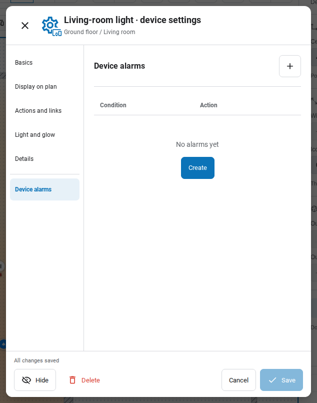

*Add your own warning or alarm conditions in this section.*

&emsp;&emsp;Nested **OK** changes only the device draft; outer **Save** persists it. Nested **Cancel/Escape** leaves the original draft unchanged. Deleting the last rule removes the optional block. An unavailable or foreign saved link remains visible with a reason and never substitutes a similarly named source.

&emsp;&emsp;Activation and removal each require three continuous seconds. Missing/incomparable values cannot activate a condition. Attention is a passive yellow triangle to the left; Alarm uses the existing red indication. The device card and actual preview retain every cause, separately from maintenance. Native critical alarms retain priority.

&emsp;&emsp;Static modes and disabled live states create no custom live clock; reconnect starts confirmation afresh. This feature adds no room/summary counters or HA actions.

### Automatic icon rules

&emsp;&emsp;Open **Devices → Icon rules**. Rules match a device’s name plus model as a case-insensitive regular expression; the first matching row wins. Reorder rows for specific matches before general ones, use the test field to see the result, and reset to the recommended list if needed. Invalid expressions are marked rather than executed.

&emsp;&emsp;Rules choose the automatic icon; a marker’s explicit icon remains its own setting. They never change a binding or action.

<a id="background-editor"></a>

## 11. Background editor

&emsp;&emsp;Use Background to work with the plan image, labels, furniture and other images. These help you decorate the plan; walls and HA devices are edited separately.

<a id="14-background-editor"></a>

<!-- docs-section: background -->

### New objects and selected objects

&emsp;&emsp;The toolbar’s colour is the default for **new** objects. Change an existing object, or a multi-selection, in **Properties**; changing the default is not a batch recolour command. Shapes groups Line, Rectangle and Ellipse. Undo/Redo uses the icons beside editor Close and the normal keyboard shortcuts.

&emsp;&emsp;For a Line, click its first point and each successive endpoint; every accepted segment is a separate selected object. Esc ends the unfinished preview without deleting accepted lines. Dragging the canvas pans rather than placing a segment. Rectangle and Ellipse still use drag creation.

&emsp;&emsp;The authoritative technical interaction contract is [DECOR-EDITOR.md](DECOR-EDITOR.md).

&emsp;&emsp;While this mode is active, device markers and room labels do not intercept the pointer (#362, #376): drawing works right through them.

&emsp;&emsp;The main-toolbar default colour and style for new objects is saved with the plan (#377): it survives a page reload and is shared by everyone who edits this plan.

### Tools

| Tool | Create | Edit |
|---|---|---|
| Select | Select an item | Move, scale, rotate; double click properties; Delete/Backspace removes |
| Backdrop | Available when a plan image exists | Move, corner-scale, rotate; double click numeric size/angle |
| Line | Click successive endpoints; Shift gives 45° steps, Escape ends the chain | Colour/opacity, physical thickness and solid/dashed style; existing endpoints also have handles |
| Rectangle | Drag diagonal; Shift makes a square | Stroke plus independent fill, size and angle |
| Oval | Drag bounds; Shift makes a circle | Stroke plus independent fill, radii and angle |
| Text | Click to open dialog | Multiline text, HA tokens, colour, physical size and angle |
| Furniture | Pick a front-view category, pick a top-view variant, then click | Symbol, smooth size, horizontal/vertical mirror, colour, outline and wall magnet |
| Image | Upload PNG/JPEG/WebP/SVG or choose a previous upload, then click | Smooth size, horizontal/vertical mirror, opacity, angle and file replacement; no wall magnet |
| Delete | Click an item | Confirmed deletion, undoable |

&emsp;&emsp;Creation and ordinary decor transforms snap to the grid plus nearby room/background anchors. Furniture resize is the exception: corners move smoothly and preserve proportion (`Shift` changes axes independently), while four middle handles change one axis. Crossing the opposite edge mirrors the item. Rotation is smooth and `Shift` snaps it to 45°; signed size fields and the two mirror checkboxes provide the same result numerically.

&emsp;&emsp;Furniture is selected within 10 physical centimetres of its drawn strokes, not throughout its empty bounding box. **Optimize plans** preserves the complete smooth position, size and rotation of furniture and uploaded images; these authored transforms are not grid debt. The plan image is interactive only with Backdrop selected. Undo/Redo shares the 50-command editor history.

&emsp;&emsp;Cancelling its move, resize or rotation restores the normal cursor immediately; you can start another drag without waiting for a Home Assistant update.

&emsp;&emsp;New shapes are at least half a grid cell. The created object stays selected. Arrow keys in **Select** move the chosen decor by exactly one current grid cell without re-running wall/decor magnetism; `Shift` does not accelerate the step, and each press is one Undo command. The backdrop is fully opaque outside this editor and at 0.5 opacity here unless Backdrop itself is selected.

&emsp;&emsp;The main toolbar colour applies only to new objects; selecting an existing object's colour makes it the next default without recolouring other objects. Outline and text sizes are physical centimetres/inches, so zoom changes their on-screen width consistently rather than changing the saved line weight.

### Multiple decor objects

&emsp;&emsp;In **Select**, hold `Ctrl` and click objects to add or remove each member. `Ctrl+A` selects all decor in the current space, and `Ctrl+M` selects furniture. The backdrop image and devices do not enter this selection. Each object has an individual contour, and the wide Properties panel shows their count. Drag any selected member to move the whole set; the empty space between members remains canvas.

&emsp;&emsp;An ordinary click returns to one selected object. An empty click or idle `Esc` clears the set; `Esc` during a drag restores all positions and keeps the selection.

&emsp;&emsp;Matching object kinds share colour and opacity fields. Rectangles and ovals have independent fill fields; images have opacity only. **Different values** is independent for colour and percentage: editing one preserves every member's other channel. Opening or cancelling the picker saves nothing. Other fields and individual commands stay disabled; right-click or double-click enters the existing single-object scenario.

&emsp;&emsp;One group edit is one `Ctrl+Z` step. Selection shortcuts remain native in fields/dialogs and do not interrupt unfinished drawing.

### Single-object order and context menu

&emsp;&emsp;Select a decor object. The properties sidebar shows **Bring to front** and **Send to back** in one row immediately above **Delete**. They move the object above or below the other decor in the current space; the other plan layers keep their existing positions.

&emsp;&emsp;Right-click selects the invoked object, shows its properties and opens four commands: **Bring to front**, **Send to back**, **Delete**, **Create a copy**. Order commands retain that selection. Escape or an outside click dismisses the menu without changing the plan.

&emsp;&emsp;A copy appears beside its source and becomes selected, with independent properties. Custom images create another representation of the same uploaded file, without uploading or adding a catalog entry. Ordering, copying and deletion use the existing Undo/Redo history. Saved order survives reload and plan transfer. If nearby placement or the object limit prevents copying, the command explains why and leaves no partial copy.

### Double-click in Select

| Object | Properties opened |
|---|---|
| Text | Full text and HA-token dialog |
| Line | Length, angle, colour/opacity and physical thickness; endpoints also have handles |
| Rectangle/oval | Width, height, angle, stroke and independent translucent fill |
| Furniture | Symbol, signed width/depth, horizontal/vertical mirror, angle, colour/opacity and physical outline |
| Backdrop | Width, height and angle, while the Backdrop tool is active |

### Live Home Assistant text

&emsp;&emsp;Text accepts ordinary content and any number of brace tokens within the 200-character limit:

```text
Outside {sensor.outdoor_temperature}, humidity {sensor.outdoor_humidity}%
Boiler: {climate.boiler:hvac_action}
```

&emsp;&emsp;Use `{sensor.room_temperature}` for formatted state and either `{climate.living_room:current_temperature}` or `{climate.living_room.current_temperature}` for an attribute. The entity and state/attribute pickers insert at the caret or replace the current selection; tokens may also be typed. Missing, unknown and unavailable values render `—`, arrays join with commas, objects are omitted, malformed braces remain text and values longer than 60 characters are shortened. `Ctrl/Cmd+Enter` saves; newlines are preserved and do not auto-wrap.

&emsp;&emsp;After selecting furniture, click to place it on mouse release. Dragging pans the plan and keeps the selected item ready for the next click. Every member of a multiple selection has its own frame; moving the selection stays shared.

### Furniture

&emsp;&emsp;The Furniture palette always uses two levels: categories first, then the available plan variants. **All categories** returns to the first level and disarms the current symbol. Existing placed furniture keeps its saved size and position when the built-in artwork is updated. The library has 60 top-view symbols in 33 populated categories. **Other → Exercise equipment** now contains the exercise machine previously mislabeled as Cactus; Plant contains only the plant.

&emsp;&emsp;Bookcase and floor shelving show their corrected drawings. A Cactus item on an older saved plan still appears as exercise equipment without changing its saved position, size or styling.

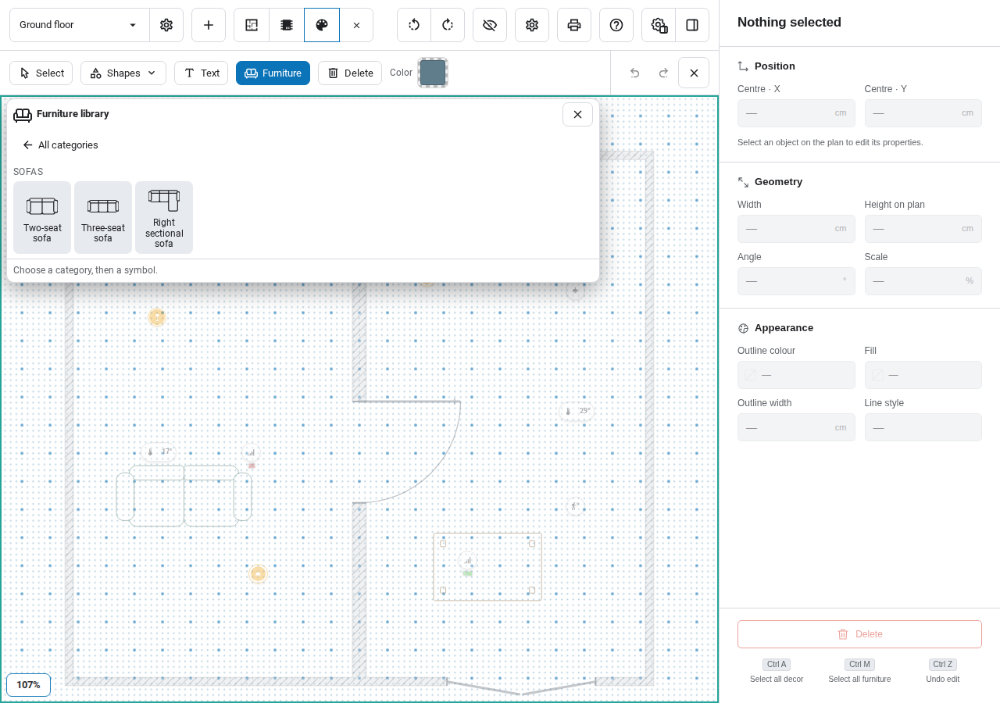

*Choose a category and item in the library, then place it on the plan.*

&emsp;&emsp;After choosing a symbol, mouse hover shows the exact future position, size and rotation; editing width/depth updates that preview and a click places it there. Leaving the plan, `Esc`, changing tool/space/editor cancels it. On touch there is no hover preview: a clean tap places, while movement, pointer cancellation or a second finger cancels. Near a wall, furniture aligns to the nearest physical face and rotates parallel. `Shift` bypasses only wall magnetism while decor/room/grid snapping still applies.

### Computer on a work desk

&emsp;&emsp;In the Background editor, place an ordinary computer over the usable surface of a straight or corner work desk. Select the computer or that desk and choose **Place on desk**. The monitor, keyboard and mouse become part of the desktop; the tower keeps its current floor position. Moving, rotating, mirroring or resizing the desk moves its equipment, not the tower.

&emsp;&emsp;Select the equipped desk and choose **Remove from desk** to restore a plain desk and an ordinary computer assembled around the tower's current position. Mount and unmount each use one Undo/Redo step. The link survives reload, space copies and export/import, including plan-only transfer. A single copied item is independent and never points into its original pair. An older tab must reload before changing the relationship; the furniture itself is retained.

### Custom images

&emsp;&emsp;The Image palette stores reusable files privately in House Plan. Each processed file in storage is at most 2 MiB; PNG, JPEG, WebP and safe SVG are supported. When a raster source exceeds that limit, the warning dialog offers to upload a reduced copy while keeping the oversized original unavailable. After picking a file, you can place one instance: the pointer preview shows the result, one click adds it at 100 cm wide (aspect-preserving, height capped at 200 cm), and the tool returns to Select.

&emsp;&emsp;Images use the same smooth handles, mirroring and `Shift`-45° rotation as furniture, but never snap to a wall. Their complete rectangle is selectable, including transparent pixels.

&emsp;&emsp;Deleting or replacing a placed image leaves the reusable file in the palette. The palette deletes a file only after all placed copies in all spaces are gone. If a file is missing or fails its integrity check, View hides it; Background shows a crossed placeholder that can be selected and repaired with Replace. Exports still keep that image object without embedding the absent file.

&emsp;&emsp;A later import shows the existing missing-content confirmation and, once confirmed, keeps the same repairable placeholder instead of rejecting the whole plan.

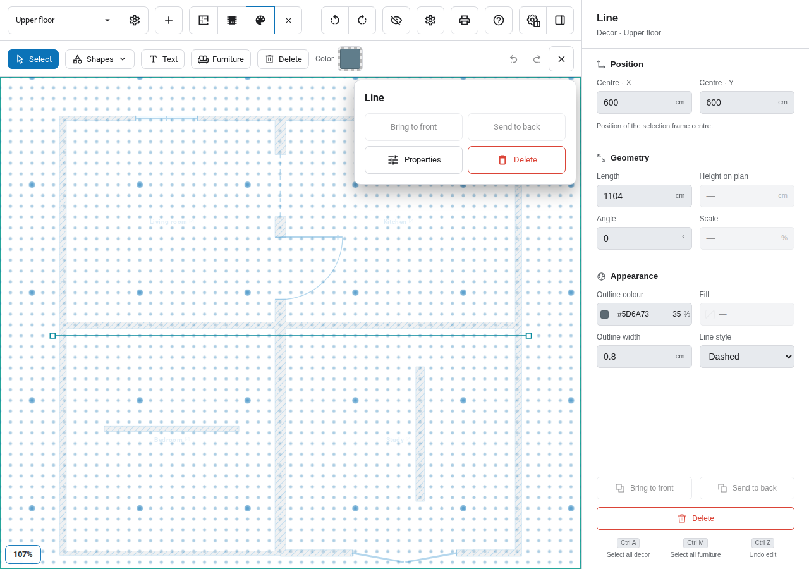

<a id="summary"></a>

## 12. Summary panel

&emsp;&emsp;Add a few useful readings to this panel so you can see them beside the plan. It is your home’s summary, separate from the HA navigation menu and the editor’s Properties column.

### Example: a compact daily overview

&emsp;&emsp;Create a block for the active floor, add an outside-temperature entity and a built-in clean floor-area value, then Save. The values are formatted readings, not formulas or HA cards. The panel’s contents are shared; its local eye/sidebar choice is separate. A profile may request its own visibility without overwriting the ordinary browser preference; see [screens](#screens).

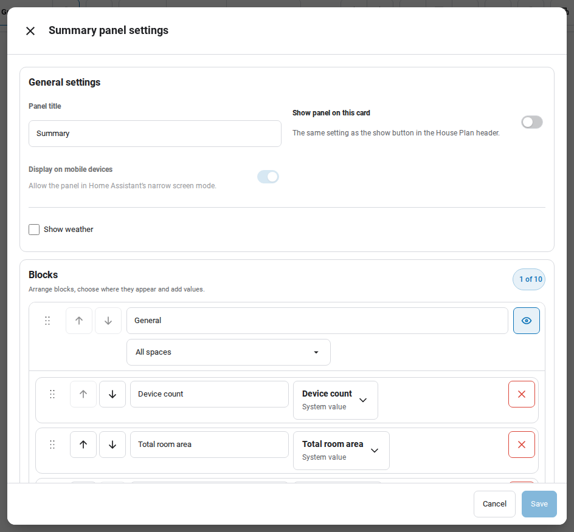

*Combine built-in values and selected HA entities in the summary.*

### Summary panel

&emsp;&emsp;The two-part control at the end of the View header opens **Summary panel settings** with its left gear and shows or hides the panel with its right sidebar icon. Only the right half is highlighted when the panel is on. In kiosk these controls are hidden; the configured Summary visibility is retained. The panel is off on a new screen until you explicitly show it.

&emsp;&emsp;Everyone uses the same contents throughout this House Plan installation; the show/hide choice belongs only to your Home Assistant user and this particular card or sidebar panel. A read-only user can change that local choice without being allowed to edit the shared contents; kiosk uses its configured visibility without rendering header controls.

&emsp;&emsp;An administrator can name the panel, add up to ten ordered blocks, show a block on every space or one selected space, and add up to twenty values to a block. A value can be the state of any entity available to that user, the number of real HA devices represented on valid plans, the total clean room area across all spaces, or the current date and time. Entity values use Home Assistant's own formatting and units.

&emsp;&emsp;Rows are informational only: pressing them never opens more-info or calls a service.

&emsp;&emsp;Press the source field beside a value to choose where its reading comes from. Only that row's picker is shown: search by friendly name or exact entity ID, then choose one of the matching entities or a built-in value. A broad search shows the first 100 matches and asks you to refine it; the search still covers every entity. Escape or a press outside closes the picker without changing the draft.

&emsp;&emsp;If an old source is missing, you will still see it until you choose a replacement.

&emsp;&emsp;The wide settings dialog separates general settings from the block cards. Use a block's eye button to show or hide it, its grip or arrow buttons to reorder it, and the dashed add buttons to add values or blocks. A source field shows its friendly name above the entity ID. On a narrow screen or with larger text the fields move below one another; Save and Cancel remain in the footer.

&emsp;&emsp;There are no icon/text size controls in this dialog; previously saved per-card sizes are preserved.

&emsp;&emsp;**Display on mobile devices** is disabled while **Show panel on this card** is off. Its previous value is kept, not reset. Both switches are drafts until Save; Cancel, Escape or closing the dialog discards their changes. Leaving the House Plan page, reconnecting under another user, or changing edit permission closes an open summary draft rather than carrying it into the new context.

&emsp;&emsp;The compact panel floats over the plan without resizing it, with a separate header and scrollable block cards. Showing and hiding it both use a brief slide and fade; reduced-motion preferences are respected. It appears on the right when the House Plan working area is at least as wide as it is tall and at the bottom otherwise. It temporarily hides when the card cannot fit a readable panel, and restores itself after the card grows.

&emsp;&emsp;Turning off **Display on mobile devices** also hides it whenever Home Assistant reports a narrow view; the show/hide button remains pressed because the local choice was not erased. The panel itself is absent from all three editors and from the static space card. Its two direct header buttons stay available at every width outside kiosk, including the editors: you can open settings or change the local show/hide choice there, but the overlay appears only after returning to View.

<a id="screens"></a>

## 13. External screens, profiles and dashboard cards

&emsp;&emsp;Prepare a television or tablet profile in the main panel, or add the plan to a dashboard. These give you different views of the same shared data, without creating separate copies of the plan.

<a id="3-adding-a-card"></a>

<a id="18-static-space-card"></a>

### Choose a display type

| Need | Use |
|---|---|
| Full shared plan and editors | Main **House Plan** sidebar page. |
| A television/tablet with repeatable camera and sizing | **General settings → External screens** profile URL; it enters [kiosk](#kiosk). |
| An interactive plan inside a dashboard | The full **custom:houseplan-card**; its YAML display options are not new global settings. |
| A compact diagram linking to the full plan | **custom:houseplan-space-card**; its sole link is interactive, its devices are not. |

&emsp;&emsp;Create profiles on desktop, then open the copied URL on the intended screen. A profile does not make the URL public or bypass HA login. Configuration and device positions are shared; local camera/sizes remain display-specific unless the profile explicitly supplies them.

<a id="screen-profiles"></a>

### External screens: a separate television or tablet view

&emsp;&emsp;Use **General settings → External screens → Create** on a desktop. Choose one/all spaces, auto-advance and idle return globally. Each space has its own rotation, 10–1000% default scale, summary visibility/centering and icon/text scales. A one-space installation uses the shorter form. 100% fits all content into the available area; Reset changes only the selected space's scale.

&emsp;&emsp;Manual camera changes are temporary; idle return and floor arrival restore its saved view. Kiosks always hide the control buttons over the plan; the summary itself remains available. **OK** changes the outer draft; **Save** applies it and closes with the shared animation. A save failure leaves the form open. Click **Screen N** to edit; deletion never reuses its number.

&emsp;&emsp;Up to 20 profiles are allowed. Copy produces your installation's complete URL.

&emsp;&emsp;Open `/houseplan?hpprofile=1` on the screen: it enters kiosk and receives later profile edits without reloading. Unknown/deleted numbers mean kiosk without a profile. A deleted referenced space means all spaces and warns in settings.

&emsp;&emsp;Link overrides: `hprotate=0|90|180|270`; integer `hpcycle`/`hpidle` 0–3600 seconds; `hpsummary=0|1`; `hpicons`/`hptext` 50–300 percent rounded to 5. Invalid values are ignored. `/kiosk/N` or `hpspace=N` selects space ahead of the profile. For example `/houseplan/kiosk/2?hpprofile=1` combines the second space and profile 1. A fixed space does not auto-advance; cycling retains its 60-second interaction pause, while independent idle return works without cycling.

&emsp;&emsp;Hidden devices follow the ordinary House Plan local preference; retired hphidden/hpcontrols and their profile fields are inert.

&emsp;&emsp;Priority is URL → profile → local choice → defaults. As on the main plan keeps local choice. Explicit profile/link values never overwrite browser preferences; removing the profile restores them. Main-panel route aliases share summary/hidden/scales preferences. Lovelace cards and YAML options retain their own identities.

### Adding a card

&emsp;&emsp;Normally there is nothing to add: open **House Plan** in the HA sidebar. It occupies the available page area, keeps the existing space/editor controls, and does not duplicate the product title inside the plan. Leaving the page ends an editor session; returning keeps the last space and opens View.

&emsp;&emsp;The dashboard card remains available for layouts that intentionally embed the plan. In a Sections view it requests full width and 10 rows by default, with a minimum of 6 rows. Use Home Assistant's standard resize handle while editing the dashboard to make the plan taller or shorter; View and every editor fill the selected height. A size explicitly chosen in Home Assistant remains authoritative.

&emsp;&emsp;Existing Sections cards that did not have an explicit row count adopt the new 10-row default once after this update.

&emsp;&emsp;Minimal configuration:

```yaml
type: custom:houseplan-card
title: House plan
```

| Field | Default | Purpose |
|---|---:|---|
| `title` | empty | Card title |
| `default_floor` | first/last opened | Initial/fallback space for an unpinned card |
| `floor` | not pinned | Keep this card on one stable space ID or zero-based YAML index |
| `language` | HA language | `auto`, `en`, `ru`, `de` or `fr` |
| `icon_size` | `2.5` | Base marker size, 1–6% of plan width |
| `show_temperature` | `true` | Compact temperature and humidity values |
| `live_states` | `true` | Work/open/unavailable presentation and activity; alarms remain visible |
| `show_signal` | inherit | Only exact `false` hides system LQI for this card; explicit space On wins |
| `kiosk` | `false` | Full plan without editors or header |
| `cycle` | `0` | Kiosk auto-cycle interval in seconds; `0` disables it |

&emsp;&emsp;The legacy card-level `tap_action` is ignored. Each marker owns its action.

&emsp;&emsp;An open device form and its display preview use the same card language, including live language changes; `auto` follows the current Home Assistant language.

&emsp;&emsp;`auto` recognizes the primary Home Assistant locale: `de`, `de-DE`, `de-AT` and `de-CH` use German, while `fr`, `fr-FR`, `fr-CA`, `fr-BE` and `fr-CH` use French (a community translation — thank you, @OUARZA). Lazy dictionaries (German, French) are downloaded once on first use and shared by all House Plan cards on the page. Until it is ready, a neutral busy surface is shown instead of briefly flashing English; if both bounded download attempts fail, the card becomes usable in English and says so with a "Could not load the language pack" toast.

### Static space card

&emsp;&emsp;Doors, windows and gates appear on both room walls and independent partitions. The frame includes their complete painted envelope and does not jump when a contact changes state. Hiding borders also hides opening symbols; showing them again restores the symbols and their physical cuts. The plan remains read-only.

&emsp;&emsp;`custom:houseplan-space-card` renders one space as a non-interactive live diagram. Markers use the same states, values, alarms and effects as the full plan, but never open tooltips or more-info. The footer link is its only action; use it for compact dashboard navigation, not direct control.

&emsp;&emsp;The compact card keeps radial light pools and wall shadows off by default, so existing dashboards retain the cheapest render path. Set `light_pools: true` to show the full plan's Glow: the same source colour, brightness and radius, additive overlap, passages and shadows from walls, partitions and columns. This is independent from `live_states`; disabling ordinary live marker dressing does not disable light transport.

&emsp;&emsp;The option is intentionally heavier than the default because every visible source needs clipped floor visibility geometry.

```yaml
type: custom:houseplan-space-card
space: ground
title: Ground floor
fit: house
show_button: true
button_label: Open full plan
button_target: /lovelace/house
icon_size: 2.5
live_states: true
show_temperature: true
show_signal: true
light_pools: true
```

| Field | Default | Purpose |
|---|---:|---|
| `space` | required | Space ID |
| `title` | space name | Header; exact `""` removes it and only the top scene padding |
| `fit` | `content` | `content` fits visible content with 5%; `house` tightly fits structural geometry |
| `show_button` | `true` | Shows the footer link |
| `button_label` | localized | Link label |
| `button_target` | `/plan-doma` | Full-plan path; the card adds `#space=<id>` |
| `icon_size` | base | Static marker size |
| `live_states` | `true` | Work/open/unavailable state, icon changes and activity; alarms always remain |
| `show_temperature` | `true` | Compact temperature/humidity values |
| `show_signal` | inherit | Only exact `false` hides system marker LQI; explicit space On wins |
| `light_pools` | `false` | Full Glow transport and wall shadows; the heavier render path |

&emsp;&emsp;`fit` controls only this compact card's frame:

- `content` (default) keeps the existing frame around all visible content and
  its 5% breathing room;
- `house` removes that intentional padding and fits every room, every visible
  opening symbol, and — when `show_borders` keeps them visible — every wall,
  partition and column (#384: hidden architecture does not widen the frame).
  A detached but valid wing stays in the frame. Backdrop, decor, room labels
  and device markers do not widen it.

&emsp;&emsp;Choose `house` when the building should occupy as much of the card as possible. Auxiliary objects remain rendered, but an object outside the structural bounds may be clipped. An image-only or empty space safely falls back to `content`.

&emsp;&emsp;By default the card uses the configured space name as its header. A non-empty `title` replaces that text. Set `title: ""` explicitly when the surrounding dashboard already provides the name: the header is omitted and the plan meets the top of the stage, while the normal left, right and bottom breathing room is kept. Omitting `title` is not the same as setting it to an empty string.

&emsp;&emsp;With `fit: house` all four intentional paddings are already zero, so `title: ""` removes only the header and leaves the same structural frame.

&emsp;&emsp;The old `aspect_ratio` YAML field has had no effect since v1.59.1 and is no longer offered by the visual editor. The canvas is square and content controls the card size; the field may be removed safely.

### Several cards and starting spaces

&emsp;&emsp;Use `floor` when separate card instances must stay on separate spaces. A stable space ID is recommended:

```yaml
type: custom:houseplan-card
floor: ground
kiosk: true
cycle: 0
```

&emsp;&emsp;YAML also accepts an unquoted zero-based numeric index such as `floor: 1`. Indexes follow the current server space order, so reordering spaces may change which one is shown. A quoted value such as `floor: "1"` is a literal space ID.

&emsp;&emsp;A pinned card shows only its assigned space. It ignores the browser's shared last-space record, `#space=` links, other floor tabs, swipe and kiosk cycling, and it does not overwrite the shared last-space record. If the configured ID or index is invalid, the card shows a configuration error instead of choosing another space. Remove `floor` to restore normal navigation.

&emsp;&emsp;Unpinned `custom:houseplan-card` instances may still use different `default_floor` values. That option is only the initial/fallback choice; the last selected space, a valid `#space=` link or normal navigation may replace it. If the saved id no longer exists, runtime still opens the first valid space and the visual card editor shows the raw missing id with an inline warning until a valid choice is made.

- configuration, rooms, Background and device layout are shared server data;
- `floor` always determines which space this card shows, while `default_floor`
  is only an initial/fallback choice for an unpinned card;
- current mode, selected space, zoom/pan and kiosk sizing are local;
- WebSocket broadcasts saved changes and revision checks reject a stale write;
- avoid editing the same object in two browsers: the second save may need a
  refresh and manual reapplication.

&emsp;&emsp;Every client that saves the shared configuration must return the revision from `houseplan/config/get`. Omitting it is allowed only while the configuration store is still empty; afterwards House Plan rejects the save as a conflict instead of risking another client's work. If an old cached card repeatedly reports conflicts, update House Plan and refresh the dashboard.

<a id="kiosk"></a>

## 14. Kiosk

&emsp;&emsp;Kiosk is useful for a wall screen: it hides setup controls and keeps everyday viewing available. It changes navigation and presentation; Home Assistant permissions stay the same.

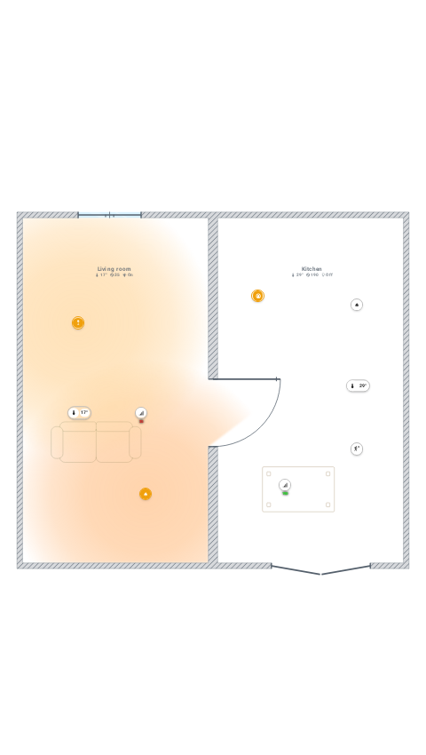

*In kiosk, the plan fills the screen without the header or setup controls.*

<a id="17-kiosk"></a>

&emsp;&emsp;With two or more available spaces, tap or click the field to reveal a compact vertical space switcher on the left. Buttons follow the existing order, numbered 1…N, with names in tooltips and the current space in the theme accent. Buttons also work while zoomed. The group fades after five idle seconds; another action renews it, while hover and automatic cycling never reveal it.

&emsp;&emsp;Reduced motion removes transitions. The switcher overlays the plan without affecting the camera or Fit all and scrolls when height is limited. It is absent in ordinary View, editors, single-space or fixed-floor cards, and single-space screen profiles.

&emsp;&emsp;The main page needs no separate dashboard. Open `/houseplan/kiosk` for all spaces or `/houseplan/kiosk/2` to pin the second space in the visible space list. Equivalent links are `/houseplan?hpkiosk=1` and `/houseplan?other=keep&hpkiosk=1&hpspace=2`. Positions start at **1** and follow the same order as the tabs/dropdown. A missing or invalid position leaves all spaces available; this main-page mode does not enable automatic cycling.

&emsp;&emsp;Reordering spaces changes what a position selects. An explicit kiosk path wins as a whole over query options: `/houseplan/kiosk/2?hpspace=3&hpkiosk=0` still pins the second space. The card header and its HA menu are hidden without an outer bar. Exit through `/houseplan` without `hpkiosk=1`, or Back. These links do not change stored settings or other Lovelace cards.

```yaml
type: custom:houseplan-card
kiosk: true
cycle: 30
```

| Capability | Behaviour |
|---|---|
| Card header | Hidden |
| Editors | Unavailable |
| Height | `100dvh` |
| Swipe | At 1:1, switches to an existing neighbour from the inner 48 px edge |
| Pinch/pan | Zooms and moves the plan |
| Double-tap background or room | Fits all content without an intermediate room jump |
| Hold empty space for 3 seconds | Opens per-display icon/text sizing |
| `cycle` | Automatically advances; any interaction pauses it for 60 seconds |

&emsp;&emsp;Cycling is active with `cycle > 0`, multiple spaces and no fixed `floor`. After 60 idle seconds the plan returns to **Fit all**, even when the cycle interval is longer. Carousel arrivals also start at Fit all and remember that base zoom only for that floor in this browser, just like a double tap. Local cards, confirmations, screen-size settings and a down contact hold the floor; closing a dialog starts a fresh 60 seconds.

&emsp;&emsp;Plan/dialog wheel and keyboard input also count. `cycle: 0`, one-space and fixed-floor kiosks never reset by idleness.

&emsp;&emsp;Changing floors closes old device/door cards and confirmations without sending an action. A removed or moved target, or a door rebound to another lock, is refused with “The action target changed. Try again.” Open its current card again. Unlock still asks for confirmation; Lock does not.

&emsp;&emsp;Kiosk sizing is stored in that display's browser, so one tablet may use larger markers without affecting other clients. Main-page kiosk hides the House Plan header and its HA menu together. In Lovelace, the surrounding dashboard header remains controlled by Home Assistant.

&emsp;&emsp;A kiosk without a running carousel, with one space or with a fixed floor may automatically reload a new version even while enlarged, after the usual 60-second interaction pause and only without pending dialogs/writes. Its own floor, zoom and pan return after cold boot. A deleted floor falls back normally without copying that floor's coordinates to another one.

<a id="appearance"></a>

## 15. Appearance, room fills, light, Sun and Moon

&emsp;&emsp;You can set the background around your home, room fills and lighting effects independently. Below, you will find what each layer does and where to adjust it.

<a id="13-room-fills-and-light"></a>

<a id="15-sun-and-moon-background-window-rays-and-the-moon"></a>

### Three different visual layers

| Layer | Where to change it | What it does not do |
|---|---|---|
| Background around the plan | General Appearance and background, or Space Background and lighting override | Does not upload a drawing or recolour room floors. |
| Backdrop image | Space Plan and scale; align it in Background editor | Does not create architectural walls or rooms by itself. |
| Room fill | Space Room appearance; room Fill override; General colour palettes | Does not control the background or the device’s actual state. |

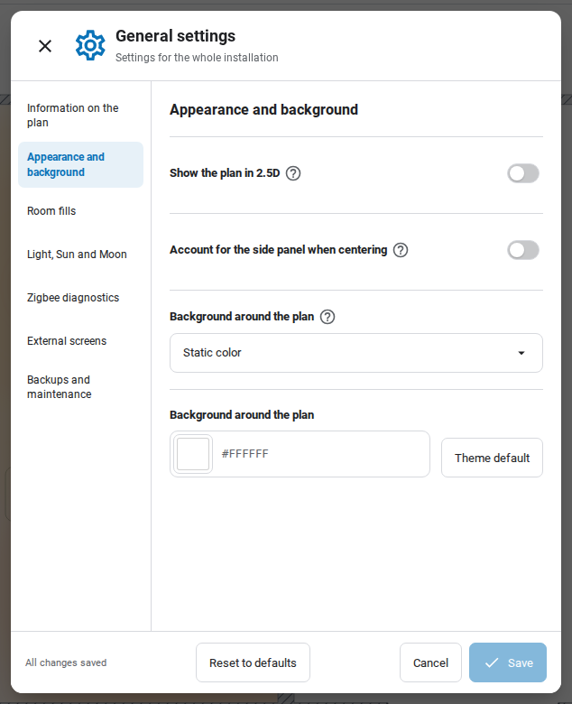

*The background and 2.5D view are configured separately from room fills.*

&emsp;&emsp;For one differently coloured room, use its own fill. For uniformly coloured captions, change Space **Name color**; a room’s own caption colour remains until returned to inheritance. Glow and sunlight use their physical/source rules, not the visibility of a wall outline.

### 2.5D presentation

&emsp;&emsp;A user with House Plan editing permission turns the volumetric plan on: **General settings → Appearance and background → Show the plan in 2.5D**. View and kiosk use the accepted 35° yaw and 40° viewing elevation; rotation buttons change the side by 90°. Walls have a 140 cm cutaway, windows retain masonry below their sills, and doors and passages have lintels. All 60 library items have matching volumetric forms. Saved dimensions, positions and states remain authoritative; no second 3D plan is stored.

&emsp;&emsp;Device icons, LED strips, door locks and room names sit level with the top of the walls. Names and their readings are visible over the walls. Icons and labels turn with the view and stay upright. Lights can also illuminate the sides of nearby walls.

&emsp;&emsp;Open **Space settings → Room appearance** to adjust the wall cut and sides separately. **Wall hatching color** sets the top and **Wall fill color** sets the sides. **Accent color for 3D windows and doors** tints frames, door panels, reveals and sills. Set white or 0% to restore the original colour. The percentage controls the strength of the tint. Glass, shades and hardware keep their own appearance.

&emsp;&emsp;Markers keep their plan anchors. Where a foreground wall covers a marker, the covered part is dimmed and the wall hides the shadow. A group has one outline and individual member actions. Windows cast sunlight onto the floor beneath furniture when sun rays and north are configured. Walls retain their colour in both themes. Changing views or entering an editor preserves the physical floor point at the camera centre without editing plan data.

&emsp;&emsp;Editors are always flat. The option is off by default; turning it off or **Reset** returns the flat plan. There is no separate button on the card.

&emsp;&emsp;Hidden wall borders disable volume: furniture, coordinates and hits use the Flat presentation. If the volume registry cannot load or the scene fails to build, House Plan safely displays the complete Flat plan without deleting furniture or clearing the saved preference.

### Room fills and light

#### Space fill modes

| Mode | Source | Colour/behaviour | No data |
|---|---|---|---|
| None | — | Transparent room / border only | — |
| Zigbee signal | Average LQI for room devices | Red at ≤40 through green at ≥180 | No fill |
| Lights | One resolved set of visible sources: external controls plus own Auto/Always/Never source | Configured on/off/no-source colours | No-source colour when its opacity is above zero |
| Temperature | Room source or sensor average | Cold below minimum, comfort between bounds, hot above maximum | No fill |
| Custom color | Space or room setting | Constant colour and opacity | Safe `#607d8b` at 18% |

&emsp;&emsp;**Light-source Glow** is independent of the selected fill and works with every fill. With no data, room-level None or a zero-opacity custom colour the ordinary paper remains visible: Glow adds only the light pools of active lamps and LEDs. “House darkness” is removed, including its General settings controls; legacy darkness settings are ignored without a reset or an automatic config save.

&emsp;&emsp;Visible fills keep their exact colour/opacity beneath light pools. A new manual space starts with Custom color at 0% and Glow on, which looks like the former None default. Legacy light-source and None settings keep independent light pools and migrate on the next normal save.

&emsp;&emsp;Space fill modes include user colour, temperature comfort range and LQI. Room settings may override the space. A room has its own colour only while its fill is set to its own **Custom color**; choosing **As the space** forgets that colour and the room is painted like the rest of the space. Glow is independent from the base fill.

#### Inheritance

| Level | Overrides |
|---|---|
| General settings | Shared fill palettes, default light-pool colour/intensity and radius, background and north defaults |
| Space | Fill mode and custom colour, wall/caption colours, temperature bounds, battery/LQI display, background and north/rays overrides |
| Room | Inherit or select None/LQI/Lights/Temperature/Custom; independent lower/upper temperature bounds and a colour only in room Custom mode |
| Device | Auto/Always/Never own light role, Glow colour, brightness and radius |

&emsp;&emsp;When a room effectively uses the temperature fill, its settings show optional lower and upper comfort bounds. Each blank field independently inherits the matching space bound, and the **As the space** link under the fields clears both overrides. The range changes only the room floor and opening-tunnel fill; room-card and tooltip temperature values are unchanged.

#### What counts as light

| Source | Lights fill | Glow pool | Yellow marker |
|---|---:|---:|---:|
| Visible `light.* = on` | Yes | Yes | Yes |
| Ordinary `switch.* = on` | No | No | Yes |
| `switch.* = on` with **Always** | Yes | Yes | Yes |
| Passive **Always**, no controllers | Always on | Yes, manual/fallback parameters | By resolved marker state |
| Passive source linked from controllers | OR of active controllers | At the passive lamp position | Controller shows aggregate work |
| External `controls` group | Yes, by group state | Only at separate real/Always source markers | Yes when any source works |
| Hidden marker | No | No | Not drawn |

&emsp;&emsp;A light source may come from automatic classification, an explicit Always role, or a controlled source group. Walls, partitions and columns occlude Glow; open passages transmit it. When a configured light source disappears or loses its valid binding, its contribution is removed instead of keeping stale light.

&emsp;&emsp;Glow, Lights fill, the room-card light row and group Toggle use the same deduplicated source set. `controls` describes state and control, not the switch's physical light position. **Never** removes only the marker's own source, not external controls. A manually assigned room wins over HA Area. Manual brightness uses the same perceptual curve as live `brightness`: 100% keeps the old ceiling and low values remain visible; use **Never** instead of a nonexistent 0% to disable it.

&emsp;&emsp;An off/unavailable source draws no pool.

&emsp;&emsp;Walls block by their true thickness; partitions and columns block too. Doors, gates and passages transmit light through their tunnels. Dashed zero walls are transparent; solid zero walls are zero-area barriers. Overlap is additive where the browser supports SVG blending. Colour priority is live RGB, then colour temperature, then the configured general light colour; brightness has a 15% visual floor.

&emsp;&emsp;Overlapping Glow pools add brightness and colour where browser SVG blending is supported; otherwise House Plan uses a safe normal blend without changing the saved setting.

### Sun and Moon: background, window rays and the moon

&emsp;&emsp;These are independent features. **Follow the sun** needs no compass: it uses valid `sun.sun` data and otherwise falls back to the browser clock. North and `sun.sun` are required only for window rays. A space may override the General settings.

#### Setup

1. Choose **Follow the sun** for the background if desired.
2. For rays, enter north as 0–359° or rotate the compass. The N arrow must
   literally point to true north on the drawing, not to an inverse correction.
3. Turn on **Sunlight through windows**.
4. Choose ray origin from the inner window corners (the existing default) or
   the outer corners. This General setting remains editable while rays are off.
5. For one floor, inherit or override north/background/rays.

&emsp;&emsp;If an old setup mirrored the compass to compensate for the former direction bug, return N to real north after updating.

#### Behaviour

| Condition | Result |
|---|---|
| Any editor open | Rays are hidden |
| Sun below 3° | No rays |
| Crossing 3° | Layer fades in/out over 2 seconds |
| Internal window without an exterior-connected Lets sunlight through chain, or a window facing away | No ray |
| Thick exterior wall, inner-corner mode | Ray starts on the room side of the tunnel |
| Thick exterior wall, outer-corner mode | Ray starts at the facade and reaches the room only through the tunnel |
| Zero-thickness wall | Both origin modes look the same |
| Opening-symbol layer hidden | Window symbol is hidden; its ray still works |
| White plan | A thin 1 px dark edge keeps the ray readable |
| Any weather, including rain or snow | Weather does not alter rays |

&emsp;&emsp;Rays are clipped by the clean room contour, have crisp sides and fade along their length. They are visual only and never change HA state.

&emsp;&emsp;For a terrace or balcony, open **Room settings → Sunlight** and enable **Lets sunlight through**. The marked room receives no window rays of its own; windows into ordinary neighbouring rooms can admit sunlight instead. The terrace needs no exterior window. Access follows a chain of marked rooms sharing a wall, provided at least one has a real exterior wall. An isolated internal group or corner contact creates no solar access.

&emsp;&emsp;The option is off by default, works in Flat and 2.5D, and leaves artificial lighting, walls and room fills unchanged.

&emsp;&emsp;The background has dawn, day, sunset and night. With `sun.sun`, elevation and direction of travel choose the phase; clock fallback uses 05:00–08:00, 08:00–18:00, 18:00–21:00 and 21:00–05:00. Environment transition lasts 1.1 s or is immediate with reduced motion. Only the area around the plan changes; the decorative paper-outline glow has been removed. Rooms, fill, Glow, markers, labels, decor, backdrop, vacuum display, hover highlights and window rays are not recoloured.

&emsp;&emsp;Full card, kiosk and static card share the phase; editors keep their normal background. New installs and spaces default to Follow the sun; upgrades/imports preserve their existing choice. Shadows from trees, awnings or other building wings are not modelled.

#### Moon

&emsp;&emsp;With any background — **Follow the sun**, the theme background or a colour of your own — at dawn, dusk and night the moon in its current phase stands in the top-left corner of the scene — a thin crescent, a half, a full disc. One switch in General settings turns it on: **Sun and Moon** → **Moon over the plan at dusk and night**. It is on for new installations and off for upgraded ones until switched on: an update never changes how a plan looks.

&emsp;&emsp;If the switch was already on with a static background, the moon appears on that background after the update; the same switch removes it.

&emsp;&emsp;Dusk and night are decided as for the Follow the sun background: with a valid `sun.sun` by the sun's elevation (below 6°), without it by the browser clock (day is 08:00–18:00). A static background stays as it is: the chosen colour around the plan, no gradients and no outline glow — only the moon is added.

| Condition | Result |
|---|---|
| Daytime, moon below 3° above the horizon, or new moon (under 3 % lit) | No moon |
| The moon rises above 3° or sets below it | Fades in/out over 2 seconds; immediately with reduced motion |
| Phase | Changes continuously, every day; waxing is lit on the right, waning on the left. The drawing stays north up in both hemispheres; its surface never mirrors or rotates |
| Space with its own static background | The same moon: same place, size and phase; the background keeps its colour |
| Changing the background, or a tab with another background | The moon does not flicker and stays in place |
| The plan covers the corner of the scene | The moon is behind the plan: the part of the disc in the margins shows; the plan, devices and labels are always on top |
| Editors | No moon |
| Full card, kiosk, static space card | The same |

&emsp;&emsp;Position and phase are computed in the card from the Home Assistant home location (Settings → System → General) and the device clock, with no integration or external data. A Home Assistant that kept the default location shows someone else's moon — as with `sun.sun`; a wrong tablet clock gives a wrong phase and moment. Position accuracy is about 1°, so crossing 3° may differ from ephemerides by a few minutes.

&emsp;&emsp;The terminator tilt and earthshine are not modelled; the dark side is a faint silhouette so a crescent reads. One image serves every background: on a mid-grey colour of your own the moon has less contrast.

&emsp;&emsp;Under the switch a «Now: …» line says whether the moon is shown this minute and, if not, why — the first reason that holds:

| Line | When |
|---|---|
| Now: shown (24° above the horizon, 79% lit). | The moon is shown; altitude and illumination in whole numbers |
| Now: not shown (the home location is not set in Home Assistant). | No home latitude and longitude — even by day |
| Now: not shown (the sun is 25° above the horizon; the moon shows once it is below 6°). | Daytime by `sun.sun` |
| Now: not shown (daytime by the clock, 08:00–18:00: Home Assistant has no sun.sun data). | Daytime by the browser clock |
| Now: not shown (the moon is at 2°; it shows from 3° above the horizon). | The moon is below 3° |
| Now: not shown (new moon, 2% lit; it shows from 3%). | Under 3 % lit |

&emsp;&emsp;The line is computed once when the dialog opens and tells what the switch would show when on: the switch itself, the background chosen in the dialog and the space settings do not change it. It belongs to the browser the dialog is open in: a wall tablet with another clock or time zone may show or hide its moon at another moment. While the moon's data loads, or if loading failed, there is no line — the general hint stays.

<a id="special"></a>

## 16. Special devices and Zigbee diagnostics

&emsp;&emsp;These features need data from their integrations. Devices with a position on the plan also need calibration. If something is missing, check the source and its status first; you usually do not need to delete the marker.

<a id="16-robot-vacuums"></a>

### Zigbee links

&emsp;&emsp;For an occasional Zigbee placement check, an administrator can enable **General settings → Show Zigbee links when hovering over a device**. The option is off by default. If links have not yet been saved as enabled, **Save settings and update map** and **Save settings and read ZHA** explicitly save all changes in the current dialog, keep it open, and load data only after saving succeeds.

&emsp;&emsp;If saving fails, no load starts; correct the error and retry. The toggle alone neither saves settings nor starts a scan. Once enabling has been saved, **Read ZHA data** reads ZHA's existing cache, while **Update map** starts an explicit Zigbee2MQTT raw network-map scan for each entered base topic (default `zigbee2mqtt`). The latter may take many minutes when collecting routes.

&emsp;&emsp;The scan continues in Home Assistant after you close settings or the browser. Reopening settings restores its stage and elapsed timer, including on another administrator's device. Progress is not a percentage: Zigbee2MQTT does not provide one. After 10 minutes, waiting continues and **Cancel request** becomes available. It only stops House Plan waiting for this result, not the radio scan in Zigbee2MQTT.

&emsp;&emsp;Do not start another scan until that scan has finished; scanning can temporarily slow the Zigbee network. Successful Z2M maps survive Home Assistant restart/integration reload, marked stale with their original reception time. No scan starts automatically. **Update map** removes the old map before starting a new scan; an error or cancellation does not bring it back.

&emsp;&emsp;Turning links off and **saving** clears all Z2M maps; a draft toggle does not. Removing a topic hides its map without deleting it. At the eight-map limit, existing maps are kept and another topic is refused. Storage errors are shown; a visible map that could not be saved will be lost on restart. A rejected cache is preserved on startup; explicit **Update map** or saved OFF can replace it.

&emsp;&emsp;If that write fails, the action is refused and can be retried after fixing storage. ZHA data remains temporary, and a failed ZHA read keeps its previous cache. Running Z2M jobs are not resumed after a restart; turning links off only retires House Plan waiting, not the provider's radio scan. Update and restart the House Plan integration as well as updating the card.

&emsp;&emsp;After data is loaded, moving a real mouse over a mapped Zigbee marker shows links on the plan. If **Zigbee diagnostics** reports **Incomplete data**, expand **Why the data is incomplete** at the end of the ZHA section or after all Zigbee2MQTT topic rows. It lists affected nodes and known reasons, including reported failed read stages, ambiguous HA/plan mappings and unknown routes.

&emsp;&emsp;Each MQTT topic has its own group. A missing route alone does not mean the device is off or faulty. Missing source details are stated explicitly. A failed ZHA refresh is separate from the retained snapshot's incomplete-data reasons. Opening the block does not start a scan.

&emsp;&emsp;**Marker visibility** separately lists devices hidden by the user. A concealed marker is not a missing placement or a Zigbee source error. Use the header eye to show eligible hidden devices and their normal direct links; the explanation then says the hidden device is currently shown. This changes no saved flags, starts no scan and does not suppress genuine source or binding failures.

&emsp;&emsp;Moving a real mouse over a mapped Zigbee marker shows its parent (end device) or active next hop towards the coordinator (router), as reported by the integration. There is at most one outgoing arrow; confirmed incoming arrows show devices routing through this node. The coordinator has incoming arrows only. Ordinary neighbour links are hidden; LQI is not used to guess a route.

&emsp;&emsp;Confirmed incoming devices on other spaces are counted.

&emsp;&emsp;Links also work when a device is represented by an LED strip. Highlighting follows its visible shape; a small halo marks half its path length and the arrow approaches that halo. There is no need to restore the icon or calibrate another point. Hovering the other end keeps the same anchor. This is a plan reference, not a claim about the LED controller's physical location.

&emsp;&emsp;The active diagnostic layer is deliberately drawn above room names and devices that are not part of the shown link, so a busy plan cannot hide the route. The complete source and locally connected device markers remain above the lines. All lines and arrows are solid and share a separate LQI scale: red at 0, yellow at 128, green at 255. Unknown quality is grey with a black outline that scales with the plan.

&emsp;&emsp;Device LQI badges and room colours are unchanged. Clicks pass through this layer, so you can still use devices and rooms normally.

&emsp;&emsp;If the next step is in another space, its bubble names the space and destination device, for example **Upstairs (Hallway socket)**; an unknown device name is omitted. The ordinary device tooltip moves into free space around network badges. Only when the card cannot fit both is it temporarily hidden, returning when space becomes available. No extra setting is needed.

&emsp;&emsp;If the needed router or coordinator is not placed on the plan, the bubble says so; an unplaced device's available name is included in parentheses. “No route data” means the outgoing route is unknown or conflicting, not that the device is offline. No substitute line is drawn. Without a displayed connection, only **No route data** appears, without a duplicate **Incomplete data** caption.

&emsp;&emsp;With a visible incoming link, **Incomplete data** remains when the snapshot is partial and this device's outgoing route is unknown. A coordinator never shows it, nor does a device with a known outgoing route, including remote or unplaced parents. The overall partial snapshot status in settings is unchanged. Staleness is marked separately: a snapshot older than one hour is stale, and a failed refresh marks the last snapshot stale at once.

&emsp;&emsp;Lines and arrows pass over battery indicators and the value badges of the devices at the ends of a link but stay under device faces and captions. A recent read of ZHA's cache does not prove a recent radio scan. These records come from the integration. They do not trace live packets or confirm the whole route. The layer does not appear on touch/pen, in kiosk, in editors or in the static card, and hovering never starts a scan.

### LED strip (#780)

&emsp;&emsp;An LED strip is drawn on the plan as a polyline and can stand in for any device instead of its round icon. Everything happens in the **Devices editor** — there is no need to switch to the Plan editor.

| Action | Result |
|---|---|
| **LED strip** (next to «Add») | Starts drawing. A clean click adds a point; the grid and wall faces attract it, a zero-thickness wall its axis; `Shift` gives 45° steps. A new segment stops at the first face of a thick wall, partition, column or window («The strip stopped at a wall»); doors, gates and passages let it through |
| `Ctrl/Cmd+Z` while drawing | Removes the chain's last point, not another history step |
| `Esc`, a double click on the last point, pressing **LED strip** again, leaving the editor, switching to another space | Finish the strip in the space it was drawn in; a chain of fewer than two distinct points is not saved |
| A click on the first point (at least three vertices) | Closes the strip |
| After finishing | The device picker opens: lights first, devices bound to another strip are disabled with an explanation, **New device…** creates one and binds it in the same write, **Later** keeps an unbound strip (grey dashes, visible in the Devices editor only) |
| A click on a strip | Selects it and shows its vertices; they can be dragged, and walls stop them even on a fast drag. The tray offers **Device settings**, **Bind / Change device**, **Unbind**, **Show as icon**, **Delete strip**. `Esc` or a clean click on free space drops the selection |
| In the device dialog | **Show as LED strip** draws a shape for the same marker (or brings a saved one back at once); **Show as icon** returns the ordinary icon, the shape is kept hidden and comes back without redrawing. The usual unsaved-changes question comes first |

&emsp;&emsp;Binding creates no new Home Assistant device: the same marker, light settings, tap actions and badge — drawn at the middle of the strip's length. When the device is on, the core inside its outline uses the selected light colour, with or without Glow. Glow adds a soft band of colour with a 30 cm radius by default (or the device's own radius). An off strip has a white inner fill with 30% transparency; its outline stays opaque.

&emsp;&emsp;Light does not pass through walls or closed doors. In View the whole strip is one tap target, like an icon. Every finished shape change and every switch of the representation is one **Undo/Redo** step.

&emsp;&emsp;«Unbind» keeps an unbound shape, «Delete strip» deletes the shape but not the device. Deleting the device leaves the strip unbound. Up to 50 points per strip and 50 strips per space (hidden shapes included). «Optimize plans» reports strips passing through walls and changes nothing in them.

### Presence radars

&emsp;&emsp;An automatically recognized LD2450 with target1 X/Y sources has a **Radar** tab. Verify its exact sources and room, then enable **Use this presence radar**. Disabling this operational switch retains the setup. The separate remove action removes radar settings only after the ordinary device Save; it does not delete the marker. New radars cannot be declared manually.

&emsp;&emsp;Previously saved manual profiles continue to work. If the current binding is not recognized as a radar, **Details → Open previous radar settings** opens the existing profile for correction or removal. Explicit removal also removes this compatibility entry after Save. Until then, **Undo removal** restores the profile without discarding other Device edits. Unknown future versions stay preserved and inactive until explicitly removed.

&emsp;&emsp;The editor never guesses coordinate units, axis directions or a bearing from entity names.

&emsp;&emsp;**Configure on plan** records the physical sensor position and direction, independently of the decorative marker. Coordinate profiles can then use two measured reference positions; an optional third point checks the result without changing it. Use a desktop browser and stand alone/still at each reference. **Check live data** distinguishes no target, stale or partial coordinates, unavailable sources and presence without a usable position.

&emsp;&emsp;Live dots and range arcs do not intercept clicks and are clipped to the selected room. Their short trail and smoothing exist only in the open browser session; House Plan does not save raw radar samples or target history. Disable either the radar itself or **General settings → Show live presence on the plan** to hide the layer. See [Presence radars](RADAR.md) for supported profiles, setup and privacy.

### Robot vacuums

&emsp;&emsp;**Vacuum → Robot path color** sets this robot’s path colour and opacity. The default is a thin blue line (#64B5F6, 70% opaque) without an outline; the previous run is additionally dimmed. The colour previews immediately but is stored by Device Save; discarding restores the old appearance. This does not change calibration, route acquisition or cleanup detection.

&emsp;&emsp;Dreame's current full path continues updating after transport map/frame resets between cleanups, without deleting the marker/history or recalibrating. If a new snapshot is rejected while the previous path remains visible, diagnostics say that the last accepted path is being shown, with its actual reason and time. A fresh robot position does not by itself prove a fresh path; no invented line is added to connect a retained native path to the robot.

&emsp;&emsp;Official Ecovacs works with the verified map format (first example: X1 Omni). Choose this robot's `image.*` source; the global list is now **All cameras and maps**. Once telemetry arrives, **Fit manually** shows the translucent floor image: move it, resize from four corners, rotate by 90° or mirror, then Save. Ecovacs room names have no geometry for automatic fitting.

&emsp;&emsp;This does not create House Plan rooms or walls; it aligns the robot to an existing plan. Update the House Plan integration and restart HA if requested. Another device's image or an unsupported format never supplies guessed coordinates.

&emsp;&emsp;Live position needs finite `vacuum_position` or `robot_position` coordinates. Xiaomi Cloud Map Extractor, Tasshack dreame-vacuum and Valetudo-like cameras are supported; Roomba's string `position` is not. **Live position** reports source, integration, health, position, rooms, path and map ID. A source belonging to the same device is selected deterministically; an unrelated XCME camera must be chosen explicitly through **All cameras and maps**.

&emsp;&emsp;A saved source is pinned and is not silently replaced when it is disabled, missing, unavailable or unreadable.

&emsp;&emsp;Open the device's **Vacuum** section. **Source and status** shows the current source and health; **Source and path display** contains the source picker, live-position switch and trail mode. **Maps and calibration** keeps map/floor assignments and fitting. Expand **Map and route diagnostics** for integration, position, room counts, map ID and detailed path counters.

&emsp;&emsp;These values remain available without filling the ordinary settings view with technical rows. Changing the source, live-position switch or trail mode saves immediately as before; cancelling other device edits does not undo those operations. Map assignment and calibration retain their own Apply/confirmation workflows.

#### Calibration

| Mode | Requirement | Result |
|---|---|---|
| Automatic | At least three matching room names in robot map and plan | Computes an affine transform and saves it immediately when maximum error is at most 40 cm |
| Manual | Robot map/contours are available | Move, scale, rotate by 90° and mirror a translucent map overlay |

&emsp;&emsp;A multi-floor robot uses **Maps and floors**: map every distinct map ID to one space and calibrate it there. The dock marker remains in its configured space; live puck and trail appear only in the space mapped to the current map. Until a map is identified, mapped and calibrated, no puck is guessed and the dock shows the reason. Routes referencing a deleted space remain in a separate **Space deleted** group for explicit remap or removal.

&emsp;&emsp;Above 40 cm error, nothing changes until **Apply**; manual fitting and Cancel remain available.

#### Position and path

| Path setting | During cleaning | Afterwards |
|---|---|---|
| Never | No path | No path |
| During cleaning | Current path | Hidden |
| Always | Current path | Last completed path |

- Position appears for cleaning/returning/on with valid data; a moving puck
  opens the vacuum's HA more-info, while the dock marker remains separate.
- The server path survives card reloads and is shared across clients. Current
  and previous runs are kept, with up to 100,000 raw points and 1,024 segments
  without blind thinning. All robots in the selected space share a limit of
  20,000 rendered vertices.
- A position older than 60 seconds is visually stale. Gaps, invalid samples
  and position jumps never become false connecting lines. At a protective
  limit, the last good path remains and diagnostics explain the incomplete
  data; points omitted by the integration are not invented.
- Current and previous trails use bounded curves that preserve endpoints and
  gaps and deviate no more than 17.5 cm from the recorded polyline.
- The new server prefers a complete integration path, including a valid empty
  response, then sampled positions. Connecting during cleaning does not require
  observing the beginning of the integration path. The browser reserve remains for old/unavailable
  backends. Between native snapshots, fresh observed positions form a separate
  live tail ending at the visible puck; confirmed sections are replaced by
  the precise native path as it catches up. There is no invented straight
  shortcut from a remote old endpoint. Map changes, unavailable data and
  teleports do not create false connections.
- Dreame Vacuum / Tasshack 2.0.2 can supply a complete path from the selected
  ordinary camera, without enabling a separate JSON entity or adding a token.
  The server reads it during cleaning and performs a bounded check after the
  robot stops. A dock visit or long pause never cuts a native path. Explicit
  empty clears the old native line; fresh positions may continue the separate
  live tail. Missing data or a read error is not empty. Only structured data actually
  exposed by the integration is supported, not hidden app history or map pixels.
- **Live position** diagnostics show path source/quality, received/stored/drawn
  point counts and snapshot time. An unconfirmed final snapshot does not mean
  the path was lost: the integration may not provide a final marker. Upstream
  compatibility does not replace checks on the installed version and device.
- **Path display** explains why stored points are not shown: another floor,
  an unmatched map, missing calibration, the display mode, or too few
  consecutive points. With several cameras, the robot and its path use the
  source from the matching **Maps and floors** assignment.
- Opening the plan during cleaning restores the path already recorded by the
  server, which continues recording with the plan closed. Correcting a map
  assignment lets new points accumulate automatically; older points of unknown
  origin are not joined to another map.
- Stop, pause or docking hides the current trail in **During cleaning**. For
  position-only sources without provider session information, motion
  on the same map within 30 minutes resumes that run; another map or a longer
  stop starts a new one. Mere entity unavailability does not end a run.
- **Vacuum → Source and path display → New path after docking when no
  integration path is available** is Off by default. It splits the sampled
  fallback after an observed dock-to-cleaning cycle, including service visits.
  Integration geometry/session information always takes priority. The shared
  plan setting applies after HA accepts it; unsupported backends show disabled
  update/restart guidance. Always retains the separate previous run.

#### Preview a past cleanup

&emsp;&emsp;In the device's **Vacuum** settings, **Cleaning history preview** lets you choose a real past cleanup and press **Show**. Picking another row alone does not change the displayed path. A filled Show button and **On plan** date identify the cleanup actually shown. **Hide from plan**, or **Hide** in the plan banner, returns the latest live path. Saving settings is unnecessary; no command is sent to the robot and other screens are unaffected.

&emsp;&emsp;Closing the dialog keeps the preview, including a Show still loading. There is no automatic timer. Reloading the page, changing space or robot, a confirmed new cleanup, or losing the source/calibration/editing permission ends it. History is available in View and the Devices editor to House Plan writers outside kiosk; Plan and Background do not add a history surface.

&emsp;&emsp;The first supported contract is Dreame Vacuum/Tasshack 2.0.2's public history. The integration must expose real records and numeric historical paths, and House Plan must be able to verify their original map against saved calibration. Missing calibration, another floor, interrupted or empty paths and unsupported integrations have distinct guidance. Dates follow HA timezone; seconds and a UTC offset distinguish colliding times.

&emsp;&emsp;House Plan creates no long-term archive and does not turn current or previous live samples into historical cleanups.

&emsp;&emsp;Deleting the marker erases its server trail immediately; adding it again starts from scratch. See [VACUUM.md](VACUUM.md) for the source and calibration contract.

<a id="maintenance"></a>

## 17. Printing and plan maintenance

&emsp;&emsp;Printing downloads a file without changing the plan. Optimization changes shared data after you review and confirm the preview; you do not need to run it before every ordinary edit.

<a id="19-plan-maintenance"></a>

### Read the optimization outcome

&emsp;&emsp;**General settings → Backups and maintenance → Optimize plans** first checks the plan and shows a preview. Nothing is written until Apply. During a confirmed write the dialog says it is saving; checking the saved result is not a second automatic Apply. There is no invented progress percentage.

| Outcome | What to do |
|---|---|
| No optimization needed | Close; no new revision or maintenance Undo was created. |
| Optimization complete | Read the applied changes. The saved result needs no further automatic pass. |
| Available changes saved | Safe changes were saved; preserved/unverified items and reasons remain visible. Do not delete unknown owners merely because HA registries are incomplete. |
| Additional changes found | Check again builds a new preview, not another write. Applying again replaces the sole previous optimization Undo point. |
| Could not confirm saving | It may already have saved. Restore the connection and refresh data before retrying; reopening the dialog does not authorize a duplicate write. |
| Geometry calculation/refusal | The candidate was not applied. Use the proven location if supplied; otherwise copy diagnostics and report it instead of redrawing arbitrary walls. |

&emsp;&emsp;Closing while saving does not cancel an already sent operation. Reopening shows that operation rather than starting another. If saving succeeded but result verification failed, the report distinguishes those facts. Permission, revision conflict, unsupported format and storage failures have different remedies. **Copy diagnostics** and **Report a problem** help explain a failure; sending the full support package still requires your explicit choice.

### Download a file for printing: PDF or SVG

&emsp;&emsp;Choose the file format at the top. **PDF - architectural plan** retains the existing architectural sheet. **SVG - current view** saves the displayed View area, projection, colours and opacity without changing the camera. Switch out of an editor before exporting SVG. Live states/animations become a static frame.

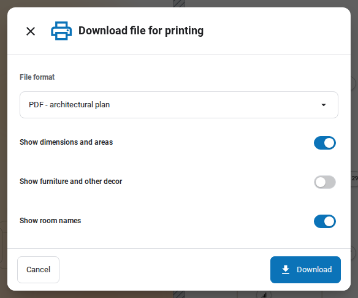

*Before downloading, choose the format and what to include in the file.*

&emsp;&emsp;Devices start unchecked for SVG; decor, room labels and backdrop are independent. Hidden View layers are not restored. Background can be **Transparent** (default), **As on the plan** or **Custom color**, which reveals the shared colour/opacity picker below the list. This affects the document background, not room fills or the backdrop image. Press **Download**.

&emsp;&emsp;SVG opens in a browser without HA. Editors lacking SVG foreignObject support may omit HTML labels/markers; plan geometry remains vector. The following describes the unchanged PDF mode.

&emsp;&emsp;Users with House Plan editing permission can press the printer button between **General settings** and **Help & feedback** to download the current space as a clean one-page A4 plan. The sheet always includes walls, partitions, columns and openings, but excludes devices, live states, Glow, sunlight, room colours, vacuum trails and Zigbee topology. The dialog can add dimensions and clean floor areas, room names, Background-editor decor and the space backdrop.

&emsp;&emsp;Its choices are remembered in this browser.

&emsp;&emsp;House Plan lays out the complete selected content before choosing portrait or landscape and a standard scale, then centres that complete scene on the sheet. Physical walls use a grey base and architectural hatch. Measurements are limited to horizontal and vertical walls, and a matching opposite pair is printed once within its own room or connected outer contour.

&emsp;&emsp;The footer includes a scale bar, a vector compass when north is configured, the date and version; the old architectural-symbol legend is no longer printed. The export is read-only and always uses the flat plan, including while the card is in isometric view. Its dialog remains usable without horizontal scrolling down to a 320 px-wide View area. See [PDF export](PDF-EXPORT.md) for measurement, image-limit and font details.

&emsp;&emsp;Rectangular facade steps keep a complete reconstructable dimension chain: both adjacent exterior sections, the height of the step and one copy of its depth remain visible without adding diagonal measurements.

### What Optimize plans does

&emsp;&emsp;Ordinary config or marker-position saves remove invisible numeric noise without snapping legitimate diagonal walls or free decor to the grid. Import and server Undo use the same cleanup rules. Saving an unchanged plan creates no revision and does not consume the last maintenance Undo. Simply opening an old plan still writes nothing; its geometry is cleaned on the next edit, or all at once through **General settings → Optimize plans** after preview.

&emsp;&emsp;Current plans give every stored wall segment a stable internal identity. This keeps the wall's thickness and its door, window, gate or passage attached while Resize, Split, Merge and other structural tools change surrounding geometry. There is no new control and the plan is not rewritten merely by opening it.

&emsp;&emsp;An older plan is upgraded atomically on its first structural edit or when you run **Optimize plans**. Names, colours and other presentation settings do not trigger the upgrade. If old geometry is ambiguous, House Plan cancels the edit without partially saving it and asks you to run **Optimize plans**. If the same message remains, fix the reported conflicting wall geometry or attach that space's export to a bug report.

&emsp;&emsp;Optimization compacts old off-grid geometry and repairs the plan's reference graph while preserving rooms, bindings and supported settings. An exact independent-import signature restores the copied space, room and positions. If there is no exact copy, an active real device follows its unambiguous HA Area; otherwise only its missing placement is detached, so the marker becomes available on a valid plan without losing its settings.

&emsp;&emsp;Old plans can also contain invisible floating-point tails around ordinary grid nodes. Optimize reports how many coordinate values it will clean up, the maximum physical movement and only the affected spaces. This cleanup does not pull intentional off-grid or diagonal geometry to a node. Current ordinary edits apply the same invisible boundary automatically, so the noise cannot return after a later room, opening, decor or marker-position save.

### What optimization preserves

&emsp;&emsp;Equal neighbouring wall-thickness fragments are compacted only while they have the same physical role: one outer room or the same pair of shared rooms. A shared-to-outer transition or a change of shared-room pair stays as an exact breakpoint even when the thickness is equal. Optimize may also remove a different-thickness fragment shorter than half a grid step when equal pieces of the same straight wall prove the replacement.

&emsp;&emsp;This includes a fragment touching exactly one room T-junction: the junction and perpendicular wall do not move. A fragment between two room vertices or touching an opening boundary is preserved. Ordinary opening, rendering, Save and editing never perform this cleanup without explicit Optimize confirmation.

&emsp;&emsp;Before an editor stores a change to rooms, walls, boundaries, openings, partitions or columns, House Plan builds the exact candidate with the same physical-geometry engine used for display. If the result is unsafe, the change is canceled before Undo history or server storage is touched and the card reports that the wall geometry could not be built safely. Titles, colours, markers and other non-geometry settings remain editable.

&emsp;&emsp;When an old plan contains an independent wall exactly on top of solid room masonry, Optimize can absorb each proven covered section even when consecutive room-wall intervals form the cover. Free or ambiguous residual sections remain independent walls with stable identities. Doors, windows and gates stay in place: each is reattached to the room wall or to the retained residual that still hosts it.

&emsp;&emsp;The resulting thickness is the wider original thickness, so visible masonry does not shrink. Each independently stored section is absorbed only when it is fully redundant; a free, partly covered or thicker partition remains unchanged. The report counts absorbed independent-wall sections.

&emsp;&emsp;Every Plan editor tool draws room and independent-wall centre axes and endpoint nodes through the same layer above wall bodies. An independent wall hidden under other masonry additionally retains its source diagnostic axis and nodes. These pointer-transparent layers do not change snapping or selection and are absent outside the Plan editor. The diagnostic disappears after Apply only when the corresponding independent geometry was safely absorbed or removed.

&emsp;&emsp;Old positions are classified before Apply. A position whose room label, device or light-group owner is proven absent is removed automatically and counted by a plain-language category. A live owner in a deleted space is named and preserved by default; **Remove old positions** explicitly adds only those entries to the same Apply candidate. An owner that cannot be checked against a complete HA registry is preserved without a destructive action.

&emsp;&emsp;Raw IDs appear only inside collapsed **Details**, and vacuum room mappings remain a separate warning for manual review. Preview, the secondary option and Cancel do not write anything. Plan images and attachments are never deleted merely because nothing currently references them.

&emsp;&emsp;Position records that could not be matched to an object form a block of their own. They refer to deleted spaces, but that alone does not prove they are unused: a live room's scale can still be read independently of its old space reference. They are kept by default; remaining coordinates are snapped to the grid on Apply. The block counts the records by cause: **old per-area lamp groups** (`grp_<area id>`, created before v1.5.0; when Home Assistant has an area with exactly that id, its name is shown), records whose owner **could not be determined**, and records **not checked because Home Assistant data is incomplete**.

&emsp;&emsp;When the analysis ran on incomplete Home Assistant data, the block says so and offers **Check again**: the card requests the registries once more (waiting at most 10 seconds) and builds the same preview again. If the data still does not arrive, the report stays as it was and the block explains that a full check needs administrator access to the Home Assistant registries.

&emsp;&emsp;A background registry load never changes the report by itself: the preview stays the exact pair that Apply writes. **Copy diagnostics** puts JSON on the clipboard with every such record (id, old space, kind, cause), the count per cause, the registry state and the versions — without names, states or coordinates; when the clipboard is unavailable, the same text opens inside the dialog.

&emsp;&emsp;When there is nothing to apply, the footer button is **Close**. Viewing, checking again, copying and closing write nothing. In **Details**, a known name is shown before the record's id.

&emsp;&emsp;**Remove invalid records** prepares a separate preview of only proven-unused old positions. The report shows the eligible count and why other records are kept. Only **Apply changes** writes the candidate; selecting cleanup, Cancel and Close change nothing. An unused record is removed in full, including its old scale. Live-room scale, existing or hidden devices, unknown fields and unchecked owners stay.

&emsp;&emsp;An icon being off-screen is not proof of an unused record. Obsolete `grp_*` positions with no current owner may be cleaned with limited registry data; opaque old HA device IDs require a full roster, including entities with a live state but no registry entry. After cleanup the report is rebuilt, and Optimize Undo restores the removed records.

&emsp;&emsp;Movement of existing-space positions and archived deleted-space positions is counted separately; archived positions are not visible plan icons. If the plan, layout or check data changes after preview, Apply sends nothing, refreshes the report and resets the cleanup choice. Vacuum warnings identify the device and direct you to **Device editor → vacuum → Maps** to check segment links.

&emsp;&emsp;Optimize does not remove those links or change calibration.

### Risk and Undo

&emsp;&emsp;Optimization creates one server-side undo point which restores automatically and explicitly removed positions with the rest of the previous layout. Any later edit makes that undo stale, so create a Home Assistant backup before a large maintenance operation.

&emsp;&emsp;If a temporary storage error interrupts Optimize or its server-side Undo, House Plan does not let the next edit overwrite the unfinished half. The next save first completes the recorded operation (or its safe rollback) and then checks the edit against the fresh revisions. A stale browser may therefore ask you to reload and retry. If storage is still unavailable, the save fails and the recovery record remains for another attempt or a Home Assistant restart.

<a id="backup"></a>

## 18. Storage, collaboration, backups and recovery

&emsp;&emsp;Here you can check which data is shared, what stays in your browser and what each backup includes. Before maintenance that may remove or replace data, keep a complete backup.

<a id="20-storage-multiple-cards-and-backups"></a>

<!-- docs-section: multiple-cards -->

### Who can see and change shared data

| Home Assistant role | Visible in House Plan | May change House Plan |
|---|---|---|
| Administrator | The complete plan, represented devices and the maintenance catalog of plan files | Yes |
| Ordinary user | The complete plan and every device represented on it | Only when “administrators only” editing is disabled for the integration |
| `system-read-only` user | The complete plan and every device represented on it | Never |

&emsp;&emsp;House Plan is a shared spatial map of the home, not a separate per-entity privacy boundary. The plan configuration is therefore not filtered through the viewer's entity permissions: a household member who can open View sees its rooms and represented devices. Normal Home Assistant permissions still govern actions against real devices.

&emsp;&emsp;The maintenance catalog of stored plan files (names, sizes and usage) is writer-only. Vacuum coordinates remain available because View renders the path, but the map source's internal entity ID is removed from the response.

### Portable backup: full ZIP and JSON

&emsp;&emsp;Stale device links do not have to block restoration of the whole plan. A radar with a missing room or stale calibration scale, or a vacuum map with a missing floor, is retained turned off with its settings. Invalid control links and dependent marker values are removed. The import report names the affected devices before confirmation; choose their destinations again after restoring.

&emsp;&emsp;House Plan never guesses a room/floor or silently runs the geometry optimizer.

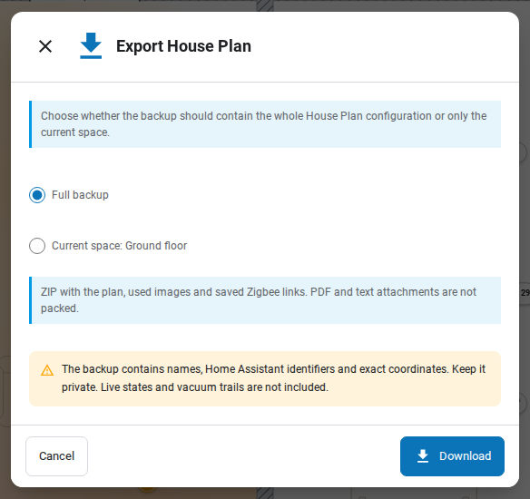

*Choose a full backup or the current space. The dialog explains what the file includes.*

&emsp;&emsp;Export performs the same checks on a copy without changing the working plan. When repairs are needed, review the report and choose **Download repaired backup**. This downloads the prepared snapshot, not newly read live data. Source files are not rewritten. Unsafe/corrupt archives, invalid types and impossible sizes (zero or negative) are still refused without changing the accepted plan.

&emsp;&emsp;A door, window, gate or open passage that no longer fits its wall or partition is repaired instead of refusing the whole file — it may be the only copy of the plan. An opening next to a free wall is put back onto it (it moves by at most 1/50 of a grid step). Otherwise it stays where it was without a wall: it is drawn in place, cuts no wall, and you can move it onto a wall in the plan editor.

&emsp;&emsp;The import preview counts both and lists the openings under **Show openings**; keeping openings off walls needs the confirmation box. Of two overlapping openings the one earlier in the file keeps its wall. House Plan never puts an opening without a wall over another opening on the same wall.

&emsp;&emsp;For Home Assistant administrators, **Full backup** creates a ZIP containing the complete model, used background images, custom-image decor, graphical device attachments and the saved Zigbee link snapshot. Images are copied, not just linked; PDFs and text attachments are not packed. Backgrounds travel as they are, under the same rule as uploading a background: an SVG with room labels and styles or a very large raster image is included, as long as the file is what its name says.

&emsp;&emsp;Full-backup ZIP export, restore and its Undo require administrator permission. Ordinary editors keep full JSON; **Current space** and its **Plan only** remain JSON for everyone. The separate house-plan ZIP below is available to editors.

&emsp;&emsp;If an image is missing, unsafe or external, the report names it and explains how to repair it. Nothing downloads automatically: **Download incomplete backup** is a separate confirmation and the filename marks the incomplete copy. The restore preview repeats the report and requires consent before detaching missing backgrounds/attachments; missing custom images remain repairable placeholders.

&emsp;&emsp;External image bytes are never downloaded by HA.

&emsp;&emsp;Both import entries accept the new ZIP and older JSON. The preview shows image counts and the snapshot's original dates. Restoring replaces the current saved Zigbee snapshot, including clearing it when absent; if Zigbee links are disabled in the restored plan, the saved cache is cleared. Restored links are outdated and no radio scan starts. **Undo import** restores the previous plan and saved links once, until later plan or cache changes make that Undo stale.

&emsp;&emsp;Export itself changes neither plan nor images. Keep backups private: they contain names, identifiers, exact geometry and potentially network topology. This is separate from the diagnostic JSON in **Help & feedback**.

&emsp;&emsp;ZIP limits: 2 GiB compressed and unpacked, 1600 entries; existing individual image/storage limits still apply. Only one ZIP operation per user and two per installation may be active, with a ten-minute preview lifetime. Closing or cancelling a preview releases its operation so import can be retried immediately, without waiting ten minutes. Cancel and retry after a timeout; errors leave the accepted plan intact.

&emsp;&emsp;Older House Plan versions cannot read this ZIP; their JSON import/export remains unchanged.

&emsp;&emsp;With no spaces yet, choose **Import backup** next to **Add space** on the empty screen. Close the automatic first-space/floor dialog if it is open, select a House Plan ZIP (administrator) or JSON backup and confirm the normal preview; no temporary space is needed. Nothing changes before confirmation, and Cancel returns to the empty screen. This entry requires editing permission and is unavailable in House Plan kiosk mode.

&emsp;&emsp;It does not import a complete Home Assistant backup.

&emsp;&emsp;**Global settings → Backup and transfer** exports either the complete House Plan model or the current space; confirm with **Download**. Import first shows a server-side preview with type, versions, object counts, source and content-link state; nothing is written until confirmation.

&emsp;&emsp;A full import replaces the model and creates one undo point. A space import assigns new internal IDs and adds the copy without replacing global settings. When that exact import map matches orphan references already present in the target, the preview reports them and Apply restores them together with the space. Re-importing a copy still creates an independent space, but no longer grows nested service prefixes in internal IDs.

&emsp;&emsp;Preview and **Add space** use the same prepared candidate. **Import reference details** reports links updated inside the copy and in the existing plan. If more than one target is possible, House Plan preserves the reference instead of guessing and recommends running **Optimize plans** after the import. Internal uploaded files are not embedded in JSON (unlike full ZIP); an import to another HA instance must explicitly detach those links.

&emsp;&emsp;For **Current space**, enable **Plan only** to transfer the architectural template without devices or Home Assistant bindings. It keeps rooms, walls, openings, decor, backdrop transforms and manually positioned room labels at their chosen scale, but removes real and virtual markers, device positions, Area assignments, temperature/humidity sources and opening contacts/locks.

&emsp;&emsp;Live values in text labels become `—`; surrounding static text stays intact. The import preview marks this file as plan-only and adds it through the normal space-import flow.

&emsp;&emsp;Plan-only is not full anonymisation: space and room names, static text, file names, exact coordinates and external URLs remain in the JSON. Internal plan files are still referenced rather than embedded and may need to be detached on another Home Assistant instance.

### Whole house — plan only

&emsp;&emsp;The third export option transfers all floors, inter-floor stairs, backgrounds and decor images in one ZIP. It is available to writers, including a standalone editor whose host supports the optional house-transfer API. An empty house cannot be exported.

&emsp;&emsp;No real/virtual devices, device positions, HA bindings, sensors, locks, automations, Zigbee data, vacuum paths or global settings are transferred. Room labels and their positions remain; live text values become `—`. Names, static text, exact geometry and original image metadata including EXIF remain, so this is not full anonymisation.

&emsp;&emsp;Choose the ZIP through the normal import picker. Preview lists floors, their new names, object/image counts and warnings. **Add house** appends one independent copy without replacing existing floors, devices, global settings or unresolved target references. Stairs link the new floors to each other. Re-importing creates another independent copy; no global import Undo is created.

&emsp;&emsp;Supported per-floor appearance settings travel with the copy. Global palettes, lighting, Moon and volumetric settings remain the target home's authority, so exact visual parity is not promised. Unavailable images need explicit download/import consent: missing backgrounds are detached and decor stays repairable. External URLs remain but the server does not fetch them. Corrupt embedded files are never treated as declared missing images.

&emsp;&emsp;The HA limit is 576 MiB compressed and expanded, 512 entries; existing individual file/storage limits remain. Standalone hosts may use lower limits. One separate house operation per installation lasts ten minutes; closing/cancelling releases it immediately. Installation backups use their own pool and retain their existing rules.

&emsp;&emsp;If the target does not support this format, update the card and integration: no file is uploaded to the wrong importer. Extracting document.json is not a workaround. Errors preserve the old plan; after interruption HA completes the paired save or rollback before another edit. Do not downgrade the integration until that recovery finishes.

### Storage locations

| Data | Location |
|---|---|
| Spaces, geometry, Background and marker settings | HA storage `houseplan.config` |
| Marker and room-card positions | HA storage `houseplan.layout` |
| Plan files | `config/houseplan/plans` |
| Marker attachments | `config/houseplan/files` |
| Reusable custom decor images | `config/houseplan/assets` |
| Vacuum path | Separate House Plan HA storage |
| Cache, viewport and kiosk scale | That browser's `localStorage` |

&emsp;&emsp;A normal Home Assistant backup that includes `config` preserves House Plan configuration and files. Make a fresh HA backup before major manual plan work.

### Several clients

- Configuration and positions are shared by every card and user; point updates
  do not overwrite unrelated simultaneous marker moves.
- WebSocket broadcasts saved changes without a page reload. Viewport, last
  space and kiosk sizing remain local to the browser/card.
- A quickly rebuilt Lovelace card attempts to restore an unsaved dialog draft
  for a short window.
- Every save after initial empty storage must return the revision obtained from
  `houseplan/config/get`; a stale revision is rejected rather than overwriting
  another client. Refresh an old cached card that repeatedly reports conflicts.

### Files and quotas

&emsp;&emsp;Plan files accept SVG/PNG/JPG/WebP up to 8 MB, with a 200-file/256-MB total. A plan file above that limit is not sent: the card names the limit at once and, for a raster image, offers to upload a reduced copy. Marker attachments accept PDF/PNG/JPG/WebP/TXT up to 50 MB, with a 1000-file/1-GB total and 50 links per marker. Writes are also refused below 512 MB free disk space.

&emsp;&emsp;Detached files remain until explicitly deleted.

<a id="troubleshooting"></a>

## 19. Limitations and troubleshooting

&emsp;&emsp;Find your situation below and start with the suggested check. If House Plan refuses an action, find out why before redrawing or deleting objects.

<a id="21-current-limitations"></a>

<a id="22-troubleshooting"></a>

<!-- docs-section: limits -->

<!-- docs-section: diagnostics -->

### Current limitations

| Limitation | Practical effect |
|---|---|
| Rooms must be closed | An open path is walls, not a room with area |
| An unfinished chain does not remain a draft | Changing tool or leaving the editor keeps accepted segments as ordinary independent walls; the chain is not resumed later |
| One HA area per room | To split one HA area visually, assign devices manually |
| Zero-thickness walls cannot host openings | Give the target wall a positive thickness before adding a door, window, gate or passage |
| Opening bodies are inert in View | Only a separate lock badge is interactive |
| Editors are desktop-first | Touch editing may be awkward, limited or absent |
| Room details use hover in View | A touch-only user may need an editor or another visible metric |
| Sun has no exterior 3D model | It cannot know shadows from trees, awnings or neighbouring structures |
| Icon rules use regular expressions | First matching rule wins and invalid expressions are rejected |
| LED strips are not cut by walls | A thickened wall does not edit a strip: parts inside the wall do not glow, «Optimize plans» shows how many strips pass through walls |

&emsp;&emsp;Storage guards allow up to 50 spaces, 400 rooms per space, 2,000 markers, 500 openings, 1,000 Background items and bounded wall/physical-object catalogues per space. The configuration package is limited to 2 MB.

### Card does not load

| Symptom | Check |
|---|---|
| `Custom element doesn't exist: houseplan-card` | Integration loaded; resource is `/houseplan_files/houseplan-card.js` with type `module`; restart HA, then hard-refresh with `Ctrl+F5` (Windows/Linux) or `Cmd+Shift+R` (macOS) |
| MIME `text/plain` | Replace `/custom_components/...` with `/houseplan_files/...` |
| Integration missing | Folder is exactly `custom_components/houseplan`; restart HA; inspect import errors |
| Old version after update | Restart HA and reload resources/browser; the integration maintains the resource version query |

### Devices or values are missing

- confirm the room's HA-area binding and the device/entity registry area;
- open Device → **Devices** and inspect **Hidden** / **Available again**;
- verify the selected source still exists and is available;
- remember that a virtual marker has no active state;
- inspect the dialog's exact target and skipped-target explanation.

### Geometry looks wrong

- confirm grid cell size before judging physical dimensions;
- use Fit all to include distant objects;
- check wall thickness and the space's zero-thickness wall style;
- use desktop for precise nodes, Split and Resize.
- if some masonry remains visible but Optimize or an edit reports unsafe wall
  geometry, export the affected space and attach it to a bug report. House Plan
  preserves known-valid wall components for inspection and does not repair or
  delete the ambiguous object during rendering.

### Vacuum does not move

- confirm the active map source and map identity;
- check calibration anchors and current source availability;
- verify that the active map is assigned to this space;
- open source diagnostics instead of deleting/recreating the marker.

&emsp;&emsp;When reporting a problem, include House Plan version, HA version, browser, console/server errors and reproducible steps. Replace private entity IDs and plans with synthetic equivalents.

<a id="help"></a>

## 20. Help and safe operation

&emsp;&emsp;If a problem is repeatable, describe it through Help & feedback and keep the report ID. Check the diagnostic preview before sending it. A complete plan backup is a separate file for your own safekeeping.

<a id="23-help-and-private-feedback"></a>

<!-- docs-section: support -->

### Quick safety checklist

- Keep administrator-only editing enabled unless other users truly need to
  upload files and modify the complete shared plan.
- Removing a device, independent wall, plan file or space, and unlocking a
  lock, use the common House Plan confirmation. **Cancel** has initial focus;
  close, backdrop click and `Esc` change nothing. If the target changed or
  disappeared, confirmation is not applied to a different object.
- Enable confirmation for potentially dangerous Toggle, Run and cover actions.
- Unlock only through the dedicated opening card; marker configuration cannot
  bypass that path.
- Make an HA backup before deleting a space, large room merges or optimization.
- Read the optimization report: old/imported coordinates between grid nodes may
  be corrected together.

### Help & feedback

&emsp;&emsp;The **Help & feedback** button follows **General settings** in the card header. It is available to users allowed to edit House Plan in View and all editors, but is hidden in kiosk. The dialog contains the current card version, the GitHub and Telegram links, and this guide. Russian UI opens the Russian guide; all other languages open this English guide.

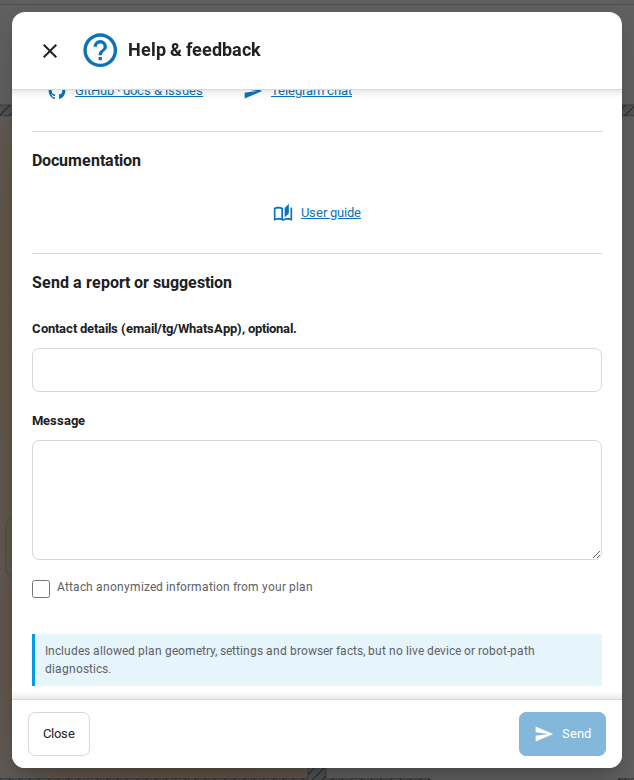

*Describe a problem in the feedback form; diagnostic attachments are enabled separately.*

&emsp;&emsp;Enter a required message and, optionally, a contact such as an email, Telegram username or WhatsApp number. Your message and contact stay only in this open card: it is not written to House Plan settings, local storage or Home Assistant.

&emsp;&emsp;Diagnostic attachments are **off by default**. When enabled, House Plan builds an allowlisted package in the integration and shows its exact size, SHA-256 and JSON before sending. The package excludes names, Home Assistant entity/device/area IDs, arbitrary sensor readings, raw attributes, URLs, files, message and contact. Extended diagnostics (package v2) include configuration links, normalized current diagnostic statuses and display decisions, robot calibration and bounded samples of position, room anchors and paths.

&emsp;&emsp;They also include exact room/wall/opening geometry and home dimensions. Four coverage categories explain what was collected and what is incomplete; one snapshot cannot diagnose every transient problem. With an older integration, the form explicitly labels package v1 as limited diagnostics. Use the attachment checkbox again after an integration update in an already-open dialog to agree to v2; Refresh alone never expands existing consent.

&emsp;&emsp;Use **Show data** to inspect the exact bytes and **Download JSON** to keep them. The preview expires after ten minutes; refresh it before sending if required.

&emsp;&emsp;When your report is sent, keep the report ID shown in the dialog. A network or relay failure does not close or clear the draft and never claims delivery: retry with the same preview, or copy the message/download the JSON and continue through the provided Telegram or GitHub links. The form is available when the card and integration support the same feedback API; their release numbers may temporarily differ during a normal HACS update.

&emsp;&emsp;Update an old or incompatible side. Retention and deletion details are in
[SUPPORT-PRIVACY.md](SUPPORT-PRIVACY.md).

### Keeping the two guides current

&emsp;&emsp;If you maintain this documentation, update RU and EN together when behaviour changes. Match their scenarios, dependencies and limitations rather than word counts. Put explanations in the relevant sections, link related settings and keep existing anchors. When the described version changes, update the source label and screenshots. Keep task history out of the introduction, and describe a prototype as a prototype until it ships.

&emsp;&emsp;This note adds no CI checks.
