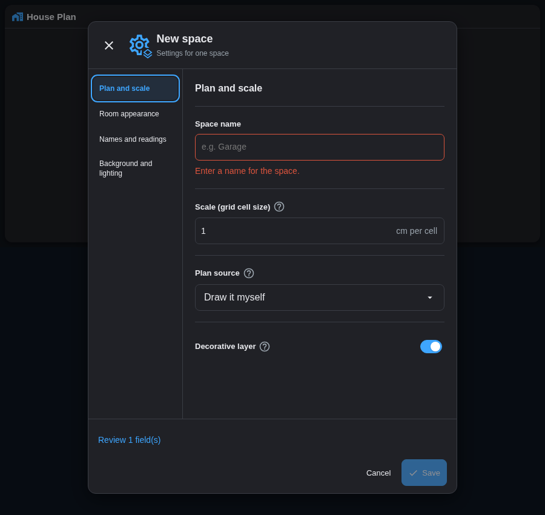
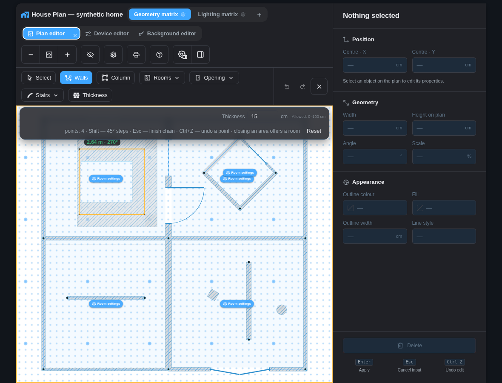
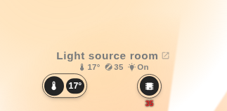
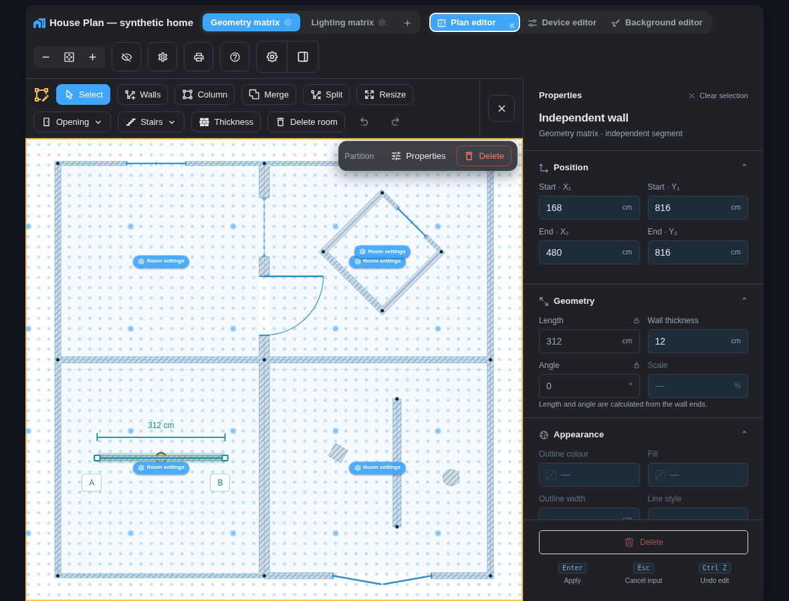
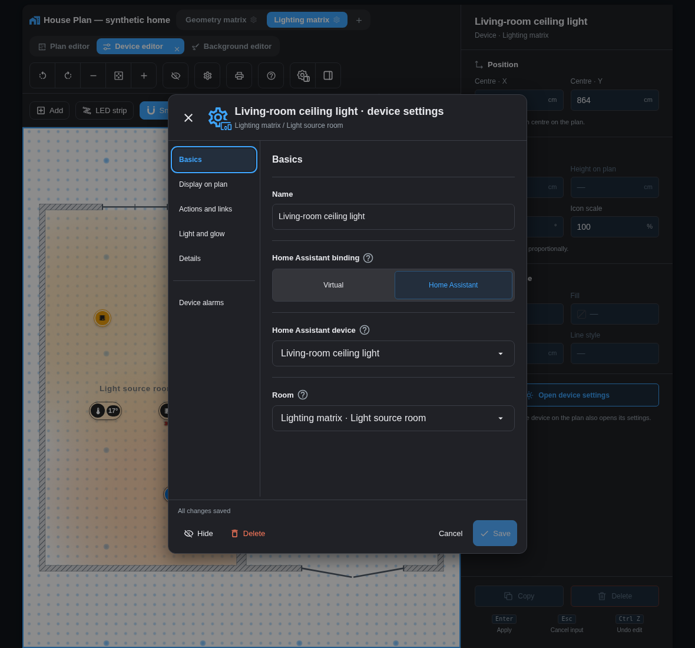
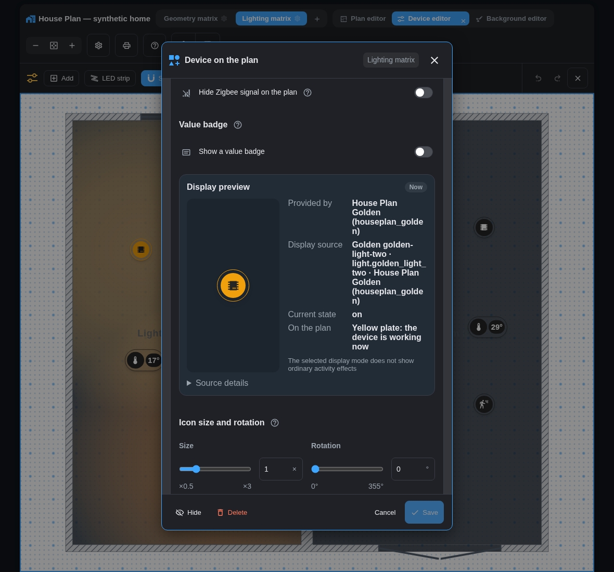
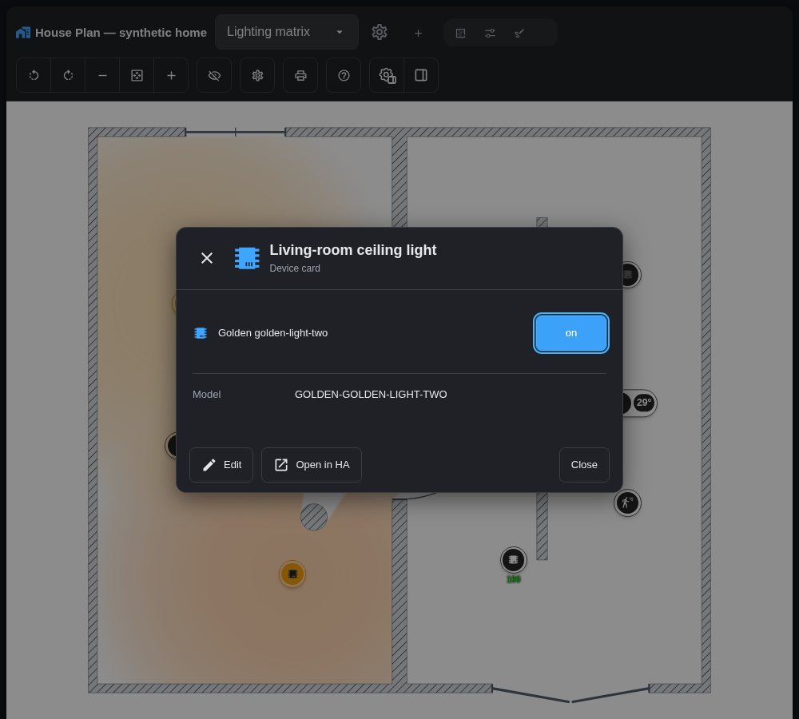
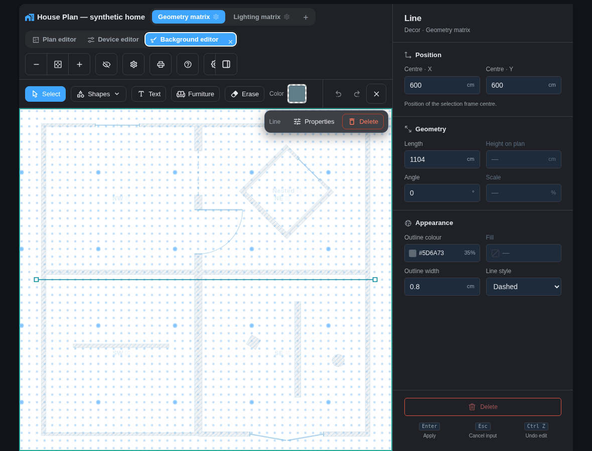

# House Plan — полное руководство пользователя

## Как выбрать диалог Home Assistant для устройства

В настройках устройства откройте «Действия и связи» и выберите действие «Диалог HA (more-info)». Под ним появится «Открывать в Home Assistant». «Авто» выбирает основную сущность устройства, например термостат, а список позволяет выбрать другую его сущность; поиск находится внутри списка. Этот же выбор действует для кнопки «Открыть в HA» в карточке устройства. Правый клик по-прежнему открывает настройки Houseplan. Источники состояния значка, значения и управления от этого выбора не меняются. Если выбранная сущность удалена или отключена, Houseplan предложит проверить настройку и не подменит её другой.

### Начать с готового плана

На пустом экране и в диалоге выбора этажей HA есть ссылка на
[конвертер планов](https://houseplan.tech/convert/). Поддерживаются Sweet Home 3D
(.sh3d) и Easy Floorplan (YAML / JSON). Ссылка открывает новую вкладку и сохраняет
выбор этажей. Подсказка доступна без прав редактирования и без интеграции хранения.
После удаления последнего пространства она возвращается; создание или
восстановление пространства убирает её с пустого экрана.

### Согласованные действия редакторов

Новое пространство всегда открывает «План и масштаб» с вариантом «Нарисовать
вручную». В режиме изображения «Уже загруженные» доступно, когда есть
сохранённые изображения. Последующий выбор в открытой форме сохраняется.

Выбрав мебель, щёлкните для размещения при отпускании кнопки мыши. Перетаскивание
панорамирует план и сохраняет выбранный предмет для следующего щелчка. У каждого
объекта мультивыделения своя рамка; совместное перемещение остаётся общим.

Контекстное меню устройства в его редакторе содержит настройки, копирование,
скрытие или показ на плане и удаление. Показанное скрытое устройство отмечено
серой точкой. Показ скрытых переключается кнопкой глаза на основной панели;
дублирующего переключателя в диалоге «Устройства» нет.

### Выбор цвета

Бегунки «Оттенок», «Насыщенность» и «Яркость» показывают один выбранный цвет.
Шкала насыщенности показывает его изменение от серого к насыщенному, шкала
яркости — от чёрного к яркому. Цвет можно менять также на поле или через HEX;
прозрачность настраивается отдельно. Настройки сохраняются кнопкой диалога.

В боковых свойствах выбранного декора HEX и процент можно вводить прямо рядом
с образцом. Допустимы 3 или 6 цифр HEX с `#` или без него; 100% означает
полностью непрозрачный цвет. Валидная пара сразу видна на плане. `Enter` или
переход из всего составного поля сохраняет её одним действием; `Escape`
отменяет ввод и предпросмотр. Неполное или неверное значение не сохраняется.
Образец открывает тот же пикер. В свойствах мебели подпись «прозрачность»
показывает обратную величину: 0% для полностью непрозрачного цвета.

### Диалоги и инструменты

Выпадающие списки используют общее оформление. В выборе иконки поиск называется
«Поиск»; на узком или низком экране HA открывает нижнюю панель, на desktop —
список рядом с полем. Escape сначала закрывает этот список и возвращает фокус,
сохраняя открытыми настройки устройства и введённые данные.

«Помощь и обратная связь», «Устройства», «Правила иконок» и печать используют
единое оформление настроек. Прокручивается содержимое, а кнопки закрытия и
нижние действия остаются доступны. Принятое закрытие плавное; системное
уменьшение движения отключает анимацию. Ошибка сохранения или решение продолжить
редактирование оставляет введённые данные в открытом окне. Фокус возвращается
к открывшей кнопке без вспышки рамки; следующий `Tab` снова показывает подсветку.

В редакторе подложки инструмент **Удалить** отмечен корзиной. После меню фигур,
мебели или изображений другой инструмент выбирается одним нажатием; клик по
плану только закрывает открытое меню. Подтверждение, отмена и история прежние.
Общая палитра задаёт шкалы для всех пространств; предустановка применяется
к комнатам отдельно в настройках пространства или комнаты.

### Панель свойств в редакторах

При ширине самой карточки от 960 px справа в редакторах плана, устройств и
подложки появляется панель **Свойства**. Клик выбирает объект; размеры, положение
и внешний вид меняются без открытия отдельного окна. Серые поля недоступны,
поля с замком вычисляются автоматически. У стены контура концы меняются только
перетаскиванием узлов; у проёма ширина сохраняет центр, а отступ считается до
ближнего края от отмеченного на плане физического угла или конца стены.

Панель занимает всю высоту справа; разделы постоянно раскрыты и подстраиваются
под содержимое. Пояснение общих концов A/B находится в разделе «Положение».
Окно предлагает сторону комнаты или улицы; у двери сохраняется выбор петель.
Рамки и ручки выделения остаются, а дополнительные подписи объекта убраны;
обозначения A/B стены, названия комнат и пользовательский текст сохраняются.

В меню **Комнаты** собраны «Объединить», «Разделить», «Изменить размер» и
«Удалить». В редакторе подложки меню **Фигуры** содержит линию, прямоугольник и
эллипс. Отмена и повтор — значками справа перед закрытием каждого редактора.
Подсказки появляются после короткой задержки при наведении или фокусе клавиатуры;
`Esc` закрывает их. В редакторе подложки лестницы приглушены вместе со стенами.

`Enter` или уход из поля применяет одно изменение, `Esc` отменяет ввод.
Некорректное значение или ошибка сохранения удерживает выбор и показывает причину.
В тексте `Enter` добавляет строку, `Ctrl/Cmd+Enter` применяет правку; **Вставить
переменную HA** вставляет значение сущности или атрибута в позицию курсора.
Для изображения можно отключить локальное сохранение пропорций. Прозрачность
основной картинки плана хранится отдельно от её масштаба и сохраняется при сбросе
положения.

Полные диалоги остаются доступны двойным кликом и прежними кнопками **Свойства**
или **Открыть настройки устройства**. Пока диалог открыт, боковая панель неактивна.
На узкой карточке остаётся прежний интерфейс: один клик по устройству открывает
настройки. Сужение карточки не сохраняет незавершённый ввод: он ждёт возвращения
панели; открытие полного диалога на узком экране отменяет этот локальный черновик.
В просмотре и киоске панели нет. Undo/Redo устройств включает также масштаб и
поворот значка из панели, не отменяя посторонние настройки устройства.

Актуально для **v1.78.0-beta.5**. Руководство составлено по исходному коду и
фактическому интерфейсу этой версии. [English version](USER-GUIDE.md).

House Plan добавляет отдельную страницу **House Plan** в боковое меню Home
Assistant. Эта полноэкранная панель — основной способ просмотра и редактирования
общего плана. Вместе с ней устанавливаются две необязательные Lovelace-карточки:

- `custom:houseplan-card` — интерактивный план с редакторами, состояниями и управлением;
- `custom:houseplan-space-card` — статическая схема одного пространства со ссылкой на полный план.

Все планы, настройки и позиции хранятся внутри Home Assistant. Только явная
отправка через «Помощь и обратная связь» обращается к relay поддержки, а точная
геометрия плана прикладывается лишь после отдельного согласия и предпросмотра.

> **Уровень поддержки устройств ввода.** Просмотр и киоск должны полноценно и
> удобно работать на телефонах, планшетах и настенных touch-панелях. Создавать и
> редактировать планы рекомендуется на компьютере с мышью и клавиатурой.
> Редакторы на touch поддерживаются по остаточному принципу: отдельные жесты,
> точные операции или элементы интерфейса могут работать неудобно, ограниченно
> либо отсутствовать. Это не относится к безопасности данных и действий:
> touch-редактор не должен повреждать план или отправлять случайные команды.

## Содержание

1. [Модель данных и терминология](#1-модель-данных-и-терминология)
2. [Установка и доступ](#2-установка-и-доступ)
3. [Добавление карточки](#3-добавление-карточки)
4. [Быстрый старт](#4-быстрый-старт)
5. [Режимы интерфейса](#5-режимы-интерфейса)
6. [Навигация, масштаб и жесты](#6-навигация-масштаб-и-жесты)
7. [Пространства](#7-пространства)
8. [Комнаты и стены](#8-комнаты-и-стены)
9. [Двери, окна, открытые проёмы, ворота и замки](#9-двери-окна-открытые-проёмы-ворота-и-замки)
10. [Устройства](#10-устройства)
11. [Действия по нажатию](#11-действия-по-нажатию)
12. [Визуальные состояния устройств](#12-визуальные-состояния-устройств)
13. [Заливки комнат и свет](#13-заливки-комнат-и-свет)
14. [Редактор подложки](#14-редактор-подложки)
15. [Солнце и Луна: фон, оконные лучи и луна](#15-солнце-и-луна-фон-оконные-лучи-и-луна)
16. [Роботы-пылесосы](#16-роботы-пылесосы)
17. [Киоск-режим](#17-киоск-режим)
18. [Статическая карточка пространства](#18-статическая-карточка-пространства)
19. [Обслуживание планов](#19-обслуживание-планов)
20. [Хранение, совместная работа и резервные копии](#20-хранение-совместная-работа-и-резервные-копии)
21. [Ограничения текущей версии](#21-ограничения-текущей-версии)
22. [Диагностика](#22-диагностика)
23. [Помощь и закрытая обратная связь](#23-помощь-и-закрытая-обратная-связь)

<!-- docs-section: model -->

## 1. Модель данных и терминология

Настройки образуют иерархию: общие значения задают базовый вид, пространство может их переопределить, затем отдельная комната, затем устройство.

| Уровень | Что это | Что хранит |
|---|---|---|
| Панель/карточка | Основная страница в боковом меню либо один необязательный экземпляр на дашборде | Последнее/стартовое пространство; карточка дополнительно задаёт язык, размер иконок, показ значений/LQI, киоск и автолистание |
| Общие настройки | Настройки всего House Plan | Палитры заливок, фон, радиус света, север, солнце, окно комнаты при наведении, объёмный вид плана (2.5D), правила иконок |
| Пространство | Этаж, двор, гараж, отдельное строение | Подложку, масштаб сетки, комнаты, стены, проёмы, декор и настройки отображения |
| Комната | Только замкнутый контур | Название, необязательную HA-зону, источники температуры/влажности и локальную заливку |
| Стена | Сегмент контура комнаты или независимая стена | Стабильный ID и толщину 0–100 см; вид стен нулевой толщины задаётся для пространства |
| Проём | Дверь, окно, открытый проём или ворота на стене комнаты либо законченном независимом отрезке | Размер и, где применимо, ориентацию, контактный датчик и замок |
| Маркер | Значок устройства на плане | Привязку к HA, комнату, действие, внешний вид, свет, описание и файлы |
| Декор | Элемент подложки | Линию, фигуру, текст, мебель или положение изображения плана |

Стены комнаты выводятся из её замкнутого контура. Незамкнутые и свободно
стоящие стены хранятся отдельно как независимые перегородки; они не создают
комнату или пол сами по себе.

<!-- docs-section: installation -->

## 2. Установка и доступ

### Требования

| Компонент | Требование |
|---|---|
| Home Assistant | 2024.6.0 или новее |
| Тип установки | Любой, где доступны пользовательские интеграции |
| Браузер | Современный браузер с Web Components, SVG и Pointer Events |
| Права | По умолчанию редактировать House Plan могут только администраторы |

### Установка через HACS

1. Найдите **House Plan** в поиске HACS и установите — интеграция входит в основной каталог HACS, пользовательский репозиторий добавлять не нужно.
2. Перезапустите Home Assistant.
3. Откройте **Настройки → Устройства и службы → Добавить интеграцию** и выберите **House Plan**.
4. Оставьте включённой опцию «редактировать план только администраторам», если обычным пользователям нужен только просмотр и управление.

Интеграция сама регистрирует страницу в боковом меню и Lovelace-ресурс. После установки или обновления
House Plan перезапустите Home Assistant и полностью перезагрузите
страницу: `Ctrl+F5` в Windows/Linux или `Cmd+Shift+R` в macOS.

#### Режим Storage (по умолчанию в Home Assistant)

Обычно YAML не нужен. Если авторегистрация не сделала карточку доступной,
откройте **Настройки → Панели управления → меню ⋮ → Ресурсы → Добавить
ресурс**, укажите `/houseplan_files/houseplan-card.js` и выберите тип
**JavaScript-модуль**.

#### YAML-ресурсы в Home Assistant 2026.2+

Чтобы управлять ресурсами в `configuration.yaml` независимо от режима
самой панели, используйте:

```yaml
lovelace:
  resource_mode: yaml
  resources:
    - url: /houseplan_files/houseplan-card.js
      type: module
```

#### Home Assistant 2024.6–2026.1: устаревший режим

Только для панели, которая уже полностью управляется через YAML:

```yaml
lovelace:
  mode: yaml
  resources:
    - url: /houseplan_files/houseplan-card.js
      type: module
```

`mode: yaml` переводит в YAML-режим саму панель. Не переключайте
storage-панель в устаревший YAML только ради House Plan; используйте
инструкцию для Storage выше. Не используйте
`/custom_components/houseplan/frontend/houseplan-card.js`: Home Assistant не
раздаёт этот путь как модуль. Обе карточки находятся в одном файле
`/houseplan_files/houseplan-card.js`.

### Ручная установка

1. Скопируйте папку `custom_components/houseplan` из релиза в `config/custom_components/houseplan`.
2. Перезапустите Home Assistant.
3. Добавьте интеграцию **House Plan**.
4. Если карточка всё ещё недоступна, выполните инструкцию для
   своей версии Home Assistant и режима ресурсов выше.

Копируйте папку интеграции целиком: стабильный URL ресурса по-прежнему один,
но entry-файл загружает внутренние модули с хешированными именами. Установка
одного `houseplan-card.js` не поддерживается.

В обычном просмотре код редакторов не загружается. Поэтому первое открытие
«Плана», «Устройств» или «Подложки» может занять короткое время. Если внутренний
модуль не загрузился и после одной повторной попытки, план остаётся в просмотре;
наполовину открытого редактора не остаётся. При сетевом сбое карточка предлагает
проверить сеть и нажать ещё раз — повторное нажатие пробует загрузку заново.
Если же на вкладке остался код другой версии карточки, поможет только
перезагрузка страницы, о чём и говорит подсказка. Полностью устаревший
`houseplan-card.js` из кэша прокси после обновления больше не оставляет пустую
карточку: вместо неё показывается плашка с просьбой перезагрузить страницу.

Если после обновления не загрузились подсказки и быстрые обновления, сводка
или связи Zigbee, в карточке остаётся плашка с названием недоступной функции.
План и доступное управление продолжают работать. **«Повторить»** выполняет
одну попытку загрузки той же сборки; при успехе плашка исчезает, иначе остаётся
**«Перезагрузить страницу»**. Скрытая вами сводка не считается неисправной,
её настройка не меняется. Обычная карточка не перезагружается сама; киоск
при неисправимом отказе может безопасно обновиться один раз на сборку за
сеанс, только без диалогов, действий и несохранённых операций. Ручная
перезагрузка соблюдает обычный вопрос об отказе от черновика редактора.

### Удаление и повторная установка

Удаление записи House Plan в **Настройки → Устройства и службы**, а затем
пакета в HACS не удаляет планы. Данные остаются в каталоге конфигурации HA:
`.storage/houseplan.config`, `.storage/houseplan.layout`,
`.storage/houseplan.virtual_lights`, `.storage/houseplan.trails` и
`houseplan/plans/`, `houseplan/files/`, `houseplan/assets/`.

При повторном добавлении интеграции мастер показывает число пространств,
файлов и дату последнего изменения, затем предлагает:

1. **Восстановить прежние планы** — продолжить с прежними данными и штатными
   миграциями. Это первый пункт. Повреждённый или слишком новый конфиг мастер
   отмечает как нечитаемый; восстановление не исправляет такой файл.
2. **Начать с чистого листа** — перенести весь прежний набор в
   `houseplan/archive/<UTC-дата-время>-<уникальный-id>/` и открыть пустой план.

После выбора появится прежний флажок правки только администраторами.
Перенос начинается только после подтверждения этой последней формы. Закрытие
мастера до подтверждения ничего не меняет. Если данных нет или остался только
архив, вопроса не будет. Если в прежних данных нет пространств (одни устройства
не в счёт), вопроса тоже не будет: после подтверждения последней формы прежний
набор уходит в архив, как при «Начать с чистого листа». Меню появляется, только
когда пространства есть, данные нельзя прочитать или осталось незавершённое
сохранение плана. Архив не учитывается в квотах файлов и никогда не
очищается автоматически; каждый новый чистый лист создаёт отдельный архив.
Удаление архива вручную — ответственность администратора.

Для ручного возврата сначала сделайте резервную копию HA и **остановите HA**.
Сохраните текущий новый набор отдельно, затем верните **один выбранный набор**:
из `archive/<...>/storage/houseplan.*` — в `.storage/`, каталоги `plans/`,
`files/`, `assets/` этого архива — в `houseplan/`. Не смешивайте старый и новый
наборы и не перезаписывайте единственную копию. Запустите HA и, если запись
интеграции удалена, добавьте её и выберите восстановление. Кнопки возврата из
архива в интерфейсе нет.

При ошибке переноса запись не создаётся, выполненные переносы откатываются.
Аварийное выключение или отказ носителя во время отката могут оставить часть
файлов в архиве: сохраните оба набора и смотрите путь архива в журнале HA для
ручного восстановления. Ничего автоматически не удаляется.

### Права пользователей

| Настройка интеграции | Просмотр | Управление устройствами | Редактирование планов и загрузка файлов |
|---|---:|---:|---:|
| Только администраторы — включено (по умолчанию) | Все вошедшие пользователи | По обычным правам HA | Только администраторы |
| Только администраторы — выключено | Все вошедшие пользователи | По обычным правам HA | Все, кроме пользователей группы HA `system-read-only` |

Оптимизация планов и её отмена используют те же права на изменение Houseplan.
При выключенной опции «Только администраторы» обычный пользователь с правами
записи тоже может их запускать. В киоске эти действия недоступны.

Пункт **House Plan** виден всем вошедшим пользователям. Без права редактирования
доступен полноценный просмотр, но редакторы скрыты. Если план ещё пуст,
пользователь увидит понятное read-only сообщение без кнопки добавления и без
автоматически открытого диалога настройки.

В карточке устройства **«Изменить»** доступно только с правом редактировать
план и вне киоска. Без этого права состояние, управление, **«Открыть в HA»**
(обычное окно сущности) и **«Закрыть»** сохраняются; флаг **«Новое»** не снимается.
Значок перехода в HA-зону у названия комнаты виден только администратору HA
вне киоска. В редакторе плана он остаётся частью перетаскиваемой подписи,
в том числе у редактора без HA-admin, но никуда не переходит.
В Просмотре переход — отдельная кнопка: Tab выбирает её, Enter или пробел
открывают зону в HA, не меняя масштаб комнаты. Настройки устройства, открытые
в Просмотре, после короткого пересоздания карточки возвращаются вместе с
несохранённым черновиком; при загрузке редактора доступны закрытие и повтор.

## 3. Добавление карточки

Обычно ничего добавлять не требуется: откройте **House Plan** в боковом меню
HA. Панель занимает доступную область страницы, сохраняет вкладки пространств и
редакторы, но не повторяет внутри плана заголовок продукта. Уход со страницы
завершает редактор; при возвращении сохраняется последнее пространство и
открывается режим просмотра.

Карточка для дашборда остаётся для случаев, когда план нужно встроить в свою
компоновку. В Sections она по умолчанию запрашивает всю ширину и 10 строк при
минимуме 6 строк. В режиме редактирования дашборда стандартной ручкой Home
Assistant можно сделать план выше или ниже; просмотр и каждый редактор заполняют
выбранную высоту. Явно выбранный пользователем размер Home Assistant остаётся
главным. Существующая карточка Sections без явного числа строк после обновления
один раз получает новый размер по умолчанию — 10 строк.

Минимальная конфигурация основной карточки:

```yaml
type: custom:houseplan-card
title: План дома
```

Параметры основной карточки доступны в визуальном редакторе Lovelace.

| Поле | Значение по умолчанию | Поведение |
|---|---:|---|
| `title` | пусто | Заголовок карточки |
| `default_floor` | первое/последнее открытое | Стартовое/резервное пространство незакреплённой карточки |
| `floor` | не закреплено | Всегда показывать один stable ID пространства или числовой индекс YAML с нуля |
| `language` | язык HA | `auto`, `en`, `ru` или `de` |
| `icon_size` | `2.5` | Базовый размер маркеров, 1–6% ширины плана |
| `show_temperature` | `true` | Показывает компактные значения температуры **и влажности** у подходящих устройств |
| `live_states` | `true` | Включает рабочие/открытые/недоступные состояния, смену иконок и активность; аварии остаются видимыми всегда |
| `show_signal` | наследование | Только точное `false` скрывает системный LQI этой карточки; явное «Вкл» пространства сильнее |
| `kiosk` | `false` | Полноэкранный режим без шапки и редакторов |
| `cycle` | `0` | Интервал автолистания пространств в киоске, 0–3600 секунд; `0` выключает |

Карточечный `tap_action` из старых конфигураций игнорируется. Действие задаётся отдельно для каждого устройства.

Предпросмотр в открытой форме устройства использует тот же язык карточки,
в том числе после смены языка; `auto` следует текущему языку Home Assistant.

`auto` учитывает основной язык профиля Home Assistant: `de`, `de-DE`,
`de-AT` и `de-CH` включают немецкий интерфейс, а `fr`, `fr-FR`, `fr-CA`,
`fr-BE` и `fr-CH` — французский (перевод сообщества, спасибо @OUARZA).
Ленивые словари (немецкий, французский) загружаются один раз
при первом использовании и разделяются всеми карточками House Plan
на странице. До готовности показывается нейтральный индикатор без краткой
вспышки английского текста; если обе ограниченные попытки загрузки не удались,
карточка остаётся работоспособной на английском и сообщает об этом тостом
«Не удалось загрузить языковой пакет…».

<!-- docs-section: first-run -->

## 4. Быстрый старт

Рекомендуемый порядок настройки:

1. Создайте пространство кнопкой **+**. Можно импортировать этажи из реестра этажей HA.
2. Загрузите SVG/PNG/JPG/WebP или выберите вариант без изображения.
3. Укажите размер одной клетки сетки в сантиметрах. От него зависят размеры стен, проёмов, мебели и площадь.
4. В **Редакторе плана** обведите каждую комнату замкнутым контуром.
5. Свяжите комнату с одноимённой HA-зоной или оставьте без зоны.
6. Добавьте толщину стен и проёмы.
7. В **Редакторе устройств** расставьте автоматически найденные маркеры и настройте действия.
8. В **Редакторе подложки** подвиньте изображение, добавьте мебель, подписи и декоративные линии.
9. Выберите режим заливки пространства и настройте палитру в общих настройках.
10. При необходимости включите киоск, солнечные лучи и живую позицию пылесоса.

Шаги создания и редактирования плана выполняйте в desktop-браузере. Телефон,
планшет и настенная панель являются полноценными целевыми устройствами для
последующего просмотра и управления домом, но не гарантированной средой
редактирования.





<!-- docs-section: modes -->

## 5. Режимы интерфейса

Обычный просмотр — не отдельная вкладка: это состояние, в которое возвращает крестик активного редактора.
Редакторы переключаются напрямую. Новая панель инструментов коротко проявляется,
а её фактическая высота плавно подстраивается даже при переносе кнопок на несколько строк;
при системной настройке уменьшения движения переход отключается.
Escape сначала отменяет активный диалог, меню, перетаскивание, выбор или
инструмент; следующее нажатие в нейтральном состоянии возвращает в Просмотр.

| Режим | Основное назначение | Устройства | Комнаты/стены | Декор и проёмы |
|---|---|---|---|---|
| Просмотр | Контроль дома | Интерактивны; видны состояния, значения и подсказки | Комната подсвечивается при наведении; подсказка показывает название, чистую площадь, температуру, влажность и LQI | Видны, если не скрыты настройками пространства; проёмы не реагируют на клик, кроме значка замка |
| Редактор плана | Геометрия комнат, стен и проёмов | Не редактируются и полупрозрачны, как в редакторе подложки; клики и наведение проходят к инструментам плана | Интерактивны; видны кнопки настроек комнат, размеры и сетка | Проёмы всегда видны и редактируются; стены нулевой толщины рисуются полностью по оси |
| Редактор устройств | Позиции и параметры маркеров | Перетаскиваются; клик открывает настройки; доступны скрытые маркеры | Не редактируются | Служат фоном |
| Редактор подложки | Изображение, линии, фигуры, текст, мебель | Не редактируются и полупрозрачны | Комнаты и все стены полупрозрачны | Декор интерактивен и непрозрачен; скрытый в просмотре декор всё равно виден здесь |
| Киоск | Настенный экран | Интерактивны как в просмотре | Только отображение | Только отображение; редакторы отсутствуют |
| Статическая карточка | Компактная схема пространства | Живые состояния, значения и тревоги как в просмотре (`live_states`), без подсказок и more-info | Только рисунок | Без интерактивности; см. §18 |

### Шапка на телефоне

Когда окно не шире 480 px, шапка Просмотра занимает одну строку: компактный выбор
пространства, кнопки масштаба и одна шестерёнка **«Действия и настройки»**.
В поле виден текущий этаж; список показывает полные названия в прежнем порядке.
Заголовок карточки на телефоне не показывается. Всё остальное открывается
шестерёнкой: администратору — **Редактор плана**, **Редактор устройств**,
**Редактор подложки**, **Настроить пространство**, **Добавить пространство**,
**Общие настройки**, **Скачать файл для печати** и **Помощь и обратная связь**; в
просмотре любому пользователю — **Настройки сводной панели** и показ или
скрытие сводной панели. Пункт делает то же, что прежняя кнопка, и закрывает
меню; Escape или касание вне меню просто закрывают его — касание при этом не
нажимает ничего на плане. В редакторе крестик закрытия остаётся в строке, хотя
сами кнопки редакторов находятся только в меню. В киоске шапки нет.

Если ширина окна браузера меньше 360 px, редактор может занимать две строки
шапки. Обе кнопки поворота остаются рядом с масштабом; выбор этажа, шестерёнка
и крестик доступны. Просмотр сохраняет одну строку. При ширине 360–480 px
редакторы остаются однострочными; более широкие окна сохраняют обычную
адаптивную компоновку.

Если сама шапка не шире 1024 px — в панели это Home Assistant без бокового
меню, на дашборде ширина карточки, — кнопки редакторов показывают только
иконку. Название видно во всплывающей подсказке и доступно экранному диктору.
Шире 1024 px у кнопок иконка и подпись.

При той же ширине шапки **1024 px и меньше** вместо вкладок этажей показывается
выпадающий список. Длинное имя в поле сокращается; полное имя доступно в списке.
Выбор сохраняет обычное переключение и проверку незавершённых изменений.
Если окно шире 480 px, рядом остаются шестерёнка текущего пространства и **+**;
на телефоне эти команды находятся в прежнем меню. Права и закреплённый этаж
действуют как прежде. Шире 1024 px остаются обычные вкладки.

### Сводная панель

Составная кнопка в конце шапки режима просмотра открывает левой шестерёнкой
**Настройки сводной панели**, а правым значком боковой панели показывает или
скрывает её. Когда панель включена, подсвечена только правая половина кнопки.
В киоске кнопка размещается поверх плана. На новом экране панель выключена,
пока пользователь не включит её сам. Состав панели общий для всей установки
House Plan; выбор показа относится только к текущему пользователю Home
Assistant и конкретной карточке или странице в боковом меню. Пользователь
без права редактирования и киоск могут менять этот локальный выбор, но не
общее содержимое.

Администратор может назвать панель, создать до десяти упорядоченных блоков,
показывать блок на всех пространствах или на одном выбранном и добавить до
двадцати показателей в блок. Источником служит состояние любой доступной
пользователю сущности, число реальных устройств HA, представленных на
корректных планах, общая чистая площадь комнат во всех пространствах либо
текущие дата и время. Состояния и единицы форматирует Home Assistant. Строки
только информируют: нажатие не открывает more-info и не вызывает сервис.

Нажмите поле источника показателя, чтобы открыть его список. Одновременно
показывается список только одной строки: найдите сущность по названию или
точному entity ID либо выберите системный показатель. При широком запросе
видны первые 100 совпадений и подсказка уточнить поиск, но сам поиск охватывает
все сущности. Escape или нажатие снаружи закрывает список без изменения
черновика. Старый пропавший источник остаётся видимым, пока вы явно его не
замените.

Широкий диалог разделён на общие настройки и карточки блоков. Кнопка с глазом
показывает или скрывает блок; ручка перетаскивания и стрелки меняют порядок.
Пунктирные кнопки добавляют показатели и блоки. В поле источника под понятным
названием указана сущность. На узком экране или при увеличенном тексте поля
располагаются друг под другом, а Сохранить и Отмена остаются внизу диалога.
Настроек размеров значков и текста здесь больше нет; ранее сохранённые
размеры для карточки не сбрасываются.

**Отображать на мобильных устройствах** недоступно, пока выключено
**Показывать панель в этой карточке**. Предыдущее значение сохраняется, а не
сбрасывается. Оба переключателя применяются только по Сохранить; Отмена,
Escape и закрытие диалога отбрасывают изменения. Уход со страницы House Plan,
переподключение под другим пользователем или смена права редактирования
закрывает открытый черновик, а не переносит его в новый контекст.

Компактная панель с отдельной шапкой и прокручиваемыми карточками блоков висит
поверх плана и не уменьшает его рабочую область. Появление и скрытие плавные,
с небольшим сдвигом; системная настройка уменьшения анимации учитывается. Если ширина
рабочей области House Plan не меньше высоты, панель находится справа, иначе —
снизу. В слишком маленькой карточке она временно скрывается и возвращается при
увеличении. Выключенная общая опция **Отображать на мобильных устройствах**
также скрывает панель, когда Home Assistant сообщает об узком режиме; кнопка
остаётся включённой, потому что локальный выбор не сброшен. Сама панель в трёх
редакторах и статической карточке не показывается. На экране шире 480 px обе её
кнопки в шапке остаются доступны и в редакторах: можно открыть настройки или
изменить локальный выбор показа, но панель появится только после возврата в
Просмотр. В телефонном меню эти два пункта по-прежнему есть только в Просмотре.

Подсветка комнаты сохраняется в Просмотре и киоске. Чтобы оставить подсветку,
но убрать всплывающее описание комнаты, выключите **Общие настройки →
Показывать окно с информацией при наведении на комнату**. По умолчанию опция
включена и не влияет на подсказки устройств.

Объёмный вид плана включает администратор один раз: **Общие настройки →
Оформление и фон → Объёмный вид плана (2.5D)**. После сохранения Просмотр и киоск во
всех пространствах и на всех устройствах сразу показывают стены, двери, окна и
значки устройств с объёмом. Сам план не сдвигается: комнаты, мебель, прочий
декор и названия комнат остаются ровно там же, где на обычном плане, а стены
вырастают из него строго вверх. Все значки устройств и замков поднимаются на
одно и то же расстояние — высоту стен — и выглядят приподнятыми плитками с
мягкой тенью; у стены плитка может заходить на неё. Из окон на пол ложится
мягкий свет по солнцу (если включены солнечные лучи и задан север). Цвет стен —
тот, что задан в общих настройках, одинаковый в светлой и тёмной теме.
Переключение опции и вход в редактор из объёмного вида сохраняют масштаб и
положение плана на экране. Редакторы всегда плоские. Выключенная опция (по
умолчанию) и **Сбросить** возвращают обычный план. Отдельной кнопки на карточке
нет.

Для разовой проверки размещения Zigbee администратор может включить **Общие
настройки → Показывать связи Zigbee при наведении на устройство**. По умолчанию
опция выключена. Там же надо явно получить снимок. Если связи ещё не сохранены включёнными,
доступны **Сохранить настройки и обновить карту** и **Сохранить настройки и
прочитать ZHA**: эти действия явно сохраняют все изменения текущего диалога,
оставляют его открытым и загружают данные только после успешного сохранения.
При ошибке сохранения загрузка не начинается; исправьте ошибку и повторите.
Само включение тумблера ничего не сохраняет и не запускает скан.
При уже сохранённом включении **Прочитать данные ZHA**
читает уже существующий кеш ZHA, а **Обновить карту** запускает raw-сканирование
Zigbee2MQTT для каждого указанного базового топика (по умолчанию
`zigbee2mqtt`). Сбор карты с маршрутами может занять больше 10 минут.
Сканирование идёт в фоне интеграции Home Assistant: настройки и браузер можно
закрыть. При возвращении восстановятся этап и таймер прошедшего времени;
если карта уже получена, отобразится результат. Процент готовности не показывается:
Zigbee2MQTT не сообщает его. Повторное нажатие во время скана не запускает второй.

Через 10 минут ожидание **продолжается**, но появляется **Отменить запрос**.
Эта кнопка прекращает только ожидание House Plan — радиосканирование
Zigbee2MQTT может ещё идти. Новый скан после отмены запускается только вручную;
не запускайте его без необходимости, пока прежний ещё выполняется.
Успешная карта Z2M сохраняется после перезапуска HA/перезагрузки интеграции с
пометкой «устаревшие» и исходным временем получения. Новый скан сам не запускается.
**Обновить карту** сначала удаляет прежнюю карту: ошибка или отмена её не вернут.
Выключение связей с **сохранением** настройки удаляет все карты Z2M; несохранённый
переключатель ничего не удаляет. Удаление топика из списка лишь скрывает его карту.
При лимите восьми карт новая не вытесняет старую: запрос другого топика отклоняется.
Ошибка хранилища показывается явно; видимая, но не сохранённая карта пропадёт при
перезапуске. Некорректный кэш при запуске сохраняется без изменений; явно нажатое
**Обновить карту** или сохранённое выключение могут заменить его. Если запись
не удалась, действие отклоняется; после исправления хранилища его можно повторить.
Данные ZHA остаются временными, и неудачное чтение ZHA сохраняет прежний
кеш. Незавершённые задания после перезапуска не возобновляются. Выключение связей
прекращает ожидание House Plan, но не обещает остановить радиосканирование Z2M.
Разрыв HA ↔ MQTT завершает ожидание ошибкой без автоматического повтора.
Сканирование временно может снизить отзывчивость Zigbee-сети.

Для фонового режима надо обновить **и карточку, и интеграцию**, затем
перезапустить HA/перезагрузить интеграцию. Со старой интеграцией будет показана
подсказка об обновлении; скан из браузера вместо фонового задания не запускается.

Если в **Диагностике Zigbee** есть пометка **Неполные данные**, раскройте
**Почему данные неполные**: для ZHA блок находится в конце секции ZHA, для
Zigbee2MQTT — после всех топиков. Внутри перечислены узлы и конкретные причины,
в том числе ошибки этапов чтения, если источник сообщил их, неоднозначное
сопоставление с HA/планом и неизвестные маршруты. Топики перечислены отдельно.
Отсутствие маршрута само по себе не означает, что устройство выключено или
неисправно. Если источник не сообщил подробности, это указано явно. Ошибка
последнего чтения ZHA показывается отдельно от причин неполноты сохранённого
снимка. Раскрытие блока не запускает сканирование.

В **Видимости значков** отдельно перечислены устройства, скрытые пользователем.
Это не ошибка данных Zigbee и не отсутствие размещения. Включите глаз на панели:
разрешённые скрытые значки и связи появятся на плане, а пояснение изменится на
«Скрытое устройство сейчас показано». Флаг скрытия не сохраняется заново, скан
не запускается; настоящие ошибки источника/привязки остаются видимыми.

После загрузки данных наведение реальной мыши на сопоставленный Zigbee-маркер
показывает родителя конечного устройства или активный следующий узел роутера к
координатору по сведениям интеграции. Исходящая стрелка не более одной,
входящие — подтверждённые устройства, идущие через этот узел. У координатора
только входящие. Обычные соседские связи скрыты; LQI не используется для
угадывания маршрута. Подтверждённые входящие с других пространств учитываются
во временном счётчике.

Связи работают и для устройства, показанного LED-лентой. Подсветка повторяет
видимую форму ленты, а небольшой ореол отмечает половину её длины. Стрелка
подходит к этому ореолу; значок возвращать и точку вручную калибровать не нужно.
При наведении на другой конец связи точка остаётся той же. Это ориентир на
плане, а не утверждение о физическом положении Zigbee-контроллера ленты.

Активный диагностический слой намеренно рисуется поверх названий комнат и
устройств, которые не участвуют в показанной связи, поэтому насыщенный план не
скрывает маршрут. Полные маркеры исходного и локально связанного устройств
остаются поверх линий. Все линии и стрелки сплошные; отдельная плавная шкала
LQI: 0 — красный, 128 — жёлтый, 255 — зелёный. Без LQI — серые с чёрной
обводкой, масштабируемой вместе с планом. LQI-бейджи и заливки комнат не меняются. Весь слой
прозрачен для указателя, поэтому действия комнат и устройств работают как
раньше.

Если следующий шаг находится в другом пространстве, подпись содержит его
название и имя устройства в скобках: **Второй этаж (Розетка коридора)**.
Если имя неизвестно, показывается только пространство. Обычная подсказка
устройства перемещается в свободное место, не закрывая сетевые бейджи.
Только когда места для обеих подсказок недостаточно, она временно скрывается;
при освобождении места возвращается. Новая настройка для этого не нужна.
Если нужный роутер или координатор не размещён на
плане, короткая подпись сообщает об этом; доступное имя отсутствующего
устройства добавляется в скобках. «Нет данных о маршруте» означает отсутствие
однозначных сведений об исходящей связи, а не недоступность устройства.
Подменяющей линии нет. «Неполные данные» рядом с устройством показываются,
только если снимок неполный и исходящая связь устройства неизвестна; одних
входящих связей недостаточно, чтобы скрыть эту подпись. У координатора её нет
никогда, а у устройства с известной исходящей связью её нет даже при родителе
на другом этаже или вне плана. Общий статус неполноты в настройках сохраняется.
Устаревание отмечается отдельно: снимок старше
часа считается устаревшим, а ошибка обновления сразу оставляет последний снимок
с отметкой об устаревании. Линии и стрелки проходят поверх индикаторов заряда
и бейджа со значением у устройств на концах связи, но под лицом устройства и
подписями. Недавнее чтение кеша ZHA
не доказывает свежесть радиосканирования. Это записи интеграции, а не маршрут
каждого текущего пакета или гарантия всей цепочки. На touch/pen, в киоске, редакторах и
статической карточке слой не появляется; само наведение никогда не запускает
сканирование.

В редакторах сетка продолжается по всему рабочему холсту. В режиме просмотра сетка не показывается.

Основная панель каждого редактора содержит только постоянные инструменты, а
кнопка закрытия закреплена справа. Параметры активного инструмента, подсказки
незавершённой операции и действия выбранного объекта появляются в
полупрозрачной суб-панели поверх верхней части холста. Она не уменьшает рабочую
область и не меняет масштаб плана. На узком экране действия прокручиваются
горизонтально внутри самой суб-панели.

Если редактор показывает образец цвета, один клик открывает палитру House Plan.
Оттенок, насыщенность, яркость, точное значение HEX и прозрачность (если она
поддерживается этой настройкой) доступны вместе, без второго системного диалога
браузера. Шкала «Оттенок» сразу показывает полный цветовой спектр, а контрастный
контур сохраняет видимость ползунка. Изменения остаются черновиком до сохранения
родительского диалога свойств.

Один и тот же элемент выбора используется везде: для декора и своих заливок, общих
палитр света, температуры, LQI, Glow и стен, общего и локального фона
пространства, цвета комнат, Glow маркера и пульсации активности устройства. Если
у настройки уже есть прозрачность, она показывается внутри палитры; поля только
с цветом новую прозрачность не получают. Действия **«По умолчанию»** и
**«Наследовать»** остаются рядом с образцом фона и не сохраняют показанное
значение по умолчанию, пока пользователь не изменит цвет.

Поле «Цвет активности» показывает выбранный цвет либо текущий автоматический
цвет обычной пульсации. Открытие палитры и «ОК» без изменения не фиксируют
автоматический цвет. Цвет и размер сохраняются при временном выборе другого
режима отображения; критическая тревога по-прежнему красная.

### Контекстные подсказки настроек

Значок вопроса в кружке рядом с названием сложной настройки открывает короткое
объяснение, не меняя её значение. Подсказка работает мышью, клавиатурой и тапом,
закрывается по `Escape` раньше самого диалога и не добавляет ему прокрутку.

Такие подсказки есть у масштаба пространства, общего и локального фона и севера,
режима заливки комнат, общего и персонального радиуса Glow, вида стен нулевой
толщины, роли и связей источника света, привязки, иконки, режима отображения и
размера маркера, а также фильтра **Показывать скрытые на плане**. Для стен
нулевой толщины подсказка дополнительно напоминает: пунктир пропускает Glow и
солнечные лучи, сплошная линия блокирует их.

### Как устроены диалоги настроек

Четыре диалога настроек — **Пространство**, **Общие настройки**, **Настройки
комнаты** и **Устройство на плане** — собраны одинаково. Это одна форма шириной
с одной полосой прокрутки; в заголовке — название пространства. Настройки
разложены по карточкам с заголовком и «?». Внутри карточек встречаются одни и те
же элементы:

| Элемент | Как выглядит | Что делает |
|---|---|---|
| Строка с тумблером | Иконка, название, подпись и переключатель справа | Включает или выключает одну настройку; вся строка — цель нажатия |
| Сегмент | Несколько вариантов в одной рамке, выбранный подсвечен | Выбор из короткого списка вместо выпадающего меню; стрелки и чтение с экрана работают как у радиокнопок |
| Плашка цвета | Сплошной цвет, код `#RRGGBB` и текущее значение прозрачности | Цвет и прозрачность меняются в одной палитре. Процент на форме — только показание |
| Плитка цвета | Название на цвете; под цветом шахматка; ниже код `#RRGGBB` и `%` | Вся верхняя часть открывает палитру с прозрачностью. При 0 % видна одна шахматка — комнаты этим цветом не заливаются |
| Поле с единицей | Число и `см`, `°C`, `м`, `%` или `°` внутри рамки | Пустое поле означает наследование только там, где это прямо написано в подсказке. В обязательном поле пустой или неверный черновик остаётся видимым и блокирует сохранение |
| Слайдер с числом | Ползунок, редактируемое число и «Сбросить до 100%» | Двигайте ползунок или введите точное значение |
| Кнопка выбора | Кнопка в стиле выпадающего меню | Раскрывает под собой панель с поиском и списком; панель раздвигает карточку, а не всплывает поверх |
| Чипы | Выбранные элементы с крестиком | Связанные светильники, инструкции |
| Сообщение о состоянии | Плашка с иконкой в ряду настроек | Говорит, что сейчас что-то не работает или изменится при сохранении — например, нет сущности `sun.sun` или пропала цель действия. Под «?» такие сообщения не прячутся |

Кнопка **Сохранить** активна только когда что-то изменилось; отдельная фраза
об этом в футере не дублируется. Если закрыть диалог крестиком, кнопкой
**Отмена** или щелчком мимо него при несохранённых изменениях, House Plan
сначала спросит, сбросить ли их. **Вернуться** сохраняет черновик и снова
открывает форму с фокусом в поле ввода; **Не сохранять** закрывает форму и теряет несохранённые
правки. Неверное значение — например, пустое обязательное число, север вне
0–359°, не выбранная привязка, имя виртуального устройства, цель запуска или
источник бейджа — подписано под полем красным, а ссылка **Проверить N полей**
в футере ведёт к первому такому полю. Пустые границы температуры комнаты —
исключение: они по-прежнему означают наследование от пространства.

В **Общих настройках** шесть разделов: «Информация на плане», «Оформление и
фон», «Заливки комнат», «Свет, Солнце и Луна», «Диагностика Zigbee», «Резервные
копии и обслуживание». На широком экране навигация слева; на телефоне раздел
выбирается сверху. Переход между разделами сохраняет черновик. Север можно
задать числом, ползунком или компасом: 0° — вверх по плану, угол растёт по
часовой стрелке. Он помогает правильно показать лучи из окон.

Режим фона «Следует за солнцем» показывает четыре примера. Для статичного
цвета кнопка «Как в теме» возвращает фон темы Home Assistant. Диалог сам
подстраивается под светлую, тёмную и пользовательскую тему, в том числе при
её смене во время редактирования.

Диагностика Zigbee показывает установленные интеграции по доступным сведениям
HA. Если определить интеграцию не удалось, ручная настройка остаётся доступной;
сохранённые источники не скрываются. У карты указаны дата и время получения.
Перед обновлением существующей карты предупреждение объясняет удаление старых
данных. Запрос работает в фоне после закрытия диалога и может занять около
десяти минут или дольше. Обновление карты требует уже сохранённого включения
связей. Импорт и экспорт открывают отдельные мастера; несохранённые изменения
перед выходом из общих настроек требуют подтверждения.

Это подтверждение действует и при создании устройства или комнаты, включая
названия комнат в очереди и при разделении. Просто открыть новую форму — не
изменение. При отказе сохранения настроек комнаты введённое остаётся в форме;
исправьте причину и попробуйте снова. Закрытие формы не сохраняет её автоматически.

Если Home Assistant быстро пересоздал карточку без перезагрузки страницы,
открытый диалог и его черновик восстанавливаются вместе с исходной точкой
сравнения: неизменённая форма остаётся неизменённой, а сделанные правки не
теряют состояние кнопки **Сохранить**. После полноценной перезагрузки страницы
черновики не восстанавливаются.

<!-- docs-section: input -->

### Почему устройство сообщает о тревоге

Вверху карточки устройства раздел «Причина тревоги» перечисляет все активные
источники: название, причину и текущее состояние Home Assistant. В «Технических
подробностях» видны entity_id, исходное состояние и класс датчика. Кнопка
«Открыть источник в Home Assistant» открывает именно этот датчик; она не
сбрасывает тревогу и не меняет состояние устройства. Раздел доступен и обычному
пользователю, и в киоске, без наведения указателя. Те же причины видны в
предпросмотре настроек устройства.

Подтверждённые напоминания Home Connect Local об уходе за машиной и очистке
фильтра показываются в разделе «Требуется обслуживание» и пассивным жёлтым
гаечным ключом слева от значка. Они не вызывают красную пульсацию даже у
выключенного прибора. Настоящая авария сохраняет красную тревогу; если она
совпала с обслуживанием, карточка показывает обе группы. Статические режимы
значка сохраняют нейтральный вид, а причины остаются доступны в карточке.

## 6. Навигация, масштаб и жесты

Две кнопки рядом с масштабом поворачивают план на 90° в обе стороны в Просмотре
и редакторах. Выбор запоминается в этом браузере для каждого пространства и
переживает перезагрузку. Он важнее необязательного параметра карточки `rotation`
(`0`, `90`, `180`, `270`, по часовой стрелке). Без доступного хранилища поворот
работает до перезагрузки. В киоске шапки и кнопок нет: действует только параметр
карточки. Поле есть в обоих визуальных редакторах карточек; неверное значение
показывает ошибку и считается нулём при выборе начальной ориентации карточки.

Геометрия, мебель, текст декора, солнечные лучи и заданные углы значков следуют
плану. Обычные значки устройств, подписи комнат с показателями и размеры
редакторов читаются горизонтально; бейдж справа остаётся справа. Панорама,
щипок, колесо и стрелки клавиатуры сохраняют экранные направления. «Вписать всё»
учитывает повёрнутые границы. Статическая карточка и PDF следуют эффективному
повороту. Сохранённые координаты и выбор на других устройствах не меняются.

Холст практически бесконечен: элементы можно рисовать и размещать за пределами исходного квадрата плана. Команда **Вписать всё** подбирает вид по фактическому содержимому.

Touch-жесты просмотра и киоска из таблицы ниже входят в гарантированный
сценарий. Наличие редактора на сенсорном экране не означает полного соответствия
desktop: для точного рисования, Resize, модификаторов клавиатуры и свойств по
двойному клику используйте компьютер.

| Сценарий | Мышь | Touch в просмотре | Touch в редакторах | Клавиатура |
|---|---|---|---|---|
| Масштаб и панорама | Колесо; drag пустого места; кнопки `−`/`+`; двойной клик по фону, заливке комнаты или её пассивной подписи вписывает всё | Щипок; drag; двойной тап по фону, заливке комнаты или её пассивной подписи вписывает всё | Работает, но точность не гарантируется; двойного тапа «Вписать всё» нет | — |
| Комната | Одиночный клик по свободной части комнаты ждёт 350 мс и вписывает её с полями 10%; второй чистый клик за это время вписывает весь план без промежуточного движения | Одиночный tap ждёт 350 мс и вписывает комнату; второй чистый tap за это время вписывает весь план без промежуточного движения | — | `Enter`/`Space` на видимой подписи комнаты вписывает её сразу |
| Переключение пространства | Клик по вкладке | Клик; в киоске при масштабе 1:1 — свайп внутрь из 48 CSS px у края, за которым есть соседнее пространство | Клик по вкладке | — |
| Устройство | Клик/двойной клик по правилам режима | Tap; безопасные действия как на desktop | Drag и свойства — best effort | `Esc` закрывает верхнюю поверхность |
| Рисование стен и точный drag | Полный контракт | Не применяется | Best effort; для Resize и точных точек используйте мышь | `Shift` меняет магнит/угол; `Esc` завершает цепочку стен или отменяет текущий точный drag |
| История редактора | Кнопки Undo/Redo | Не применяется | Кнопки могут работать, жест не гарантирован | `Ctrl/Cmd+Z`, `Ctrl/Cmd+Shift+Z`, `Ctrl+Y` |
| Киоск-размеры | — | Удерживать пустое место 3 секунды | — | — |

Особенности:

- колесо, кнопки `−`/`+`, «Вписать всё», стрелка возврата и двойной клик/тап по
  фону, заливке комнаты или её пассивной подписи в Просмотре или киоске используют короткий плавный переход
  камеры; частые события колеса меняют текущую цель, а не выстраиваются в очередь;
- щипок и панорамирование по-прежнему следуют за пальцами без задержки; при
  включённом в системе уменьшении движения любой масштаб меняется мгновенно;
- панорамирование работает при любом масштабе;
- при изменении масштаба свечение LED-лент временно рисуется с менее подробным
  градиентом для плавной навигации; свет остаётся видимым, а после короткой
  паузы автоматически возвращается полное качество. Простое перемещение плана
  качество не меняет;
- вписывание комнаты учитывает видимый пол и её стены, но не устройства,
  подписи, Glow, солнечные лучи, подложку или декор; ручной масштаб/панорама и
  **«Вписать всё»** отменяют удержание выбранной комнаты при следующем resize;
- масштаб режима просмотра запоминается отдельно для каждого пространства на текущем клиенте;
- масштаб и панорама внутри редактора — рабочие и не заменяют сохранённый вид просмотра;
- если один или несколько объектов далеко от основного плана, появляется подсказка о дальних объектах;
- в киоске при увеличении выше 1:1 горизонтальный жест двигает план, а не листает этажи;
- любая ручная операция в киоске приостанавливает автолистание на 60 секунд;
- если автолистание активно, через 60 секунд без действий увеличенный или
  сдвинутый план возвращается к **«Вписать всё»**, затем листание продолжается;
  открытая карточка или подтверждение и нажатый палец удерживают этаж, а после
  закрытия карточки снова отсчитываются 60 секунд;
- `Shift` не отключает позиционную сетку при размещении и перемещении; при рисовании контура комнаты он фиксирует стену по ближайшему направлению с шагом 45°; в редакторе подложки делает прямоугольник квадратом/овал кругом при создании и разрешает непропорциональное масштабирование обычного декора; у мебели плавный resize не зависит от сетки, а `Shift` разрешает разные оси и привязывает поворот к 45°; у компаса включает шаг 15°.

### Клавиши отмены

| Контекст | `Esc` | `Ctrl+Z` / `Cmd+Z` | `Ctrl+Shift+Z` / `Ctrl+Y` |
|---|---|---|---|
| Активная цепочка «Стены» | Завершает принятые отрезки как независимые стены, оставляя инструмент активным | Убирает последнюю принятую точку и отрезок | — |
| Незавершённый Split | Убирает последнюю точку или выходит из инструмента | Сначала убирает незавершённую точку | — |
| Любой другой инструмент редактора плана | Отменяет текущий жест/выбор | Отменяет последнюю именованную геометрическую операцию | Повторяет отменённую операцию |
| Подложка | Отменяет незавершённое рисование или возвращает состояние до начала активного move/resize/rotate | Отменяет последнюю именованную операцию декора или картинки | Повторяет отменённую операцию |
| Текстовое поле | Закрывает верхний диалог | Обычная отмена текста браузером | Обычный повтор текста браузером |

Общий стек геометрии хранит 50 операций и используется редакторами плана и подложки. В обе панели добавлены кнопки **Отменить** и **Повторить**; их подсказка показывает имя следующего шага. История живёт в текущей сессии карточки и безопасно сбрасывается, если с сервера приходит более новая внешняя ревизия плана.

Если отменить или повторить операцию нельзя, история не стирается и одно нажатие не применяет следующую операцию. Операция для пространства, недоступного в карточке с закреплённым этажом, остаётся на своём месте: откройте карточку с доступом к этому пространству или снимите закрепление этажа и повторите. Временный сбой показывает «Операция сейчас недоступна. Повторите попытку.». Операцию, которую уже нельзя восстановить (пространство больше не существует, сохранённое состояние или геометрию нельзя безопасно восстановить), карточка убирает из истории одну и называет причину; остальные шаги сохраняют порядок. В активной цепочке «Стены» временный отказ сохраняет точки, а после удаления её шага цепочка завершается без изменения уже сохранённых стен — инструмент остаётся выбран.

Во всех диалогах `Tab` и `Shift+Tab` перемещают фокус только внутри открытого
окна, `Esc` закрывает верхнее окно, а после закрытия фокус возвращается на
кнопку или объект, которыми диалог был открыт. При открытии вложенного окна
возврат сначала происходит в родительский диалог.

<!-- docs-section: spaces -->

## 7. Пространства

Пространство подходит не только для этажа: это может быть двор, гараж, баня или отдельное строение.

### Источник плана

В настройках пространства список «Источник плана» предлагает «Использовать
изображение плана» или «Нарисовать вручную». Под изображением расположены
«Заменить» и «Уже загруженные». Переход к рисованию сохраняет загруженный файл.

| Вариант | Когда использовать | Поведение |
|---|---|---|
| Изображение | Есть готовый чертёж или фото | SVG, PNG, JPG, WebP; пропорции изображения сохраняются, положение и масштаб можно менять позже |
| Уже загруженный файл | Один план используется повторно или файл уже лежит на сервере | Выбор из серверного списка; используемый пространством файл нельзя удалить |
| Без изображения | План рисуется непосредственно в House Plan | Бумага формируется по контурам комнат; границы и названия удобно включить сразу |
| Импорт этажей HA | В HA уже создан реестр этажей | Мастер создаёт пространства по очереди; любой этаж можно пропустить |

Очень большие растры (примерно от 32 мегапикселей) карточка распознаёт ещё до
загрузки и предлагает безопасную уменьшенную копию — с точными цифрами
разрешения и памяти в диалоге; исходный файл при этом не изменяется, а текущий
план не трогается ни при каком исходе. Изображения шире 16384 px по стороне
браузеры показать не могут — их придётся уменьшить на компьютере. SVG
загружается как есть и никогда не преобразуется в растр.

Новое пространство с изображением открывается с выключенными границами и
названиями. При выборе варианта **«Без изображения»** оба переключателя сразу
включаются — это видимый default ручного плана. Если изменить хотя бы один из
них, последующая смена источника больше не сбрасывает ни один выбор. В мастере
этажей каждый следующий этаж получает собственные чистые defaults.

### Порядок вкладок

Вкладки пространств стоят в том порядке, в котором пространства заведены, и
этот порядок можно изменить: расширьте шапку больше 1024 px и в любом режиме
редактора возьмите вкладку мышью и
перетащите на новое место. Порядок сохраняется сразу и действует везде —
вкладки, свайп между этажами в киоске, стрелки карусели. Во время перетаскивания
тонкий разделитель показывает точную сторону вставки; отпустите мышь вне панели
вкладок, чтобы оставить прежний порядок.

Перетаскивание работает **только мышью и только в редакторах**. В обычном
просмотре и на сенсорных экранах вкладка по-прежнему только переключает
пространство: там это основной способ навигации, и жест не должен мешать
обычному нажатию. Порядок меняется на компьютере — как и остальная работа с
планом.

Если где-то карточка закреплена за этажом **по номеру** (`floor: 0`), помните,
что номер означает позицию: после перестановки такая карточка покажет другой
этаж. Карточка предупредит об этом один раз. Чтобы этого не случалось, задавайте
этаж идентификатором пространства, а не номером.

### Настройки пространства

В редакторе параметры собраны в четыре раздела. На узком экране раздел
выбирается списком над формой; черновик сохраняется при переходах.

| Раздел | Настройка | Результат |
|---|---|---|
| План и масштаб | Имя, масштаб, источник плана | Нарисовать план встроенным редактором либо использовать изображение; «Заменить» и «Уже загруженные» выбирают подложку в черновике |
| План и масштаб | Декоративный слой | Скрывает декор в просмотре; редактор подложки всегда показывает его для редактирования |
| Оформление комнат | Отображать границы комнат (в том числе двери и окна) | Включает обводку и символы всех проёмов. Старое независимое состояние проёмов приводится к разрешённому значению границ. Объекты, датчики, тела толстых стен и расчёт света сохраняются |
| Оформление комнат | Стены нулевой толщины (виртуальные стены) | Пунктирные пропускают свет, сплошные блокируют его, в том числе при скрытой линии |
| Оформление комнат | Цвет стен / Цвет названий | Линии, контуры и штриховка стен отдельно от всей подписи комнаты — названия и показателей. Каждый цвет выбирается вместе с прозрачностью |
| Оформление комнат | Свой цвет заливки комнат / Цвет заливки стен | Собственный цвет комнаты действует в режиме «Свой цвет»; тело толстых стен под штриховкой настраивается отдельно, сразу после него, и доступно при любом режиме заливки. Остальные режимы: Zigbee, свет, температура; комфортная температура — «От / До» |
| Названия и показатели | Названия и метрики | Температура, влажность, CO₂, Zigbee и свет показываются только при наличии источника. Отключение названий сохраняет выбор метрик |
| Названия и показатели | Размер названия / размер показателей | Два независимых ползунка 50–300% с числом и живым образцом. Комнатные множители применяются поверх соответствующего размера; старый общий размер не умножается повторно |
| Названия и показатели | Заряд устройств / Zigbee-сигнал | Как в общих настройках либо собственное значение пространства; явный локальный выбор сильнее общего, локальное скрытие устройства может дополнительно выключить индикатор |
| Фон и освещение | Фон вокруг плана | При наследовании общий режим и цвет доступны только для просмотра. Собственный статичный цвет редактируется здесь |
| Фон и освещение | Север и лучи | Общий источник либо собственный выбор; своё направление задаётся тем же компасом, полем и ползунком, что в общих настройках |

Ссылка «Общие настройки» открывает нужный раздел; после возврата сохраняются
пространство, раздел и черновик. «Копировать / Удалить» находятся внизу и
сохраняют свои подтверждения. «Отмена» отменяет черновик, «Сохранить» применяет
обычные поля. Выбор рисования не удаляет загруженный файл.

Цвета этого раздела локальны для пространства; заливки стен в общих настройках
больше нет. «Цвет названия» в настройках комнаты меняет также показатели под
ним: «Как у пространства» или «Свой цвет». Возврат к наследованию сбрасывает
только цвет подписи, не заливку и не размеры. Прозрачность 0 — явное значение,
а не наследование. Старые планы сохраняют прежний вид до первого сохранения;
собственные цвета комнат не затираются при изменении пространства.

Прежний выключатель свечения пространства убран. До сохранения старое false
сохраняет действие; обычное сохранение пространства включает свечение.
Для отдельного устройства остаётся режим источника света «Никогда».

Карточка комнаты остаётся частью плана. Если названия выключены, редактор
Плана временно показывает карточку для настройки позиции. После возврата в
Просмотр она исчезает; позиция не теряется.



Более мелкая клетка даёт больше точек привязки на метр и повышает точность, но
не меняет внешний вид готового плана. Физически одинаковые комнаты, стены,
проёмы, подписи и маркеры выглядят одинаково при 1 и 5 см на клетку.
Существующие пространства сохраняют записанный масштаб; для старого
пространства без `cell_cm` остаётся compatibility fallback 5 см, без скрытой
миграции.

В настройках существующего пространства кнопка **«Копировать»** создаёт новое
пространство с теми же стенами, проёмами, колоннами, элементами подложки,
положением фонового плана, масштабом и настройками отображения. Предлагается
первое свободное имя с номером, но при необходимости можно оставить совпадающее
имя. Комнаты и размещение устройств намеренно не переносятся: контурные стены
комнат становятся обычными самостоятельными стенами, на которых можно собрать
другую планировку. После успешной записи House Plan открывает копию в редакторе
Плана с инструментом **«Стены»**. Если сохранённому плану сначала требуется
исправление, отдельное предупреждение сообщает, что **оптимизация изменит весь
план**; отмена этого предупреждения ничего не записывает.

Удаление пространства блокируется, пока хотя бы одно активное устройство — в
том числе скрытое — ссылается на это пространство, его комнату или сохранённую
на нём позицию и при этом остаётся другое пространство. Тогда **«Удалить»** при
каждом нажатии прокручивает диалог к предупреждению и переводит на него фокус.
Можно сначала перенести или удалить такие устройства — затем подтверждённое
удаление уберёт пространство и принадлежащую ему раскладку, — а можно нажать в
предупреждении **«Удалить пространство вместе с устройствами»**. Одно окно
подтверждения называет пространство и число устройств (и, если они есть,
сколько из них скрытых); после него пространство и эти устройства удаляются
одной записью. Каждое устройство удаляется так же, как кнопкой **«Удалить»** в
его диалоге: исчезает с плана, его позиция, вложения и след пылесоса удаляются,
а привязка появляется в **«Устройства → Доступны снова»**. В Home Assistant
ничего не меняется. Отмена ничего не записывает; после записи отмены нет —
вернуть пространство и устройства можно только из
[резервной копии](#20-хранение-совместная-работа-и-резервные-копии).
Если план изменился после подтверждения, ничего не удаляется, а предупреждение
показывает актуальное число.

Единственное оставшееся пространство можно удалить после подтверждения:
затронутые устройства сохранят привязки к HA, иконки, действия и настройки, но
останутся без размещения. Файл подложки и их вложения при этом автоматически не
удаляются.

<!-- docs-section: plan-tools -->

## 8. Комнаты и стены

### Создание комнаты

1. Откройте **Редактор плана**.
2. Выберите **Стены**.
3. При необходимости укажите толщину новых стен в появившейся над холстом
   панели параметров.
4. Рисуйте одну непрерывную цепочку. Если оставить её открытой и сменить
   инструмент, этаж либо выйти из редактора, сегменты сохранятся обычными
   независимыми стенами; отдельной кнопки завершения нет.
5. Когда новый сегмент замкнёт область собственными стенами, существующими
   стенами либо вычисляемой конечной, T- или X-точкой, откроется диалог комнаты.
   Проём не разрывает структурную ось стены и не мешает замыканию; ось стены
   нулевой толщины остаётся частью графа. Если возникло несколько областей, диалоги
    идут от меньшей площади к большей.
   Если стены были закончены раньше, обычный клик внутри наименьшей свободной
   замкнутой области открывает тот же диалог. `Shift+click` начинает новую
   цепочку и обходит это предложение; клик по оси или узлу остаётся обычным
   рисованием стены.
6. Для каждой области задайте название и свободную HA-зону и нажмите
   «Сохранить», либо выберите **Оставить стенами**. Cancel/Esc отменяет всю
   очередь без частично созданных комнат и оставляет нарисованные стены;
   если есть несохранённый ввод, сначала появляется подтверждение.

Если новая стена вместе с уже нарисованными перегородками отделяет часть
существующей комнаты, диалог предложит меньшую часть. Большая сохраняет
название, HA-зону и настройки исходной комнаты; позиции устройств не меняются.
Полностью вложенный контур без общего участка границы остаётся отдельной
вложенной комнатой. При отказе сохранения диалог закроется, а уже нарисованные
стены останутся. Исправив причину из сообщения, нажмите внутри свободного
замкнутого контура, чтобы заново открыть диалог создания.

При создании комнаты из готового контура допустимые исходные координаты стен
вне сетки сохраняются; предварительно запускать оптимизацию не требуется.
Явное выравнивание в оптимизации по-прежнему требует предпросмотра и подтверждения
и сохраняет носитель каждого проёма. Отказ не меняет сохранённый план.

Диалог комнаты — одна форма без боковых вкладок: название и зона Home Assistant,
**Заливка**, **Источники данных** (температура, влажность и CO₂), **Подпись комнаты** (цвет и размеры шрифтов).
Пояснение к зоне открывается кнопкой «?» у поля; у остальных блоков — у заголовка.

В **Заливке** один список: **Как у пространства** с текущим режимом или собственный
режим (Нет / Свой цвет / По уровню сигнала Zigbee / Вкл/выкл свет / По температуре).
«Свой цвет» раскрывает единый выбор цвета и прозрачности. При температурной
заливке границы **От / До** стоят в одной строке; каждую можно оставить пустой для
независимого наследования. Ссылка **Как у пространства** очищает обе границы;
отмена возвращает исходные значения. Смена режима не сбрасывает границы.

Источник каждого измерения выбирается сегментом «среднее по комнате / выбранный
датчик», затем поиском по устройствам и сущностям. Комната без HA-зоны также
поддерживает выбранный источник. Недоступный сохранённый источник не удаляется.
Размер названия и размер показателей — два независимых слайдера 50–300% с числом.
Комнатные проценты умножают соответствующие размеры пространства. Под ними
показан подписанный синтетический образец с иконками и текстом CO₂ 820 ppm;
это пример размеров, а не текущие показания. **Сохранить комнату** активна при
изменениях; закрытие с несохранёнными изменениями сначала спрашивает.

**CO₂** включается в настройках пространства и появляется после влажности в
основном плане и киоске, в Flat и 2.5D. Статическая карточка метрики не показывает.
По умолчанию берётся среднее по физическим датчикам комнаты; размещение на плане
имеет приоритет над HA-зоной. В источниках комнаты можно выбрать конкретный
датчик или устройство, в том числе из другой зоны. Нужен именно датчик
углекислого газа (`carbon_dioxide`) с единицей `ppm`, а не CO/VOC/AQI.
Пример — **850 ppm**. Без корректного значения метрика скрыта; для недоступного
выбранного источника подмены средним нет. Подсказка комнаты показывает то же CO₂
независимо от плитки; образец размеров содержит демонстрационное значение. Это только информация:
цвет заливки, пороги и действия устройств не меняются.

Во время рисования поверх толстого тела видны ось активного сегмента и его
точный конечный узел, рядом показываются длина и угол. Зелёным отмечается только
фактически кратный 45° вектор. Удерживайте `Shift`, чтобы зафиксировать текущий
отрезок по ближайшему такому направлению: House Plan примет совместимую конечную точку
или точное пересечение луча со стеной, а несовместимую привязку проигнорирует.
Новая комната не может частично перекрывать другую, но полностью вложенная
«островная» комната поддерживается.

При работе инструментом **Стены** поверх уже
нарисованных стен видны тонкие осевые линии и точки их концов. Увеличенная
точка показывает точное место следующего соединения: конец стены имеет
приоритет, а увеличенная точка посреди линии создаёт T-соединение, не разрезая
существующую стену. Осевая линия остаётся непрерывной и в месте проёма. Для точного наведения и
предпросмотра рекомендуется редактор на компьютере; tap на сенсорном экране
тоже выполняет привязку, но отдельный hover до касания не показывается.
Если несколько разных конечных точек на текущем масштабе выглядят как одна, клик не
добавляет отрезок: House Plan подсвечивает конфликт и просит увеличить масштаб.

При явном создании комнаты единственный однозначный разрыв контура до 2 см
может быть точно соединён с конечной точкой или сплошной осью стены. Красный пунктир
показывает исправление заранее; оно записывается одним Undo вместе с комнатой.
Cancel и «Оставить стенами» ничего не исправляют. Больший, неоднозначный либо
попадающий на неоднозначный участок стены разрыв нужно соединить вручную.

Толстые отрезки, соединённые в такой точке, сразу показываются как одна стена:
прямые и косые углы получают ограниченный mitre/bevel без зуба или щели, а
T-соединение входит в проходящую стену без видимого торца. Это действует уже у
активного rubber-band до клика и сохраняется после клика, в View и на статичной
карточке. Толщина каждого ранее поставленного отрезка остаётся своей; свободный
конец незамкнутой стены остаётся плоским. У сохранённого T-стыка обе половины
физической стены остаются сплошными: фаска убирает только чрезмерно выступающий
угол и не оставляет белого треугольного клина. Короткое плечо заканчивается в
своей реальной точке: исправление стыка не рисует торец, тень или световой
барьер там, где сохранённой стены нет. В стыке трёх и более стен удалённый
сектор фаски соединён с окружающей комнатой/фоном и не превращается в маленькую
замкнутую дыру. В перпендикулярном T/X-стыке полная физическая ширина каждой
участвующей стены остаётся сплошной до узла — в том числе у близко расположенных
соседних стыков. Это исправление отображения: для валидного плана команда
**Оптимизировать планы** может ничего не изменить.

Отрезок, который отклонён от горизонтали или вертикали не больше чем на
`0,25°`, инструмент «Стены» сразу показывает и сохраняет строго по оси: меняется
только свободный конец. Настоящие диагонали не выпрямляются. Старые невидимые
уступы в один шаг предлагается исправить через **Оптимизировать планы**: до
подтверждения показываются число физических стен и максимальный сдвиг, общая
стена двух комнат считается один раз, а небезопасные варианты пропускаются.
Отмена ничего не записывает, подтверждённое исправление можно отменить обычным
Undo оптимизации.

Конец горизонтального или вертикального отрезка «прилипает» к линии,
продолжающей конец уже нарисованной параллельной стены — тоже строго
горизонтальной или вертикальной, в том числе стены нулевой толщины и уже
поставленного отрезка текущей цепочки. Магнит срабатывает, когда курсор ближе
8 пикселей экрана к этой линии с любой стороны: конец встаёт точно в
координату конца параллельной стены, даже если тот не на сетке, а отрезок
остаётся строго по оси. При увеличении масштаба зона в сантиметрах сужается —
так можно поставить точку рядом с линией; клавиши, отключающей магнит, нет.
Предпросмотр и подпись длины показывают уже этот конец, клик ставит ровно его.
Конец или ось существующей стены и замыкание контура важнее магнита; у
наклонного отрезка, в том числе с `Shift` под 45°, магнита нет, а под 0° и 90°
он работает.

Если кнопка **«Настройки комнаты»** перекрывает нужный элемент, перетащите её
за любое место капсулы. Она движется только внутри этой комнаты и запоминает
место до выхода из редактора плана; зум, перемещение плана и переход на другой
этаж положение не сбрасывают. Это временная помощь для текущей сессии: в
конфиг и Undo ничего не записывается. Обычный клик или тап без перетаскивания
по-прежнему открывает настройки комнаты. Предпросмотр изменения размера стены
не стирает положение при отмене; после подтверждённого изменения формы комнаты
оно сохраняется, только пока остаётся внутри комнаты.

Каждый законченный отрезок цепочки сохраняется сразу. `Esc` завершает принятые
отрезки как независимые стены, оставляет инструмент **Стены** активным и
отцепляется от последней точки; совместимые прямые участки становятся одной
стеной, а доказанный дубликат поверх кладки комнаты сразу поглощается. Следующий
клик начинает новую цепочку.
`Ctrl/Cmd+Z` вместо этого удаляет последнюю точку и отрезок. Pan, pinch и
`pointercancel` ничего не завершают и не добавляют. После перезагрузки стены
остаются на плане, но цепочка не возобновляется автоматически. После обычного
завершения Undo/Redo по-прежнему работает по отрезкам, однако восстанавливает
канонический результат: цепочка текущей версии не оставляет работу для команды
**«Оптимизировать планы»**.

Если завершить цепочку не удалось, **Продолжить редактирование** оставляет её
для повторной попытки. **Выйти без завершения** убирает только текущую сессию
рисования: сохранённые стены остаются, новый Undo не добавляется, запрошенный
инструмент, редактор или этаж открывается. После ошибочного `Esc` или «Сбросить»
выход ведёт в **Выбрать (Select)**; успешный `Esc` по-прежнему оставляет **Стены**.
Отменённый переход по ссылке на другой этаж также возвращает URL к фактическому
этажу. Уход со страницы HA или перезагрузка сохраняет прежние правила сброса.

### Ограничения стыков стен

Чтобы план оставался физически осмысленным, редактор отказывает в записи,
которая создала бы невозможный стык. Пороги абсолютные — они не зависят от
масштаба `cell_cm`:

| Правило | Порог |
|---|---|
| Угол между соседними стенами одного узла | не меньше 15° |
| Стен в одном узле | не больше 6 |
| Длина стены | не меньше 20 см и не меньше собственной толщины |
| Расстояние между несмежными узлами и от узла до чужой стены | не меньше 5 см |
| Внутренний просвет комнаты после вычета кладки | не меньше 25 см² |

Длина меряется по СТЕНЕ, а не по отдельному участку контура: короткий
доборный отрезок, компенсирующий перепад толщин соседних стен, законен, если
стена целиком длиннее 20 см. Т-стык (конец стены упирается в середину чужой)
правилом дистанции не запрещён.

Если проверку выполнить не удалось (внутренняя ошибка), изменение тоже не
сохраняется — появляется тост «Проверку стыков выполнить не удалось»:
редактор никогда не пропускает запись «на авось».

Проверка работает только на записи. Уже сохранённый план не переоценивается:
миграция, импорт и восстановление из бэкапа не блокируются никогда, а правка,
не трогающая нарушающий элемент, проходит как обычно. Отказ виден там, где вы
работаете: рисование и «Толщина» не применяют значение и показывают тост с
названием правила, а Resize останавливает стену в последней разрешённой
позиции и один раз за жест поясняет тостом, какое правило дальше нарушится.

### Связь с HA-зоной

Одна HA-зона может быть назначена только одной комнате. Связь нужна для автоматического размещения устройств, LQI, света и средних климатических показателей. Если реальный датчик температуры или влажности вручную назначен другой комнате House Plan, в автоматическом среднем он следует этому размещению и больше не учитывается в исходной HA-зоне. Это работает и для комнаты без HA-зоны: вручную назначенные реальные датчики автоматически дают ей среднее, а отдельно выбранный источник температуры/влажности по-прежнему имеет высший приоритет.

### Инструменты плана

При обычном входе в редактор готового плана включается **Выбрать**, а пустого —
**Стены**. План считается непустым, если в нём есть хотя бы комната, стена,
колонна, проём или лестница; одна подложка, декор, устройства или LED-ленты
не мешают начать рисование. Внутри редактора инструмент выбираете вы; после
выхода и повторного входа он снова определяется по текущему плану.
Создание пространства и команда копирования по-прежнему сразу открывают
**Стены**; следующий обычный вход в непустую копию откроет **Выбрать**.
Если старая геометрия не позволяет безопасно построить ручки узлов, они не
показываются, но редактор остаётся доступным. Сам вход не исправляет данные
и не отменяет обычную проверку геометрии при сохранении.

#### Сдвиг стены и проёма стрелками

В **Выбрать** стрелки переносят выбранную свободную отдельную стену целиком
на одну текущую клетку: оба конца и привязанные проёмы смещаются вместе.
Стена, соединённая с соседней стеной или комнатой, остаётся на месте.
Команда не разрывает стыки и не деформирует соседей.

Выбранный проём движется вдоль той же стены на клетку. Для горизонтальной
или преимущественно горизонтальной стены работают Left/Right, для
преимущественно вертикальной — Up/Down. При 45° работают Left/Right;
другая пара ничего не меняет. Right/Down направлены вправо/вниз независимо
от порядка концов стены. Если полный шаг не помещается у торца или другого
проёма, объект остаётся на месте.

`Shift` не ускоряет сдвиг; масштаб и магниты не меняют шаг или исходный offset.
Каждое принятое нажатие — отдельная отменяемая операция. Поля ввода, панель
свойств, диалоги, меню и незаконченный жест сохраняют свои стрелки.

#### Перемещение узлов стен

В **Выбрать** наведите мышь на конец стены, угол комнаты или поддерживаемый
стык: курсор становится рукой для перетаскивания. Потяните узел — старые
затронутые стены остаются видны с непрозрачностью 35%, а новое положение
узла, стен и проёмов рисуется полупрозрачно. Исходная штриховка и вырезы
проёмов сохраняются; старые символы проёмов не дублируются. Магниты помогают двигаться вдоль исходных направлений стен и
делать стену строго горизонтальной или вертикальной. Если связанная с узлом
стена в новом положении строго горизонтальна или вертикальна, узел вдоль неё
прилипает к линии, продолжающей конец другой параллельной стены (тоже строго по
оси, в том числе нулевой толщины), когда курсор ближе 8 пикселей экрана; стены,
которые двигает сам узел, не учитываются. Магниты складываются: стена может
одновременно выпрямиться и закончиться вровень с соседней, даже вне сетки. Если
на ту же координату тянет и прежний магнит узла, побеждает более близкий, при
равенстве — прежний. Отпустите мышь для
сохранения. **Esc до отпускания** отменяет весь жест; **Ctrl+Z во время
перетаскивания** тоже только отменяет жест, не предыдущую операцию. После
сохранения работают обычные Undo и Redo.

T-стык скользит вдоль проходящей стены и выравнивается только вдоль неё. В обычном X сначала задайте направление
по одной из двух стен: она остаётся прямой, а поперечная сгибается в новом узле,
сохраняя дальние концы. Сложные сквозные стыки пока не перемещаются. Проёмы
сохраняют ширину и расстояние от неподвижного конца; если проём не помещается
или геометрия небезопасна, отпускание отменяет перемещение целиком. Близкие
неразличимые узлы требуют увеличения масштаба. Перемещение узлов рассчитано на
мышь в редакторе плана; в Просмотре и киоске оно отсутствует. При старом backend
подсказка предлагает обновить интеграцию, а не сохраняет неподдерживаемую правку.

#### Удаление узла стены

В Плане с любым выбранным инструментом нажмите правой кнопкой на промежуточный
узел и выберите **Удалить узел**. Два соседних участка заменяются прямой
стеной между их неподвижными внешними концами. Это работает и для безопасного
угла; соответствующая граница комнаты меняет форму по новой прямой.
Общая стена учитывается один раз независимо от числа комнат-владельцев.

Команда недоступна у конца стены, T/X-стыка, несовместимых участков или при
небезопасном результате; меню показывает причину. Проёмы сохраняют положение,
размер и настройки. Если их нельзя оставить на новой стене, удаление целиком
отказывается. Устройства, декор и другие этажи не удаляются и не сдвигаются.

Правый клик сам не переносит узел. **Esc** или клик снаружи закрывает меню.
Удаление — один шаг обычной истории; Undo возвращает исходные участки и узел,
Redo повторяет замену. Серверный отказ оставляет команду в истории. Завершите
редактирование поля свойств перед действием. В Просмотре и киоске команды нет;
для старой интеграции показано предложение обновить её. Меню рассчитано на мышь.

#### Инструменты плана в короткой таблице

| Инструмент | Что создаёт | Площадь комнаты | Свет и тени | Главное ограничение |
|---|---|---|---|---|
| Стены | Непрерывную цепочку стен; при замыкании предлагает комнаты, при выходе сохраняет независимые стены | Площадь появляется только у подтверждённой комнаты | Положительная толщина блокирует свет; нулевая следует настройке пространства | Частичное перекрытие комнат запрещено; отдельных инструментов «Перегородка» и «Граница» нет |
| Колонна | Квадратную или круглую опору | Не меняет площадь комнаты | Блокирует свет внутри своей формы | Имеет одну форму/размер/поворот, но не является стеной или комнатой |
| Проём | Дверь, окно, открытый проём или ворота на стене комнаты либо законченном независимом отрезке | Не меняет площадь | Дверь/ворота пропускают свет между полами, открытый проём — всегда; только наружное окно комнаты может давать солнечный луч | Должен целиком помещаться на одном подходящем отрезке стены |
| Лестница | Прямой марш или один оборот винтовой лестницы с автоматическим шагом ступеней 30 см и стрелкой подъёма | Вычитает из чистой площади только пересечение своего габарита | Не влияет на Glow, солнце и стены | Существует только на этом этаже; необязательная корректная цель превращает её в ссылку в Просмотре |

Остальные операции меняют уже созданную геометрию:

| Операция | Результат |
|---|---|
| Объединить | Склеивает соседние комнаты; в диалоге выбирается сохраняемая идентичность, имя и HA-зона |
| Split | Делит комнату путём от одной стены до другой; большая часть сохраняет исходную комнату |
| Resize | Двигает одну допустимую горизонтальную/вертикальную стену без изменения топологии комнат. Подписи показывают два меняющихся **внутренних** размера боковых стен, подсвечивают эти стены и ставят площадь каждой затронутой комнаты с её стороны перемещаемой стены |
| Толщина | Задаёт толщину 0–100 см выбранному участку или всем стенам комнаты |
| Удалить комнату | Открывает выбор: удалить комнату и оставить её физические стены либо удалить комнату вместе с ними; общие стены остаются всегда |

Пока открыт диалог **Толщина**, выбранная стена остаётся подсвеченной независимо
от указателя и введённого, но ещё не применённого значения. Полоса следует за
стеной при перемещении и масштабе плана, а не за перетаскиваемым диалогом.
Закрытие диалога или смена инструмента/этажа убирает выделение; оно не сохраняется.

Выберите **Лестница → Прямая** или **Лестница → Винтовая**, затем нарисуйте её
на плане как фигуру декора: нажмите, протяните и отпустите. Направление
протяжки — направление подъёма, нарисованный размер — размер лестницы, а
обычный клик по-прежнему ставит размер по умолчанию. У выделенной лестницы
поверх стен рисуется рамка с угловыми, серединными узлами и узлом вращения;
курсор над узлом показывает, куда он тянет. Узел меняет размер относительно
противоположной стороны, не поворачивая и не зеркаля лестницу, и
примагничивает перетаскиваемую сторону вплотную к параллельной стене;
перетаскивание за тело магнитит ближайшую сторону к стене (доворачивая не
больше чем на 5°) или вплотную к другой лестнице; `Shift` привязывает поворот
к 45°. **Оптимизировать планы** сохраняет этот continuous-transform без
привязки к сетке. Двойной клик открывает размеры (от 30 см до 100 м, хранятся
ровно такими, как показаны), направление подъёма, угол, цвет/прозрачность линий
и заливки и целевой этаж. Новая лестница копирует основной цвет декора и не
имеет видимой заливки. У прямого марша «Вверх/Вниз» разворачивает трапецию
100%/80%, но не стрелку — стрелка поворачивается вместе со всей лестницей.
Ступени и сектора винтовой лестницы равномерно делят весь путь с шагом,
максимально близким к 30 см. В
Просмотре наведение на лестницу с корректной целью показывает подсказку
«Переход на этаж …», а чистый клик переходит на эту цель и восстанавливает
сохранённый вид этажа; хвост жеста, битая ссылка и карточка с закреплённым
этажом ничего не делают. На целевом этаже объект автоматически не создаётся.
В 2.5D символ остаётся плоским на полу. Подробный контракт — в
[документе о лестницах](STAIRS.md).

При варианте **«Удалить комнату, оставить стены»** эксклюзивные участки
положительной толщины становятся обычными независимыми перегородками с той же
толщиной, а их двери/окна перепривязываются к ним. Нулевые участки сохраняются
как независимые стены `0 см`, если выбран вариант оставить стены. Отмена такого
удаления или создание комнаты по тому же контуру сохраняют проёмы, если их
физические стены полностью восстанавливаются с прежними размерами и толщиной.
При варианте
**«Удалить комнату и стены»** удаляются
только проёмы, принадлежавшие эксклюзивной стене этой комнаты; общая стена,
явная совпадающая перегородка и их проёмы сохраняются. Оставшиеся записи
толщины нормализуются уже по новому составу комнат: одинаковая толщина не
склеивается через переход «общая ↔ наружная» или между разными парами комнат.
Удаление также убирает именно эту комнату из прямых привязок устройств и карт
сегментов пылесоса, даже если пылесос находится на другом этаже. Объединение
переводит те же ссылки на оставшуюся комнату. Undo/Redo восстанавливает или
повторяет геометрию и ссылки вместе, не затрагивая прочие настройки маркеров.



При перетаскивании перегородки в режиме **Выбор** её двери и окна сразу
двигаются в превью. У каждого проёма видна только одна копия; ширина,
отражения и настройки не меняются. Отпускание сохраняет один шаг Undo.
Нажмите **Esc** или Undo во время удерживания, чтобы отменить без сохранения.

### Merge

- Комнаты должны иметь общую границу.
- Пользователь выбирает, какая комната остаётся основной.
- Название, HA-зона и привязанные к ней устройства второй комнаты не переносятся автоматически. Устройства её HA-зоны исчезнут с этого плана, пока зона не будет назначена другой комнате.
- Вложенные и геометрически несовместимые варианты могут быть отклонены.

### Split

- Первая и последняя точки разреза должны лежать на границе выбранной комнаты.
- Промежуточные точки должны идти внутри комнаты и не пересекать контур или сам разрез.
- Большая по площади часть сохраняет исходную комнату и устройства.
- Для меньшей части открывается диалог новой комнаты.
- Разрез можно начать или закончить точно в существующем углу. Наружная форма
  дома при этом не меняется: общая стена двух новых комнат примыкает к фасаду
  только изнутри, даже если она толще наружной стены.

### Resize

| Сценарий | Что происходит |
|---|---|
| Движение внешней стены | Меняется только выбранная комната |
| Движение общей стены | Меняются ровно две комнаты, только если обе их стены совпадают от конца до конца |
| Комната неправильной формы | Движение разрешено, пока сохраняется точное совпадение; у первого угла стена упирается |
| На перемещаемой стене есть обычный проём | Проём один раз следует за стеной и сохраняет остальные параметры |
| На примыкающей стене есть проём | Кладка останавливается у ближнего косяка с учётом половины своей толщины |
| Боковая стена перестала бы быть общей или, наоборот, стала бы общей | Движение упирается в точную границу роли; если безопасного шага нет ни в одну сторону, ручка объясняет: «Нельзя сдвинуть только часть общей стены» |
| Общая граница частичная, диагональная, затрагивает третью комнату или перекрыта независимой стеной/колонной | Ручка остаётся видимой, но приглушена; наведение, фокус или нажатие объясняет запрет |
| Размер стал слишком мал | Последняя допустимая позиция сохраняет минимум 30 см и не удаляет вершину |

Resize показывает живые длины и чистую площадь по внутреннему контуру толстых
стен. Он больше не имеет угловой рамки масштабирования, не двигает диагональные
стены, не вставляет вершины на частичной общей границе и не меняет больше двух
комнат. Завершённый drag становится одним именованным шагом общего
50-командного Undo/Redo; Esc, pointercancel и потеря захвата ничего не записывают.
Границы толщины соседних стен при этом остаются на своих реальных точках сетки:
Resize не пересчитывает их пропорционально новой длине. Неоднозначный результат
отклоняется целиком, а не повреждает стену в другом месте плана.

У самой перемещаемой стены больше нет дублирующей подписи длины. У внешней
стены показывается одна площадь, у общей — две на противоположных сторонах, с
короткими выносными линиями. В узкой комнате площадь остаётся видимой и может
выйти за контур, но не перекрывает вторую площадь или кнопку настроек комнаты.

Прямая стена, нарисованная в несколько кликов, сохраняется одной перегородкой:
соседние отрезки одинаковой толщины и направления срастаются сразу после
завершения цепочки. Узел остаётся там, где в него приходит третья стена, стена
комнаты, колонна или конец другой перегородки — то есть везде, где он
что-то значит. Планы, нарисованные раньше, приводит в порядок «Оптимизировать
планы».

Перегородки и колонны можно перетаскивать по сетке и редактировать двойным
кликом. У перегородки задаётся толщина 0–100 см. У колонны задаются квадратная
или круглая форма и внешний размер 1–150 см; у квадрата доступен поворот, у
круга размер означает диаметр. Они вычитаются из чистой площади, перекрывают
Glow и солнечные лучи, но при Resize комнаты остаются на месте. За пределами
комнат эти объекты не создают пол или фон. Проём в независимой стене движется
вместе с выбранным отрезком и остаётся в том же относительном месте.

### Толщина стены

Значение можно выделить мышью и заменить. Потяните диалог за фон, подпись или
единицу измерения, чтобы отодвинуть: он остаётся в пределах сцены и сохраняет
положение на экране при панорамировании и масштабировании плана. После закрытия
позиция забывается. Колёсико над диалогом не меняет ни план, ни значение.
Для точной правки используйте мышь на компьютере; перемещение диалога пальцем —
best effort.

| Параметр | Поведение |
|---|---|
| Значение | 0–100 см для стен комнаты и независимых стен; пустое/нечисловое значение отклоняется |
| Какие стены | Любые: контуры комнат и отдельно стоящие стены; при точном наложении клик берёт отдельно стоящую стену — именно её тело видно |
| Геометрия | Толщина растёт на половину значения в обе стороны от оси стены |
| Общая стена | Одна физическая стена между комнатами |
| Чистая площадь | Считается по внутренней грани стен |
| Углы | Соседние тела стен соединяются; на малом масштабе штриховка скрывается, тело остаётся |
| Штриховка | Шаг полос — расстояние на плане (9.6 см), одинаковое при любом масштабе сетки и при любом зуме; стена вдвое толще получает вдвое больше полос |
| Независимые стыки | Контуры и перегородки с точным общим узлом образуют один ограниченный mitre/bevel; T-стык не дробит исходную стену |
| Соседние одинаковые участки | Нормализуются в один участок при редактировании/оптимизации |
| Нулевая толщина | Не имеет тела, штриховки и откосов; реальные соседние остатки сохраняют свою толщину |

### Стены нулевой толщины

`0 см` — обычное значение толщины стены, а не отдельный тип объекта. Такую
стену можно рисовать инструментом **Стены**, получить при замыкании комнаты
или назначить инструментом **Толщина** любому участку контура, независимой
стене. Она сохраняет ось и узлы, но не создаёт
кладку, штриховку, площадь тела, откосы или тоннель проёма. Дверь, окно,
открытый проём и ворота нельзя разместить на нулевой стене; перевод занятого
проёмом участка в `0 см` отклоняется целиком.

В настройках пространства поле **«Стены нулевой толщины»** применяется сразу
ко всем таким стенам:

| Вариант | Вид | Glow и солнечные лучи |
|---|---|---|
| Пунктирные | Осевая пунктирная линия | Пропускают свет |
| Сплошные | Осевая сплошная линия | Блокируют свет как барьер нулевой площади |

Если настройка отсутствует, используется пунктир. При отключённых границах
линия скрыта в просмотре/киоске, но её световая семантика сохраняется; во всех
редакторах ось остаётся видимой. Отдельного инструмента «Граница» и отдельной
сущности виртуальной стены больше нет.

## 9. Двери, окна, открытые проёмы, ворота и замки

Проём всегда привязан к одному отрезку стены комнаты или к одному законченному
независимому отрезку «Стен». Дверь и открытый проём по умолчанию создаются
шириной 90 см, окно — 120 см, ворота — 300 см. Допустимый размер в интерфейсе:
20–600 см с шагом 5 см.

В **Редакторе плана** кнопка **Проём** сама по себе ничего не размещает: она
открывает компактное подменю **Окно / Дверь / Открытый проём / Ворота**. После выбора типа
наведите указатель на физическую стену. Для окна, двери и ворот полупрозрачный
символ показывает точный будущий вид, положение и сторону открывания. Для
открытого проёма полупрозрачный сегмент цвета стены показывает точную длину и
глубину будущего разрыва, а две оранжевые засечки отмечают его границы. Клик
открывает свойства, а **Сохранить** создаёт объект. После сохранения или
отмены выбранный тип остаётся активным для серии одинаковых проёмов. `Esc`,
выбор другого инструмента, редактора или пространства завершает эту серию.

Возле превью также рисуются тонкие размерные линии от обоих косяков до
физических внутренних концов стены. На общей стене двух комнат одновременно
видны четыре размера — по два вдоль внутренней грани каждой комнаты, поскольку
их полезные границы могут различаться. На законченном независимом отрезке
каждая линия заканчивается на ближайшей физической грани примыкающей стены или
перегородки; если такой грани с этой стороны нет, остаётся расстояние до
собственного торца отрезка. Эти расширенные размеры относятся только к
размещению нового проёма: при переносе уже сохранённого проёма остаются две
прежние подписи расстояний до концов стены.

Наводить указатель перед кликом необязательно: клик по телу толстой стены сам
находит её ось и открывает тот же диалог. Виртуальная стена не принимает проёмы.
Если независимая стена точно совпадает со стеной комнаты, House Plan использует
её как явную привязку и прорезает единое составное тело. Не совпадающая
геометрически неоднозначность у стыка не угадывается: поставьте проём чуть
дальше от узла.

Проём можно перетаскивать только вдоль того же независимого отрезка. При его
размещении, перепривязке, переносе или изменении длины у каждого торца такой
стены должен остаться участок не меньше половины её фактической толщины. На
точной границе проём допустим; если места недостаточно, редактор показывает
требуемое расстояние. Уже сохранённый проём у торца остаётся видимым и может
быть сохранён без изменения геометрии — House Plan не сдвигает его сам.

При удалении стены House Plan показывает отдельное подтверждение со всеми привязанными
проёмами; отмена ничего не меняет, подтверждение удаляет стену и перечисленные
проёмы одним шагом Undo. Если привязанный отрезок пропал из старого или
повреждённого конфига, в Редакторе плана проём помечается как потерявший стену
и предлагает перепривязку; в Просмотре он не рисуется и не создаёт ложный
проход для света.

Ворота по данным и поведению равны двери: могут иметь датчик открытия и замок, вырезают стену и пропускают Glow. Отличается только символ: две половинные створки без большой дуги, приоткрытые наружу на 10°. С датчиком угол меняется от 0° до 10°; без датчика показаны статически открытыми на 10°. Выбор распашных/откатных и других типов пока не предусмотрен.

**Открытый проём** обозначает арку или проход без полотна. В обычном виде у
него нет самостоятельного символа: видны только разрыв кладки и пол в тоннеле.
Он всегда пропускает внутренний свет, не имеет датчика, замка, инверсии и
настроек створки. При смене существующей двери или ворот на открытый проём
диалог предупреждает, что сохранение удалит их датчик и замок; отмена оставляет
исходный объект без изменений.

### Настройки проёма

| Поле | Дверь | Окно | Открытый проём | Ворота |
|---|---:|---:|---:|---:|
| Размер | Да | Да | Да | Да |
| Контактный датчик | Да | Да | Нет | Да |
| Инверсия датчика | Да | Да | Нет | Да |
| Петли с другой стороны | Да | Да | Нет | Нет: створки симметричны |
| Открывается в другую сторону | Да | Да | Нет | Да; по умолчанию — наружу |
| Замок `lock.*` | Да | Нет | Нет | Да |

Контакт выбирается из подходящих `binary_sensor` и дверных `cover`. Состояние
датчика анимирует створку/полотно. Инверсия нужна, если интеграция отдаёт
противоположную логику. Контактный датчик и замок — самостоятельные точные
привязки проёма: удаление отдельного маркера той же сущности с плана не убирает
её из этих списков и не выключает уже сохранённую связь. Можно выбрать живую
YAML-сущность без `unique_id` и строки в Entity Registry: пока Home Assistant
передаёт её точное состояние, она так же управляет проёмом и значком замка в
Просмотре. Явно отключённая, потерянная или отсутствующая сущность не работает.

В списках контактных датчиков и замков нажмите поле выбора и введите часть
отображаемого имени либо `entity_id`. Под каждым результатом показан полный
идентификатор. Пункт **«— нет —»** всегда остаётся первым и очищает привязку;
поиск не меняет исходный приоритет дверных и оконных датчиков.

### Поведение в разных режимах

| Режим | Клик по проёму | Перетаскивание |
|---|---|---|
| Просмотр | Сам проём инертен; значок замка открывает карточку проёма | Нет |
| Редактор плана | Открывает настройки | Да, вдоль стены |
| Остальные редакторы | Инертен | Нет |

При перетаскивании проём всегда магнитится к центру стены либо к шагу сетки вдоль стены. Обхода этой привязки нет.

### Замок

Карточка проёма показывает имя точного замка или датчика из Home Assistant;
разные имена видны рядом с соответствующими состояниями. Если другой клиент
удалит проём или сменит его привязку, карточка сразу обновится или закроется,
а прежнее незавершённое подтверждение открытия будет отменено.

- `locked` показывается как закрытый замок на зелёной подложке;
- `unlocked`/`open` — как открытый замок на красной подложке;
- неизвестное состояние получает нейтральное/неизвестное оформление;
- клик по значку открывает карточку проёма;
- до значка также можно дойти клавишей Tab и открыть ту же карточку через Enter
  или пробел; видимая рамка показывает фокус, сам значок замком не управляет;
- закрытие выполняется без дополнительного подтверждения;
- открытие замка требует общего диалога подтверждения House Plan; в нём
  указано имя замка, а безопасным начальным действием остаётся «Отмена»;
- обычное действие маркера устройства никогда не переключает `lock.*` и не снимает охрану `alarm_control_panel.*`.

### Толстые стены

Тело стены вырезается по ширине проёма, откосы идут через всю глубину стены.
Видимая группа двери, окна или ворот всегда расположена точно по центру
толщины стены; у окна это относится одновременно к стеклу, створкам и дугам.
Флаг «Открывается в другую сторону» меняет только направление створок: у двери
и окна зеркалит их относительно оси, а у ворот меняет направление 10° поворота.
Положение символа не сдвигается к грани стены. Свет проходит через дверь,
ворота или открытый проём по ширине внутреннего тоннеля и отсекается откосами.
Солнечный луч начинается из внутренних или внешних углов оконного тоннеля —
режим выбирается в общих настройках, по умолчанию используются внутренние.

Искусственный свет ламп и LED проходит через внутреннее окно между двумя
комнатами, даже если контакт сообщает о закрытой створке. Стены, откосы,
колонны и радиус света сохраняют тени. Специальной настройки не нужно.
Наружное окно и наружная часть смешанного проёма остаются преградой;
это правило одинаково для просмотра, 2.5D и поддерживаемого Glow в Static.

В компактной Static-карточке открытый проём также разрывает тело стены и
продолжает текущую заливку комнаты через тоннель. Отображение уже существующих
дверей, окон и ворот в Static в рамках этой функции намеренно не менялось.

Солнце проходит только через наружные окна комнаты. Внутренние окна и окна в
независимых стенах солнечных лучей не создают.

<!-- docs-section: devices -->

## 10. Устройства

При расстановке направляющие опираются только на другие видимые перемещаемые
значки этого этажа, а не на скрытые устройства или значки, заменённые LED-лентой.
Если во время перетаскивания уйти со страницы, сменить этаж или редактор,
незавершённое перемещение отменяется и значок возвращается на место. Следующее
перетаскивание работает сразу. Уже отпущенный для сохранения значок не откатывается.

### Как маркеры появляются автоматически

House Plan читает реестры устройств, сущностей и зон Home Assistant. Устройства HA-зоны появляются в комнате, связанной с этой зоной. Позиция назначается автоматически, затем её можно изменить.

Если прямое HA-устройство или отдельно размещённую сущность перенести в другую
HA-зону, автоматический маркер переедет в связанную с ней комнату. Ручное
перетаскивание считается только раскладкой, а не закреплением комнаты: старая
позиция удаляется, новое место выбирает обычная сетка комнаты, и появляется
красная отметка внимания. Явно выбранная в настройках маркера комната важнее
HA-зоны. Если зона не связана ровно с одной комнатой, House Plan ничего не
угадывает и сохраняет прежнее положение.

Некоторые служебные и нефизические интеграции скрываются при первой материализации списка: например HACS, системные сущности, мосты, сцены и часть агрегатов. Лампочки, входящие в группу света, могут быть заменены одним групповым маркером.

После первичного заполнения новые устройства отмечаются красной точкой. Точка исчезает после первого открытия маркера в редакторе устройств.
Исключение — устройства, которые автоматически разместились в только что
созданной комнате после её привязки к комнате HA: они сразу считаются известными,
если сохранение комнаты успешно. Это действует и при разделении комнаты или
создании нескольких комнат из стен. Старые красные отметки не снимаются.
Устройства, появившиеся в HA позже, по-прежнему получают красную точку.

Текущий компактный размер маркера сохраняется напрямую в его базовой геометрии,
без дополнительного уменьшения уже рассчитанного результата; сохранённая точка
остаётся центром, а область нажатия не уменьшается. У режима **Значение** внутренняя подложка числа имеет
ровные полукруглые торцы и одинаковый отступ внутри внешнего shell.

### Виды привязки

| Вид | Что выбирается | Особенности |
|---|---|---|
| Устройство HA | Запись из реестра устройств | Использует все связанные сущности; основной домен выбирается автоматически |
| Сущность HA | Одна сущность | Доступно после включения «Показывать сущности»; удобно для helper/group/template |
| Виртуальное устройство | Ничего | Только подпись/иконка/описание; живого состояния HA нет |

Одну и ту же привязку нельзя одновременно использовать в двух маркерах.

Если отдельная HA-сущность принадлежит устройству, после её размещения этот
канал принадлежит точному entity-marker. Автоматический родительский маркер,
если он ещё нужен, строится только из оставшихся активных, видимых в HA и не
размещённых отдельно сущностей; при пустом остатке он исчезает. Одни только
скрытые в HA siblings не удерживают auto-marker на плане. Чтобы одновременно
показать точную сущность и полное устройство, явно разместите и `entity:X`, и
`device:D` — два явных маркера считаются осознанной конфигурацией. После
удаления entity-marker сущность снова доступна автоматическому родителю:
binding tombstone не вырезает её из живого устройства HA.

После удаления целого HA-устройства можно вернуть только одну его сущность:
откройте **Устройства → Доступны**, включите **Показывать сущности** и выберите нужную
сущность. House Plan вернёт выбранный маркер на свежую позицию, а всё устройство
и остальные его сущности останутся удалёнными. Само устройство продолжит
предлагаться в **Доступны снова**, если позднее вы решите явно вернуть и его.

### Редактор устройств

Выбранный маркер можно сдвинуть стрелками на одну текущую клетку, начиная
с его видимого положения. `Shift` не ускоряет шаг; исходное смещение
относительно сетки сохраняется. В контактной связке перемещается только
выбранный маркер, остальные остаются на своих видимых местах. Полный
недопустимый шаг ничего не меняет; каждое принятое нажатие доступно в
**Отменить/Повторить**. Фокус поля, диалога или панели управления сохраняет
обычное действие стрелок. Нарисованная геометрия LED этим не редактируется.

Если отпустить перемещение и сразу уйти со страницы и вернуться, пока запись
завершается, старый снимок перечитывания не отменит принятую позицию и её
историю. В той же живой карточке после входа в редактор остаются **Отменить**
и **Повторить**; действительно новая внешняя правка по-прежнему сбрасывает
конфликтующую историю. Неподтверждённая запись не считается успешной, а
незаконченное перетаскивание при уходе отменяется, как прежде.

| Действие | Результат |
|---|---|
| Перетащить маркер | Меняет его общую серверную позицию; центр оказывается на сетке, кроме точного прилипания к стене или соседу. Одно завершённое перетаскивание создаёт один шаг истории, отменённое, неизменившее позицию или неудачное — ни одного |
| **Магниты** (#866, #1003) | По умолчанию включены в текущей сессии: значок прилипает к видимой грани стены, сразу к двум граням в углу либо к соседу с точным шагом без люфта. Alt временно отключает только это прилипание; равный интервал ниже работает независимо. В плоском плане связка перестраивается при изменении значения или размера значка; если места не хватает, контакты могут разорваться. Полностью виртуальная связка и виртуальный значок у стены имеют пунктир, смешанная — сплошную обводку. Пристенные участки обводки не рисуются. Нажатия и перетаскивание остаются индивидуальными. Выключение магнитов само по себе не разрывает связки; 2.5D показывает отдельные значки |
| Ровный шаг в ряду (#873) | Если два маркера уже стоят в одном горизонтальном или вертикальном ряду, перетаскиваемый маркер притягивается к точке на том же расстоянии за крайним маркером ряда — с любого конца, когда указатель ближе 6 px к ней; отпускает дальше 10 px, при любом масштабе одинаково. На плане два одинаковых промежутка — эталонный (дальний в ряду) и новый — показаны тонкими размерными линиями с длиной; если длина не помещается, подписи скрыты у обоих. Четвёртый и следующие маркеры повторяют тот же шаг. Рядом считаются маркеры одной горизонтали или вертикали с одинаковым шагом, если за его концами ближе двух шагов нет других; скрытые, деактивированные и LED-ленты не участвуют. Точка всегда на узле сетки, поэтому ряд из маркеров между узлами магнита не даёт — поставить их на узлы помогает **Оптимизировать планы**. Отпускание — обычное сохранение позиции с одним шагом истории, Отмена возвращает прежнюю точку без магнита, другие маркеры не двигаются. В просмотре и киоске магнита нет |
| Отменить / Повторить | Постоянные кнопки панели меняют только позиции маркеров. Та же отдельная история доступна по `Ctrl/Cmd+Z`, `Ctrl/Cmd+Shift+Z` и `Ctrl+Y`, хранит до 50 завершённых перемещений текущей сессии и не восстанавливается после повторного открытия карточки |
| Клик по маркеру | Выбирает в панели свойств при ширине от 960 px; на узкой карточке открывает диалог настройки |
| **Добавить** | Сразу открывает диалог нового устройства, без перехода в каталог |
| **Устройства** | Открывает единый каталог с поиском и вкладками «На плане», «Доступны», «Скрытые» и «Доступны снова»; у каждой привязки показаны причина, статус HA и допустимое следующее действие |
| **Скрыть выбранные** / **Показать выбранные** (#618) | На вкладках «На плане» и «Скрытые» у строк есть флажки, над списком — **Выбрать все (N)**. N — все подходящие строки вкладки с учётом поиска и «Только новые», включая строки за **Показать ещё**. При выборе появляются «Выбрано: K», кнопка действия с числом и **Снять выбор**. Весь пакет сохраняется одной записью, после неё — тост «Скрыто: K» или «Показано: K». Подтверждения нет: действие обратимо той же вкладкой |
| **Фильтры обнаружения** (#44) | Живут на вкладке «Доступны»: тумблер «Объединять светильники комнаты» (включён по умолчанию) и список исключённых интеграций с поиском и кнопкой «Вернуть рекомендуемые». Изменения показывают счётчики «появится/скроется» до записи; Сохранить пишет настройки один раз. Фильтры влияют только на автоматических кандидатов — явно размещённое устройство из-за них не исчезает, а исключённый кандидат называет свою интеграцию в каталоге |
| **Добавить устройство** | Прежняя кнопка «Добавить виртуальное устройство» вверху каталога; открывает тот же диалог нового маркера, без автоматического сохранения |
| **Показывать скрытые на плане** | Тот же переключатель, что глаз **Отображать скрытые устройства** в шапке (на телефоне — в меню шестерёнки после «Помощь»). Показывает скрытые активные устройства как обычные во всех режимах, с их светом и эффектами. Запоминается в этом браузере отдельно для пользователя и карточки; сохранённый флаг «Скрыть» не меняет. Не переключает реальные лампы. Деактивированные в HA устройства остаются только служебными призраками редактора |
| **Правила иконок** | Открывает приоритетный список регулярных выражений для «имя + модель» |

Автоматически найденный маркер уже относится к **На плане**, даже если для него
ещё нет сохранённой записи marker. Значок **Новое** — отдельный признак: поиск и
кнопка **Найти на плане** его не снимают, а открытие настроек снимает. Поиск работает по имени,
модели, интеграции, комнате, пространству и exact binding. **Найти на плане** переключает пространство
при необходимости, центрирует маркер и кратко выделяет его, не записывая config или layout.

Скрытие обратимо, а удаление оставляет tombstone точной привязки и переносит подтверждённо
существующее устройство в **Доступны снова**. Деактивация или исчезновение привязки в Home Assistant не
меняет выбранную пользователем вкладку: к ней добавляется отдельный статус HA. После настройки,
сохранения или отмены каталог возвращается с тем же поиском и фильтрами.

В каталоге есть и виртуальные устройства: они различаются по ID, поддерживают
поиск, поиск на плане, настройки, скрытие/показ и удаление. Они не получают
статусы HA или строки «Доступны снова» после удаления.

Фильтр **Пространство** действует на все четыре вкладки вместе с поиском.
Новый каталог открывается со **Все пространства**. Последний вариант — **Без
пространства**: сюда попадают неназначенные или неоднозначно связанные с
этажами кандидаты. У размещённого устройства используется его фактический
этаж, а не догадка по HA-зоне. Фильтр не переключает сам план. Счётчики вкладок
учитывают пространство, но не строку поиска.

**Удалить выбранные (N)** доступно на «На плане» и «Скрытые». Одно подтверждение
называет весь выбранный набор и предупреждает: настройки, позиции, вложения и
пути робота удаляются, LED-формы остаются без привязки. Устройства и сущности
HA не удаляются, привязки контактов/замков проёмов остаются. Удаление нельзя
отменить кнопкой Undo; восстановить настройки можно из прежней резервной копии.
Операция сохраняет весь пакет одной записью. Недоступные HA-привязки тоже можно
выбирать для удаления; Hide/Show для смешанного с ними набора неактивен, без
молчаливой обработки только части выбора. Устаревшее подтверждение требует
повторной проверки списка.





У наклонной стены поворачивается только внешняя оболочка: иконка и текст
остаются читаемыми. Проёмы и слишком короткая грань не принимают прилипание.
Точный контакт может находиться между узлами сетки; сохранение и Optimize его
не округляют, если контакт остаётся допустимым. Esc и потеря фокуса отменяют
незавершённое перемещение. В 2.5D сохраняются прежние отдельные плитки на тех же
позициях. Выбора формы и перемещения связки целиком нет.

### LED-лента (#780)

Светодиодную ленту можно нарисовать на плане как ломаную и показать ею любое
устройство вместо круглого значка. Всё делается в **редакторе устройств** —
в редактор плана переходить не нужно.

| Действие | Результат |
|---|---|
| **LED-лента** (рядом с «Добавить») | Включает рисование. Чистый клик ставит точку; сетка и грани стен притягивают точку, у стены нулевой толщины — её ось; `Shift` даёт шаг 45°. Новый отрезок упирается в первую грань толстой стены, перегородки, колонны или окна («Лента упёрлась в стену»); двери, ворота и проходы пропускают |
| `Ctrl/Cmd+Z` во время рисования | Убирает последнюю точку цепочки, а не чужое действие истории |
| `Esc`, двойной клик по последней точке, повторное нажатие **LED-лента**, выход из редактора, переход на другое пространство | Завершают ленту в том пространстве, где её рисовали; цепочка меньше двух различных точек не сохраняется |
| Клик по первой точке (не меньше трёх вершин) | Замыкает ленту |
| После завершения | Открывается выбор устройства: сначала светильники, занятые другой лентой недоступны с пояснением, **Новое устройство…** создаёт его и привязывает в той же записи, **Позже** оставляет непривязанную ленту (серый пунктир, видна только в редакторе устройств) |
| Клик по ленте | Выделяет её и показывает вершины; их можно перетаскивать, упор в стены действует и при быстром перетаскивании. Внизу — лоток: **Настройки устройства**, **Привязать / Сменить устройство**, **Отвязать**, **Показывать значком**, **Удалить ленту**. `Esc` или чистый клик по свободному месту снимают выделение |
| В диалоге устройства | **Показывать LED-лентой** — нарисовать форму для этого же маркера (или сразу вернуть сохранённую); **Показывать значком** — вернуть обычный значок, форма сохраняется скрыто и восстанавливается без перерисовки. Перед этим действует обычный вопрос о несохранённых изменениях |

Привязка не создаёт нового устройства в Home Assistant: тот же маркер, те же
настройки света, действия по нажатию и бейдж — он стоит в середине длины ленты. Лента светится, когда светится
устройство: ядро внутри обводки имеет выбранный цвет свечения независимо от
Glow. При включённом Glow добавляется мягкая полоса света радиусом 30 см
(или персональный радиус устройства). Внутренняя белая заливка выключенной
ленты имеет прозрачность 30%; обводка остаётся непрозрачной.
Подтверждённая недоступность привязанного устройства сохраняет этот обычный
выключенный вид ленты. Если бейдж включён, приглушается только его текст;
без бейджа дополнительной индикации недоступности нет. Неизвестное состояние
само по себе недоступность не подтверждает и не создаёт свечение.
Свет не проходит сквозь стены и закрытые двери. В просмотре лента
— одна цель нажатия по всей длине, как значок. Каждое законченное изменение
формы и смена представления — один шаг **Отменить/Повторить**.

«Отвязать» оставляет непривязанную форму, «Удалить ленту» удаляет форму, но не
устройство. Удаление устройства оставляет ленту непривязанной. Не более 50 точек
в ленте и 50 лент в пространстве (включая скрытые формы). «Оптимизировать
планы» сообщает число лент, проходящих сквозь стены, и ничего в них не меняет.

### Основные настройки маркера

Для любого устройства доступны пять одинаковых разделов: **Основное**,
**Отображение на плане**, **Действия и связи**, **Свет и свечение**, **Сведения**.
У пылесоса и автоматически распознанного радара ниже разделителя есть профильная
вкладка. У LED отдельной пустой вкладки нет: выбор представления расположен в
**Отображении на плане**, форма ленты редактируется прежним инструментом.
На узком экране вместо бокового меню — выбор раздела. Слева в футере —
**Скрыть / Удалить**, справа — **Отмена / Сохранить**; видимость входит в черновик.
Все четыре формы следуют текущей теме Home Assistant и показывают состояние
несохранённых изменений. Ошибка не закрывает форму и не теряет черновик.

В **Основном** находятся имя, привязка, комната и доступные для данного типа
источники климатических показателей в блоке **Показатели комнаты**.
В **Отображении на плане** — штатный
MDI-пикер с поиском, представление LED, источники значения и бейджа, соседние
переключатели заряда/Zigbee, размер, поворот и реальный предпросмотр.
**Действия и связи** объединяют действие по нажатию, его цель и подтверждение,
а также чипсы управляемых источников с именами устройств. **Свет и свечение** —
роль источника, ведущая сущность, цвет, яркость и радиус. **Сведения** — модель,
ссылка на производителя или устройство, описание и вложения с удалением чипса.
Смена раздела сохраняет черновик. У пылесоса живой источник/путь, работа с картой
и калибровка сохраняют прежние отдельные границы записи и подтверждения;
результат мастера радара сначала возвращается в общий черновик.

| Поле | Назначение |
|---|---|
| Имя | Подпись и заголовок карточки устройства; показывается на плане |
| Привязка | Сегмент «Виртуальное / Home Assistant». Во втором случае ниже появляется закрытая кнопка выбора: нажмите её, чтобы раскрыть внутри карточки панель с поиском, чекбоксом **Показывать сущности** и списком устройств. Escape закрывает только раскрытый список и возвращает фокус кнопке, не стирая черновик. Пока привязка не выбрана, **Сохранить** неактивна, а причина подписана под полем |
| Комната | Автоматическая HA-зона либо ручное назначение, включая комнату без зоны |
| Действие по нажатию | Карточка House Plan, HA more-info, **Настройки устройства**, универсальное **Переключить состояние**, запуск сценария или явное **Ничего не делать**. Под селектором сразу показаны точная цель, текущее состояние и результат следующего нажатия либо причина, почему нажатие ничего не сделает |
| Управляет другими источниками света | Чипсы с именами других `light.*`/`switch.*` и принудительных источников, уже размещённых на плане. Собственная entity и сущности привязанного устройства сюда не входят |
| Является источником света | Сегмент **Авто / Всегда / Никогда**; у «Авто» в скобках показан рассчитанный результат. **Авто** использует роль устройства, **Всегда** создаёт собственный источник даже без entity HA, **Никогда** исключает только собственный источник. Внешние `controls` продолжают учитываться в свете комнаты |
| Ведущая сущность | Появляется для роли **Всегда**, если у устройства несколько `light.*`/`switch.*`. Выбранная сущность определяет состояние и service call; исчезнувший выбор не стирается и временно заменяется безопасным fallback |
| Цвет и яркость свечения | Сегмент **Из источника / Задать цвет / Задать цвет и яркость**; при **Никогда** весь блок неактивен и объясняет почему. **Из источника** использует живые данные HA; **Задать цвет** сохраняет живую яркость; **Задать цвет и яркость** фиксирует оба параметра (1–100%) |
| Учитывать температуру устройства в комнате | Находится в разделе **Основное → Показатели комнаты** и добавляет `current_temperature` термостата/кондиционера в маркер и среднее назначенной ему комнаты |
| Скрыть / Показать | Кнопка слева в футере диалога. После сохранения убирает или возвращает значок; LQI и климатические данные скрытого устройства всё ещё могут участвовать в среднем назначенной комнаты |
| Удалить | Кнопка рядом со «Скрыть». Общий диалог House Plan называет устройство и объясняет последствия; после подтверждения устройство полностью исчезает с плана и позднее может быть добавлено заново |
| Радиус свечения | Поле с единицей показывает общий радиус, пока своего нет; показанное по умолчанию число не записывается как собственное без редактирования; пустое поле наследует общий радиус; значение, не являющееся положительным числом, тоже сохраняется как общий радиус, как и раньше. Локально переопределяет общий радиус, 0.1–100 м в хранилище |
| Иконка | Ручная `mdi:*`; пусто — автоматический подбор. Автовариант показывается в поле как значок с именем `mdi:*`, но не сохраняется как ручная замена |
| Отображение | Иконка, иконка + активность или значение вместо иконки. В конце раздела видны фактический результат, источник и интеграция. Заряд и Zigbee можно дополнительно скрыть двумя соседними переключателями; выбранное значение и бейдж от этих флагов не зависят |
| Размер и поворот иконки | Два слайдера с числами: масштаб маркера (×0.5–×3) и угол (шаг 5°). Превью всегда стандартного размера; поворот меняет иконку, а значения и бейдж остаются прямыми |
| Модель, ссылка, описание | Информация во внутренней карточке |
| Инструкции | Вложения чипами и кнопка **Прикрепить…**: PDF, PNG, JPG/JPEG, WebP, TXT; несколько вложений |

### «Тупая» лампа с умным выключателем

1. Добавьте виртуальный маркер в реальной позиции лампы.
2. Выберите для него роль **Всегда**. Даже без сущности HA он станет пассивным
   источником; задайте цвет, яркость и радиус вручную. «Из источника» недоступно,
   потому что live-данных у такой лампы нет.
3. Откройте маркер умного выключателя. В **Управляет другими источниками света**
   найдите лампу в группе источников на плане и добавьте её.

После этого выключатель отображает агрегированное рабочее состояние, но пятно,
заливка и статистика принадлежат лампе и её комнате. Несколько выключателей
управляют одной лампой по OR. `marker:*` является только внутренней ссылкой
плана и никогда не отправляется в Home Assistant как entity ID.

Если у самой виртуальной лампы одновременно выбраны **Является источником
света → Всегда** и **Действие по нажатию → Переключить состояние**, нажатие
по связанной лампе переключает реальные реле её входящих контроллеров. Нажатие
по каждому выключателю управляет только его собственной группой, а нажатие по
лампе — объединением всех её реальных реле. Текущее состояние берётся только
из Home Assistant: физическая клавиша, автоматизация и другой дашборд одинаково
обновляют Glow, заливку «Свет», статистику комнаты и оба маркера.

Без входящих связей та же точная тройка включает ручной режим #107. Новая лампа
начинается включённой; состояние общее для всех полных и статических карточек и
сохраняется после перезагрузки страницы и Home Assistant. В этом несвязанном
режиме сохранённые исходящие `controls` не вызывают сервисы HA, но остаются в
настройках без потерь. Добавление связи не стирает ручное состояние, а снятие
последней связи возвращает его прежнее значение. Если действие лампы не равно
**Переключить состояние**, пассивный источник **Всегда** без связей остаётся
постоянно включённым по обычному правилу #84. Смена роли, привязки или действия
сохраняет прежний lifecycle #107; скрытие сохраняет состояние, удаление маркера
очищает его. Ручное состояние не является entity/helper HA и не входит в
экспорт или импорт плана.

Удаление и скрытие — разные операции. Скрытый маркер можно показать через
**Устройства → Скрытые**, и он продолжает участвовать в предусмотренных для скрытых
устройств данных. Удалённый маркер там не показывается, не участвует в LQI,
температуре, влажности, свете, Glow, карточке комнаты, управлении, текстовых
переменных и внешних controls других маркеров. Его привязка снова появляется в
списке **Доступны снова**. Контактный датчик или замок, явно выбранный в свойствах
проёма, остаётся отдельной рабочей связью и не восстанавливает удалённый маркер.
Повторное добавление создаёт маркеру новую позицию и снова оживляет сохранённые
текстовые переменные и controls, но не дублирует и не переписывает связь проёма.
Позиция удаляется с плана; в истории редактора устройств она и вложения
сохраняются для Undo, пока команда доступна. Удаление вне этого контекста
не получает новой возможности восстановления. Серверный след пылесоса
стирается и после восстановления маркера начинается заново.

### Скрытые устройства

При выключенном глазе скрытый маркер:

- не рисуется в просмотре;
- не рисуется и в редакторах;
- не создаёт световое пятно и не считается источником для заливки «Свет»;
- может продолжать участвовать в среднем LQI и климатических показателях назначенной комнаты; скрытие значка не меняет принадлежность данных.

Глаз **Отображать скрытые устройства** показывает активные скрытые устройства
как обычные — со значениями, состояниями, управлением, светом и эффектами.
В просмотре и редакторах действует один выбор; в каталоге он продублирован
галочкой **Показывать скрытые на плане**. Выбор запоминается в браузере отдельно
для пользователя и карточки. Кнопка не меняет сохранённое скрытие, не управляет
реальными устройствами и не сдвигает план; следующий **Вписать всё** уже учитывает
показанные устройства. В киоске новая кнопка не появляется, а статическая
карточка пространства этот выбор не наследует. Отключённые в HA, удалённые и
непроверенные привязки обычными устройствами не становятся.

Много устройств разом скрывают и показывают из каталога: **Устройства → На
плане** → флажки или **Выбрать все (N)** → **Скрыть выбранные**; обратно —
**Устройства → Скрытые** → **Показать выбранные**. Результат тот же, что у
одиночных кнопок «Скрыть»/«Показать» по каждой строке, но сохранение одно.
Строки со статусом «Отключено в Home Assistant», «Привязки больше нет в HA» или
«Реестр HA временно недоступен» можно выбрать для удаления, но они блокируют
скрытие/показ всего выбранного набора. Выбор сбрасывается при смене пространства,
вкладки, поиска, видимости сущностей и «Только новые»,
переживает открытие диалога устройства из каталога и очищается после
успешного сохранения. Если сохранить не удалось, ни одно устройство не
меняется, показывается ошибка, а выбор остаётся для повтора.

### Деактивированные в Home Assistant

Если устройство, привязанная сущность или все сущности устройства имеют
`disabled_by` в HA, House Plan временно исключает привязку полностью: маркер не
рисуется, не входит в LQI/температуру/влажность/свет/Glow, не питает текстовые
переменные и проёмы, не выполняет действия; у пылесоса также нет puck и следа.
Конфигурация, позиция, вложения и серверная история при этом не удаляются.

В каталоге **Устройства** такой marker остаётся в своей lifecycle-вкладке и
получает статус «Отключено в Home Assistant». **Показывать скрытые на плане**
показывает его серым служебным призраком с причиной.
Его можно открыть, изменить описание, удалить с плана или перейти в настройки
HA. «Показать» заблокировано до активации. После активации того же ID устройство
возвращается со старыми настройками и позицией; ранее установленное пользователем
«Скрыть» сохраняется.

Если аккаунту не разрешено читать полный реестр HA, House Plan не угадывает
деактивацию по отсутствию записи. Подтверждённые живые привязки работают, а
неподтверждённые безопасно не влияют на план до восстановления доступа.

### Радары присутствия

У автоматически распознанного LD2450 с координатами target1 X/Y появляется
отдельная вкладка **Радар**. Проверьте источники, комнату и включите
**Использовать этот радар присутствия**. Выключение этого переключателя
приостанавливает работу, сохраняя настройки; отдельная кнопка удаления удалит
их только после общего сохранения. Ручного объявления нового радара больше нет.

Ранее сохранённый ручной профиль продолжает работать. Если текущая привязка
не распознана как радар, в **Сведения** есть предупреждение и ссылка
**Открыть прежние настройки радара** для корректировки или удаления. После
явного удаления и сохранения этот переход исчезает. До сохранения кнопка
**Отменить удаление** возвращает профиль без потери других правок устройства.
Неизвестная будущая версия сохраняется
без преобразования и остаётся неактивной; её можно явно удалить. House Plan
не угадывает единицы, направления осей или ориентацию по названиям сущностей.

**«Настроить на плане»** отдельно фиксирует физическое положение и направление
датчика — положение декоративного маркера на это не влияет. Для координатного
профиля можно измерить две опорные позиции; третья необязательная точка только
проверяет результат и не меняет калибровку. Для точной настройки нужен
компьютер; во время каждого измерения стойте неподвижно и по возможности один.
**«Проверить живые данные»** различает отсутствие цели, устаревшие или неполные
координаты, недоступность источника и presence без доступной позиции.

Живые точки и дуги дальности не перехватывают клики и обрезаются по выбранной
комнате. Короткий след и сглаживание живут только в открытой сессии браузера:
сырые измерения и история целей не сохраняются. Слой можно выключить у
конкретного радара или глобально в **«Общие настройки → Показывать текущее присутствие
на плане»**. Подробности о профилях, настройке и приватности — в
[документе о радарах присутствия](RADAR.md).

## 11. Действия по нажатию

### Жесты маркера

| Жест | Режим просмотра | Редактор устройств |
|---|---|---|
| Короткий клик/тап | Выполняет выбранное действие | Открывает настройки маркера |
| Долгое нажатие, 600 мс | Открывает внутреннюю карточку House Plan | Не используется для управления |
| Правый клик | Настройки устройства при праве редактирования вне киоска; иначе подсказка об ограничении | Меню «Копировать устройство» |

Отменённое нажатие, отпускание рядом с маркером или потеря фокуса не открывают
карточку позже и не переключают устройство. После возвращения из фона новый
тап или Enter работают сразу; запоздалое окончание старого жеста ничего не
делает. Уже открытая карточка устройства остаётся открытой при потере фокуса.

Когда короткое нажатие действительно отправляет команду устройству, маркер
мягко уменьшается на 5% и возвращается за 0,2 секунды. Открытие информации,
редактора или подтверждения само по себе такого отклика не даёт; при включённом
подтверждении он появляется только после согласия и фактической отправки
команды. При системной настройке уменьшения движения масштабирование заменено
коротким немигающим акцентом.

### Копирование в редакторе устройств

В редакторе «Устройства» правый клик по обычному значку или LED-ленте →
**«Копировать устройство»** создаёт рядом виртуальную копию. Копируется и
реальное HA-устройство, даже без ручных настроек. Сохраняются оформление,
описание, файлы и световые связи в обе стороны; собственная HA-привязка и
текущее состояние оборудования не копируются. Иконка из HA закрепляется,
а собственные HA-цвет и яркость светильника становятся ручными значениями.
При необходимости роль света у копии становится «Всегда», чтобы сохранить
источник и входящие связи. Состояние виртуальной лампы подчиняется обычным
правилам: без входящих связей новая ручная лампа изначально включена.

Имя получает первый свободный номер от 2: копия «Лампа 4» может называться
«Лампа 2», если это имя свободно; второй числовой суффикс не добавляется.
Копия остаётся в прежней комнате и на том же этаже, но при тесноте может
оказаться за контуром комнаты. Соседи и оригинал не двигаются. LED копируется
**обычным значком**, а исходная форма ленты остаётся у оригинала.

Файлы у копии независимы; редактирование копии не меняет оригинал.
Если план изменился в другом окне или сохранить копию не удалось, обновите
план перед повтором. Повреждённые связи не удаляются молча — операция может
быть отклонена целиком. Само копирование ничего не переключает. Меню
закрывается Escape или нажатием снаружи; отдельного touch-жеста копирования
нет. Копирование и удаление теперь входят в историю редактора устройств.

### Отмена копирования и удаления устройств

Кнопки **Отменить** и **Повторить** рядом с закрытием редактора, а также
`Ctrl/Cmd+Z`, `Ctrl/Cmd+Shift+Z` и `Ctrl+Y` используют одну историю из 50 шагов:
копирование, удаление, перемещение, размер и поворот значка, оформление и
изменения LED-ленты идут в порядке выполнения. Например, после копирования,
перемещения и удаления три отмены последовательно возвращают удалённую копию,
возвращают её прежнюю позицию и убирают саму копию. Повтор восстанавливает ту же
копию. В текстовом поле эти клавиши по-прежнему редактируют текст.

Копирование, удаление и их отмена/повтор завершаются после подтверждения
сохранения сервером. До ответа панель показывает **«Копирование устройства…»**,
**«Удаление устройств…»**, **«Отмена: …»** или **«Повтор: …»**; повторные и
конфликтующие действия недоступны. Потерянный ответ сначала проверяется, поэтому
повторное нажатие не создаёт вторую копию. Отказ не передвигает историю к
следующему шагу. У перемещения, размера, поворота и LED остаётся прежний
немедленный предпросмотр с откатом при ошибке записи.

Удаление из настроек устройства, панели свойств и каталога устройств при
активном редакторе использует ту же историю. Пакетное удаление — один шаг:
отменяется или повторяется весь выбранный набор. Восстанавливаются настройки и
положение маркера, относящиеся к нему связи, привязка к комнате, LED-привязки и
вложения; форма LED-ленты не меняется. Само HA-устройство и его сущности не
удаляются и не создаются. Настройки робота возвращаются, а путь уборки берётся
из текущих данных, а не из старого шага истории.

Независимые изменения другого клиента сохраняются. Если устройство или
затронутые связи уже изменены и восстановление небезопасно, House Plan
показывает причину и убирает только неприменимый шаг; остальные сохраняют
порядок. История относится к текущей карточке, пользователю и соединению,
не входит в резервную копию и не восстанавливается после перезагрузки страницы.
После 24 часов без активности структурный шаг может стать недоступным.
Вложения удерживаются, пока шаг можно отменить; освобождение истории не
удаляет файлы, которые используются текущим планом или другой применимой
командой. При старой версии интеграции обычные копирование и удаление остаются
доступны, но их отмена новой историей не обещается.

### Действия

| Действие | Что происходит | Защита |
|---|---|---|
| Карточка устройства | Открывается House Plan-карточка с сущностями, моделью, описанием, ссылками и файлами | Состояние не меняется |
| HA more-info | Открывается штатный диалог основной сущности | Состояние не меняется |
| Настройки устройства | Открываются существующие настройки этого устройства House Plan, режим остаётся «Просмотр» | Требуется право редактирования вне киоска; подтверждения нажатия и команды устройству нет |
| Переключить состояние | Переключает точную привязанную сущность, функциональную сущность устройства либо явно настроенную группу `controls`. Для штор/жалюзи и клапанов автоматически выбирает open/close/stop | Замки, охранные панели и защитные `garage`/`door`/`gate` остаются безопасным no-op; можно включить подтверждение |
| Run | `automation.trigger`, `script.turn_on` или `scene.turn_on` | Цель выбирается явно; можно включить подтверждение |
| Ничего не делать | Короткий клик/тап, Enter и Space игнорируются | Нет карточки, команды, подтверждения, уведомления и анимации нажатия |

Если для **«Переключить состояние»** включено подтверждение, диалог показывает
текущее состояние и точный ожидаемый результат: «Включено», «Выключено»,
«Открыто», «Закрыто» или «Остановлено». У группы отдельно показаны число
включённых целей и недоступные цели; результат относится только к получателям
будущей команды. Текст является снимком на момент открытия, но при подтверждении
House Plan заново определяет состояние и направление. Если набор целей успел
измениться, действие отменяется с предложением повторить попытку.

Та же включённая настройка защищает **все кнопки переключения внутри карточки
этого устройства**, а не только основную сущность. Кнопка переключает ровно
свою строку, не всю группу управления маркера. Подтверждение действует, только
когда чекбокс виден в редакторе: для **«Переключить состояние»** или **Run**.
Скрытое сохранённое значение при «Карточке», HA more-info или «Ничего не делать»
не включает подтверждение строк. Если во время диалога строка или её привязка
изменились либо сущность стала недоступна, команда не отправляется.

У устройства, чья основная функция — `light.*`, действием по умолчанию уже
является **Переключить состояние**. У остальных устройств по умолчанию
открывается внутренняя карточка. **Ничего не делать** — отдельный сохранённый
выбор, а не новое значение по умолчанию: внешний вид, ховер, долгая House Plan-
карточка и отдельный вход настроек по правому клику сохраняются, отключается
только короткая активация. Правый клик открывает настройки независимо от
сохранённого действия по нажатию.

**Настройки устройства** открываются также коротким тапом, Enter или Space.
План и пространство остаются прежними; закрытие диалога возвращает к ним.
Без права редактирования House Plan и в киоске появляется подсказка об
ограничении, а настройки, информационная карточка и HA more-info не
открываются. Статус администратора HA сам по себе не заменяет право House Plan.
Явное действие **HA more-info** и карточка по долгому нажатию работают по прежним
правилам. Редактирование с сенсорного экрана остаётся best effort.

Если у маркера с привязкой к устройству есть две или больше собственных
сущностей `light.*`/`switch.*`, под действием появляется **«Переключаемая
сущность»**. Она выбирает точный канал и меняет подсказку цели ещё до
сохранения. **«Автоматически»** сохраняет прежние правила binding /
функциональной роли. Исчезнувший сохранённый ID не стирается: диалог показывает
предупреждение и временный fallback, а возврат того же ID восстанавливает выбор.
Эта настройка не зависит от **«Ведущей сущности света»**. При явно настроенной
внешней группе выбранная собственная сущность входит в группу; без явного
выбора старые группы остаются только внешними.

Вариант **Переключить состояние** доступен для любого маркера, в том числе
виртуального. Выбор всегда сохраняется. Если у маркера нет переключаемой цели,
под настройкой прямо написано, что по нажатию ничего не произойдёт; House Plan
не подменяет такое действие открытием карточки. Привязка к одной HA-сущности
всегда точная: неподдерживаемый датчик не будет незаметно заменён соседним реле
того же устройства. Временно отсутствующие или деактивированные цели остаются
в конфигурации, но не получают service call. Если недоступна вся явно
настроенная группа `controls`, короткое нажатие называет недоступную цель в
системном сообщении House Plan и поясняет, что действие не выполнено. При
частично доступной группе команда по-прежнему отправляется только доступным
целям, поэтому сообщение «действие не выполнено» не показывается.

Если указаны несколько управляемых источников света:

- когда включён хотя бы один, нажатие выключает все;
- когда выключены все, нажатие включает все;
- жёлтое рабочее состояние маркера объединяет эти источники, но
  полупрозрачность зависит только от собственных сущностей контроллера;
- если доступна только часть группы, подсказка перечисляет пропуски, а вызов
  получает ровно показанное доступное подмножество; собственная сущность
  контроллера не подставляется вместо исчезнувших настроенных целей.



<!-- docs-section: visual-states -->

## 12. Визуальные состояния устройств

### Источник состояния значка

В настройках устройства откройте **Отображение на плане → Источник состояния
значка** (сразу после «Способ отображения»). «Авто» сохраняет привычную логику.
Можно выбрать сущность **этого же устройства**, например датчик выполнения
программы стиральной машины вместо питания. Поиск по имени или entity_id
находится внутри раскрытого списка; в закрытой форме лишнего поля нет.
Escape закрывает список и оставляет настройки открытыми. В поле **Активно при** выберите
**Автоматически** или **Задать вручную**. «?» объясняет автоматическую логику
по типу, классу и состоянию сущности. Вручную укажите одно точное состояние
HA, например `running` или `washing`; это не формула и не числовой порог.

Изображение превью занимает всю ширину; сведения об интеграции, источнике,
текущем состоянии и причине активности расположены ниже. Нет данных — активность
неизвестна, другой датчик незаметно не подставляется. Управление, показания,
батарея/Zigbee, Glow и заливка света не меняются. Тревоги сохраняют приоритет;
двери, замки и шторы используют автоматическую специальную индикацию.
У виртуального устройства нет собственных HA-сущностей для такого выбора.
Возврат к прежнему поведению — выбрать «Авто» и сохранить.

### Слои индикации

В динамических режимах система состоит из общего внешнего shell и трёх
независимых слоёв:

1. **подложка маркера** сообщает устойчивый статус;
2. **иконка/число** сообщает тип или значение;
3. **пульсация активности** в режиме «Значок + состояние и активность» сообщает событие, присутствие, движение или работу.

Приоритет оформления: **авария → клавиатурный фокус → выбранный маркер →
hover → состояние → нейтрально**. Когда все собственные активные сущности
явно сообщают `unavailable`, бледнеют только иконка/число внутри маркера и
содержимое бейджа. Фон, рамка, контактная обводка, LQI и заряд не бледнеют.
Обычный клик/тап по-прежнему открывает информацию либо настройки; визуальный
hover и обычная пульсация недоступного устройства не включаются. `off` у
медиаплеера означает выключение, а `unknown` или отсутствие строки — неизвестные
данные: сами по себе они не означают offline и не приглушают маркер.

У маркера-контроллера с `controls` это два независимых факта: лампы определяют
жёлтое состояние «работает», а доступность определяют только собственные
активные сущности контроллера. Живой `battery`, `linkquality` или `update`
удерживает беспроводной выключатель непрозрачным, даже если все лампы
недоступны; в таком случае выключатель нейтрален, а не жёлтый. Если ни одна
собственная сущность из непустого списка не имеет живого состояния, работающая
цель не создаёт жёлтое состояние или пульсацию контроллера. Приглушение содержимого
появляется только когда каждая собственная сущность явно `unavailable`;
смесь с `unknown` или отсутствующими данными не доказывает offline. Если активное физическое устройство HA
вообще не предоставляет собственных сущностей, House Plan не считает отсутствие
телеметрии доказательством недоступности: такой контроллер остаётся непрозрачным,
становится жёлтым при работающей цели и нейтральным во всех остальных состояниях
цели. Виртуальный контроллер не имеет физического HA-устройства и считается
доступным.
То же правило действует, если маркер этой цели отдельно удалён с плана:
удалённый маркер не возвращается, но он не может сделать контроллер визуально
недоступным или вызвать расхождение плана и preview в редакторе устройства.

Hover включается только после события от настоящей мыши на устройстве, которое
поддерживает точный hover. Касание пальцем или пером сразу снимает подсказку и
подсветку и не оставляет их «прилипшими»; последующее движение реальной мыши
возвращает desktop-hover без перезагрузки страницы.

В полном режиме просмотра клавиатурный Tab также открывает у сфокусированного
устройства ту же подсказку, что наведение мыши; переход к следующему элементу
переносит или закрывает её. Текущее пространство программно отмечено в
именованной навигации по пространствам. Статическая карточка остаётся
неинтерактивной.

### Подложка и постоянный статус

| Вид | Что означает | Примеры |
|---|---|---|
| Красная авария | Критическое событие; показывается даже при выключенных живых состояниях | Дым, газ, CO, протечка, tamper/problem/safety, сирена `on`, охранная панель `triggered` |
| Жёлтая подложка | Устройство сейчас выполняет работу | Свет/реле/вентилятор/увлажнитель `on`; climate с распознанным action `heating`, `cooling`, `preheating` или `defrosting`; при отсутствии распознанного action — включённый HVAC-режим как лучшее доступное приближение; vacuum cleaning/returning; script on; техника washing/drying/etc. |
| Красная подложка замка | Замок разблокирован | lock unlocked/open |
| Зелёная подложка замка | Замок заблокирован | lock locked |
| Оранжевая подложка | Физически открыто | Датчик двери/окна/гаража `on`, клапан open/opening/closing |
| Бледное содержимое | Подтверждённая недоступность самого устройства | Все собственные активные сущности явно `unavailable`. Только иконка/число и содержимое бейджа; выключение, неизвестные данные и недоступная цель `controls` сами по себе не приглушают маркер |
| Нейтральный | Нет аварии, работы и открытого состояния | Выключено, закрыто, idle/standby/docked и т. п. |

`automation.* = on` означает «автоматизация включена», а не «исполняется», поэтому жёлтая подложка не появляется. Для climate распознанный `idle` всегда нейтрален; неизвестные служебные значения action от сторонних интеграций игнорируются и не блокируют проверку HVAC-режима. `cover.*` специально не получает оранжевую подложку за открытое состояние: открытие показывается формой иконки.

### Активность

Обычная пульсация рисуется только при выбранном отображении **Значок + состояние и активность** и включённых живых состояниях. Тревога остаётся отдельным критическим сигналом во всех динамических режимах.

| Тип активности | Длительность | Источники |
|---|---|---|
| Короткое событие: три конечные волны | Около 3.3 секунды | Motion/vibration/sound при срабатывании; открытие контакта; button/event при изменении; ручной запуск сценария из карточки; мгновенный terminal-переход без travelling state |
| Постоянная: присутствие | Пока состояние активно | Binary sensor с классом occupancy/presence |
| Постоянная: переход | Пока идёт движение | Cover opening/closing, lock locking/unlocking, valve opening/closing, moving sensor, vacuum returning |
| Постоянная: работа | Пока устройство работает | Свет, switch, fan, humidifier, climate action (либо включённый HVAC-режим при отсутствии action), vacuum cleaning, script и известные рабочие состояния техники |

Постоянная пульсация длится 3,6 секунды на цикл: присутствие зелёное, работа
жёлтая, нейтральный переход синий. Короткое событие — три волны за 3,3 секунды;
красная тревога использует две волны с циклом 2,4 секунды. Цвет и максимальный
размер пульсации можно изменить для конкретного маркера; явно сохранённые
значения имеют приоритет, а новый размер по умолчанию равен 1,5 диаметра. Если
цвет не задан, RGB-свет может передать ей свой текущий цвет. Статичных колец
нет; при системном уменьшении движения обычная активность обозначается
компактной цветной точкой, а тревога остаётся понятной по красной подложке.

### Пять вариантов «Отображение»

| Опция | Иконка | Подложка статуса | Активность | Значение |
|---|---:|---:|---:|---:|
| Значок + состояние | Да | Да | Только тревога | Отдельные компактные °/% и LQI возможны |
| Значок + состояние и активность | Да | Да | Да | Отдельные компактные °/% и LQI возможны |
| Значение + состояние | При автоматическом выборе — если значение получить нельзя или источник неоднозначен; при явном — только для virtual marker | Да | Только тревога | Автоматическое либо явно выбранное состояние, атрибут, LQI или состояние связанного источника света |
| Всегда статичный значок | Да | Нейтральная в цветах текущей темы | Нет | Нет |
| Значение + статичный значок | Как в «Значение + состояние» | Нейтральная в цветах текущей темы | Нет | Как в «Значение + состояние» |

В режиме «Значение вместо иконки» поддерживаются и числа, и локализованные HA
текстовые состояния. Поле **«Источник значения»** позволяет оставить
**«Автоматически (как раньше)»** либо выбрать тот же показатель, который
доступен внешнему бейджу: например, положение cover даст `42 %` вместо
`Открыто`. В автоматическом режиме отсутствующий, недоступный или неоднозначный
источник по-прежнему возвращает иконку. Явно выбранный временно недоступный
источник остаётся выбранным и показывает `—` до восстановления, не подменяясь
другим. Выбор не меняет действие по клику или тапу. Длинный текст
уменьшается до читаемого минимума, затем общий shell расширяется: многоточие и
скрытие хвоста не используются. LQI остаётся отдельной строкой под shell.

### Бейдж со значением рядом с устройством

В настройках устройства над предпросмотром можно включить отдельный бейдж,
выбрать его значение и положение: справа, снизу, слева или сверху. В список
попадают состояния сущностей этого устройства, полезные атрибуты (например,
текущая температура, яркость, заряд, положение или громкость), средний LQI и
состояния связанных источников света. Изменения сразу видны в предпросмотре.

Это независимая секция общего shell: она может показываться и рядом с обычной
иконкой, и рядом с режимом «Значение вместо иконки». Если секция расположена
снизу, системный LQI автоматически становится второй строкой; если сама секция показывает LQI,
дублирующая строка скрывается. Недоступный сохранённый источник не заменяется
другим молча — отображается `—`, а редактор позволяет сохранить связь или
выбрать новую.

Вся видимая внешняя капсула является одной областью наведения и действия:
клик или тап по секции значения выполняет то же выбранное действие с теми же
подтверждениями и ограничениями безопасности, что и нажатие по core иконки.

Для старых маркеров без этой настройки прежние автоматические °/% сохраняются
как дополнительная секция того же shell.
Явно выключенный бейдж подавляет эту legacy-эвристику. Явный бейдж не зависит
от общей настройки показа температуры; «Всегда статичный значок» временно
скрывает его, не удаляя выбор. Настройка «Учитывать температуру устройства в
комнате» теперь отвечает только за среднее значение комнаты и не управляет
внешним бейджем.

«Значение + статичный значок» соединяет две строки таблицы: содержимое маркера
выбирается ровно так же, как в «Значение + состояние» — тот же «Источник
значения», те же числа и локализованные состояния, тот же откат к значку с
объяснением причины, — а цвет ведёт себя как у «Всегда статичный значок».
Состояние, тревога, недоступность, цвет RGB-света и активность не меняют маркер
никогда. Пульсации нет, включая тревожную; компактные °/% и LQI не
показываются; внешний бейдж со значением скрыт так же, как в статичном режиме
(настройка сохраняется), потому что число уже внутри маркера. Для пылесоса
подавляются живой puck, след и предупреждение о маршруте — сохранённая история
не удаляется.

«Всегда статичный значок» — осознанное исключение из общей матрицы состояний.
Маркер не меняет подложку или иконку, не показывает тревогу, недоступность,
RGB-цвет, значение, температуру, влажность и LQI. Для пылесоса также скрываются
живой puck, след и предупреждение о маршруте, но сохранённая история не
удаляется. Hover/focus остаются такими же, как у других маркеров; клик, controls,
Glow и заливка «Свет» продолжают работать по фактическому состоянию и отдельным
настройкам устройства. Для привязок, способных сообщать о тревоге, редактор
показывает неблокирующее предупреждение перед сохранением этого режима.

Отдельный значок батарейки показывается и в обоих статичных режимах, а также
при отключённых живых состояниях. Это не включает обратно LQI, пульсацию,
внешний бейдж и другие скрытые элементы.

### Показ Zigbee-сигнала

House Plan получает собственный LQI каждого устройства напрямую из Zigbee2MQTT
или ZHA: включать диагностические сущности не требуется. Чтение не зависит от
линий Zigbee-связей и доступно домочадцам и аутентифицированному read-only киоску.
Нестандартный MQTT base topic укажите в существующем поле тем Zigbee в общих
настройках: оно доступно и при выключенных линиях, скан запускать не нужно.
ZHA раз в 30 секунд читает уже известные значения из памяти без обращения к радио.

После перезапуска House Plan/HA первое значение может ждать следующего сообщения
устройства, если сохранённого в памяти провайдера/retained значения ещё нет.
Доступные данные Home Assistant остаются резервом. При потере прямого источника
последнее известное число может сохраняться с пояснением в подсказке; чтение
кэша не означает «измерено сейчас». Настоящий LQI 0 показывается как 0.
Эти значения живут только в памяти и не входят в резервные копии или экспорт.

**Общие настройки → Информация на плане → Показывать Zigbee-сигнал** — сразу под
настройкой заряда — включает или скрывает системные числа сигнала для всего
дома. По умолчанию включено. В **настройках пространства → Внешний вид →
Видимые слои** можно оставить «Как в общих» или выбрать собственное «Вкл/Выкл».
Рядом с наследованием видно актуальное общее значение. Обычное сохранение
формы не делает наследуемое значение собственным.

На старых планах прежнее «Выкл» сохраняется, а прежнее «Вкл» наследует общее.
Параметр YAML `show_signal: false` остаётся исключением для карточки;
`true` и отсутствие параметра наследуют общее. Новое явное «Вкл» пространства
сильнее такого исключения. В визуальных редакторах карточек переключателя нет.

Выбор одинаково работает в панели, карточках, киоске и предпросмотре.
Показатель сигнала под названием комнаты, заливка Zigbee, явно выбранное
значение/бейдж LQI, заряд и настройка Zigbee-связей не меняются.

### Заряд батареи

У устройства с собственным батарейным датчиком справа от всего блока
«значок/значение + бейдж» находится вертикальная батарейка, без цифры процентов:

- **Зелёная:** заряд от 60 до 100%.
- **Жёлтая, заполненная примерно на треть:** от 20 до 60%, не включая 60%.
- **Красный пустой контур:** от 0 до 20%, не включая 20%.
- **Серая с вопросом:** батарейный датчик известен, но актуальных данных нет.

Если Home Assistant передаёт только «нормально/низко», показываются зелёная
и красная батарейки соответственно. При нескольких датчиках используется
первый числовой по идентификатору сущности, а при отсутствии числовых — первый
двоичный. Недоступность выбранного датчика даёт серый вопрос, а не переключает
индикатор на другой датчик. Маркер конкретной батарейной сущности показывает
именно её состояние; обычный маркер сущности наследует батарейку своего
физического устройства. Заряд управляемой лампы не становится зарядом пульта.

У небатарейных и виртуальных устройств, активных LED-лент и отдельного
движущегося значка пылесоса батарейка не появляется. У обычного маркера базы
пылесоса действуют общие правила. Значок не меняет область клика устройства;
информация о Zigbee-связях при наведении находится поверх него.

Общие настройки → **Информация на плане → Показывать заряд устройств** — три варианта:
**Все** (по умолчанию) — у всех батарейных устройств; **Только низкий** — только
красные индикаторы (заряд ниже 20 % или двоичный датчик низкого заряда),
зелёные, жёлтые и серые не рисуются; **Нет** — ни у одного устройства. Выбор
сохраняется для всей установки. В настройках пространства → «Названия и
показатели» можно выбрать свой режим; например, «Все» при общем «Нет».
Карточки и предпросмотр используют итоговый режим пространства устройства. В
разделе **«Отображение на плане»** настроек отдельного устройства можно включить
**«Скрыть отображение заряда на плане»** — это скроет только его батарейку при
любом общем варианте, не обычный бейдж со значением. По умолчанию локальное
скрытие выключено. Мягкая масштабируемая тень сохраняет читаемость иконки на
светлом и неоднородном фоне. Обе настройки переносятся с полным экспортом.

Рядом можно включить **«Скрыть уровень Zigbee-сигнала на плане»**. Исчезнет
только системная подпись LQI этого значка: выбранное вами значение или бейдж,
подсказка и Zigbee-связи останутся. По умолчанию скрытие выключено. Маркер
отдельной HA-сущности использует заряд и сигнал своего физического устройства,
а не Zigbee-роутера. Несколько каналов одного устройства не увеличивают его
вес в среднем LQI комнаты. Для связей предпочтителен видимый значок устройства,
иначе первая пригодная сущность в порядке настроенных маркеров; наведение на
другой канал не переключает этого представителя. На другом этаже показывается
подпись этажа, а не линия через этажи.

В основной подсказке батарейного устройства — при наведении и при фокусе с
клавиатуры — есть отдельная строка заряда из того же датчика: «Заряд N%» (целое
после округления), а у двоичного датчика — «Заряд в норме» или «Низкий уровень
батареи». Она не зависит от «Показывать заряд устройств» и «Скрыть отображение
заряда на плане»; если актуальных данных нет или датчик либо устройство
отключены в Home Assistant, строки нет. Если бейдж значения устройства уже
показывает этот же батарейный датчик, заряд в подсказке не дублируется.

Цвет числа Zigbee LQI под маркером плавно меняется от красного при слабом
сигнале к зелёному при сильном. Числовое значение и градиент LQI-заливки
комнаты не меняются.

В Просмотре/киоске и редакторе устройств интерактивный маркер получает
клавиатурный фокус и область действия не меньше 44×44 CSS px. Enter и Space
выполняют ровно тот же путь, что клик: в Просмотре сохраняются выбранное
действие и все подтверждения, в редакторе открываются настройки. План,
Background, read-only static card и предпросмотр не добавляют ложных tab-stop.

Живой блок предпросмотра в настройках marker использует несохранённые поля
формы и текущее состояние HA. Он отдельно показывает интеграцию привязки и
фактическую сущность отображения. Для «Значок + состояние и активность» можно
безопасно запустить отдельный локальный пример короткой пульсации на 3,3 секунды
либо постоянной пульсации до её остановки: состояние HA, конфигурация и эффект
marker на плане при этом не меняются.

### Смена иконки по состоянию

При включённых живых состояниях автоматически меняются известные пары:

- дверь/окно/гараж — закрыто/открыто;
- шторы, жалюзи, ставни, ворота и другие cover — закрыто/открыто;
- замок — locked/unlocked;
- стандартная лампочка — off/on.

Ручная иконка обычно не меняется. Для `cover.*` известная пара может меняться даже при ручном выборе, чтобы открытое состояние не потерялось.

### Матрица по типам устройств

| Тип сущности/устройства | Устойчивый статус | Активность «Иконка + активность» | Смена иконки | Короткий клик по умолчанию |
|---|---|---|---|---|
| `light.*` | Жёлтый, пока `on` | Работа, пока `on` | Стандартная лампочка off/on | Toggle |
| `switch.*`, `fan.*`, `humidifier.*` | Жёлтый, пока `on` | Работа, пока `on` | Обычно нет | Внутренняя карточка, если Toggle не выбран явно |
| Составное switch-only устройство с отдельной сущностью Power | При одном Power=`on` нейтральное; жёлтое при явном активном Status/Run state/Job state (`start`, `running`, `washing`, `rinse` и т. п.); приглушённое при Power=`off`/`unknown`/`unavailable` | Постоянная работа только по явному lifecycle; соседние переключатели режимов и функций не считаются работой всего устройства | Обычно нет | Внутренняя карточка |
| Motion/vibration/sound binary sensor | Нейтральный | Событие около 3.3 с при переходе off→on | Нет | Внутренняя карточка |
| Occupancy/presence binary sensor | Нейтральный | Пока присутствие активно | Нет | Внутренняя карточка |
| Door/window/garage contact | Оранжевый, пока `on` | Короткое событие при открытии | Закрыто/открыто для известных классов | Внутренняя карточка |
| `cover.*` штор/жалюзи | Нейтральный | Переход во время opening/closing либо короткий fallback | Закрыто/открыто | Внутренняя карточка; **Переключить состояние** автоматически делает open/close/stop |
| `cover.*` garage/door/gate | Нейтральный | Переход во время движения | Закрыто/открыто | **Переключить состояние** можно сохранить, но оно явно показывает защитный no-op и не выполняет service call |
| `lock.*` | Красный при unlocked/open, зелёный при locked | Переход при locking/unlocking | Замкнут/открыт | Карточка; Toggle запрещён |
| `valve.*` | Оранжевый при open/opening/closing | Переход при opening/closing | Обычно нет | Карточка; Toggle можно выбрать явно |
| `climate.*` | Жёлтый при реальном heating/cooling/working; если интеграция не отдаёт action — пока включён HVAC-режим | Работа по `hvac_action`/аналогичному атрибуту, иначе по режиму из `hvac_modes` | Нет | Внутренняя карточка |
| `media_player.*` | Нейтральный при включении, воспроизведении и `off`; только подтверждённый own offline приглушает содержимое | Нет: `playing`, вспомогательная подсветка и служебные переключатели не считаются работой | Нет | Внутренняя карточка |
| `vacuum.*` | Жёлтый при cleaning и returning | Работа при cleaning, переход при returning | Нет | Внутренняя карточка; движущийся puck открывает HA more-info |
| `script.*` | Жёлтый, пока `on` | Работа, пока выполняется | Нет | Внутренняя карточка или явный Run |
| `automation.*` | Нейтральный даже при `on` | Короткое событие после явного Run из плана | Нет | Внутренняя карточка или явный Run |
| `button.*` / `event.*` | Нейтральный | Короткое событие при изменении | Нет | Внутренняя карточка |
| Smoke/gas/CO/moisture/safety/tamper/problem, siren, triggered alarm | Красная авария | Кольцо не требуется: авария имеет высший приоритет | Зависит от базовой иконки | Карточка; опасный Toggle запрещён |
| Виртуальный маркер | Нейтральный | Нет без HA-источника | Нет | Внутренняя карточка или явный Run |

У составной техники `Mode`, `Program`, `Stage` и оставшееся время сами по себе
не доказывают работу: они могут сохранять последнее значение после цикла.
Power=`off`/`unavailable` подавляет даже устаревший активный Status. Обычное
одиночное реле не считается составной техникой и по-прежнему жёлтое при `on`.

## 13. Заливки комнат и свет

### Режимы заливки пространства

| Режим | Источник | Цвет/поведение | Нет данных |
|---|---|---|---|
| Нет | — | Прозрачная комната/только граница | — |
| Zigbee signal | Средний LQI устройств HA-зоны | Градиент от красного (≤40) до зелёного (≥180) | Без заливки |
| Свет | Единый набор видимых источников комнаты: внешние `controls` + собственный источник по роли Авто/Всегда/Никогда | Цвет «включено», «всё выключено» или «нет источников» | Цвет «нет источников», если его прозрачность >0 |
| Температура | Источник комнаты или среднее датчиков | Холодно ниже минимума, комфорт между границами, жарко выше максимума | Без заливки |
| Свой цвет | Настройка пространства или комнаты | Постоянный цвет и прозрачность, не зависящие от HA | Безопасный серо-синий `#607d8b`, 18% |

«Свечение источников света» теперь включается отдельно и сочетается с любым
режимом заливки. Оно добавляет только световые пятна включённых ламп и LED,
не затемняя комнату. «Темнота дома» удалена, в том числе из общих настроек:
без данных, в режиме «Нет» и при своём цвете с прозрачностью 0% видна обычная
подложка. Цвет и прозрачность видимой заливки сохраняются точно, световые пятна
остаются поверх неё. Старые настройки затемнения игнорируются без действий
пользователя и без автосохранения плана. Новое вручную созданное пространство по
умолчанию имеет режим «Свой цвет» с прозрачностью 0% и включённое свечение:
пока пользователь не повысит прозрачность заливки, вид остаётся таким же, как
у прежнего режима «Нет». Старые планы с режимом
«Световые источники» сохраняют независимое свечение и при следующем обычном
сохранении переводятся в независимые настройки. Старое space-level значение
«Нет» показывается как «Свой цвет» с прозрачностью 0% и сохраняется без
визуального изменения.

### Наследование

| Уровень | Что можно изменить |
|---|---|
| Общие настройки | Цвет и прозрачность состояний данных, цвет/интенсивность самого Glow и его радиус, цвет стен |
| Пространство | Режим заливки, свой цвет и прозрачность, независимый переключатель Glow, температурные границы, показ LQI, фон |
| Комната | Наследовать или явно выбрать Нет/LQI/Свет/Температуру/свой цвет; задать собственные нижнюю и верхнюю границы температуры; собственный цвет есть только в режиме «Свой цвет» комнаты — «Как у пространства» забывает его, и комната красится цветом пространства; каждая пустая температурная граница наследуется от пространства; пока наследует Glow пространства |
| Устройство | Выбрать Авто/Всегда/Никогда для собственной световой роли, цвет и яркость Glow, радиус свечения |

При температурной заливке в настройках комнаты появляется диапазон комфорта.
Можно переопределить обе границы или только одну: пустое поле всегда следует
соответствующей границе пространства. Ссылка «Как у пространства» под полями
очищает оба переопределения. Эти значения меняют только цвет пола комнаты и продолжение
этой заливки внутри толстых проёмов — температура в карточке и подсказке
остаётся прежней.

### Что считается светом

| Источник | Заливка «Свет» | Световое пятно Glow | Жёлтая подложка устройства |
|---|---:|---:|---:|
| Видимое `light.* = on` | Да | Да | Да |
| `switch.* = on`, обычный | Нет | Нет | Да |
| `switch.* = on` + роль «Всегда» | Да | Да | Да |
| Пассивный источник «Всегда», без связей | Всегда «включён» | Да, с ручными/fallback параметрами | По resolved состоянию маркера |
| Пассивный источник, связанный с контроллером | По OR активных контроллеров | В позиции пассивной лампы | Контроллер показывает агрегированную работу |
| Управляемая группа `controls` | Да, по состояниям группы | Только у отдельных маркеров реальных источников; выключатель сам пятно не создаёт | Да, если работает любой источник |
| Скрытый маркер | Нет | Нет | Не рисуется |

Для всех четырёх потребителей — Glow, заливки «Свет», строки света в карточке
комнаты и группового toggle — набор вычисляется одинаково. Если заданы
`controls`, они описывают управляемые источники и состояние группы, но не
назначают координаты выключателя координатами лампы. Пятно Glow строится только
от отдельного маркера реального `light.*` либо от маркера с ролью «Всегда».
Роль «Никогда» подавляет собственный источник, но не удаляет внешние `controls`
из статистики комнаты. Без явных настроек автоматически учитываются собственные
`light.*` устройства. Одна сущность не считается дважды; при наличии и
контроллера, и лампы физическая точка принадлежит лампе независимо от порядка
реестра. Собственная `switch.*`-сущность внутри старого `controls` игнорируется,
пока пользователь явно не выберет роль «Всегда». Ручная привязка маркера к
комнате (`room_id`) точнее HA-зоны и работает в том числе для комнаты без HA Area.

Ручная яркость Glow — не обычная прозрачность, а доля интенсивности источника.
Она проходит ту же перцептивную кривую, что и живой атрибут `brightness`: 100%
сохраняет прежний потолок эффекта, а малые значения остаются различимыми. Ноль
на шкале намеренно отсутствует; чтобы убрать собственное свечение маркера,
выберите роль «Никогда». Выключенный или недоступный источник не рисует пятно
даже при зафиксированной яркости.

При включённом Glow лампа освещает тот пол, который видит. Стены не пропускают
свет своей настоящей толщиной, как и колонны с отдельными перегородками; двери
и ворота — проходы, поэтому через них свет идёт дальше, а откосы толстой
стены сужают луч. Виртуальные границы не стены вовсе: комнаты за ними
освещаются свободно. Окно и наружная дверь для света глухие — за наружной
дверью нет пола, освещать нечего. Отсюда же берутся тени: тень колонны или угла
стены — это просто пол, которого лампа не видит, в том числе если стена
принадлежит комнате через одну.

Пересекающиеся световые пятна складываются как свет: пересечение двух
источников становится ярче и смешивает их цвета. Перед включением этого режима
карточка проверяет реальную поддержку SVG-смешивания браузером. Если движок его
не поддерживает, используется обычное наложение без ошибки и без изменения
сохранённых настроек.

Цвет пятна выбирается по приоритету: RGB-состояние лампы → цветовая температура → общий цвет света. Яркость влияет на интенсивность, но имеет минимальный визуальный порог 15%.

<!-- docs-section: background -->

## 14. Редактор подложки

Пока этот режим активен, маркеры устройств и подписи комнат не перехватывают
указатель (#362, #376): рисовать можно прямо сквозь них.

Цвет и стиль по умолчанию для новых элементов (пикер на основной панели)
сохраняются вместе с планом (#377): они переживают перезагрузку страницы и
общие для всех, кто редактирует этот план.

### Инструменты

| Инструмент | Создание | Редактирование |
|---|---|---|
| Выбрать | Клик выбирает объект | Drag перемещает; стрелки сдвигают на одну клетку без повторного магнита; общая рамка масштабирует пропорционально и поворачивает; `Shift` разрешает разные оси; двойной клик открывает свойства; `Delete`/`Backspace` удаляет |
| Подложка | Доступна, если есть изображение | Drag перемещает изображение, угловые ручки масштабируют, верхняя поворачивает; `Shift` разрешает разные оси/свободный угол; двойной клик открывает числовые размеры и угол |
| Линия | Клик задаёт начало, следующие клики — концы отрезков; `Shift` фиксирует шаг 45°, `Esc` завершает цепочку | Цвет, толщина и стиль «Сплошная / Пунктирная»; показываются длина и угол. Стиль меняется только в свойствах по двойному клику |
| Прямоугольник | Drag по диагонали; `Shift` фиксирует квадрат | Контур и независимая заливка с прозрачностью; показываются ширина × высота и площадь |
| Овал | Drag по габаритам; `Shift` фиксирует круг | Контур и независимая заливка с прозрачностью; показывается `R` либо `Rx × Ry` |
| Текст | Клик открывает диалог | Многострочный текст, переменные HA, цвет/прозрачность, физический размер и угол; масштаб и поворот ручками |
| Мебель | Выбор категории спереди, затем варианта сверху и клик по центру | Символ, плавный размер, отражение по горизонтали/вертикали, цвет, толщина, поворот; магнитится к стене |
| Изображение | Загрузка PNG/JPEG/WebP/SVG или выбор ранее загруженного файла, затем клик | Плавный размер, отражение по горизонтали/вертикали, прозрачность, угол и замена файла; без магнита к стене |
| Стереть | Клик по объекту | После подтверждения удаляет объект; действие можно отменить через Undo |

Линия рисуется как стена: первый клик ещё ничего не сохраняет, второй создаёт
отрезок, третий — следующий от его конца. Каждый отрезок самостоятелен и сразу
выбран. Пока цепочка активна, Undo/Redo возвращают и её начало следующего
отрезка. `Esc` убирает только незавершённый preview, оставляет линии и инструмент;
после завершения Undo/Redo не возобновляют цепочку. Протягивание мыши двигает
холст, два касания масштабируют его и не рисуют. Прямоугольник и овал по-прежнему
создаются протягиванием.

Новые фигуры создаются не меньше половины клетки. После создания объект остаётся выбранным. Создание, движение и изменение размера обычного декора квантуются по сетке. Resize мебели — исключение: углы двигаются плавно и по умолчанию сохраняют пропорции (`Shift` разрешает разные оси), а четыре средние ручки меняют только одну ось. Переход через противоположную грань зеркалит предмет. Поворот плавный, с `Shift` привязывается к 45°. Знаковые размеры и две галочки отражения в свойствах дают тот же результат численно. Выбрать мебель можно в пределах физических 10 см от её нарисованных линий, но не по всей пустой рамке. Команда **«Оптимизировать планы»** сохраняет целиком плавные координаты, размер и поворот мебели и загруженных изображений: такие авторские трансформации не считаются отклонением от сетки. При рисовании и перемещении действует лёгкий магнит к углам, серединам, центрам и рёбрам других объектов декора и комнат; устройства, проёмы и картинка-подложка не являются целями магнита.

В инструменте **«Выбрать»** клавиши-стрелки сдвигают выбранную линию, фигуру,
надпись, мебель или пользовательское изображение ровно на одну текущую клетку
сетки. `Shift` не ускоряет шаг. Команда сохраняет исходное смещение относительно
сетки и не запускает повторно магнит декора или стен, поэтому мебель можно точно
отвести от стены. Каждое нажатие — отдельный шаг Undo; поля, диалоги, панель
управления и незавершённый pointer-жест стрелки не перехватывают.

Картинка подложки интерактивна только в своём инструменте. В остальных инструментах этого редактора она показана с непрозрачностью `0.5`, а в просмотре и других редакторах — `1.0`.

Цвет контура/текста/мебели и его прозрачность заранее задаются общим компактным
полем на основной панели: оно постоянно доступно при любом инструменте и влияет
только на новые элементы. Нажмите на образец, чтобы открыть выбор цвета и
прозрачности. Такое же поле остаётся в параметрах подходящего инструмента; оба
показывают один default. Сохранённый цвет существующей линии, фигуры или мебели
становится default следующего объекта, но не перекрашивает остальные готовые
элементы. Толщина и размер текста хранятся физически и показываются в
сантиметрах или дюймах. Поэтому при приближении плана контур мебели становится
толще вместе с остальными физическими линиями, а при отдалении — тоньше;
изменение ширины и глубины самого предмета толщину не искажает. Для
прямоугольника и овала заливка имеет собственные цвет и прозрачность. Большие
размеры в свойствах показываются в метрах или футах.

Остальные параметры нового объекта показываются в общей суб-панели над холстом
только для применимого инструмента. При выборе готового объекта эта же панель
показывает «Свойства» и «Удалить». Палитра мебели использует расширенный вариант
той же поверхности и также не меняет высоту или масштаб рабочей области.



Редактор подложки использует тот же именованный Undo/Redo на 50 команд, что и геометрия плана. `Esc` отменяет только незавершённое рисование или текущий drag/resize/поворот; после отпускания указателя используйте `Ctrl+Z`/`Cmd+Z`. Повтор — `Ctrl+Shift+Z` либо `Ctrl+Y`.

После отмены перемещения, размера или поворота картинки курсор сразу возвращается
в обычное состояние. Следующее перетаскивание доступно без ожидания обновления HA.

Диалоги настроек — «Общие настройки», «Пространство», «Настройки комнаты» и
«Устройство на плане» — устроены одинаково; как читать их карточки, тумблеры,
сегменты и сообщения, описано в разделе **«Как устроены диалоги настроек»**.

Палитра мебели всегда двухуровневая: сначала категории, затем доступные виды
сверху. Кнопка **Все категории** возвращает на первый уровень и снимает выбор
символа. Уже размещённая мебель сохраняет размеры и положение при обновлении
встроенных рисунков.

### Несколько объектов декора

В инструменте **Выбрать** зажмите `Ctrl` и кликайте по объектам: каждый клик
добавляет объект или исключает его. `Ctrl+A` выбирает весь декор текущего
пространства, `Ctrl+M` — только мебель. Изображение подложки и устройства в
набор не входят. У выбранных объектов отдельные контуры, а в широкой панели
показано их количество. Перетаскивайте любой выбранный объект — весь набор
двигается вместе; пустое место между объектами остаётся холстом. Обычный клик
возвращает одиночный выбор, пустой клик или `Esc` снимает набор. `Esc` во время
перетаскивания возвращает весь набор на прежние места, сохраняя выделение.

Для одного типа объектов в панели доступны общие цвет и прозрачность;
у прямоугольников и овалов отдельно меняется заливка, у картинок — только
прозрачность. **Разные значения** показываются отдельно для цвета и процента:
изменение одного сохраняет индивидуальные значения другого. Открытие и отмена
палитры ничего не сохраняют. Другие поля и одиночные команды заблокированы;
правый или двойной клик открывает прежний сценарий для одного объекта.
Одно совместное действие отменяется одним `Ctrl+Z`. Сочетания выбора не
перехватываются полями/диалогами и не прерывают незавершённое рисование.

### Порядок одного объекта и контекстное меню

Выберите объект декора. В боковой панели над **Удалить** находятся две кнопки
в один ряд: **На передний план** и **На задний план**. Они перемещают объект
поверх или под все остальные объекты декора этого пространства; стены,
устройства и остальные слои плана сохраняют своё место.

Правый клик выделяет объект под курсором, показывает его свойства и открывает
четыре команды: **На передний план**, **На задний план**, **Удалить**,
**Создать копию**. После изменения порядка выделение сохраняется. `Esc` или
клик снаружи закрывает меню без изменения плана.

Копия сразу появляется рядом и выделяется. Её свойства можно менять независимо
от оригинала. Для своего изображения это ещё одно представление того же
загруженного файла, без повторной загрузки или новой записи в каталоге.
Все три вида изменений — порядок, копирование и удаление — отменяются и
повторяются штатными кнопками истории. Порядок сохраняется после загрузки и
переноса плана. Если места рядом или лимита объектов не хватает, команда
показывает причину и не создаёт частичной копии.

### Двойной клик в «Выбрать»


| Объект | Что открывается |
|---|---|
| Текст | Полный диалог текста и HA-переменных |
| Линия | Длина, угол, цвет/прозрачность и физическая толщина; концы также двигаются отдельными ручками |
| Прямоугольник/овал | Ширина, высота, угол, контур и независимая заливка с прозрачностью |
| Мебель | Символ, знаковые ширина/глубина, отражение по горизонтали/вертикали, угол, цвет/прозрачность и физическая толщина контура |
| Картинка-подложка | Ширина, высота и угол (двойной клик в инструменте «Подложка») |

### Живой текст Home Assistant

Поле принимает обычный текст и любое количество ссылок в фигурных скобках до лимита 200 символов.

```text
На улице {sensor.outdoor_temperature}, влажность {sensor.outdoor_humidity}%
Котёл: {climate.boiler:hvac_action}
```

Поддерживаемые формы:

| Синтаксис | Значение |
|---|---|
| `{sensor.room_temperature}` | Состояние сущности, отформатированное Home Assistant |
| `{climate.living_room:current_temperature}` | Атрибут сущности |
| `{climate.living_room.current_temperature}` | Альтернативная форма атрибута |

Выбор сущности и затем состояния/атрибута вставляет токен в позицию курсора либо заменяет выделение. Токены можно вводить вручную, смешивать с любым текстом и добавлять несколько раз.

| Ситуация | Вывод |
|---|---|
| Сущность/атрибут отсутствует | `—` |
| Состояние `unknown`/`unavailable` | `—` |
| Массив | Элементы через запятую |
| Объект/dict | Не выводится |
| Некорректные скобки | Остаются обычным текстом |
| Очень длинное значение | Обрезается до 60 символов |

`Ctrl+Enter`/`Cmd+Enter` сохраняет подпись. Переносы строк сохраняются, автоматического переноса по ширине нет.

### Мебель

Библиотека содержит 60 символов вида сверху в группах мебели, бытовой техники, сантехники и прочего, разложенных по 33 категориям. В «Прочем» доступен «Тренажёр», а «Растение» содержит только растение. Исправлены перепутанные рисунки книжного шкафа и напольного стеллажа. Старый предмет «Кактус» на сохранённом плане показывается как тренажёр без изменения его размеров, положения и оформления; новый предмет сохраняется как «Тренажёр». Все рисунки сделаны в одном стиле; обновление встроенного набора меняет только рисунок — уже расставленные предметы остаются на своих местах, того же размера, поворота, отражения, цвета и толщины линии. Размер можно задать в метрах или десятичных футах. После выбора символа наведите мышь на план: полупрозрачное изображение заранее показывает точное будущее положение, размер и поворот предмета. Изменение ширины или глубины сразу обновляет предпросмотр. Клик размещает предмет именно в показанной позиции; выход курсора с плана, `Esc`, смена инструмента, пространства или редактора убирают предпросмотр без изменения плана.

На сенсорных экранах предпросмотр не показывается: чистый тап размещает предмет, а движение, отмена касания или второй палец отменяют ожидающее размещение. Редактирование на touch-устройствах по-прежнему поддерживается по остаточному принципу; для полноценной работы используйте desktop.

При размещении рядом со стеной предмет:

- прижимается к ней и поворачивается параллельно;
- у внешней стены остаётся на внутренней или наружной физической грани — на той стороне, с которой подведён указатель;
- всегда прижимается к ближайшей стене в радиусе магнита, иначе размещается по сетке;
- с зажатым `Shift` пропускает стеновой магнит, но всё равно привязывается к декору, комнатам и сетке;
- угловыми ручками по умолчанию сохраняет пропорции, а с `Shift` меняет ширину и глубину независимо;
- свободно поворачивается, а с `Shift` привязывается к ближайшим 45°.

### Свои изображения

Палитра «Изображение» хранит файлы в закрытом хранилище House Plan и позволяет
повторно использовать их в разных пространствах. Поддерживаются PNG, JPEG,
WebP и безопасный SVG; лимит 2 МиБ относится к сохранённому canonical-файлу.
Если исходный растр больше, диалог предлагает загрузить уменьшенную копию, но
не позволяет оставить слишком большой оригинал. Выбор файла вооружает одно
размещение: предпросмотр следует за указателем, один клик добавляет объект
шириной 100 см с сохранением пропорций (высота не больше 200 см), затем
включается «Выбрать».

Изображение получает те же плавные ручки размера, отражение и привязку поворота
к 45° с `Shift`, что мебель, но никогда не магнитится к стене. Выбирается весь
его прямоугольник, включая прозрачные пиксели. Удаление или замена объекта не
удаляет общий файл; удалить файл из палитры можно только после удаления всех
его копий во всех пространствах.

Если файл исчез или не проходит проверку целостности, в просмотре он скрыт, а
в редакторе подложки остаётся перечёркнутая рамка. Её можно выбрать и указать
другой файл без потери позиции, размера, угла, отражения и порядка слоя.
Экспорт всё равно сохраняет такой объект, не встраивая отсутствующий файл.
При последующем импорте House Plan показывает обычное подтверждение
недостающего содержимого и после согласия оставляет ту же восстанавливаемую
рамку, а не отклоняет весь план.

## 15. Солнце и Луна: фон, оконные лучи и луна

Фон, оконные лучи и луна — независимые функции; луна стоит за планом при любом фоне. Фон **Следует за Солнцем** работает без компаса:
он использует корректные данные `sun.sun`, а при их отсутствии автоматически
переходит на локальные часы браузера. Направление севера и `sun.sun` обязательны
только для оконных лучей. Общие значения можно переопределить в конкретном
пространстве.

### Настройка

1. В общих настройках выберите фон **Следует за солнцем** при необходимости.
2. Если нужны оконные лучи, укажите север числом 0–359° или поверните стрелку
   компаса. Стрелка N должна буквально указывать туда, где на рисунке находится
   истинный север; это не обратная поправка на поворот плана.
3. При необходимости включите **Солнечный свет через окна**.
4. В поле **Лучи солнца** выберите начало от внутренних углов окна (прежнее
   поведение по умолчанию) или от внешних углов. Это общая настройка для всех
   пространств; она доступна и тогда, когда сами лучи временно выключены.
5. Для отдельного этажа задайте локальный север/режим/включение либо оставьте наследование.

Если раньше вы зеркально выставляли компас, чтобы компенсировать ошибочное
направление лучей, после обновления верните стрелку N к реальному северу.

### Поведение

| Условие | Результат |
|---|---|
| Редактор открыт | Лучи не рисуются |
| Солнце ниже 3° | Лучей нет |
| Переход через 3° | Слой плавно появляется/исчезает за 2 секунды |
| Окно между обычными комнатами | Луча нет |
| Окно не смотрит на солнце | Луча нет |
| Толстая внешняя стена, режим «внутренние углы» | Луч начинается с комнатной стороны оконного тоннеля |
| Толстая внешняя стена, режим «внешние углы» | Луч начинается с фасадной стороны и проходит к комнате только внутри оконного тоннеля |
| Стена нулевой толщины | Оба режима выглядят одинаково |
| Слой «Двери, окна и ворота» выключен | Символ окна скрыт, луч продолжает работать |
| Белый план | По бокам луча есть тонкая 1px тёмная кромка для читаемости |
| Любая погода, включая дождь и снег | Погода не влияет на лучи |

Луч обрезается чистым контуром комнаты, имеет чёткие боковые границы и плавно растворяется по длине.

Для террасы или балкона откройте **Настройки комнаты → Солнечное освещение**
и включите **Пропускает свет**. В самой отмеченной комнате лучей не будет,
а через окна между ней и обычной комнатой солнце сможет попадать внутрь.
Наружное окно на террасе не требуется. Доступ передаётся по цепочке отмеченных
комнат с общей стеной, если хотя бы одна из них выходит на улицу. Изолированная
внутренняя группа такого доступа не создаёт; касания угла недостаточно.
Настройка работает в плоском виде и 2.5D и не меняет искусственное освещение,
стены или заливки. По умолчанию она выключена.

Фон проходит четыре состояния: рассвет, день, закат и ночь. При корректном
`sun.sun` фаза определяется высотой и направлением движения Солнца; fallback по
локальным часам использует интервалы 05:00–08:00, 08:00–18:00, 18:00–21:00 и
21:00–05:00. Переход окружения занимает 1,1 секунды, а при системном уменьшении
движения происходит сразу. Мягкий свет движется по небу и полностью исчезает
ночью.

Меняется только окружение вокруг плана. Декоративное свечение контура
подложки удалено.
Сам план, заливки, Glow, устройства, подписи, декор, подложка, пылесос,
подсветка при наведении и оконные лучи не затемняются и не перекрашиваются.
Полная карточка, киоск и статическая карточка пространства показывают одну и
ту же фазу; редакторы остаются со своим обычным фоном.

У новых установок и новых пространств режим включён по умолчанию. Обновление
старой установки сохраняет её прежний статический фон; перенос полного плана
или отдельного пространства также сохраняет выбранную семантику.

Тени от других крыльев здания и внешних объектов не моделируются.

### Луна

При любом фоне — **Следует за Солнцем**, фоне темы или своём цвете — в сумерках
(утренних и вечерних) и ночью в левом верхнем углу сцены видна луна в текущей
фазе — тонкий серп, половина, полная. Включается одним переключателем в общих
настройках, раздел **Солнце и Луна** → **Луна на плане в сумерках и ночью**. У
новых установок переключатель включён, у обновлённых старых — выключен, пока его
не включат: обновление не меняет вид плана. Если переключатель уже был включён,
а фон статичный, после обновления луна появится и на нём; убрать её — тем же
переключателем.

Сумерки и ночь определяются так же, как у фона «Следует за Солнцем»: при
корректном `sun.sun` — по высоте Солнца (ниже 6°), без него — по часам
браузера (день 08:00–18:00). Статичный фон при этом не меняется: вокруг плана
остаётся выбранный цвет, градиентов и свечения контура нет, добавляется только
луна.

| Условие | Результат |
|---|---|
| День, луна ниже 3° над горизонтом или новолуние (освещено меньше 3 %) | Луны нет |
| Луна поднимается выше 3° или уходит ниже | Плавно появляется/исчезает за 2 секунды; при системном уменьшении движения — сразу |
| Фаза | Меняется непрерывно, каждый день; растущая Луна освещена справа, убывающая — слева. Рисунок остаётся севером вверх в обоих полушариях; поверхность не отражается и не поворачивается |
| Пространство с собственным статическим фоном | Луна та же: то же место, размер и фаза, фон — выбранный цвет |
| Смена фона или переход на вкладку с другим фоном | Луна не мигает и остаётся на месте |
| План закрывает угол сцены | Луна за планом: видна та часть диска, что в полях; план, устройства и подписи всегда поверх неё |
| Редакторы | Луны нет |
| Полная карточка, киоск, статическая карточка пространства | Одинаково |

Положение и фаза считаются в карточке по координатам дома из Home Assistant
(Настройки → Система → Общие) и часам устройства, без интеграций и внешних
данных. Если координаты дома в Home Assistant не заданы, луна будет «чужой» —
как и данные `sun.sun`; с неверными часами планшета неверны фаза и момент
появления. Точность положения около 1°: момент пересечения 3° может разойтись с
эфемеридами на несколько минут. Наклон терминатора и пепельный свет не
воспроизводятся, тёмная сторона — едва заметный силуэт для читаемости серпа.
Картинка одна для всех фонов: на среднем сером своём цвете луна контрастнее не
станет.

Под переключателем — строка «Сейчас: …»: видна ли луна в эту минуту, а если нет,
то почему — первая по порядку причина:

| Строка | Когда |
|---|---|
| Сейчас: показывается (на 24° над горизонтом, освещено 79 %). | Луна видна; высота и освещённость округлены до целых |
| Сейчас: не показывается (в Home Assistant не заданы координаты дома). | Нет широты и долготы дома — даже днём |
| Сейчас: не показывается (Солнце на 25° над горизонтом, луна видна, когда оно ниже 6°). | День по `sun.sun` |
| Сейчас: не показывается (день по часам, 08:00–18:00: в Home Assistant нет данных sun.sun). | День по часам браузера |
| Сейчас: не показывается (луна на высоте 2°, видна от 3° над горизонтом). | Луна ниже 3° |
| Сейчас: не показывается (новолуние, освещено 2 %, видна от 3 %). | Освещено меньше 3 % |

Строка считается один раз при открытии диалога и говорит, что было бы при
включённом переключателе: положение тумблера, выбор фона в диалоге и
настройки пространств на неё не влияют. Она относится к браузеру, в котором
открыт диалог: если у настенного планшета другие часы или часовой пояс, его
луна может появиться или исчезнуть в другой момент. Пока данные луны
загружаются или если загрузка не удалась, строки нет — остаётся общее пояснение.

## 16. Роботы-пылесосы

У Dreame текущий полный путь обновляется и после смены транспортной карты или
сброса счётчика кадров между уборками: удалять маркер, историю или повторять
калибровку не требуется. Если новый снимок не принят и пока виден прежний,
диагностика явно пишет «Показан последний принятый путь; новые данные не
приняты» и сохраняет реальную причину и время. Свежая позиция робота сама по
себе не означает, что маршрут тоже свежий; выдуманная линия к нему не добавляется.

В настройках устройства → «Пылесос» строка «Цвет пути робота» задаёт цвет
и прозрачность отдельно для этого робота. По умолчанию путь тонкий, голубой
(`#64B5F6`, непрозрачность 70%), без обводки. Рядом с образцом видны HEX и
прозрачность. Изменение сразу видно на плане, но записывается кнопкой
«Сохранить»; отмена с отказом от изменений возвращает прежнее оформление.
Предыдущая уборка дополнительно приглушена. Положение, калибровка и точки пути
от изменения цвета не меняются. Технические сведения о карте и пути находятся
под спойлером диагностики внизу этого же раздела.

Штатный Ecovacs поддерживается для проверенного формата карты (первый пример —
X1 Omni). Выберите `image.*` этого робота через **Выбрать источник**. Раздел
общего списка теперь называется **Все камеры и карты**. После получения данных
нажмите **Подогнать вручную**: полупрозрачную карту пола можно двигать, растягивать
за четыре угла, поворачивать на 90° и отражать. Совместите её с готовым планом и
сохраните. Названия комнат Ecovacs не дают их геометрию, поэтому автоматическая
подгонка по ним недоступна; стены и комнаты House Plan автоматически не создаются.
Обновите также интеграцию House Plan и перезапустите HA, если диалог просит это.
Карта другого устройства и неподдержанный формат не заменяются догадками.

Живая позиция доступна для маркера пылесоса, если источник отдаёт конечные
координаты `vacuum_position` или `robot_position`. Поддерживаются Xiaomi Cloud
Map Extractor, dreame-vacuum (Tasshack) и Valetudo-подобные камеры. Roomba со
строковым атрибутом `position` в текущий этап не входит.

В настройках устройства откройте вкладку **Пылесос**. Блок **Источники и
состояние** показывает источник и статус; **Источник и показ пути** содержит
выбор источника, живую позицию и режим следа. В **Картах и калибровке** остаются
привязка карт к этажам и подгонка. Разверните **Диагностику карты и маршрута**,
чтобы увидеть интеграцию, наличие позиции, число комнат, путь, ID карты и
подробные счётчики. Источник, переключатель живой позиции и режим пути, как и
прежде, сохраняются сразу; отмена остальных свойств устройства их не откатывает.
У карт и калибровки сохраняются собственные применение и подтверждения.

По умолчанию источник
выбирается среди сущностей того же устройства независимо от порядка в реестре.
Если XCME-камера не относится к устройству, откройте «Выбрать источник» → «Все
камеры и карты» и выберите её явно. Глобальные источники никогда не выбираются
автоматически.

Сохранённый источник закреплён: при удалении, деактивации, временной
недоступности или недостаточных правах он не подменяется другой сущностью.
Деактивированный/недоступный источник не может вывести на план старые
атрибуты. После восстановления той же сущности работа возобновляется сама.

Для Xiaomi Cloud Map Extractor включите атрибуты `vacuum_position`, `rooms`,
`path` и `map_name`; точная YAML-подсказка показывается в самом диалоге.

### Просмотр прошлой уборки

В блоке **«Просмотр истории уборок»** можно выбрать реальную прошлую уборку и
нажать **«Показать»**. Выбор другой строки сам по себе не меняет путь на плане.
Сплошная заливка кнопки и строка **«На плане»** относятся к фактически показанной
уборке. **«Скрыть с плана»** или **«Скрыть»** в плашке над планом возвращает
актуальный живой путь. Сохранять настройки не нужно; команд роботу нет, другие
экраны не затрагиваются.

Закрытие диалога сохраняет просмотр, даже если путь ещё загружается. Таймера нет.
Перезагрузка страницы, переход в другое пространство, выбор другого пылесоса,
подтверждённое начало новой уборки или потеря источника, калибровки либо права
редактирования заканчивают просмотр. Он доступен в режиме просмотра и редакторе
устройств пользователям с правом редактирования House Plan вне режима киоска.
Редакторы плана и подложки не добавляют поверхность истории.

Первый поддержанный контракт — публичная история Dreame Vacuum/Tasshack 2.0.2.
Интеграция должна предоставлять настоящие записи и числовые исторические пути,
а House Plan — безопасно сопоставлять их исходную карту с сохранённой
калибровкой. Для другой карты, отсутствующей калибровки, прерванной уборки,
пустого пути и неподдержанного источника выводятся разные пояснения. Время
показывается в часовом поясе HA; совпадающие минуты различаются секундами, а при
переводе часов — также смещением UTC. Собственного долговременного архива нет;
текущий и предыдущий живые пути не выдаются за прошлые уборки.

### Калибровка

| Режим | Требования | Результат |
|---|---|---|
| Автоматическая | В карте робота и плане совпадают минимум три названия комнат | Вычисляется аффинное преобразование; при ошибке до 40 см оно сохраняется сразу |
| Ручная | Доступна карта/контуры робота | Полупрозрачную карту можно двигать, масштабировать, поворачивать на 90° и зеркалить |

Многоэтажный робот настраивается в блоке «Карты и этажи»: каждую карту
нужно сопоставить пространству и откалибровать именно в нём. Док остаётся
в своём пространстве, а живая позиция и след появляются там, куда назначена
текущая карта. Пока карта не сопоставлена, не откалибрована или неотличима
от другой, робот не рисуется нигде — у дока появляется предупреждение
с причиной.
Маршруты, которые ссылаются на уже удалённое пространство, собраны в конце
списка в отдельной группе «Пространство удалено». Их можно сопоставить другому
пространству или удалить; House Plan не переносит такие маршруты автоматически.
Если максимальное расхождение больше 40 см, настройки не меняются до выбора
«Применить». Можно вместо этого открыть ручную подгонку или отменить операцию.

### Позиция и путь

| Настройка пути | Во время уборки | После уборки |
|---|---|---|
| Никогда | Нет пути | Нет пути |
| Во время уборки | Текущий путь | Не показывается |
| Всегда | Текущий путь | Последний завершённый путь |

- Позиция показывается, когда пылесос cleaning/returning/on и данные валидны.
- Клик по движущемуся значку открывает HA more-info пылесоса.
- Стационарный маркер док-станции/устройства остаётся отдельным.
- Путь хранится на сервере, переживает перезагрузку карточки и виден другим клиентам.
- Если открыть план в середине уборки, появится уже записанная сервером часть
  пути. Запись продолжается и при закрытом плане. После исправления привязки
  карты новые точки собираются автоматически; прежние точки с неизвестной
  принадлежностью не присоединяются к другой карте.
- Хранятся текущая и предыдущая уборка. Сырой путь ограничен 100 000 точками
  и 1024 участками без слепого прореживания; на экране — общий лимит 20 000
  рисуемых точек всех роботов выбранного пространства.
- Позиция старше 60 секунд визуально считается устаревшей.
- Разрывы, недостоверные точки и скачки позиции не соединяются ложной линией.
  При защитном ограничении сохраняется последний корректный путь, а диагностика
  сообщает неполноту. Пропущенные интеграцией точки не дорисовываются.
- Текущий и предыдущий следы автоматически показываются плавными кривыми. Они
  сохраняют исходные концы и разрывы маршрута и отклоняются от записанной
  ломаной не более чем на 17,5 см независимо от масштаба и вида плана.
- Новый сервер предпочитает полный путь интеграции, включая корректный пустой
  ответ, отдельным позициям. Начало пути не требуется наблюдать заранее:
  доступный полный путь можно увидеть и при открытии плана посреди уборки.
  Локальный резерв браузера остаётся для старого/недоступного сервера.
  Полный путь не соединяется напрямую с далёким значком робота: между снимками
  интеграции свежие позиции образуют отдельный живой хвост до значка. Когда
  точный путь догоняет его, подтверждённая часть хвоста заменяется точной.
- Dreame Vacuum / Tasshack 2.0.2 может предоставлять полный путь через обычную
  выбранную камеру, без включения отдельной JSON-сущности и без нового токена.
  Сервер читает его во время уборки и делает ограниченную сверку после остановки.
  Заезд на мойку или долгий перерыв не разрезают путь интеграции. Если она
  передала пустой путь, его старая линия исчезает; свежие позиции могут
  продолжать живой хвост. Ошибка чтения или отсутствие данных не означают
  пустой путь. Следуем доступным данным, не восстанавливаем закрытую карту
  приложения по картинке и не придумываем ID уборки.
- В блоке «Живая позиция» отдельно показаны источник и качество маршрута,
  количество полученных/сохранённых/нарисованных точек и время последнего
  снимка. Для живого хвоста отдельно показаны количество наблюдённых точек и
  время последней позиции. Ожидание текущего пути не означает отсутствие
  свежих координат. «Источник не подтвердил финальный снимок» не означает потерю пути:
  интеграция может не предоставлять такого признака. Совместимость upstream
  не заменяет проверку конкретной версии и устройства.
- Строка «Отображение пути» объясняет, почему сохранённые точки не видны:
  например, выбран другой план, не совпала карта, нужна калибровка, путь скрыт
  режимом показа или пока недостаточно последовательных точек для линии.
  При нескольких камерах значок робота и путь используют источник из
  соответствующей привязки в «Картах и этажах».
- Остановка, пауза или визит на базу сразу скрывают текущий след в режиме
  «Во время уборки». Для источника только с позициями и без сведений о границах
  уборки, если робот снова движется на той же карте не позднее чем
  через 30 минут, сервер продолжает тот же путь со всеми ранними точками.
  Смена карты или более долгая остановка начинает новый путь. Недоступность
  сущности сама по себе уборку не завершает. Поскольку не все интеграции отдают
  ID задания, две отдельные уборки одной карты с паузой менее 30 минут могут
  выглядеть как одна. Полный путь и сведения о сессии интеграции приоритетнее
  этих правил.
- В **Пылесос → Источник и показ пути** есть выключенная по умолчанию опция
  **«Новый трек после базы, если нет пути интеграции»**. Для собственного
  позиционного пути она начинает новый трек после наблюдаемого выезда на уборку;
  промежуточная мойка/сброс пыли тоже разделят его. Интеграцию настройка не
  переопределяет, предыдущий трек сохраняется в режиме «Всегда». Выбор общий
  для плана и применяется после подтверждения HA. Неподдерживаемый backend
  предлагает обновление и перезапуск, не изображая успешное включение.

## 17. Киоск-режим

```yaml
type: custom:houseplan-card
kiosk: true
cycle: 30
```

| Возможность | Поведение |
|---|---|
| Шапка карточки | Скрыта |
| Редакторы | Недоступны |
| Высота | 100dvh |
| Свайп | При масштабе 1:1 листает пространства жестом внутрь из 48 CSS px у края, за которым есть соседнее пространство; drag вне этой зоны панорамирует план |
| Щипок/панорама | Масштабирует и двигает план |
| Двойной тап по фону, заливке комнаты или её пассивной подписи | Вписывает весь план (как «Вписать всё») без промежуточного вписывания комнаты |
| Неподвижное удержание пустого места 3 секунды | Открывает локальные размеры иконок и текста; начатая панорама или свайп отменяет удержание до нового нажатия |
| `cycle` | Автоматически листает пространства; при взаимодействии пауза 60 секунд |

Автолистание активно при `cycle > 0`, нескольких пространствах и без `floor`.
После 60 секунд без действий план вписывается в экран, даже если интервал
листания длиннее. Приход на этаж также показывает **«Вписать всё»** и запоминает
этот масштаб только для данного этажа в текущем браузере, как двойной тап.
Открытая карточка, подтверждение, размеры экрана или нажатый палец удерживают
этаж; закрытие диалога начинает новые 60 секунд. Колесо и клавиши на плане или
в диалоге тоже считаются действиями. При `cycle: 0`, одном пространстве или
`floor` масштаб по простою не сбрасывается.

Любая смена этажа закрывает карточку устройства/двери и подтверждения прежнего
этажа, ничего не отправляя. Действие не выполняется, если объект удалён,
перенесён на другой этаж или дверь получила другой замок: появится
«Цель действия изменилась. Повторите попытку.». Откройте актуальную карточку
заново. «Открыть замок» по-прежнему требует подтверждения, «Закрыть» — нет.

Размеры киоска хранятся локально в браузере конкретного экрана. Это позволяет одному планшету использовать крупные значки, не меняя другие клиенты.

При обновлении версии киоск без автолистания, с одним пространством или
фиксированным этажом может автоматически перезагрузиться и при увеличенном
плане — после обычных 60 секунд без действий и только без диалогов/записей.
Этаж, масштаб и панорама восстанавливаются для этого экземпляра карточки.
Если этаж удалён, используется обычный выбор без переноса его координат.

House Plan скрывает только собственную шапку. Шапка Home Assistant скрывается средствами companion app или отдельным kiosk-плагином.

## 18. Статическая карточка пространства

`houseplan-space-card` показывает один план как неинтерактивную живую схему.
Маркеры используют те же состояния, значения, тревоги и эффекты, что полный
план, но не открывают подсказки или more-info. Единственный интерактивный
элемент — нижняя кнопка перехода.

Радиальные пулы света и тени от стен по умолчанию выключены, поэтому уже
созданные компактные карточки сохраняют самый дешёвый путь отрисовки. Включите
`light_pools: true`, чтобы получить полный Glow: те же цвет, яркость и радиус
источника, сложение пересекающихся пятен, прохождение через проёмы и тени от
стен, перегородок и колонн. Опция не зависит от `live_states`: отключение
обычного живого оформления маркеров не выключает свет. Включённый режим тяжелее
default-варианта, потому что для каждого видимого источника строится геометрия
доступного ему пола.

```yaml
type: custom:houseplan-space-card
space: ground_floor
title: Первый этаж
fit: house
show_button: true
button_label: Открыть полный план
button_target: /lovelace/house
icon_size: 2.5
live_states: true
show_temperature: true
show_signal: true
light_pools: true
```

| Поле | По умолчанию | Назначение |
|---|---:|---|
| `space` | обязательно | ID пространства |
| `title` | название пространства | Заголовок; точное `""` убирает заголовок и только верхнее поле плана |
| `fit` | `content` | `content` — всё видимое содержимое с полем 5%; `house` — без поля, плотно по полной геометрии дома |
| `show_button` | `true` | Показывать нижнюю кнопку |
| `button_label` | локализованный текст | Подпись кнопки |
| `button_target` | `/plan-doma` | Путь к полному плану; карточка добавляет `#space=<id>` |
| `icon_size` | базовый | Размер статических маркеров |
| `live_states` | `true` | Рабочие/открытые/недоступные состояния, смена иконок и активность; тревоги видны всегда |
| `show_temperature` | `true` | Компактные температура и влажность у подходящих устройств |
| `show_signal` | наследование | Только точное `false` скрывает системный LQI; явное «Вкл» пространства сильнее |
| `light_pools` | `false` | Радиальные пулы Glow и тени от стен как на полном плане; более тяжёлая отрисовка |

Если название уже показано секцией dashboard, задайте `title: ""` явно. В
этом случае карточка уберёт заголовок и верхнее пустое поле сцены, но сохранит
обычные поля слева, справа и снизу. Если поле `title` просто не указывать,
останется прежнее поведение: карточка покажет название пространства.

Если важнее максимально крупно показать сам дом, задайте `fit: house`.
Карточка сохранит в кадре все комнаты, видимые символы проёмов и — пока
`show_borders` оставляет их видимыми — стены, перегородки и колонны (#384:
скрытая архитектура кадр не расширяет), включая отдельное корректное крыло,
но не будет расширять кадр ради подложки, декора, подписей комнат и маркеров
устройств.
Такие вспомогательные объекты остаются на сцене и могут обрезаться за границей
дома. Для пустого пространства или одной подложки автоматически используется
безопасное обычное кадрирование. В `fit: house` поля уже нулевые со всех сторон,
поэтому `title: ""` только убирает заголовок и больше не меняет `viewBox`.

Устаревшее YAML-поле `aspect_ratio` в v1.59.1 фактически не используется и
больше не предлагается визуальным редактором. Холст квадратный, а размер
карточки определяется содержимым; старое поле можно безопасно удалить.

## 19. Обслуживание планов

### Скачать файл для печати: PDF или SVG

В начале диалога выберите формат. **PDF — чертежный план** сохраняет прежний
архитектурный лист. **SVG — текущий вид** сохраняет показанную область плана,
её проекцию, цвета и прозрачности. Для SVG перейдите в режим просмотра.
Файл статичный: состояние устройств и анимаций фиксируется при скачивании.

В SVG устройства по умолчанию выключены. Их можно включить первым чекбоксом;
мебель/декор, названия комнат и подложка выбираются отдельно. Скрытые на плане
слои не появляются при экспорте. Выберите фон: **«Прозрачный»** (по умолчанию),
**«Как сейчас на плане»** или **«Свой цвет»**. Для собственного цвета под списком
появляется обычный колор-пикер с прозрачностью. Фон не заменяет подложку и заливки
комнат. Нажмите **«Скачать»**.

SVG открывается в браузере без Home Assistant. В редакторах без поддержки SVG
foreignObject подписи/значки могут не отображаться; геометрия плана остаётся
векторной. Ссылки на HA-зоны в файл не попадают; название комнаты в SVG
центрируется над её показателями. Вид подписей с видимой ссылкой на живом плане
сохраняется. Далее описаны правила PDF.

Администратор может нажать кнопку с принтером между **«Общими
настройками»** и **«Помощью и обратной связью»**, чтобы скачать текущее
пространство как чистый одностраничный план A4. Стены, перегородки,
колонны и проёмы печатаются всегда. Устройства, живые состояния, Glow,
солнечные лучи, цвета комнат, треки пылесоса и Zigbee-топология не
попадают в PDF.

В диалоге можно добавить размеры и чистую площадь пола, названия
комнат, мебель и другой декор, а также подложку, если она задана. Выбор
запоминается в этом браузере. House Plan сначала компонует всё выбранное
содержимое, затем подбирает ориентацию и стандартный масштаб и центрирует на
листе всю сцену. Физические стены печатаются на сером фоне с архитектурной
штриховкой. Размеры выводятся только для горизонтальных и вертикальных стен;
из локальной пары одинаковых противоположных размеров остаётся один, но
одинаковые значения в разных комнатах не объединяются. В подвале остаются
масштабная линейка, векторный компас при заданном севере, дата и версия;
техническая легенда символов больше не печатается. Диалог не требует
горизонтальной прокрутки даже при ширине области View 320 px. Экспорт ничего
не изменяет в плане и всегда даёт плоскую проекцию, даже если на экране включён
изометрический вид. Подробные правила измерений, лимиты изображений и сведения
о шрифте есть в разделе [PDF export](PDF-EXPORT.md).

У прямоугольного выступа фасада сохраняется полная восстанавливаемая цепь:
оба соседних внешних участка, высота выступа и одна копия его глубины. При этом
диагональные размеры не добавляются.

Обычное сохранение конфигурации или позиции устройства автоматически убирает
из координат невидимый вычислительный шум. Это **не привязка к сетке**:
диагональные стены, свободный декор и другие допустимые положения остаются на
своих местах. Импорт и серверная отмена используют то же правило. Повторное
сохранение уже неизменного плана не создаёт новую ревизию и не отменяет
доступность последней служебной отмены.

Существующий план не переписывается при простом открытии. Его геометрия
очистится при следующем изменении; если очистить всё нужно сразу, используйте
явную оптимизацию ниже.

В текущей модели каждый сохранённый сегмент стены имеет стабильный внутренний
идентификатор. Поэтому Resize, Split, Merge и другие структурные операции не
отрывают от стены её толщину, дверь, окно, ворота или проход. Новых кнопок для
этого нет.

Старый план обновляется атомарно при первом структурном изменении или запуске
**«Оптимизировать планы»**. Названия, цвета и другие визуальные настройки
обновление не запускают. Если старая геометрия неоднозначна, House Plan отменит
операцию без частичного сохранения и предложит сначала выполнить оптимизацию.
Если сообщение повторяется, исправьте названный конфликт стен или приложите к
баг-репорту экспорт указанного пространства.

Кнопка **Общие настройки → Оптимизировать планы** запускает явное обслуживание. Сначала показывается точный предпросмотр; данные не меняются до подтверждения.

Если проверка геометрии отклонила результат, диалог называет причину по каждому
пространству и предлагает **Скопировать диагностику** — блок с причинами,
отпечатками и версией карточки для отчёта об ошибке (приложите его вместе с
экспортом пространства; если буфер обмена недоступен, блок раскрывается прямо в
диалоге). Планы при отказе не меняются. Совет обновить House Plan показывается
только когда версия карточки действительно отличается от версии интеграции.

### Что делает оптимизация

| Операция | Что меняется |
|---|---|
| Миграции модели | Старые, однозначно преобразуемые поля переводятся в текущий формат; для `entity:switch.*` собственный switch в старом `controls` становится ролью «Всегда» (для `device:*` это делает сохранение настроек устройства, где доступен реестр HA) |
| Масштаб сетки | Некорректный старый `cell_cm` приводится к допустимому диапазону 0,1–1000 см |
| Комнаты | Вершины записываются точными узлами сетки; микроскопический floating-point шум также устраняется без видимого сдвига |
| Декор и мебель | Положение и размеры округляются к сетке |
| Устройства и подписи комнат | Позиции округляются к сетке |
| Проёмы | Возвращаются на ближайшую стену, смещение вдоль стены округляется, угол исправляется |
| Стены | Одинаковые соседние участки толщины объединяются только в одной физической роли: наружная стена одной комнаты либо общая стена той же пары комнат. Переход «общая ↔ наружная» и смена пары комнат остаются точными границами даже при одинаковой толщине. Изолированный участок другой толщины короче половины шага сетки также схлопывается, если с обеих сторон находятся участки одной толщины той же прямой стены. Допустим один T-узел комнаты: он и перпендикулярная стена не двигаются. Два топологических узла или граница проёма защищают участок |
| Перегородки | Коллинеарные соседние отрезки одинаковой толщины сращиваются; топологический узел сохраняется. Каждый участок отдельной стены, точно покрытый одной или несколькими соседними сплошными стенами комнат, поглощается ими, а недоказанные остатки и их проёмы сохраняются. Проёмы на поглощённой части перепривязываются без сдвига и потери датчиков; сохраняется большая исходная толщина |
| Виртуальные стены | Соседние/перекрывающиеся участки объединяются и приводятся к общей границе |
| Ссылки устройств | Точная подпись независимого импорта восстанавливает пространство, комнату и позицию. Иначе реальное устройство следует однозначной Area HA либо теряет только мёртвую привязку; настройки маркера сохраняются |
| Забытые позиции | Позиции доказанно отсутствующих подписей комнат, устройств и групповых меток удаляются и считаются по понятным категориям |

Перед записью диалог показывает количество затрагиваемых элементов,
максимальный сдвиг в сантиметрах и пространство с этим сдвигом. Отдельная
строка различает пространства с обновлённым представлением стен/связей и
координаты, в которых устранён только вычислительный шум. Поэтому возможен
честный предпросмотр «сдвинуто элементов — 0» с ненулевым числом очищенных
координат. Повторный Optimize над результатом ничего не предлагает — ни сразу,
ни после серверного события обновления или перезагрузки страницы.
Для очистки координат отчёт отдельно показывает общее число исправленных
значений, максимальный физический сдвиг и только пространства, где были
изменения; неизменённые этажи в список не попадают. Максимум выводится с тремя
значащими цифрами: значения меньше 0,001 см показываются в научной записи, а
ненулевой сдвиг никогда не округляется до нуля. Допустимые значения вне сетки
не перемещаются и перечисляются отдельно.
Позиция живого объекта в удалённом пространстве по умолчанию сохраняется и
показывается с его именем. Вторичная опция «Убрать старые позиции» добавляет
только такие записи в тот же кандидат Apply; сама опция, предпросмотр и Cancel
ничего не записывают. Если полного реестра HA недостаточно для безопасной
проверки владельца, позиция сохраняется без кнопки удаления. Технические id
доступны только в свёрнутых «Подробностях». Сопоставления комнат пылесоса также
сохраняются и показываются отдельным предупреждением для ручной проверки.

Записи позиций, которые не удалось сопоставить с объектом, собраны в отдельный
блок. Они ссылаются на пространства, которых уже нет. Это не означает, что
любую такую запись безопасно удалить: например, масштаб существующей комнаты
может использоваться и при старой ссылке на этаж. По умолчанию они сохраняются;
при применении оставленные координаты выравниваются по сетке. Блок считает записи по причине:
**старые группы ламп по областям** (`grp_<id области>`, создавались до v1.5.0;
если в Home Assistant есть область ровно с таким id, показывается её название),
записи, для которых **не удалось определить**, чему они принадлежат, и записи,
**не проверенные из-за неполных данных Home Assistant**. Если при анализе данные
Home Assistant были получены не полностью, блок говорит об этом и предлагает
**Повторить проверку**: карточка заново запрашивает реестры (ожидание — не
дольше 10 секунд) и строит тот же предпросмотр. Если данные так и не пришли,
отчёт остаётся прежним, а блок объясняет, что для полной проверки нужен доступ
администратора к реестрам Home Assistant. Сам по себе, от фоновой загрузки
реестров, отчёт не меняется: предпросмотр остаётся точной парой для записи.
**Скопировать диагностику** кладёт в буфер обмена JSON со всеми такими
записями (id, прежнее пространство, вид, причина), числом записей по причинам,
состоянием реестра и версиями — без имён, состояний и координат; если буфер
недоступен, тот же текст раскрывается прямо в диалоге. Когда применять нечего,
кнопка внизу — **Закрыть**. Просмотр, повтор проверки, копирование и закрытие
ничего не записывают. В «Подробностях» известное имя записи показывается перед
её id.

**Удалить некорректные записи** готовит отдельный предпросмотр удаления только
доказанно неиспользуемых старых позиций. Сначала показаны доступное для очистки
число и причины сохранения остальных записей. **Применить изменения** записывает
кандидат; до этого кнопка очистки, отмена и закрытие ничего не меняют. Неиспользуемая
запись удаляется целиком, включая её старый масштаб. Масштаб живой комнаты,
позиции существующих и скрытых устройств, неизвестные поля и непроверенные
владельцы сохраняются. Отсутствие иконки на экране само по себе не разрешает удаление.
Старые группы `grp_*`, у которых нет действующего владельца, можно очистить и
при неполном реестре; для неиспользуемого старого HA device id требуется полный
реестр с учётом сущностей, существующих только в состояниях HA. После очистки
отчёт пересчитывается; серверная отмена Optimize восстанавливает удалённые записи.

Сдвиги позиций существующих пространств и архивных позиций удалённых этажей
считаются отдельно: архивные позиции не следует принимать за видимые значки.
Если после предпросмотра изменились план, раскладка или данные проверки,
Apply ничего не записывает, обновляет отчёт и сбрасывает выбор очистки.
Предупреждение о пылесосе называет устройство и путь
**Редактор устройств → пылесос → Карты**. Проверьте там ссылки сегментов;
Optimize не удаляет их и не меняет калибровку.

Перед подтверждением House Plan дополнительно строит точную геометрию кандидата
для **всех** пространств — тем же способом, которым затем рисуются стены,
проёмы, перегородки, колонны и пол. Если проверка хотя бы одного пространства
не прошла, оптимизация целиком блокируется: вместо отчёта диалог называет до
трёх пространств и количество остальных, а кнопки «Оптимизировать» нет.
Конфигурация, позиции, ревизии и доступная серверная отмена при этом не
изменяются. Обновите House Plan и повторите; если сообщение осталось, приложите
экспорт названного пространства к отчёту об ошибке.

Та же проверка выполняется перед обычным изменением комнат, стен, проёмов,
перегородок и колонн. Небезопасный результат
отменяется до добавления в Undo и до записи на сервер; карточка сообщает, что
геометрию стен нельзя безопасно построить. Названия, цвета, маркеры и другие
настройки, не меняющие физическую геометрию, остаются доступны.

### Что оптимизация сохраняет

- неизвестные поля новых версий;
- положение и масштаб изображения подложки;
- сохранённые виды/границы холста;
- позиции живых объектов по умолчанию и непроверенные записи раскладки;
  доказанно неиспользуемые старые позиции удаляются только после явного выбора
  очистки и Apply;
- файлы подложек и вложения.

### Риск и отмена

Если во время серверной отмены сменились подключение или пользователь
Home Assistant либо карточка была отключена, её позднее завершение не заменяет
план и историю нового контекста и не закрывает состояние его новой операции.
Новый контекст перечитывает доступность отмены со своего сервера. Уже принятую
старым сервером отмену это не отменяет. То же правило действует для отмены
полного импорта; поздний ответ пути пылесоса также не заменяет новый путь.

Старые и импортированные объекты между узлами будут привязаны к сетке. Новые редакторы такие координаты не создают. После оптимизации доступна одна серверная отмена, но только до следующего изменения плана. Отмена возвращает прежнюю геометрию, автоматически и явно удалённые позиции и неизвестные поля в чистом числовом представлении, не восстанавливая невидимый floating-point шум. Новый edit делает резервную копию оптимизации устаревшей.

Если временная ошибка хранилища прервала оптимизацию или её серверную отмену,
House Plan не позволит следующей правке перезаписать незавершённую половину.
Следующее сохранение сначала завершит записанную операцию либо её безопасный
откат, а затем проверит правку по свежим ревизиям. Поэтому устаревшая карточка
может попросить перечитать план и повторить действие. Если хранилище всё ещё
недоступно, сохранение завершится ошибкой, а запись восстановления останется
для следующей попытки или перезапуска Home Assistant.

Обычное открытие и редактирование плана не удаляет даже очень короткие точные
границы толщины. Описанное схлопывание выполняется только после явного
подтверждения Optimize, отражается в количестве объединённых фрагментов в
предпросмотре и может быть возвращено серверной отменой на общих условиях.

После преобразования точно совпадающей перегородки инструмент **Толщина**
работает с единственной общей стеной. Поэтому ей можно задать в том числе
нулевую толщину обычным способом. До явного подтверждения
предпросмотра и для неполного/неоднозначного совпадения ничего не меняется.

Отчёт считает поглощённые максимальные участки независимых стен, а не число
исходных записей. Во всех инструментах редактора Плана оси и конечные узлы
комнат и независимых стен рисуются одним и тем же слоем поверх тел стен. Для
независимой стены, скрытой под другой кладкой, дополнительно
сохраняется её исходная диагностическая ось и узлы. Эти слои не перехватывают
указатель, не меняют привязку и отсутствуют вне редактора Плана; после Apply
диагностика исчезает только вместе с доказанно избыточной геометрией.

<!-- docs-section: multiple-cards -->

## 20. Хранение, совместная работа и резервные копии

### Кто видит и изменяет общие данные

| Роль Home Assistant | Что видно в House Plan | Можно изменять House Plan |
|---|---|---|
| Администратор | Весь план, устройства и служебный каталог файлов планов | Да |
| Обычный пользователь | Весь план и все представленные на нём устройства | Только если в интеграции выключено «редактировать план только администраторам» |
| Пользователь группы `system-read-only` | Весь план и все представленные на нём устройства | Нет при любом значении настройки |

House Plan — общая пространственная карта дома, а не отдельная граница
приватности для каждой сущности. Поэтому конфигурация плана не фильтруется по
entity-разрешениям конкретного пользователя: домочадец, которому доступен View,
видит комнаты и представленные на плане устройства. Обычные права Home
Assistant по-прежнему применяются к действиям с реальными устройствами.

Служебный список файлов планов (имена, размеры и использование) доступен только
тем, кто может редактировать. Маршруты пылесоса нужны режиму View, поэтому их
координаты доступны зрителю, но внутренний entity ID источника карты в ответ не
передаётся.

### Переносимая копия: полный ZIP и JSON

Устаревшая привязка отдельного устройства не должна мешать восстановлению всего
плана. Если радар потерял комнату или масштаб калибровки, а карта пылесоса — этаж,
они сохраняются выключенными вместе со своими настройками. Некорректные связи
управления и зависимые значения снимаются. Перед импортом отчёт показывает, что
исправлено и каким устройствам потребуется повторная настройка. Комнату или этаж
House Plan не выбирает наугад; исправные устройства и планировка сохраняются.

Экспорт выполняет ту же проверку на копии, не меняя рабочий план. Если нужны
исправления, сначала появится отчёт и кнопка **Скачать исправленную копию**.
Скачивается именно показанный снимок. Сам импортируемый файл не переписывается;
оптимизация с перемещением геометрии автоматически не запускается. Защита от
повреждённых/небезопасных архивов, неверных типов и невозможных размеров
(нулевых или отрицательных) остаётся.

Дверь, окно, ворота или открытый проём, которые не стоят на своей стене или
перегородке, исправляются, а не отклоняют весь файл: другой копии плана может
не быть. Проём рядом со свободной стеной ставится на неё (сдвиг — не больше 1/50
шага сетки). Иначе он остаётся на своём месте без стены: рисуется там же, стену
не вырезает, перенести его на стену можно в редакторе плана. Предпросмотр
импорта показывает оба числа и список проёмов под **Показать проёмы**; оставить
проёмы без стены можно только с галочкой подтверждения. Из двух перекрывающихся
проёмов стену сохраняет тот, что раньше в файле. Проём без стены House Plan
никогда не ставит поверх другого проёма на той же стене.

Для администраторов Home Assistant **Полная копия** создаёт ZIP: весь план,
используемые подложки, картинки декора, графические вложения устройств и
сохранённые связи Zigbee. Картинки переносятся файлами, а не только ссылками;
PDF и текстовые вложения не упаковываются. Подложки переносятся как есть, по
тому же правилу, что и при загрузке подложки: SVG с подписями комнат и стилями
или очень большой растр попадают в копию, если файл действительно того типа,
что указан в его имени. Экспорт, восстановление ZIP и его
отмена доступны только администраторам. Обычные редакторы сохраняют полный
JSON; **Текущее пространство** и **Только планировка** остаются JSON для всех.

Если картинка отсутствует, небезопасна или задана внешней ссылкой, отчёт
называет её и предлагает исправление. Автоматического скачивания нет:
**Скачать неполную копию** — отдельное подтверждение, а неполнота отмечена в
имени файла. При восстановлении список повторяется и требуется согласие на
отвязку отсутствующих подложек/вложений; картинки декора остаются доступными
для исправления заглушками. Внешние картинки сервер HA не скачивает.

Оба входа импорта принимают новый ZIP и прежний JSON. В предпросмотре видны
число картинок и исходные даты снимка Zigbee. Восстановление целиком заменяет
сохранённый снимок; отсутствие снимка очищает прежние связи. Если в
восстанавливаемом плане связи выключены, cache также очищается. Перенесённые
связи считаются устаревшими, сканирование сети само не запускается. Одна
**Отменить импорт** возвращает прежний план и снимок до следующих изменений
плана или cache. Сам экспорт план и картинки не меняет. Храните копию
приватно: в ней есть имена, ID, точная геометрия и, возможно, топология сети.
Это не диагностический JSON из **Помощь и обратная связь**.

Лимиты ZIP: 2 GiB в сжатом и распакованном виде, 1600 записей; прежние
ограничения картинок и хранилища сохраняются. Одновременно доступны одна
операция на пользователя и две на установку, срок предпросмотра — десять
минут. Закрытие или отмена предпросмотра освобождает его операцию: повторить
импорт можно сразу, без ожидания десяти минут. После истечения срока отмените
и повторите операцию. При ошибке
принятый план не меняется. Старые версии House Plan не читают новый ZIP;
прежний JSON продолжает работать.

Если пространств ещё нет, на пустом экране рядом с **Добавить пространство**
нажмите **Импорт резервной копии**. Если автоматически открылась форма первого
пространства или выбора этажей, закройте её. Выберите ZIP (администратор) или JSON-копию House Plan и
подтвердите штатный предпросмотр — создавать временное пространство не нужно.
До подтверждения данные не меняются; отмена возвращает к пустому экрану.
Кнопка доступна пользователям с правом редактирования, кроме киоск-режима
House Plan. Это не импорт полной резервной копии Home Assistant.

Откройте **Общие настройки → Резервная копия и перенос**. Экспорт предлагает
два варианта, выбор подтверждается кнопкой **Скачать**:

- **Полная копия** — пространства, комнаты, стены, проёмы, декор, настройки
  устройств и все позиции. Её импорт заменяет текущую модель целиком; до
  следующего изменения плана доступна одна отмена.
- **Текущее пространство** — независимая копия выбранного пространства. При
  импорте оно получает новые внутренние ID и добавляется рядом с существующими;
  глобальные настройки не меняются и отмена не создаётся. Если точная карта
  этого импорта совпадает с уже оставшимися в целевом плане ссылками-сиротами,
  предпросмотр показывает их количество, а применение восстанавливает их
  вместе с пространством.

Повторный импорт копии остаётся независимым, но не наращивает служебные
префиксы внутренних ID. Предпросмотр и кнопка «Добавить» работают с одним и тем
же подготовленным вариантом. В блоке **Подробности восстановления ссылок**
видно, сколько ссылок обновлено внутри копии и в существующем плане. Если
подходят несколько возможных целей, House Plan ничего не угадывает: ссылка
сохраняется без изменений, диалог сообщает об этом и рекомендует после импорта
запустить **Оптимизировать планы**.

Для текущего пространства можно включить **Только планировка**. Такой файл
сохраняет комнаты, стены, проёмы, декор, трансформации подложки, позиции и
выбранный масштаб подписей комнат, но удаляет реальные и виртуальные маркеры,
позиции устройств, Area, источники температуры/влажности и контакты/замки
проёмов. Живые значения в текстовых подписях заменяются на `—`, а окружающий
статический текст остаётся. Предпросмотр явно помечает файл как планировку и
добавляет её обычным импортом пространства.

Файл сначала загружается в безопасный серверный предпросмотр: House Plan
показывает тип, версии, количество объектов, источник и состояние ссылок, но
ничего не записывает до подтверждения. Если привязка к устройству HA уже есть,
можно пропустить повтор или создать безвредную статичную виртуальную копию.

JSON хранит названия, идентификаторы HA и точные координаты. Подложки и вложения
в JSON, в отличие от полного ZIP, не вкладываются: внешние URL сохраняются, а внутренние ссылки работают
только на исходном экземпляре, где соответствующий файл ещё существует. При
переносе на другой экземпляр такие ссылки нужно явно согласиться отвязать.
Текущие состояния устройств и маршруты пылесосов в экспорт не входят.

Режим «Только планировка» не является полной анонимизацией: в файле остаются
названия пространства и комнат, статический текст, имена файлов, точные
координаты и внешние URL. Структурные привязки Home Assistant при этом не
переносятся.

### Импорт плана из Sweet Home 3D

Если план дома уже нарисован в [Sweet Home 3D](https://www.sweethome3d.com/),
его не нужно рисовать заново: конвертер на
[houseplan.tech/convert](https://houseplan.tech/convert/) превращает файл
`.sh3d` в документ импорта — по одному на этаж. Дальше это обычный импорт
пространства из **Общих настроек → Резервная копия и перенос**.

Это **необязательный ярлык**, а не шаг настройки: полный путь остаётся прежним
— подложка изображением или рисование с нуля. Конверсия идёт в браузере, файл
никуда не загружается.

Что переносится: этажи, комнаты с названиями, стены с толщиной, двери и окна.
Что не переносится: мебель, материалы, текстуры, свет, камеры — и привязка
комнат к областям Home Assistant с расстановкой устройств: их в файле нет, это
делается в редакторе. Круглые стены спрямляются, стены толще 100 см
обрезаются до предела. Независимые стены и этажи без комнат тоже сохраняются.
Страница показывает полный список ограничений до скачивания. Конвертер выдаёт
актуальную модель данных; требуется House Plan 1.81.0 или новее.

### Импорт из Easy Floorplan

На той же странице выберите **Easy Floorplan**, вставьте YAML одной карточки
`custom:easy-floorplan-card` из редактора HA либо выберите YAML/JSON-файл.
Не вставляйте всю панель Lovelace. Каждый этаж скачивается отдельным файлом
и добавляется обычным импортом пространства, без замены существующего плана.

Помимо комнат, стен и проёмов переносятся совместимые привязки entity/Area,
позиции и параметры устройств, значения, мебель, статический/живой текст,
ссылки на подложки и настройки света. Это не точная копия оформления исходной
карточки: неподдерживаемые символы, действия и стили перечисляются в отчёте
до скачивания. Неизвестная мебель сохраняется габаритами и подписью.

Масштаб подбирается автоматически по обычным дверям, известной мебели или
исходя из 1 см на условную единицу. Это приблизительная оценка: при необходимости
откалибруйте размер в настройках пространства после импорта. Все этажи используют
один коэффициент. Изображения переносятся **только ссылками**, без самих файлов;
при переносе в другую HA скопируйте их или замените подложку. Проверьте также
имена сущностей и Area: конвертер не создаёт их в Home Assistant.
Подписанные ссылки, неизвестные параметры URL и фрагменты после `#` не
переносятся: об этом будет запись в отчёте. Для такой подложки укажите обычную
ссылку без ключа доступа либо замените её после импорта.

### Импорт из карточки picture-elements

Третий источник на той же странице — стандартная карточка Home Assistant
`picture-elements`: вставьте YAML одной карточки из редактора карточки
(«Показать редактор кода») либо выберите её YAML/JSON-файл. Не всю панель и не
стек карточек: конвертер читает ровно одну `type: picture-elements`.

Геометрии в карточке нет, поэтому переносятся подложка (ссылкой, как у Easy
Floorplan) и элементы на своих местах: `state-icon` и `icon` с сущностью
становятся устройствами, `state-badge` — устройством с бейджем значения,
`state-label` — живым текстом с префиксом и суффиксом; `title` становится
названием устройства. `icon` без сущности и `service-button` становятся
виртуальными устройствами. More-info / none и Toggle собственной сущности
переносятся; lock/alarm остаются безопасным no-op. Точная одиночная цель
`automation.trigger`, `script.turn_on` или `scene.turn_on` без прочих параметров
становится Run; простой вызов `script.<имя>` — Run того же скрипта.
Подтверждение действует для Toggle/Run, особый текст/исключения отражаются как
потеря. Для info/none флаг сохраняется, но не действует; это тоже видно в отчёте.
Другие действия заменяются информацией для связанного устройства или none
для виртуального, с кодом в отчёте. Legacy `service-button` читает
`service`/`service_data`, а не `tap_action`. Комнат, стен, привязки к Area и
масштаба в источнике нет: обведите комнаты и задайте масштаб в редакторе после
импорта — устройства при этом остаются на местах.

Координаты picture-elements — проценты от картинки, поэтому странице нужны её
пропорции: выберите файл картинки (читаются только ширина и высота, файл
никуда не уходит) или введите размер в пикселях. Без этого конверсия не
запускается. Не переносятся, и каждый назван в отчёте: слои `conditional`,
элементы `image` и подмена картинки по состоянию (для света включите
свечение), пользовательские карточки, CSS кроме процентов `left`/`top` и
литерального цвета/размера текста в px, действия удержания и двойного нажатия,
позиции в пикселях, числовые позиции без `%` или позиции вне картинки.
Статичный отдельный `image` тоже пропускается; подложка карточки переносится
отдельно. Отчёт до скачивания считает перенесённые, частичные и пропущенные
элементы; у потери есть стабильный код, исходный индекс и доступный id.
Дробные позиции сохраняются без привязки к сетке. YAML и картинка не уходят
по сети; просроченное чтение размеров не заменяет новые данные.

### Где лежат данные

| Данные | Хранение |
|---|---|
| Пространства, комнаты, стены, проёмы, декор и настройки маркеров | HA storage `houseplan.config` |
| Позиции маркеров и комнатных карточек | HA storage `houseplan.layout` |
| Планы | `config/houseplan/plans` |
| Вложения устройств | `config/houseplan/files` |
| Свои изображения декора | `config/houseplan/assets` |
| Путь пылесоса | Отдельное серверное storage House Plan |
| Кэш, текущий вид, локальный киоск-масштаб | `localStorage` конкретного браузера |

Обычная резервная копия Home Assistant, включающая каталог `config`, сохраняет конфигурацию и файлы House Plan. Перед крупной ручной переработкой плана всё равно разумно сделать свежую резервную копию HA.

### Несколько клиентов

- Конфигурация и позиции общие для всех карточек и пользователей.
- Точечные обновления позиций не должны перетирать одновременные движения других устройств.
- Изменения транслируются через WebSocket и появляются без перезагрузки.
- Масштаб просмотра, последнее открытое пространство и киоск-размеры локальны браузеру.
- Если открыт несохранённый диалог и Lovelace быстро пересобирает карточку, текущая версия пытается восстановить черновик в течение короткого окна.

Любой клиент, который сохраняет общую конфигурацию, обязан вернуть ревизию из
`houseplan/config/get`. Не передавать её можно только при первом создании ещё
пустого хранилища; после этого House Plan отклоняет запись как конфликт, а не
рискует чужой работой. Если старая закэшированная карточка постоянно сообщает о
конфликте, обновите House Plan и перезагрузите дашборд.

### Несколько карточек и стартовые пространства

Если разные экземпляры карточки должны всегда оставаться на разных
пространствах, используйте `floor`. Рекомендуется стабильный ID пространства:

```yaml
type: custom:houseplan-card
floor: ground
kiosk: true
cycle: 0
```

В YAML также допустим незаключённый в кавычки числовой индекс с нуля, например
`floor: 1`. Индекс следует текущему серверному порядку пространств, поэтому их
перестановка может изменить показываемое пространство. Значение `floor: "1"`
в кавычках считается буквальным ID.

Закреплённая карточка показывает только назначенное пространство. Она
игнорирует общее последнее пространство браузера, ссылки `#space=`, вкладки
других пространств, свайп и автолистание киоска и не перезаписывает общее
последнее пространство. Неверный ID или индекс показывает ошибку конфигурации,
а не открывает другое пространство. Удаление `floor` возвращает обычную
навигацию.

Для незакреплённых `custom:houseplan-card` по-прежнему можно задавать разные
`default_floor`. Это только стартовый/резервный выбор: последнее открытое
пространство, корректная ссылка `#space=` или обычная навигация могут его
заменить.
Если сохранённый id больше не существует, карточка по-прежнему безопасно
открывает первое пространство, а визуальный редактор показывает исходный id и
постоянное inline-предупреждение до выбора корректного пространства.

- конфигурация, комнаты, декор и layout устройств общие и серверные;
- `floor` является постоянным authority навигации конкретной карточки, а
  `default_floor` — только стартовым/резервным выбором незакреплённой;
- текущий режим, выбранное пространство, масштаб/панорама и киоск-размеры
  локальны браузеру или экземпляру карточки;
- WebSocket доставляет сохранённые изменения другим клиентам, а серверные
  ревизии не позволяют молча перезаписать более новую модель;
- два пользователя не должны одновременно редактировать один и тот же объект:
  второй save может потребовать обновить состояние и повторить изменение.

### Файлы и квоты

| Объект | Форматы | Лимит одного файла | Общий лимит |
|---|---|---:|---:|
| План | SVG, PNG, JPG, WebP | 8 МБ | 200 файлов / 256 МБ; в селекторе показываются 60 последних |
| Вложение устройства | PDF, PNG, JPG/JPEG, WebP, TXT | 50 МБ | 1000 файлов / 1 ГБ; до 50 ссылок на маркер |

Файл плана больше предела не отправляется: карточка сразу называет предел, а для растрового изображения предлагает загрузить уменьшенную копию. Запись также отклоняется, если на разделе HA остаётся меньше 512 МБ свободного места. Файлы не удаляются только из-за возраста. Подложка, отсоединённая от пространства, остаётся на сервере до явного удаления. Незавершённые временные загрузки очищаются автоматически.

<!-- docs-section: limits -->

## 21. Ограничения текущей версии

| Ограничение | Практическое следствие |
|---|---|
| Комната требует замкнутую область | Незамкнутая цепочка допустима как независимые стены, но не создаёт комнату или пол |
| Незавершённая цепочка не создаёт комнату | При смене инструмента или выходе из редактора она сохраняется как обычные независимые стены и больше не возобновляется как черновик |
| Нулевая стена не принимает проёмы | Сначала задайте участку положительную толщину |
| Одна HA-зона на одну комнату | Нельзя автоматически разделить одну HA-зону на несколько комнат; используйте ручное назначение |
| Проёмы инертны в просмотре | Нельзя открыть их карточку кликом по полотну; только отдельный значок замка активен |
| Комнатные подсказки основаны на hover | На touch-экране без hover площадь доступна только косвенно/в редакторе Resize |
| Редакторы desktop-first | На touch-устройствах функции редактирования могут быть неудобны, ограничены или отсутствовать; для создания и обслуживания плана используйте компьютер |
| Солнце не знает внешнюю 3D-геометрию | Нет теней от соседних крыльев, навесов и деревьев |
| Иконки по регулярным выражениям | Правила мощные, но требуют знания regex; первая совпавшая строка побеждает |
| LED-лента не режется по стенам | После утолщения стены форма не правится сама: участки внутри стены не светятся, «Оптимизировать планы» показывает число таких лент |

Технические пределы защиты хранилища: до 50 пространств, 400 комнат на пространство, 2000 маркеров, 500 проёмов, 1000 элементов декора и ограниченные текущей схемой каталоги стен/физических объектов. Конфигурационный пакет ограничен 2 МБ.

<!-- docs-section: diagnostics -->

## 22. Диагностика

### Карточка не загрузилась

| Симптом | Проверка |
|---|---|
| `Custom element doesn't exist: houseplan-card` | Интеграция добавлена и загружена; ресурс — `/houseplan_files/houseplan-card.js`, тип `module`; перезапустите HA, затем выполните полную перезагрузку через `Ctrl+F5` (Windows/Linux) или `Cmd+Shift+R` (macOS) |
| MIME `text/plain` | Использован неверный файловый URL `/custom_components/...`; замените на `/houseplan_files/...` |
| Интеграция не находится | Папка называется точно `custom_components/houseplan`; HA перезапущен; журнал не содержит ошибки импорта |
| После обновления старая версия | Перезапустите HA, перезагрузите ресурсы/браузер; URL ресурса содержит версионный query, который интеграция обновляет сама |

### Устройства или значения не появились

| Симптом | Причина/действие |
|---|---|
| Устройство не на плане | Проверьте HA-зону комнаты; откройте каталог **Устройства** и вкладки **Скрытые** / **Доступны снова**; если показан статус деактивации — активируйте устройство/сущность в HA; при необходимости добавьте маркер вручную |
| Устройство помечено деактивированным | Откройте его серый marker и нажмите «Открыть в HA». Если показано ограничение реестра, проверьте права текущего HA-пользователя или войдите администратором |
| Новая сущность не предлагается | В диалоге привязки включите **Показывать сущности** |
| Нет температуры climate | В маркере включите использование `current_temperature` |
| Нет значения в value-режиме | Основное состояние нечисловое; используйте иконку или живой текст подложки |
| Нет LQI | Сущности устройства не отдают известный атрибут качества; проверьте локальную настройку пространства |
| Реле не светит в Glow | Выберите роль «Всегда». `controls` управляет внешними лампами, но не переносит их Glow на координаты реле; реальные лампы должны иметь свои маркеры |
| Реле не влияет на заливку «Свет» | Выберите роль «Всегда», проверьте состояние основного `switch.*` и привязку маркера к нужной комнате |

### Геометрия выглядит неверно

| Симптом | Действие |
|---|---|
| Дверь/окно слегка не на стене | Перетащите в редакторе плана или запустите оптимизацию после просмотра отчёта |
| Появились мелкие отрезки стен | Запустите оптимизацию: соседние эквивалентные атомы одинаковой толщины и роли будут объединены |
| Площадь отличается от внешнего контура | Для толстых стен это ожидаемо: показывается чистая внутренняя площадь |
| После оптимизации сдвинулся старый декор | Объект был сохранён старой версией или импортирован вне сетки; отмените оптимизацию до следующего edit и скорректируйте его на сетке |
| Часть кладки видна, но Optimize или редактор сообщает о небезопасной геометрии | House Plan сохранил все заведомо валидные компоненты и не стал автоматически удалять неоднозначный объект. Экспортируйте затронутое пространство и приложите его к баг-репорту; названия, цвета и маркеры можно менять без структурной проверки |
| Лучей нет | Нужны `sun.sun`, север, включённые лучи, наружное окно, высота солнца ≥3° и подходящее направление |

### Пылесос не движется

1. Проверьте наличие `vacuum_position` или `robot_position` у выбранной сущности.
2. Убедитесь, что включена живая позиция и выбрана правильная сущность-источник.
3. Проверьте калибровку текущего `map_id`.
4. Убедитесь, что пылесос находится в состоянии cleaning/returning/on.
5. Если координаты обновляются рывками реже минуты, бледнение позиции может быть ожидаемым.

## Краткая памятка безопасности

- Не отключайте ограничение редактирования администраторами без необходимости: разрешение включает загрузку файлов и запись всего плана.
- Удаление устройства, независимой стены, файла плана и
  пространства, а также открытие замка используют единый диалог House Plan.
  «Отмена» получает начальный фокус; X, клик по затемнению и `Esc` ничего не
  меняют. Если выбранный объект успел измениться или исчезнуть, подтверждение
  не применяется к другому объекту.
- Для потенциально опасных Toggle/Run/Cover включайте подтверждение.
- Замки открываются только через специальную карточку проёма с подтверждением; не обходите это ручной конфигурацией.
- Перед удалением пространства, массовым объединением комнат или оптимизацией сделайте резервную копию Home Assistant.
- Всегда читайте отчёт оптимизации: она исправляет все старые и импортированные координаты между узлами.

<!-- docs-section: support -->

## 23. Помощь и закрытая обратная связь

Кнопка **«Помощь и обратная связь»** находится в шапке сразу после **«Общих
настроек»**. Она доступна пользователю с правом редактирования в просмотре и во
всех редакторах, но скрыта в киоске. В диалоге находятся версия карточки,
ссылки GitHub/Telegram и руководство пользователя. Русский интерфейс открывает
русское руководство, остальные языки — английское.

Введите обязательное сообщение и, при желании, контакт: email, Telegram или
WhatsApp. Поля живут только в открытом экземпляре карточки и не записываются в
настройки House Plan, localStorage или Home Assistant.

Диагностическое вложение **по умолчанию выключено**. После включения интеграция
собирает пакет по строгому списку разрешённых полей и до отправки показывает
его точный размер, SHA-256 и JSON. В пакете нет имён, HA id устройств,
сущностей и зон, произвольных показаний датчиков, сырых атрибутов, URL, файлов,
сообщения или контакта. **Расширенная диагностика (пакет v2)** содержит связи
настроек, нормализованные текущие диагностические статусы и решения отображения,
калибровку робота и ограниченные образцы его позиции, комнат и пути. В ней есть
**точная геометрия и размеры дома**: комнаты, стены и проёмы. Четыре категории
полноты показывают, что собрано и чего не хватает. Один снимок не объяснит любой
временный сбой. Со старой интеграцией форма явно предупреждает о сокращённой
диагностике v1.
Если интеграция обновилась при открытой форме, выключите и снова включите
вложение, чтобы подтвердить расширенный состав: «Обновить» само согласие не расширяет.
Кнопка **«Показать данные»** открывает ровно отправляемый JSON, **«Скачать JSON»**
сохраняет те же байты. Предпросмотр истекает через десять минут; перед отправкой
его можно обновить.

После успеха сохраните показанный номер репорта. Ошибка сети или relay не
закрывает и не очищает форму и не обещает доставку: можно повторить запрос с
тем же снимком либо скопировать сообщение, скачать JSON и продолжить через
Telegram/GitHub. Форма доступна, когда карточка и интеграция поддерживают одну
версию API обратной связи: номера их релизов могут временно различаться при
обычном обновлении через HACS. Старую или несовместимую сторону нужно обновить.
Сроки хранения и порядок удаления описаны в
[SUPPORT-PRIVACY.md](SUPPORT-PRIVACY.md).
