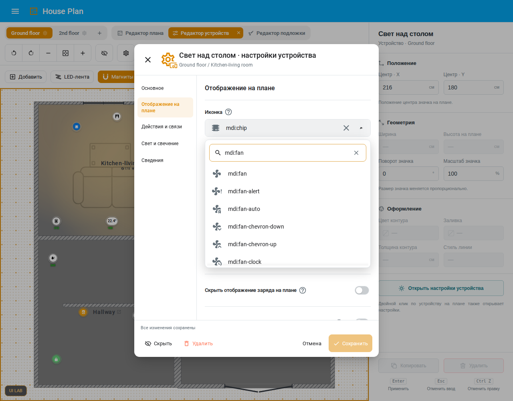
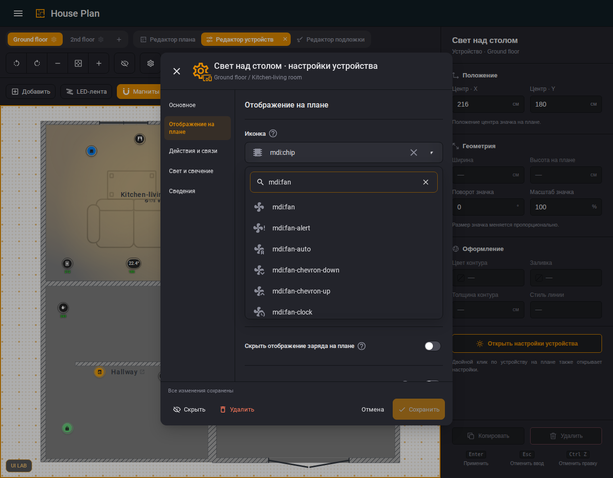
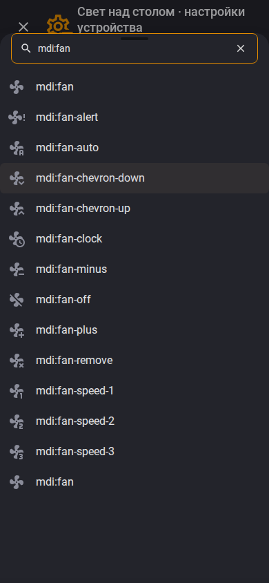
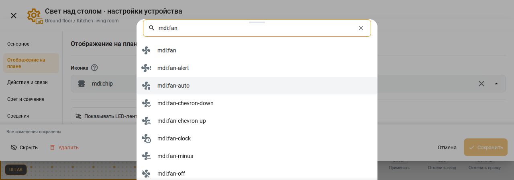

# Dialog picker acceptance — #998

The implementation uses accepted UI-029 from
`3a559559d68d0475db88d0f26cdf594be784351a`, independently replayed with its
published beta.1 assets and unmodified accepted adapter. The candidate uses
its production bundle, with no reference component overrides. Both use the
same public synthetic home and official HA frontend `20260930.4`, Playwright
1.62.0 and Chromium 151.0.7922.34 / revision 1234 on Linux.

The reference's captured host theme has an orange primary colour; the default
candidate lab has blue. The comparison records both original inputs, then
applies identical **host theme custom properties** to both pages. It does not
copy the accepted component CSS into the candidate. These are newly generated
synthetic frames, not the owner's original private screenshots.

## AC1: complete dialog inventory

`demo/smoke_dialog_picker_998.mjs` opens actual dialogs and their visible
sections at 1280 and 390 px. It checks rendered field/menu sizes, viewport
bounds, native values and Escape/focus; no public choices are replaced with
test controls. Its JSON report lists each exercised field, section and width.
The general form sweep retains the existing authentic-dialog harness pin
`20260729.7`; the separate genuine MDI and reference checks use `20260930.4`.

| Surface | Actual controls / coverage |
| --- | --- |
| General settings | Every visible select in each navigation section |
| Space settings | Shared space form, including plan/display/background choices |
| Room settings | HA area and shared room choices |
| Device settings | LED, thermostat, vacuum and radar forms; all visible sections |
| Physical editor | Column shape |
| Stairs | Kind and destination floor |
| Background/decor | Stored image asset and furniture symbol |
| Text variable dialog | Value attribute after choosing a real synthetic entity |
| Summary settings | Scope and specific space |
| Print / SVG export | Format and conditional SVG background, in View |
| First-install onboarding | Separate cold-entry smoke; shared select registered before an editor has loaded |
| Backup export/import, icon rules, confirmations | Source inventory: no dropdowns (checkboxes, text fields and action buttons) |
| Inline Properties, floor navigation, context menus | Explicitly outside this dialog-only contract |

Previously native controls now use the existing `hp-settings-select` around
their unchanged native select. Initial onboarding and summary have their own
component registration. The unrelated summary-panel CSS snapshot is unchanged;
dialog snapshots intentionally record UI-029 and still reject retired #1019
selectors.

## AC2: genuine MDI and long source lists

The selected smoke also prepares the hash-verified official frontend wheel and
runs `demo/ui-lab/verify-icon-picker.mjs`. It observes the genuine component:
44 px field, 8 px radius, solid triangle, one focus border, Search label,
44 px search field, 10 px popup radius and 7 px floating distance. It exercises
pointer and keyboard focus in light/dark, search, selection, clearing, Save and
reopening, and native adaptive sheets at 390×844 and 1280×450.

The independent `compare-reference.mjs` compares both themes at 1280×1000,
390×844 and 1280×450. Field paint/geometry and floating popup paint are compared
exactly; menus must remain inside the viewport. Bottom sheets retain native HA
placement; a floating gap is not asserted for that surface.

`smoke_marker_state_source.mjs` additionally uses an own-device entity ID over
200 characters and a long Russian name. At 360 px in both themes, searching
either name or exact ID must leave the source panel and each option without
horizontal overflow; Escape keeps the form and returns focus.

Foreign CSS has an explicit file/component/class vocabulary tied to the
official wheel pin. The genuine browser records every declared class on its
real component. Unknown local classes still fail; foreign names do not become
global local producers. Tests reject malformed/stale/wrong-file declarations,
wildcards, stale pins and missing or wrong-provider live observations. The
unused `plain-list` selector was removed: the complete MDI catalogue uses the
native virtual list even when the filtered result is short.

## AC3: retained behavior and failure witnesses

An actual adaptive Escape initially closed the parent; after preserving native
Escape ownership, it exposed a second defect: HA restored a neighbouring
control. The final adapter waits for the public picker-close event and HA's
render, then calls the public field `focus()` API. Generation/connection checks
prevent retired or reopened owners taking focus. Desktop focus remains native.
Both Escape and native custom-value selection assert the returned focus.

`custom:example_houseplan_998` and ordinary MDI choices retain selection, Save
and reopen. Unsaved name changes survive icon selection/clearing; Cancel and
the existing discard guard retain saved state. The form sweep restores
alternate choices and asserts that it did not persist fixture changes.

Registered nightly mutations cover loss of the local picker kit, a second
wrapper border, and nested Escape ownership. Development uses static
`mutation-gate --check` only: execution=0, caught=unknown. The real negative
cases and measured browser assertions above are ordinary unmodified-product
tests, not development-time mutation runs.

## Resource cost and reproduction

Against the frozen accepted #1070 build, the first complete #998 build measured
initial gzip +24 B, editor +1745 B and onboarding +3718 B. The owner explicitly
permitted byte/core budget increases. Only measured resource references move;
the onboarding reference retains its inherited 927 B gap and 2000 B band.
No timing threshold or structural core limit is raised.

Run `npm run gate:small -- --smokes` on the candidate. The genuine picker proof
is part of `smoke_dialog_picker_998.mjs`, not an optional CSS-only check.
For reference replay, run the published UI-029 server on 8898 and the candidate
UI Lab on 8899, then `node docs/audits/dialog-pickers-998/compare-reference.mjs`.
`HP_COMPARE_OUT` optionally chooses a fresh evidence directory. The script
preserves original themes and records both source-loaded resource identities.

Final executed results and selected synthetic frames are recorded beside this
document. Product behavior is verified against the pinned genuine frontend;
this does not claim a live private HA installation or release deployment.

## Final source and visual receipt

- Product source: `89f082eb236078e99610f303d315642da2dc76a5` on accepted dev `455535be9da51e0eef11ceccd1b9545a39875425`.
- Source and actual loaded browser fingerprint: `0d54fd4675b83796cc8560a6dc2ad704094480a05605a1952dd604b35dfc831c`.
- Built asset manifest SHA256: `3d4df61ee02972c46aaae41e744f9e3487ec3246776d678adb86c061a106f7bf`.
- Independent reference comparison: **PASS**, 12 records. All six candidate theme/viewport combinations preserve the parent and restore the exact trigger focus; all field/popover paint comparisons and viewport bounds pass.
- Four final candidate frames visually inspected: light/dark desktop, dark phone and light low viewport; corresponding reference frames are included. The old reference's adaptive parent-close defect is recorded, not imposed on the corrected candidate.

[Machine comparison](evidence/reference-comparison.json), [candidate loaded assets](evidence/candidate-loaded-build.json), [original theme diagnosis](evidence/original-theme-diagnosis.json).

| Light desktop | Dark desktop |
| --- | --- |
|  |  |

| Native phone sheet | Native low-screen sheet |
| --- | --- |
|  |  |

The final targeted smoke recorded **158 form controls** and **11 genuine HA
behavior groups**, including all eight declared foreign CSS class witnesses.
The keyboard witness waits for the native selected row to render before
observing it. Both browser fixtures use the shared exception guard, including
its delivery round trip and the late close tail. The initial complete local
gate exposed harness integration defects; those failures are retained in the
local execution log rather than represented as a passing gate.
[Form sweep](evidence/form-sweep-report.json), [genuine HA proof](evidence/genuine-ha-report.json).
