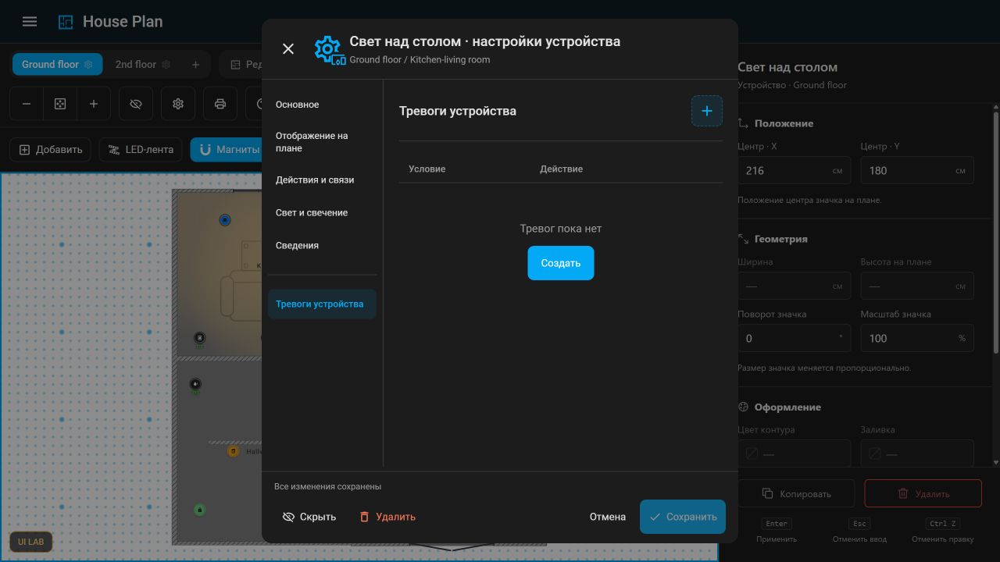
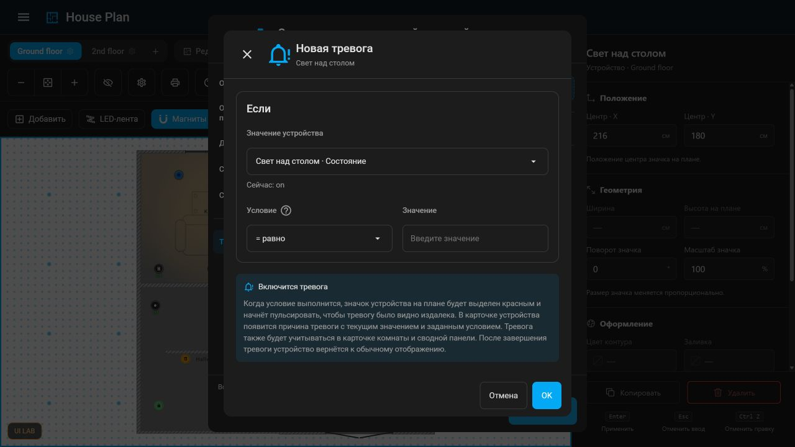
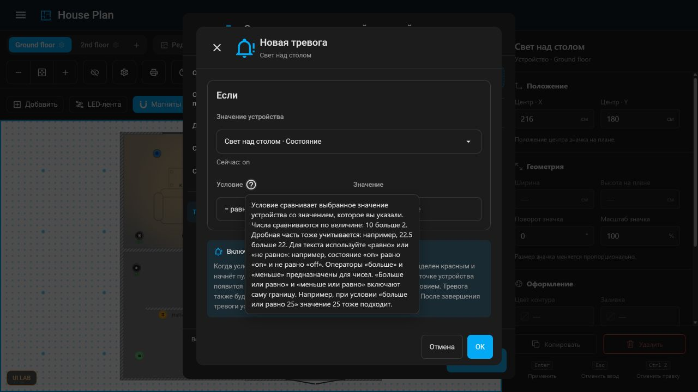
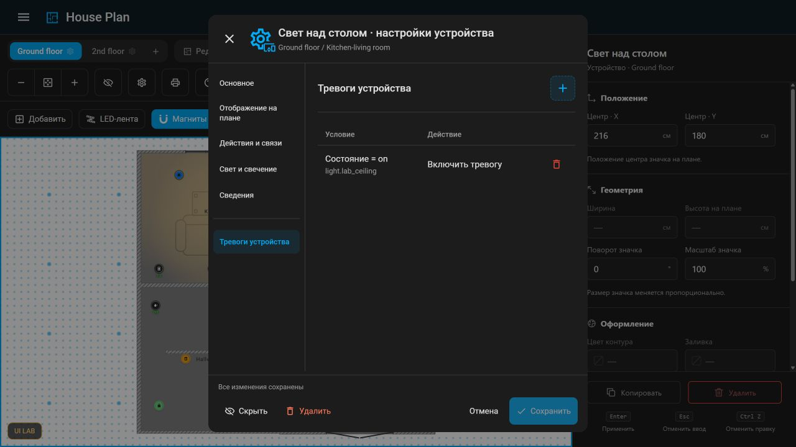

# #1000 — «Тревоги устройства»: согласованный визуал

Владелец согласовал визуальную итерацию **26 октября 2026 года** и поручил зафиксировать её в задаче #1000 через репозиторий. Этот пакет — материал для реализации в продукте: изображения, воспроизводимый UI-прототип и принятые решения.

База: `dev`, коммит **`ebecea6db23aea0531de64d996b68a9b4c7df8ca`**, Houseplan `1.83.0-beta.2`. Закреплённый HA frontend: `20260930.4`. Снимок относится к этой базе, а не к будущему состоянию ветки `dev`.

## Согласованный интерфейс

1. В настройках устройства после существующих разделов левого меню добавлены разделитель и пункт **«Тревоги устройства»**.
2. В разделе — таблица условий и действий с кнопкой **«+»**. Пустое состояние: **«Тревог пока нет»**, под текстом кнопка **«Создать»**. Обе кнопки открывают один конструктор.
3. Диалог **«Новая тревога»** использует общий UI-kit: диалог, поля, списки, кнопки, подсказки, анимации открытия и закрытия, hover и focus. За основу взят принцип конструктора в редакторе сводной панели. Прототип использует `hp-dialog`, `hp-settings-select`, `hp-help` и существующие стили форм.
4. Блок **«Если»** содержит выбор значения текущего устройства, оператор и поле **«Значение»**. В списке источников доступны состояния и скалярные атрибуты сущностей устройства; рядом показывается текущее значение. Операторы: равно, не равно, больше, меньше, больше или равно, меньше или равно.
5. У подписи **«Условие»** стоит стандартный вопросительный значок. Подсказка объясняет сравнение чисел, дробных значений, текста и включение границы. Текущий текст — черновик для дальнейшего уточнения семантики.
6. Следующий блок озаглавлен **«Включится тревога»**. Колокольчик выровнен с заголовком; разделителя между ним и блоком «Если» нет. Ниже размещено развёрнутое пояснение о будущем отображении тревоги.
7. **«OK»** добавляет строку в таблицу, **«Отмена»** закрывает конструктор. В строке предусмотрена кнопка удаления.
8. Пространство вокруг диалога затемняется. Для отсутствовавшего в offline-стенде токена задано `--mdc-dialog-scrim-color: rgb(0 0 0 / 0.45)` — значение fallback из `hp-dialog` Houseplan. Оно включено и в тему воспроизведения, и в override HA-диалога.

Текст под заголовком «Включится тревога» в согласованном макете:

> Когда условие выполнится, значок устройства на плане будет выделен красным и начнёт пульсировать, чтобы тревогу было видно издалека. В карточке устройства появится причина тревоги с текущим значением и заданным условием. Тревога также будет учитываться в карточке комнаты и сводной панели. После завершения тревоги устройство вернётся к обычному отображению.

Это описание будущего поведения: прототип не вычисляет и не запускает реальные тревоги.

## Итоговые экраны

Пустой список и обе кнопки создания:



Конструктор на общем UI-kit с затемнением фона:



Подсказка у поля «Условие»:



Пример добавленной строки с кнопкой удаления:



## Что предстоит исполнителю

Согласование относится к визуалу и сценарию редактирования. Правила сравнения и приведения типов, дробный ввод, регистр текста, пустые/недоступные значения, валидация, момент включения и снятия тревоги при пересечении границы, гистерезис и защита от частых переключений требуют отдельной реализации. Итоговый текст подсказок нужно согласовать с этими правилами. Различие уровней «внимание»/«тревога» и остальные требования issue этим макетом не закрыты.

Реализацию нужно согласовать со связанной задачей [#1001](https://github.com/Matysh/houseplan-card/issues/1001): общая модель должна учитывать источники `threshold`/`external` и два уровня — «внимание» и «тревога». В текущем UI выбор уровня не показан. Согласование этого визуала не закрывает требования к общей модели, уровням и их поведению.

Строки прототипа сохраняются отдельно для устройства в `localStorage` под ключом `ui-lab:prototype:1000:…`. Это демонстрационное состояние, не поле модели маркера; внешняя кнопка сохранения настроек устройства им не управляет. В продукте нужны интеграция с моделью, обычный цикл черновика/сохранения/отмены и реальное вычисление тревог. `prototype.mjs` внедряет демонстрационный UI через DOM; переносить такой способ в продукт не следует. Компоненты нужно встроить в существующий рендерер и общий UI-kit.

Тесты, smoke-проверки и проверки продукта в рамках этой визуальной итерации не запускались по прямому указанию владельца. Пакет не является свидетельством готовности функциональности.

## Состав пакета

- `screenshots/` — итоговые состояния согласованного UI. Они являются основным визуальным ориентиром.
- `history/` — восемь PNG предыдущих итераций и `intent.json` с прежним статусом `draft`. Это история работы, не актуальный вариант и не текущий статус согласования; итоговый визуал находится в `screenshots/`.
- `baseline/` — исходный снимок и его происхождение до правок.
- `prototype.mjs` — зафиксированный код демонстрационного интерфейса.
- `fixture.json` — синтетические данные стенда, без подключения к живому Home Assistant.
- `overrides/ha-dialog.css` — затемнение фона HA-диалога в offline-окружении.
- `provenance.json` — происхождение финального стенда.
- `replay.mjs` — переносимый запуск поверх указанной базы.

## Воспроизведение на другом компьютере

Нужны Git, Node.js 22 и npm. Пакет опубликован в ветке `issue/1000-approved-ui`, путь `docs/design/1000-device-alarms/2026-10-26/`. Комментарий в #1000 содержит ссылки на неизменяемый коммит пакета; именно они фиксируют согласованную версию.

Для получения материалов и подготовки отдельной копии базового продукта:

```sh
git clone --branch issue/1000-approved-ui --single-branch https://github.com/Matysh/houseplan-card.git houseplan-visual
git -C houseplan-visual worktree add --detach ../houseplan-base ebecea6db23aea0531de64d996b68a9b4c7df8ca
cd houseplan-base
npm ci
npm run bundle:sync
npm run ui-lab:prepare
```

`ui-lab:prepare` — штатная явная загрузка закреплённого HA frontend в локальный кеш. Она нужна при первой подготовке компьютера. Это подготовка зависимостей, а не запуск тестов.

Из каталога `houseplan-base` запустите сохранённый пакет:

```sh
node ../houseplan-visual/docs/design/1000-device-alarms/2026-10-26/replay.mjs --repo . --port 8891
```

Команды подходят для Windows, macOS и Linux. Можно указать и абсолютные пути, например `--repo "C:/work/houseplan-base"`. При отдельном каталоге кеша сначала подготовьте его через `npm run ui-lab:prepare -- --ha-cache "/path/to/cache"`, затем передайте тот же `--ha-cache "/path/to/cache"` скрипту `replay.mjs`.

Откройте **http://127.0.0.1:8891/** и перейдите **UI LAB → Устройство → Тревоги устройства**. Нажмите «Создать» или «+», чтобы открыть конструктор. Порт можно изменить; адрес и порт определяют отдельное хранилище браузера. Для чистой демонстрации можно использовать новый профиль браузера.

Скрипт копирует штатный `demo/ui-lab` во временную папку, подключает сохранённый прототип, fixture и override. Он слушает только `127.0.0.1`, не изменяет исходный checkout и не подключается к живому HA. Путь к временной папке печатается при запуске; после остановки `Ctrl+C` она остаётся доступной. Файлы пользователя скрипт не удаляет. Переносимый launcher подготовлен по API работающего стенда; отдельный запуск и тестирование по условию визуальной итерации не выполнялись.
