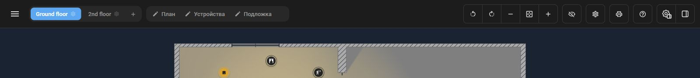
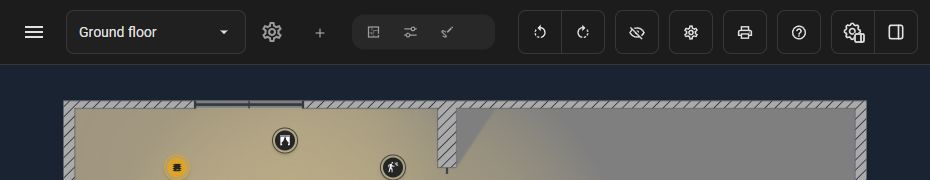
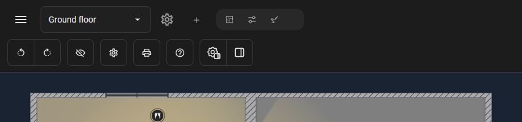

# #1120 — согласованный визуал шапки и переполнения, r6

Принят владельцем 29.10.2026: «Отлично, фиксируй согласованный визуал в задачу 1120, все материалы приложи через репозиторий. Новый принцип переполнения заменяет прежние пороги из задачи 1119».

Это визуальный эталон для реализации. Критерий приёмки — соответствие результата согласованному живому UI-прототипу, включая последовательность адаптации при сужении и расширении. Продуктовая реализация, функциональная приёмка и CI этим пакетом не подтверждаются.

## Согласованный контракт

1. На основной странице `/houseplan` убрана собственная верхняя шапка высотой 56 px. Кнопка меню HA (44 px) перенесена первым элементом влево в шапку карточки.
2. В узком HA кнопка меню доступна всегда; в широком — когда боковое меню HA скрыто. Не заставлять HA скрывать боковую панель. В Lovelace кнопку меню HA не добавлять.
3. В киоске со скрытой шапкой карточки скрыта и перенесённая кнопка меню. Отдельной строки/кнопки вместо неё нет; выход через историю/адрес браузера. Согласованное изменение поведения #1103 сохраняется; отдельный `hpheader` из #1113 не требуется.
4. При достаточном месте все элементы в одну строку. Три редактора имеют одинаковые карандаши и короткие подписи «План», «Устройства», «Подложка».
5. Как только содержимое перестаёт помещаться, сначала исчезают подписи редакторов; компактные кнопки сохраняют прежние разные значки.
6. При следующем переполнении исчезают три кнопки масштаба: уменьшить, вписать всё, увеличить. У завершающей группу кнопки поворота вправо скругляются правые углы. Жесты масштаба сохраняются.
7. При следующем переполнении список пространств заменяется выпадающим списком. Действия выбора/настройки/добавления пространств сохраняются.
8. На последнем однострочном этапе свободный промежуток между редакторами и поворотами уменьшается вплоть до обычного межкнопочного зазора **10 px**. Перенос не должен происходить из-за сохранённой широкой пустоты.
9. Только если после этого всё ещё нет места, шапка становится двухстрочной. Блок действий на второй строке выровнен **по левому краю**.
10. При расширении состояния возвращаются в обратном порядке. Решение определяется реальной шириной содержимого и контейнера House Plan, включая подписи, число пространств, язык и занимающее место меню HA. Числовых порогов для этих переходов нет.

## Замена прежних требований #1119

Новый контракт заменяет пороги шапки: UI-008 (1480 px), UI-009 (1120 px), промежуточные пробы 1100/1150/1170 px, прежний фиксированный переход списка пространств и переноса строк. Внешний вид развёрнутых/компактных редакторов, скрытие трёх zoom-кнопок и скругление сохраняются; меняется условие перехода.

**UI-010: порог 1024 px для панели свойств редакторов остаётся действующим.** Он не относится к переполнению шапки. Остальные согласованные изменения #1119 сохраняются. #1113 передана отдельно.

## Состав и происхождение

- `prototypes/` — точные два финальных файла локального стенда r6: перенос шапки, затем адаптация по переполнению.
- `context/` — девять неизменённых прототипов принятого пакета #1119, commit `0c8c13ae1d93b76f9b132a8bfbd0c864b0304161`. Старые числовые правила UI-008/UI-009 здесь исторические и перекрываются новым адаптером; они не являются актуальными требованиями.
- `fixture.json`, `theme.css` — публичные синтетические данные и оформление из того же пакета. Частный бекап и реальная инсталляция не нужны.
- `approval.json` — решение владельца; `provenance.json` — база и SHA-256 файлов.
- `replay.mjs` — воспроизведение в отдельной временной копии лаборатории, без перезаписи рабочей копии.

База: **v1.83.0-beta.3**, commit `09bda8dbee8b50577bfc4affc332b8cda914f5b4`. В лаборатории используются runtime-адаптеры, измерительный клон шапки и подмена наблюдения за шириной. Это средства визуализации, не продуктовая архитектура для копирования. В реализации использовать штатные компоненты, UI Kit, границы загрузки и жизненный цикл.

Боковая панель HA в replay — локальный макет для показа расположения и занимаемой ширины; он не доказывает интеграцию с настоящим HA. Условия реальной видимости меню, HA event/host lifecycle, Lovelace и kiosk реализуются и принимаются отдельно по контракту задачи.

## Запуск на другом компьютере

Нужны Git, Node.js 22 и npm. Скачайте этот каталог целиком либо получите ветку с материалами. Подготовьте отдельную базовую рабочую копию:

```sh
git clone https://github.com/Matysh/houseplan-card.git houseplan-ui-base
cd houseplan-ui-base
git checkout --detach 09bda8dbee8b50577bfc4affc332b8cda914f5b4
npm ci
npm run bundle:sync
npm run ui-lab:prepare
node /absolute/path/to/2026-10-29/replay.mjs --repo . --port 8893
```

Откройте `http://127.0.0.1:8893/`. Для подготовленного кеша HA при необходимости передайте `--ha-cache PATH`. Скрипт слушает только loopback. Остановка — Ctrl+C. Порядок загрузки: контекст #1119, `UI-1120-panel-header.mjs`, `UI-1120-header-overflow.mjs`.

## Иллюстрации

Кадры пересняты на синтетическом fixture. Указанные ширины — только размеры этих иллюстраций, **не новые пороги**: при других названиях/числе пространств переходы будут в других местах.

| Кадр | Состояние | Ширина кадра |
| --- | --- | --- |
| [01-full.png](screenshots/01-full.png) | Всё в одной строке, подписи редакторов | 1600 |
| [02-editor-icons.png](screenshots/02-editor-icons.png) | Редакторы без подписей | 1200 |
| [03-no-zoom.png](screenshots/03-no-zoom.png) | Кнопки масштаба скрыты | 1000 |
| [04-space-dropdown.png](screenshots/04-space-dropdown.png) | Выпадающий список, сближение групп | 930 |
| [05-two-rows.png](screenshots/05-two-rows.png) | Второй ряд слева | 850 |
| [06-ha-sidebar.png](screenshots/06-ha-sidebar.png) | Широкий HA с открытым макетом бокового меню | 1600 |





При приёмке сравнивать живой replay и результат на одинаковых данных, теме, языке и ширине контейнера; пройти сужение и расширение, включая короткие/длинные имена и несколько пространств. Статичные кадры показывают состояния, но не доказывают все промежуточные переходы. В этой визуальной итерации тестовые наборы, сборка и CI не запускались.
