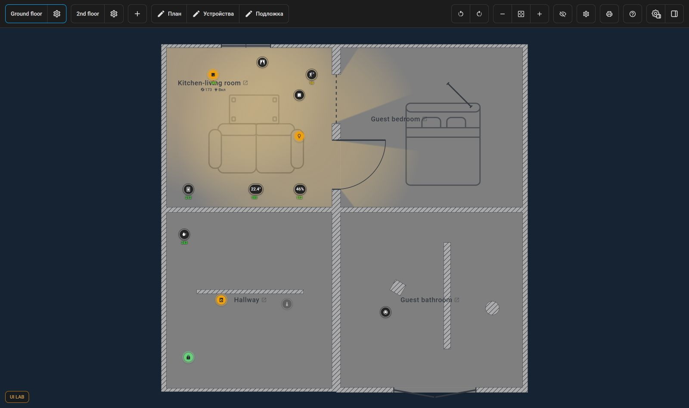
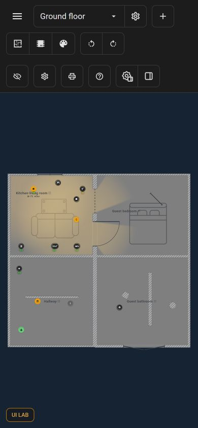
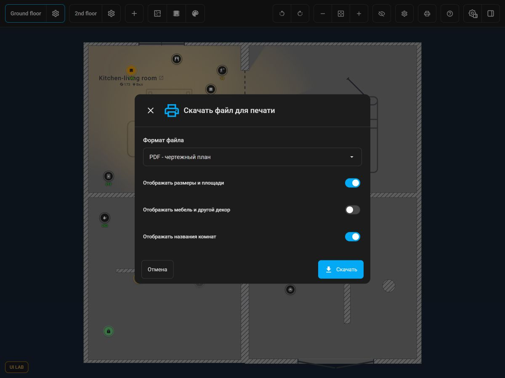
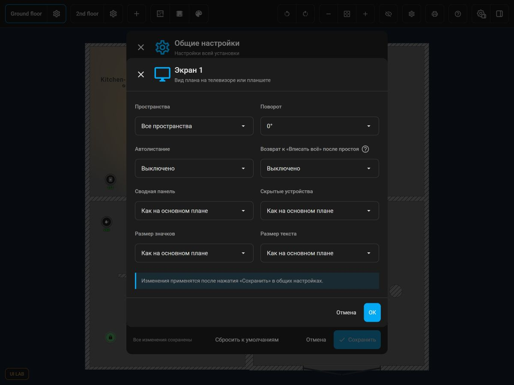

# Согласованный UI — #1132, 30.10.2026

Главный критерий приёмки: **соответствие результата согласованным UI-прототипам**. Полный контракт — [CONTRACT.md](CONTRACT.md). Решение владельца — [approval.json](approval.json).

## Состав

- `overrides/houseplan-card.css` — точные итоговые стили UI-001–UI-005, UI-007–UI-012 локального стенда.
- `runtime/app.mjs` — точный итоговый адаптер лаборатории: раздача стилей по shadow roots, UI Kit печати и скрытая опция внешнего экрана со значением false.
- `prototypes/UI-006-print-uikit.mjs` — отдельная копия адаптера печати, уже включённого в app.mjs; повторно подключать не нужно.
- `overrides/ha-dialog.css` — LAB-001: недостающий цвет scrim отдельной оболочки. Не новая правка beta 4.
- `fixture.json` — публичный синтетический план из beta 4. Добавлены LQI 148, пересечение с подписью комнаты и старый профиль экрана controls=true для открытия конструктора. Частные данные отсутствуют.
- `journal.json` — принятые ревизии 12 правок и два лабораторных примечания.
- `provenance.json` — база, fingerprint и SHA-256 материалов.
- `screenshots/` — иллюстрации на том же публичном fixture.

## Воспроизведение на любом компьютере

Нужны Git и Node.js 22. Скачайте пакет целиком из ссылки на immutable commit в задаче. Для отдельной базовой копии:

```sh
git clone --branch v1.83.0-beta.4 --depth 1 https://github.com/Matysh/houseplan-card.git houseplan-ui-base
cd houseplan-ui-base
node demo/ui-lab/prepare-ha.mjs
node "/absolute/path/to/2026-10-30/replay.mjs" --repo . --port 8893
```

В Windows замените путь к replay.mjs на абсолютный Windows-путь в кавычках. Откройте http://127.0.0.1:8893/. Остановка — Ctrl+C. Для уже подготовленного HA cache: `--ha-cache PATH`. Подготовка скачивает официальный закреплённый HA frontend; данные настоящего HA и авторизация не нужны. После подготовки replay работает локально, только на loopback.

Replay проверяет commit базы `08b154115ff815062cfc0221f39f7e53545dbe45`, создаёт временную копию лаборатории, использует релизный bundle без пересборки. Если dist отсутствует, копирует tracked frontend в dist. Если dist уже есть, он должен соответствовать базе; используйте свежий checkout. Исходный mock-ha берётся из git базы, а не из изменённой рабочей копии.

На Ground floor под «Свет над столом» есть 148 поверх имени комнаты. В данных также есть включённые/выключенные/недоступные устройства. Откройте печать, три редактора и выход по Escape, общие настройки → Внешние экраны → Экран 1. Увеличивайте и уменьшайте ширину контейнера, чтобы видеть финальные переходы, hover и отсутствие исчезающих действий. Внешний профиль в fixture содержит прежнее controls=true: конструктор не показывает опцию и редактирует её как false; CSS киоска скрывает overlay независимо от её прежнего значения.

## Иллюстрации

Размеры ниже — **размеры кадров, не фиксированные пороги панели**.

| Кадр | Содержание |
| --- | --- |
| [01-wide.png](screenshots/01-wide.png) | 1600×950: полная панель, отдельные группы поворота и масштаба |
| [02-compact.png](screenshots/02-compact.png) | 1200×850: компактные редакторы |
| [03-wrapped.png](screenshots/03-wrapped.png) | 800×850: перенос панели |
| [04-three-rows.png](screenshots/04-three-rows.png) | 390×844: три ряда, редакторы с поворотами во втором |
| [05-print-dialog.png](screenshots/05-print-dialog.png) | 1200×900: общий UI Kit печати и затемнение |
| [06-external-screen.png](screenshots/06-external-screen.png) | 1200×900: конструктор без опции кнопок |
| [07-markers-lqi.png](screenshots/07-markers-lqi.png) | Фрагмент: значки и LQI поверх названия комнаты |






## Ограничения и перенос в продукт

Владелец согласовал визуальное поведение локального стенда. Эти кадры пересняты на синтетических данных для переносимого пакета; частный план не публикуется. Статичные изображения не доказывают анимации/hover/все переходы — для этого сохранён живой replay.

Тесты, сборка, CI и полная функциональная приёмка продукта здесь не выполнялись. Пакет не является готовым production patch. Лабораторные CSS masks и подавление focus-outline — средства показа. В продукте заменить иконки штатным mdi, сохранить клавиатурную индикацию фокуса, использовать компоненты и lifecycle UI Kit. Не переносить polling/MutationObserver/подмену prototype как архитектуру.

Затемнение LAB-001 уже корректно в beta 4 по сообщению владельца. Данные LAB-002 — только демонстрация. В поставку продукта они не входят.

UI-010 заменяет прежнюю полупрозрачность Power Off из #1119/#1026. UI-011 уточняет #1113. UI-005 развивает #1120, не возвращая старые пороги #1119; 1024 px для панели свойств остаётся.
