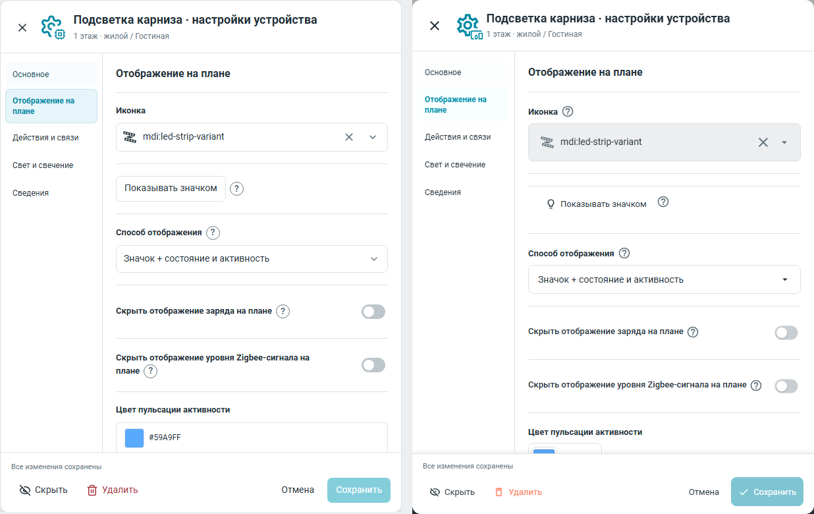
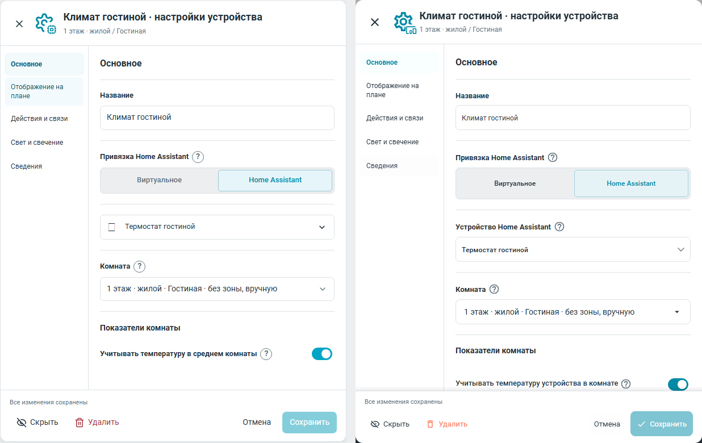
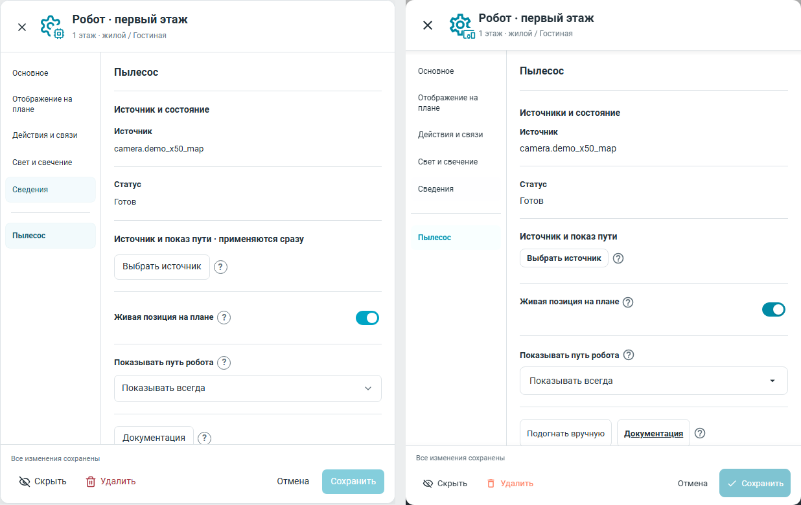
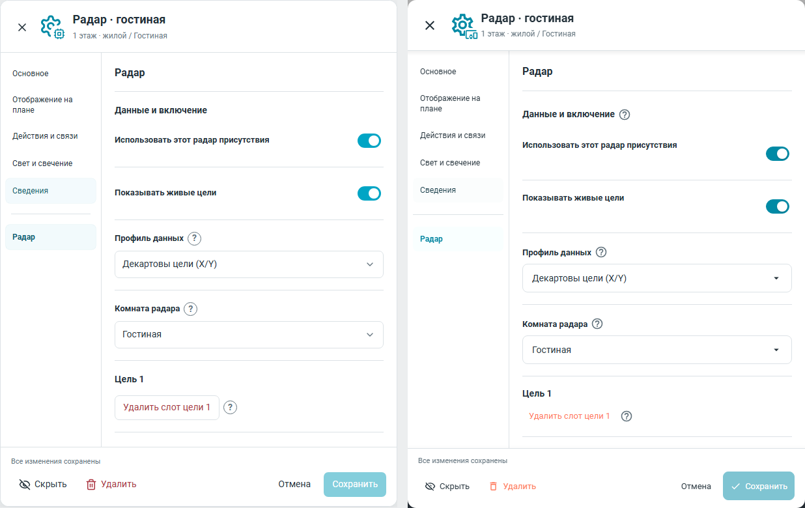
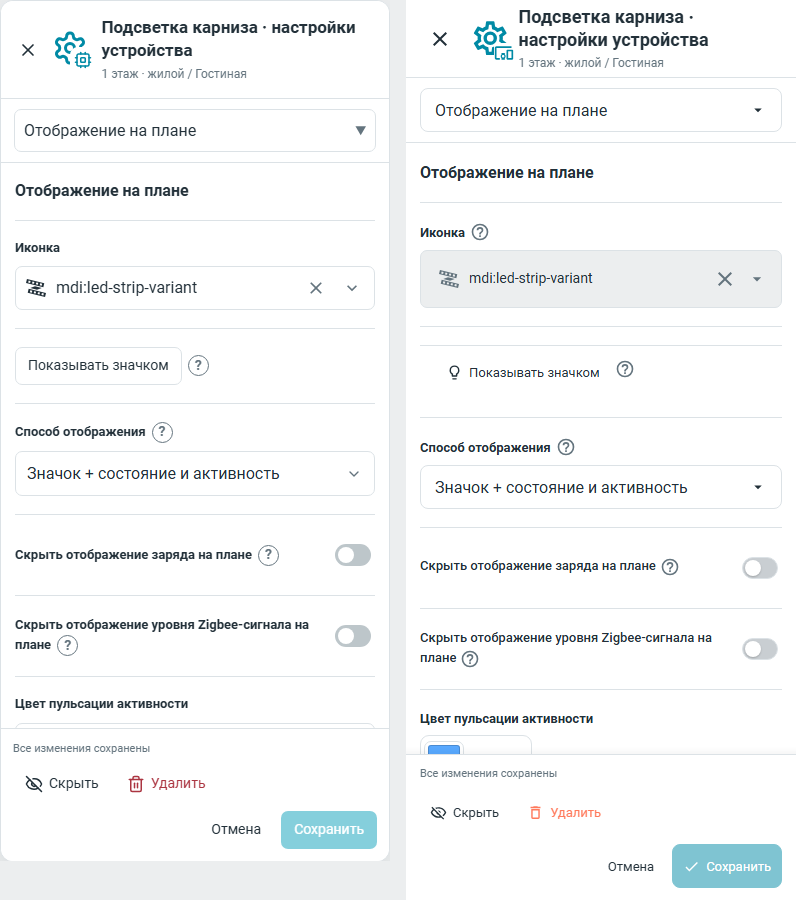

# Устройство: сравнение реализации с согласованным v6

Слева — неизменный Device v6 из
`24f7ab2f266eb89f785192eac563915732a081ab`, справа — реализация
`5eff48986137b8a255745f364ef57a4f408b2a1f`. Съёмка: DPR1, Roboto400/500/700,
1280×900 или 390×900. Справа настоящий offline-компонент HA frontend20260729.7,
без HA core/auth, серверов и реальных устройств. Хеши файлов/кадров и данных —
в [evidence.json](evidence.json). Синтетические сохранённые данные до/после
побайтово равны: `8e87d7fc03e1a621663c085c5ef4377d129b0b65a8a7455da9f9ad3dc254cea5`.

Проверены все пять общих разделов и профильные разделы, размеры/порядок
навигации, контекст и футер. Повторное сравнение обнаружило старую компоновку
пылесоса/радара и постоянную подпись климата: они исправлены в реализации,
а не в эталоне. Климат снова имеет блок «Показатели комнаты» с подсказкой у
учёта температуры. Действующие MDI-picker, preview, источники/бейдж и чипсы
управления сохранены. Новая группировка пылесоса не убирает диагностику:
технические строки доступны в раскрываемом блоке.

Различия, которые нужно учитывать при чтении пар:

- Нативный HA shell:610×780 вместо610×779; на телефоне полноэкранная высота900
  вместо ограниченной высоты самостоятельного HTML. Футер остаётся доступным.
- Продукт использует действующий настоящий MDI-picker и составную иконку из
  существующего набора HA; высота picker и форма глифов следуют этому контролу.
  Он не заменён новым выпадающим списком ради похожего рисунка.
- Цвета — переменные текущей темы HA. Цветовой picker, единицы, пояснения и
  специальные действия используют общие компоненты. Реальные условные действия
  (например, ручная подгонка карты) доступны по действующим возможностям источника.
- Точная общая оптическая центровка тумблеров, help и кнопок, одинаковый hover и
  устойчивый размер завершаются #955. Эти кадры фиксируют именно #947 до общего
  слоя полировки; его будущие кадры и результаты не приписаны этому материалу.

Восстановлены согласованные профильные подсказки: источник, позиция, путь и
документация пылесоса, профиль, комната и слот цели радара. Проверка реального
hover подтверждает показ подсказки без раскрытия выбора источника; Cancel
сохраняет исходные данные, команды не отправляются.

Нативная матрица каждого раздела, четырёх профилей,320/390/1280px и трёх тем:
202checks PASS; page errors/external requests0. `smoke_device_settings_947.mjs`
дополнительно проверяет реальный picker/preview, независимость размера preview,
поворот, свет/цвет/яркость/радиус, источники, черновик/Cancel и отсутствие команд.
`smoke_climate_temp.mjs` проверяет реальное участие климата в среднем комнаты,
изменение флага, сохранение и повторное открытие. Парные изображения не заменяют
полную golden-приёмку опубликованного материала или независимое код-ревью.
