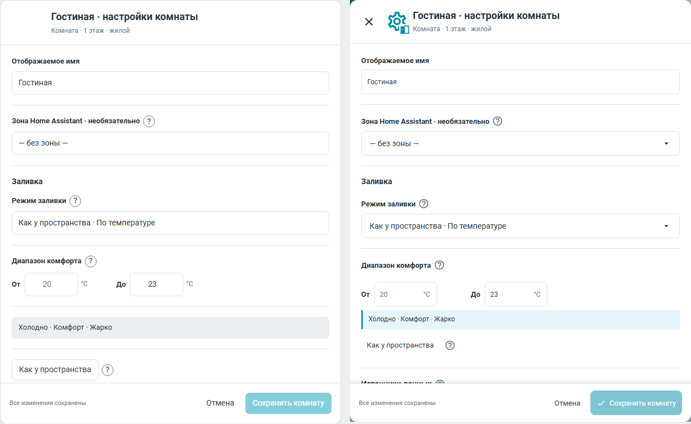
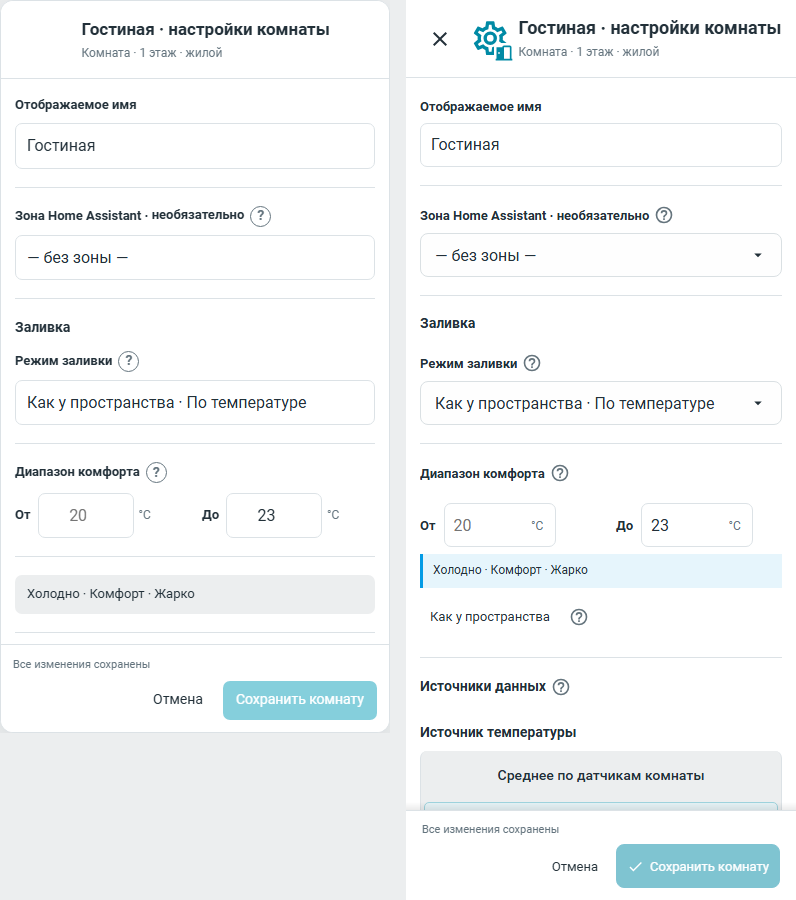

# Настройки комнаты: сравнение с согласованным v4

Слева — неизменный `room-settings-v4.html` из
`24f7ab2f266eb89f785192eac563915732a081ab`, справа — реализация
`43c7d3e710c75e62d07554f57880d3fa64016352`. В обоих случаях Roboto 400/500/700,
DPR 1, viewport 1280×900 или 390×900. Справа настоящий offline-компонент
Home Assistant frontend 20260729.7; сервера HA, авторизации и реальных устройств нет.
Хеши изображений и синтетического набора данных — в [evidence.json](evidence.json).

Совпадают единая форма без боковой навигации, порядок полей/блоков, имя и зона,
наследуемый температурный режим, независимые границы 20–23 °C, источники
температуры/влажности/CO₂, два размера и нижние действия. Образец размеров
синтетический; температура образца не подменяет выбранный HA-источник.
Геометрию всей формы и размеры проверяет `smoke_room_settings_946.mjs`,
источники, независимые поля, изменения и Cancel — `smoke_room_settings_form.mjs`.

Различия разобраны, а не скрыты изменением макета:

- Нативный заголовок добавляет действующие крестик и составную MDI-иконку.
  Одиночный HTML макета не загружает MDI. Смысл иконки закреплён в ТЗ.
- На desktop оболочка 610×756 против 610×760 в HTML; на телефоне HA раскрывает
  диалог на высоту экрана, сохраняя доступный футер. Поэтому видимый объём формы
  на mobile больше, чем в ограниченном по высоте самостоятельном HTML.
- Единицы чисел рисует действующий общий контрол; пояснения используют
  согласованный общий голубой callout. Это общий компонент четырёх форм.
- Точная оптическая центровка текста/SVG кнопок, размер help и одинаковый hover
  завершаются общим слоем #955 после #947. Эта пара фиксирует именно материал
  #946 до полировки; более поздние изображения не выданы за этот коммит.

Полная golden-приёмка #946: 212 сцен с опубликованного чистого Linux/ext4,
209 прежних кадров сохранены, три заявленных кадра просмотрены и приняты;
137 свидетелей при floor 10. Это отдельная проверка от пар выше.
Нативная матрица ширин 320/390/1280 и light/dark/custom: 9/9 PASS.
