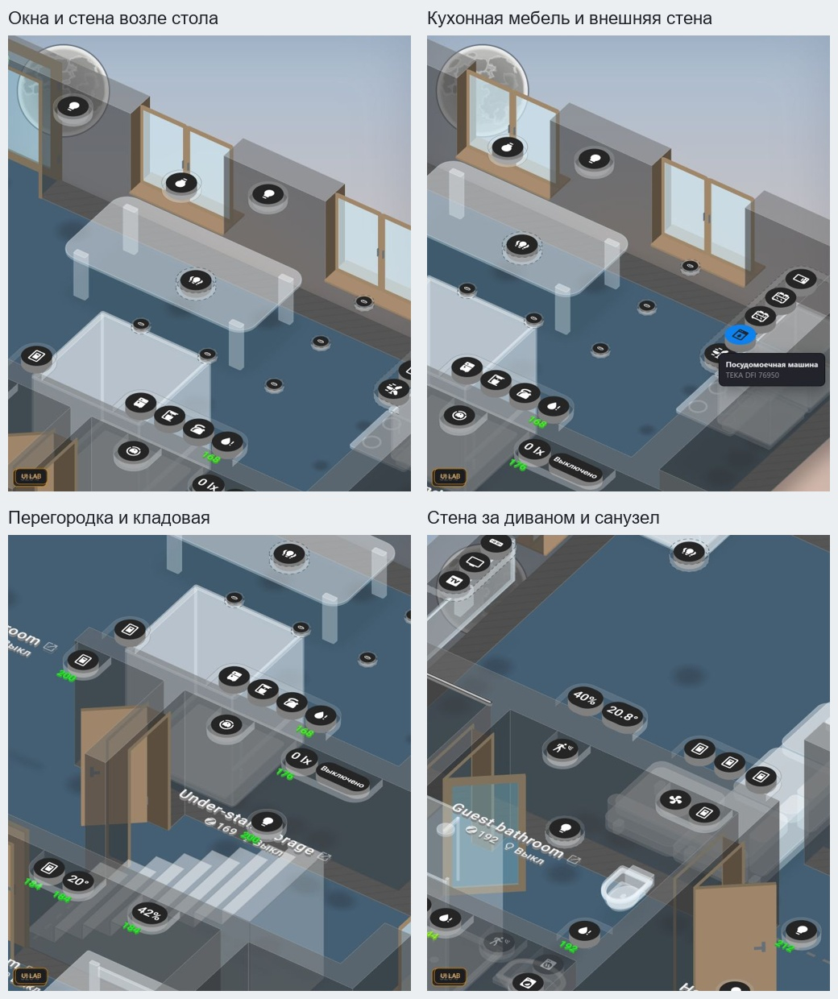

# Принятый UI-063: основание стен и швы 2.5D

Перенос в продукт: [#1555](https://github.com/Matysh/houseplan-card/issues/1555).

Согласовано 24.11.2026. Это переносимый снимок прототипа для будущей продуктовой задачи. Продуктовые src/ в этой ветке не заменены: изменения лежат только в папке материалов.

- [Журнал требований](JOURNAL.md), [область и AC задачи](IMPLEMENTATION-ISSUE.md).
- [Полный патч девяти файлов](product-prototype.patch), исходники и два изменённых теста в source-after/.
- default-plan/ — разрешённый демонстрационный двухэтажный план из #1554, с подложкой и темой; accepted-session.json — согласованная локальная конфигурация и mock-состояния.
- screenshots/before/ — исходные дефекты (16-raster-seam-before.jpg снят во время промежуточной диагностики, до окончательного исправления растрового стыка); screenshots/after/ — принятый результат и серия зума. Контактный лист: screenshots/after/verified-sections.jpg.
- verification.json — фактически выполненные проверки и ограничения; build-manifest.json — fingerprint и состав принятой сборки, а не сама сборка.
- source-files.json и SHA256SUMS — происхождение/хеши пакета.

## Восстановление на другом ПК

Работать в отдельном чистом checkout, не поверх занятого dev. Получить базу d4004f33edee67b2953b769431dc887c8ff7f32a (v1.86.1-beta.8), commit инфраструктуры 5d66d02c75b2e4f453d2d351157ba0b3025136c7 и эту ветку материалов. Скопировать данную папку за пределы checkout до переключения базы.

1. В новом checkout переключиться на d4004f33edee67b2953b769431dc887c8ff7f32a.
2. Перенести только demo/ui-lab/ из 5d66d02c75b2e4f453d2d351157ba0b3025136c7: git restore --source=5d66d02c75b2e4f453d2d351157ba0b3025136c7 -- demo/ui-lab. Это сохранённая инфраструктура #1554 (IndexedDB и демонстрационный план), не часть нового продуктового исправления.
3. Применить product-prototype.patch из пакета к базе: git apply /path/to/product-prototype.patch. Для современного dev это reference patch: исполнитель переносит изменения осмысленно с учётом последующих исправлений.
4. npm ci --ignore-scripts; node node_modules/rollup/dist/bin/rollup -c. Следовать закреплённым требованиям окружения репозитория. Полный пакет зависимостей, HA frontend и node_modules не копируются в материалы.
5. npm run ui-lab:prepare — явная подготовка закреплённого официального HA frontend. При готовом кэше использовать --ha-cache. Затем npm run ui-lab -- --port 8891. Standalone локальный mock, без подключения настоящего HA.
6. Проверить fingerprint в UI LAB. Для восстановления согласованных настроек импортировать accepted-session.json через UI LAB → Импорт локальной сессии; текущий default-plan должен совпадать по datasetId. Не использовать исходный приватный бекап.
7. Открыть Ground floor, включить 2.5D, проверить прозрачные стены и тёмные поверхности. Открыть именно встроенный браузер на DPI 2; зафиксировать фактический devicePixelRatio, не делать вывод только по размеру PNG/JPEG.
8. Повторить close-up окон/кухни/мебели/перегородок, zoom-out/zoom-in, pan через край запаса растрового кадра, остановку/возобновление, четыре поворота и выход/возврат из редактора. Снимать промежуточные кадры, когда растровые слои действительно активны.

Новый продуктовый перенос требует актуального S6 по PROCESS, адресной геометрической/браузерной регрессии и оценки производительности. Принятый прототип не заменяет код-ревью, регрессию или релизную команду. Никакой выпуск этой фиксацией не поручен.

## Иллюстрация результата

