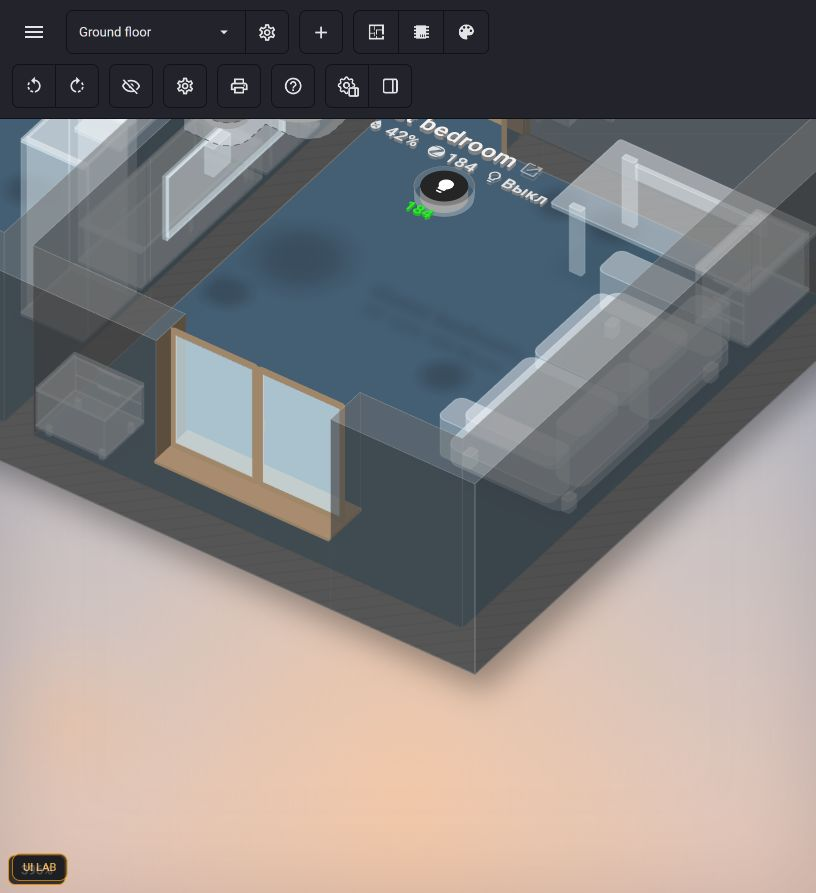

# Внутренние рёбра прозрачных стен — прототип #1560

Отдельная задача: https://github.com/Matysh/houseplan-card/issues/1560 . Создана по поручению владельца 25.11.2026. В принятый UI-063 и scope #1555 не добавляется. Эта фиксация материалов не означает перенос в продукт, выпуск или принятие golden; запись в журнал согласованных изменений пока не сделана.

## Ожидаемое поведение

При прозрачных стенах 2.5D внутренние вертикальные углы видны той же тонкой адаптивной линией, что внешние. Линии находятся на своей глубине, заслоняются непрозрачными предметами и не добавляют заливку обратных граней. Технологические стыки кладки, полосы под окнами/над проёмами и двойная обводка видимых внешних углов отсутствуют. Остальные режимы и параметры не меняются.

## Материалы и восстановление

- before.jpg и after.jpg — крупные фрагменты Ground floor до/после; кадрирование/масштаб немного отличаются, это визуальные иллюстрации, не pixel-diff или golden.
- inner-corners.patch — только новая доработка семи файлов, **поверх UI-063**, а не полный повтор #1555.
- source-after/ — полные изменённые файлы для чтения/переноса на актуальный dev.
- prototype-session.json — синтетическая сессия того же разрешённого default-plan #1554; исходный личный ZIP не используется.
- provenance.json и SHA256SUMS — происхождение и хеши.

Сначала восстановить UI-063 по [инструкции](https://github.com/Matysh/houseplan-card/blob/116795ce8b18909fdbe8a9d04269a839eb9af7e9/docs/ui-lab-reference/2026-11-24-wall-base-seams/README.md): база d4004f33edee67b2953b769431dc887c8ff7f32a, инфраструктура #1554 и принятый патч. Затем применить inner-corners.patch и собрать Rollup. Стенд запускается по прежней инструкции, импорт prototype-session.json через UI LAB. На современном dev переносить осмысленно, не заменять модули старыми снимками. Повторно копировать default-plan и HA runtime не нужно — они закреплены в базовом пакете.

## Реализация прототипа

Геометрия хранит отвёрнутые грани как отдельные edgeOnly-поверхности. Они участвуют в глубине только ради линий: не создают заливки, освещения и непрозрачной окклюзии. Видимые грани сохраняют свои рёбра. Скрытые грани фартука/перемычки учитываются для подавления копланарных стыков, но не рисуются второй заливкой. При переносе оценить лишнюю работу depth-прохода и оставлять только необходимые элементы.

## Уже выполнено при разработке

TypeScript test-build; node scripts/fix-test-build.mjs; 53 проверки в test/iso-wall-transparency.test.mjs, test/iso-architectural-tone.test.mjs, test/iso-scene-render.test.mjs; Rollup build; git diff --check — успешно. Браузерная проверка: настоящий встроенный браузер, DPR 2, финальный viewport 816×893 CSS px, ошибок консоли нет. Снимки API CSS-размера. Полная регрессия, HA E2E, сравнительный performance-прогон и браузерная матрица не выполнены. При создании issue проверки/сборка не повторялись.

